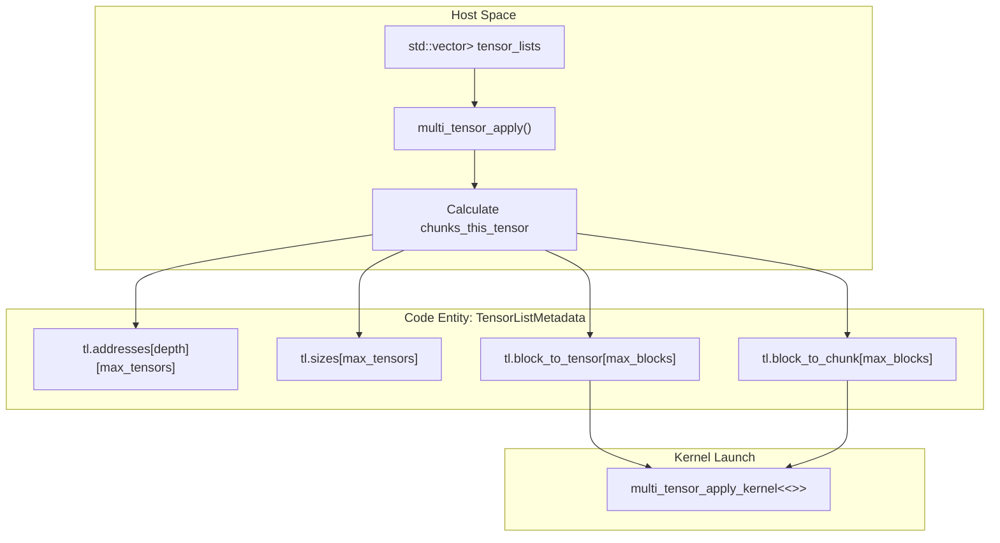
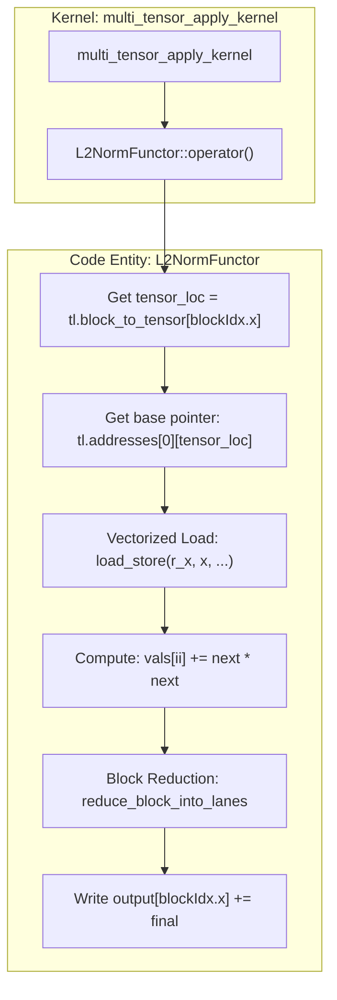

<!-- source: DeepWiki mcp.deepwiki.com · repo NVIDIA/apex · page 6.1 Multi-Tensor Apply · fetched 2026-10-26 -->

# Multi-Tensor Apply

Relevant source files

The following files were used as context for generating this wiki page:

- [apex/multi_tensor_apply/__init__.py](apex/multi_tensor_apply/__init__.py)
- [apex/multi_tensor_apply/multi_tensor_apply.py](apex/multi_tensor_apply/multi_tensor_apply.py)
- [csrc/layer_norm_cuda.cpp](csrc/layer_norm_cuda.cpp)
- [csrc/layer_norm_cuda_kernel.cu](csrc/layer_norm_cuda_kernel.cu)
- [csrc/multi_tensor_apply.cuh](csrc/multi_tensor_apply.cuh)
- [csrc/multi_tensor_axpby_kernel.cu](csrc/multi_tensor_axpby_kernel.cu)
- [csrc/multi_tensor_l2norm_kernel.cu](csrc/multi_tensor_l2norm_kernel.cu)
- [csrc/multi_tensor_scale_kernel.cu](csrc/multi_tensor_scale_kernel.cu)
- [csrc/type_shim.h](csrc/type_shim.h)
- [csrc/welford.cu](csrc/welford.cu)

Multi-tensor apply is a core optimization mechanism in APEX designed to overcome the overhead of launching many small CUDA kernels when performing element-wise operations on a large number of tensors (e.g., parameter updates in an optimizer). Instead of iterating through a list of tensors and launching a kernel for each, multi-tensor apply fuses these operations into a single (or a few) kernel launches by grouping tensors into "chunks" and processing them in parallel [csrc/multi_tensor_apply.cuh:10-30]().

## System Architecture

The system consists of a Python entry point that interfaces with C++/CUDA kernels. The core logic resides in a header-only CUDA template that manages the distribution of work across GPU blocks.

### Core Components

| Component | File | Description |
|:---|:---|:---|
| `MultiTensorApply` | [apex/multi_tensor_apply/multi_tensor_apply.py:1-28]() | Python wrapper that manages the `chunk_size` and calls into the `amp_C` extension. |
| `multi_tensor_apply` | [csrc/multi_tensor_apply.cuh:32-103]() | The C++ template function that orchestrates metadata preparation and kernel dispatch. |
| `TensorListMetadata` | [csrc/multi_tensor_apply.cuh:16-23]() | A struct passed to the GPU containing pointers, sizes, and block-to-tensor mapping. |
| `multi_tensor_apply_kernel` | [csrc/multi_tensor_apply.cuh:25-30]() | The generic CUDA global function that invokes a user-provided Functor. |

### Metadata and Work Distribution
To handle multiple tensors of varying sizes, APEX maps CUDA blocks to specific "chunks" of specific tensors. This mapping is stored in `TensorListMetadata`.

### Metadata Structure Diagram
The following diagram illustrates how the `multi_tensor_apply` function populates the `TensorListMetadata` structure before launching the kernel.

**Metadata Preparation Flow**

Sources: [csrc/multi_tensor_apply.cuh:16-23](), [csrc/multi_tensor_apply.cuh:64-83]()

## Technical Implementation Details

### TensorListMetadata and Limits
The metadata structure is constrained by the 4KB limit for kernel arguments in CUDA. Depending on the "depth" (number of tensor lists being processed simultaneously, e.g., weights, grads, and moments), the maximum number of tensors and blocks per launch varies:
*   **Depth 1:** Max 110 tensors, 320 blocks [csrc/multi_tensor_apply.cuh:13-14]().
*   **Depth 6:** Max 24 tensors, 320 blocks [csrc/multi_tensor_apply.cuh:13-14]().

If the input `tensor_lists` exceed these limits, the `multi_tensor_apply` function automatically performs multiple kernel launches in a loop [csrc/multi_tensor_apply.cuh:80-100]().

### Instruction Level Parallelism (ILP)
Most multi-tensor kernels utilize `ILP` (typically set to 4) to improve memory throughput. Threads load multiple elements at once using vectorized loads when memory is aligned [csrc/multi_tensor_l2norm_kernel.cu:15-20]().

### The noop_flag Pattern
To avoid expensive host-device synchronizations when checking for global conditions (like `NaN` or `Inf` gradients in AMP), APEX uses a `noop_flag`.
1.  A tensor (usually a single `int` on the GPU) is passed to the kernel [csrc/multi_tensor_apply.cuh:33]().
2.  If a kernel identifies a condition (e.g., `!isfinite(val)`), it performs a "blind write" to this flag in global memory [csrc/multi_tensor_l2norm_kernel.cu:85]().
3.  The optimizer can later check this flag on the device to skip updates without a `cudaDeviceSynchronize()`.

Sources: [csrc/multi_tensor_apply.cuh:26](), [csrc/multi_tensor_l2norm_kernel.cu:85](), [csrc/multi_tensor_scale_kernel.cu:92]()

## Data Flow: Multi-Tensor L2 Norm
The L2 Norm implementation demonstrates how the system bridges high-level tensor lists to low-level thread operations.

**L2 Norm Logic Flow**

Sources: [csrc/multi_tensor_l2norm_kernel.cu:29-91](), [csrc/multi_tensor_apply.cuh:25-30]()

## Key Kernel Implementations

| Kernel | Functor | Purpose |
|:---|:---|:---|
| `multi_tensor_scale_cuda` | `ScaleFunctor` | Multiplies a list of tensors by a scalar and checks for finiteness [csrc/multi_tensor_scale_kernel.cu:29-94](). |
| `multi_tensor_axpby_cuda` | `AxpbyFunctor` | Computes $out = a \cdot x + b \cdot y$ across multiple tensor sets [csrc/multi_tensor_axpby_kernel.cu:28-101](). |
| `multi_tensor_l2norm_cuda` | `L2NormFunctor` | Computes the global L2 norm (square root of sum of squares) of all elements in a tensor list [csrc/multi_tensor_l2norm_kernel.cu:29-91](). |

### Alignment Handling
Kernels check if tensor pointers and chunk sizes are aligned to `ILP * sizeof(T)`. If aligned, they use optimized `load_store` routines [csrc/multi_tensor_scale_kernel.cu:54-65](). If unaligned, they fall back to a slower, thread-safe scalar loop [csrc/multi_tensor_scale_kernel.cu:68-90]().

Sources: [csrc/multi_tensor_apply.cuh:1-103](), [csrc/multi_tensor_l2norm_kernel.cu:14-91](), [csrc/multi_tensor_scale_kernel.cu:15-112](), [csrc/multi_tensor_axpby_kernel.cu:13-123]()

---

