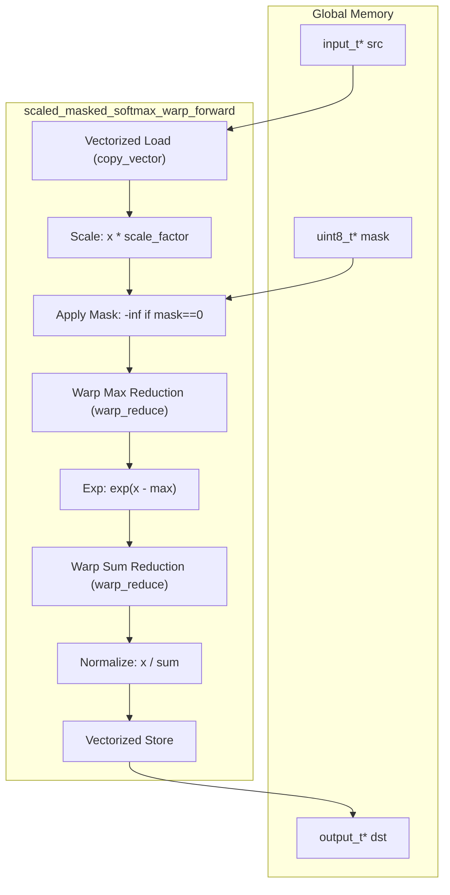
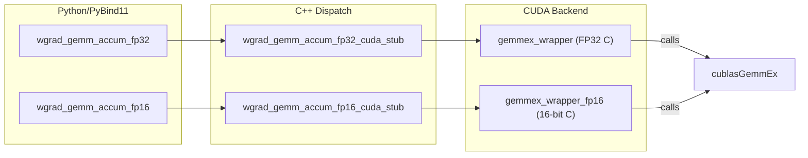

<!-- source: DeepWiki mcp.deepwiki.com · repo NVIDIA/apex · page 6.2 Megatron-LM Kernels · fetched 2026-10-26 -->

# Megatron-LM Kernels

Relevant source files

The following files were used as context for generating this wiki page:

- [apex/contrib/csrc/multihead_attn/softmax.cuh](apex/contrib/csrc/multihead_attn/softmax.cuh)
- [csrc/megatron/fused_rotary_positional_embedding.cpp](csrc/megatron/fused_rotary_positional_embedding.cpp)
- [csrc/megatron/fused_rotary_positional_embedding.h](csrc/megatron/fused_rotary_positional_embedding.h)
- [csrc/megatron/fused_rotary_positional_embedding_cuda.cu](csrc/megatron/fused_rotary_positional_embedding_cuda.cu)
- [csrc/megatron/fused_weight_gradient_dense.cpp](csrc/megatron/fused_weight_gradient_dense.cpp)
- [csrc/megatron/fused_weight_gradient_dense_16bit_prec_cuda.cu](csrc/megatron/fused_weight_gradient_dense_16bit_prec_cuda.cu)
- [csrc/megatron/fused_weight_gradient_dense_cuda.cu](csrc/megatron/fused_weight_gradient_dense_cuda.cu)
- [csrc/megatron/generic_scaled_masked_softmax.h](csrc/megatron/generic_scaled_masked_softmax.h)
- [csrc/megatron/scaled_masked_softmax.cpp](csrc/megatron/scaled_masked_softmax.cpp)
- [csrc/megatron/scaled_masked_softmax.h](csrc/megatron/scaled_masked_softmax.h)
- [csrc/megatron/scaled_masked_softmax_cuda.cu](csrc/megatron/scaled_masked_softmax_cuda.cu)
- [csrc/megatron/scaled_softmax_cuda.cu](csrc/megatron/scaled_softmax_cuda.cu)
- [csrc/megatron/scaled_upper_triang_masked_softmax.cpp](csrc/megatron/scaled_upper_triang_masked_softmax.cpp)
- [csrc/megatron/scaled_upper_triang_masked_softmax.h](csrc/megatron/scaled_upper_triang_masked_softmax.h)
- [csrc/megatron/scaled_upper_triang_masked_softmax_cuda.cu](csrc/megatron/scaled_upper_triang_masked_softmax_cuda.cu)

The Megatron-LM kernels in APEX provide highly optimized CUDA implementations for specific operations frequently used in large-scale Transformer training. These kernels focus on fusing multiple operations (like scaling, masking, and softmax) and optimizing memory access patterns for positional embeddings and gradient computations.

## Scaled Masked Softmax

The `scaled_masked_softmax` implementation fuses three distinct operations into a single CUDA kernel: element-wise scaling of the attention scores, application of a binary or additive mask, and the softmax normalization [csrc/megatron/scaled_masked_softmax.h:105-107]().

### Implementation Details
The kernels use a "warp-based" approach where a single CUDA warp handles one or more rows of the softmax operation. This avoids multiple global memory passes [csrc/megatron/scaled_masked_softmax.h:111-114]().

*   **Warp Reduction**: Uses `__shfl_xor_sync` (or `__shfl_xor` on older architectures) to perform efficient intra-warp reductions for finding the maximum value and the sum of exponentials [csrc/megatron/scaled_masked_softmax.h:79-99]().
*   **Vectorized Access**: Employs `copy_vector` to perform 128-bit loads (`float2` for FP16/BF16) to maximize memory throughput [csrc/megatron/scaled_masked_softmax.h:38-50]().
*   **Variants**:
    *   **Standard Masked**: Uses an explicit mask tensor [csrc/megatron/scaled_masked_softmax.h:205-209]().
    *   **Upper Triangular**: Implements implicit causal masking (diagonal masking) without requiring a mask tensor in memory [csrc/megatron/scaled_upper_triang_masked_softmax.h:125-128]().

### Data Flow: Scaled Masked Softmax
The following diagram illustrates the fusion of operations within the `scaled_masked_softmax_warp_forward` kernel.

**Softmax Fusion Flow**

**Sources:** [csrc/megatron/scaled_masked_softmax.h:105-203](), [csrc/megatron/scaled_masked_softmax_cuda.cu:36-65]()

---

## Fused Rotary Positional Embedding (RoPE)

The RoPE implementation applies rotation to the hidden dimensions of the query and key tensors. The APEX implementation fuses the trigonometric calculations and the rotation logic into a single kernel to minimize memory bandwidth bottlenecks [csrc/megatron/fused_rotary_positional_embedding.h:27-31]().

### Key Functions
*   `fused_rope_forward`: Computes the rotated embeddings using precomputed frequencies [csrc/megatron/fused_rotary_positional_embedding.h:98-108]().
*   `fused_rope_backward`: Computes gradients for the rotation operation [csrc/megatron/fused_rotary_positional_embedding.h:110-120]().
*   `fused_rope_cached_forward`: An optimized version that accepts precomputed `cos` and `sin` tensors to avoid redundant `sincosf` calls [csrc/megatron/fused_rotary_positional_embedding.h:122-127]().

### Logic Entity Mapping
The C++ interface in `fused_rotary_positional_embedding.cpp` validates tensor shapes before dispatching to the CUDA backend.

| C++ Interface Entity | CUDA Kernel Entity | Purpose |
| :--- | :--- | :--- |
| `fwd` [csrc/megatron/fused_rotary_positional_embedding.cpp:42]() | `fused_rope_forward` | Standard RoPE forward pass |
| `fwd_cached` [csrc/megatron/fused_rotary_positional_embedding.cpp:71]() | `fused_rope_cached_forward` | Forward pass with pre-cached cos/sin |
| `fwd_thd` [csrc/megatron/fused_rotary_positional_embedding.cpp:109]() | `fused_rope_thd_forward` | Forward pass for variable sequence lengths |

**Sources:** [csrc/megatron/fused_rotary_positional_embedding.cpp:19-121](), [csrc/megatron/fused_rotary_positional_embedding.h:98-155]()

---

## Fused Weight Gradient Computation

For dense layers, the gradient with respect to weights ($dW = dO^T \cdot I$) is often a performance bottleneck. APEX provides `fused_weight_gradient_dense` to optimize this GEMM operation, specifically supporting accumulation into FP32 master weights from FP16/BF16 inputs [csrc/megatron/fused_weight_gradient_dense_cuda.cu:39-49]().

### Implementation
The kernels wrap `cublasGemmEx` to leverage Tensor Cores while providing specialized accumulation logic.

*   **FP32 Accumulation**: `wgrad_gemm_accum_fp32` takes half-precision inputs and accumulates into a 32-bit weight gradient tensor [csrc/megatron/fused_weight_gradient_dense_cuda.cu:58-83]().
*   **16-bit Accumulation**: `wgrad_gemm_accum_fp16` performs the entire operation in 16-bit precision [csrc/megatron/fused_weight_gradient_dense_16bit_prec_cuda.cu:33-42]().

### Logic Entity Mapping: Weight Gradient
The following diagram maps the PyTorch-exposed functions to the underlying `cublas` wrappers.

**WGrad Dispatch Mapping**

**Sources:** [csrc/megatron/fused_weight_gradient_dense.cpp:10-15](), [csrc/megatron/fused_weight_gradient_dense_cuda.cu:17-37](), [csrc/megatron/fused_weight_gradient_dense_16bit_prec_cuda.cu:17-30]()

---

## Technical Summary Table

| Kernel | Supported Dtypes | Key Optimization | File |
| :--- | :--- | :--- | :--- |
| **Scaled Masked Softmax** | FP16, BF16 | Warp-level fusion, vectorized I/O | [csrc/megatron/scaled_masked_softmax.h]() |
| **Rotary Embedding** | FP16, BF16, FP32 | Fused trig & rotation, cached cos/sin | [csrc/megatron/fused_rotary_positional_embedding.h]() |
| **Weight Gradient** | FP16, BF16, FP32 | FP32 accumulation, Tensor Core GEMM | [csrc/megatron/fused_weight_gradient_dense_cuda.cu]() |

**Sources:** [csrc/megatron/scaled_masked_softmax.cpp:32-57](), [csrc/megatron/fused_rotary_positional_embedding_cuda.cu:24-63](), [csrc/megatron/fused_weight_gradient_dense_cuda.cu:79-83]()

---

