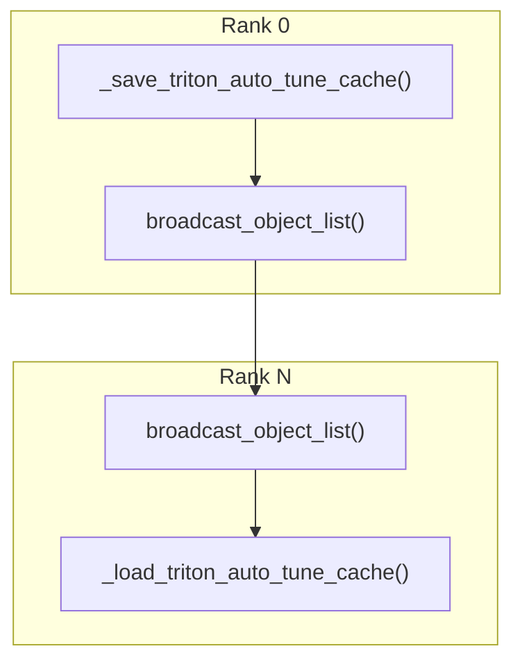
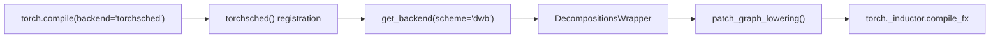

<!-- source: DeepWiki mcp.deepwiki.com · repo NVIDIA/apex · page 6.3 Contrib Experimental Modules · fetched 2026-10-26 -->

# Contrib Experimental Modules

Relevant source files

The following files were used as context for generating this wiki page:

- [apex/contrib/csrc/gpu_direct_storage/gds.cpp](apex/contrib/csrc/gpu_direct_storage/gds.cpp)
- [apex/contrib/csrc/gpu_direct_storage/gds.h](apex/contrib/csrc/gpu_direct_storage/gds.h)
- [apex/contrib/csrc/gpu_direct_storage/gds_pybind.cpp](apex/contrib/csrc/gpu_direct_storage/gds_pybind.cpp)
- [apex/contrib/csrc/nccl_allocator/NCCLAllocator.cpp](apex/contrib/csrc/nccl_allocator/NCCLAllocator.cpp)
- [apex/contrib/csrc/transducer/transducer_joint.cpp](apex/contrib/csrc/transducer/transducer_joint.cpp)
- [apex/contrib/csrc/transducer/transducer_loss.cpp](apex/contrib/csrc/transducer/transducer_loss.cpp)
- [apex/contrib/examples/gpu_direct_storage/benchmark_load.py](apex/contrib/examples/gpu_direct_storage/benchmark_load.py)
- [apex/contrib/examples/gpu_direct_storage/benchmark_save.py](apex/contrib/examples/gpu_direct_storage/benchmark_save.py)
- [apex/contrib/examples/gpu_direct_storage/example_load.py](apex/contrib/examples/gpu_direct_storage/example_load.py)
- [apex/contrib/examples/gpu_direct_storage/example_save.py](apex/contrib/examples/gpu_direct_storage/example_save.py)
- [apex/contrib/examples/nccl_allocator/allreduce.py](apex/contrib/examples/nccl_allocator/allreduce.py)
- [apex/contrib/examples/nccl_allocator/cache.py](apex/contrib/examples/nccl_allocator/cache.py)
- [apex/contrib/examples/nccl_allocator/change_cuda_allocator.py](apex/contrib/examples/nccl_allocator/change_cuda_allocator.py)
- [apex/contrib/examples/nccl_allocator/toy_ddp.py](apex/contrib/examples/nccl_allocator/toy_ddp.py)
- [apex/contrib/gpu_direct_storage/README.md](apex/contrib/gpu_direct_storage/README.md)
- [apex/contrib/gpu_direct_storage/__init__.py](apex/contrib/gpu_direct_storage/__init__.py)
- [apex/contrib/nccl_allocator/README.md](apex/contrib/nccl_allocator/README.md)
- [apex/contrib/nccl_allocator/__init__.py](apex/contrib/nccl_allocator/__init__.py)
- [apex/contrib/nccl_allocator/nccl_allocator.py](apex/contrib/nccl_allocator/nccl_allocator.py)
- [apex/contrib/openfold_triton/README.md](apex/contrib/openfold_triton/README.md)
- [apex/contrib/openfold_triton/__init__.py](apex/contrib/openfold_triton/__init__.py)
- [apex/contrib/openfold_triton/_layer_norm_backward_kernels.py](apex/contrib/openfold_triton/_layer_norm_backward_kernels.py)
- [apex/contrib/openfold_triton/_layer_norm_config_ampere.py](apex/contrib/openfold_triton/_layer_norm_config_ampere.py)
- [apex/contrib/openfold_triton/_layer_norm_config_hopper.py](apex/contrib/openfold_triton/_layer_norm_config_hopper.py)
- [apex/contrib/openfold_triton/_layer_norm_forward_kernels.py](apex/contrib/openfold_triton/_layer_norm_forward_kernels.py)
- [apex/contrib/openfold_triton/_mha_kernel.py](apex/contrib/openfold_triton/_mha_kernel.py)
- [apex/contrib/openfold_triton/fused_adam_swa.py](apex/contrib/openfold_triton/fused_adam_swa.py)
- [apex/contrib/openfold_triton/layer_norm.py](apex/contrib/openfold_triton/layer_norm.py)
- [apex/contrib/openfold_triton/mha.py](apex/contrib/openfold_triton/mha.py)
- [apex/contrib/test/openfold_triton/test_fused_adam_swa.py](apex/contrib/test/openfold_triton/test_fused_adam_swa.py)
- [apex/contrib/test/openfold_triton/test_sync_triton_auto_tune_cache_across_gpus.py](apex/contrib/test/openfold_triton/test_sync_triton_auto_tune_cache_across_gpus.py)
- [apex/contrib/test/transducer/test_transducer_joint.py](apex/contrib/test/transducer/test_transducer_joint.py)
- [apex/contrib/test/transducer/test_transducer_loss.py](apex/contrib/test/transducer/test_transducer_loss.py)
- [apex/contrib/torchsched/__init__.py](apex/contrib/torchsched/__init__.py)
- [apex/contrib/torchsched/backend.py](apex/contrib/torchsched/backend.py)
- [apex/contrib/torchsched/config.py](apex/contrib/torchsched/config.py)
- [apex/contrib/torchsched/inductor/__init__.py](apex/contrib/torchsched/inductor/__init__.py)
- [apex/contrib/torchsched/inductor/_utils.py](apex/contrib/torchsched/inductor/_utils.py)
- [apex/contrib/torchsched/inductor/event.py](apex/contrib/torchsched/inductor/event.py)
- [apex/contrib/torchsched/inductor/graph.py](apex/contrib/torchsched/inductor/graph.py)
- [apex/contrib/torchsched/inductor/scheduler.py](apex/contrib/torchsched/inductor/scheduler.py)
- [apex/contrib/torchsched/inductor/wrapper.py](apex/contrib/torchsched/inductor/wrapper.py)
- [apex/contrib/torchsched/ops/layer_norm.py](apex/contrib/torchsched/ops/layer_norm.py)
- [apex/contrib/torchsched/passes/pre_grad_passes.py](apex/contrib/torchsched/passes/pre_grad_passes.py)
- [apex/contrib/transducer/__init__.py](apex/contrib/transducer/__init__.py)
- [apex/contrib/transducer/_transducer_ref.py](apex/contrib/transducer/_transducer_ref.py)
- [apex/contrib/transducer/transducer.py](apex/contrib/transducer/transducer.py)

The `apex.contrib` package contains experimental features, optimized kernels, and specialized utilities that are either in a beta state or targeted at specific model architectures like OpenFold or Transducer-based speech models. These modules leverage low-level CUDA optimizations, Triton, and custom PyTorch backends to provide performance gains beyond standard implementations.

## NCCL Allocator for NVLS Collectives

The NCCL Allocator provides a specialized memory management system designed to work with NVIDIA Link System (NVLS) and NVLink SHARP. It allows PyTorch to allocate memory that is pre-registered or compatible with NCCL's direct GPU-to-GPU communication primitives, significantly reducing overhead in multi-GPU synchronization.

### Implementation and Data Flow
The allocator is implemented as a C++ pluggable allocator that wraps `ncclMemAlloc` and `ncclMemFree` [apex/contrib/csrc/nccl_allocator/NCCLAllocator.cpp:17-23](). It is exposed to Python via a `torch.cuda.MemPool` object [apex/contrib/nccl_allocator/nccl_allocator.py:18-33]().

**Key Components:**
*   **`create_nccl_mem_pool`**: Initializes a memory pool using the custom NCCL-backed allocator [apex/contrib/nccl_allocator/nccl_allocator.py:18-33]().
*   **`nccl_mem` context manager**: Manages the lifecycle of NCCL memory. When entering the context, it uses `torch.cuda.use_mem_pool` to redirect allocations to the NCCL pool and handles registration/deregistration with the distributed backend [apex/contrib/nccl_allocator/nccl_allocator.py:41-83]().
*   **`init()`**: Sets environment variables like `NCCL_NVLS_ENABLE=1` to ensure the underlying NCCL library utilizes NVLS capabilities [apex/contrib/nccl_allocator/nccl_allocator.py:36-39]().

### Code Entity Mapping: NCCL Allocator
| System Name | Code Entity | File Path |
| :--- | :--- | :--- |
| C++ Allocator | `CUDAPluggableAllocator` | [apex/contrib/csrc/nccl_allocator/NCCLAllocator.cpp:30]() |
| Allocation Hook | `nccl_alloc_plug` | [apex/contrib/csrc/nccl_allocator/NCCLAllocator.cpp:17]() |
| Python Interface | `create_nccl_mem_pool` | [apex/contrib/nccl_allocator/nccl_allocator.py:18]() |
| Context Manager | `nccl_mem` | [apex/contrib/nccl_allocator/nccl_allocator.py:41]() |

Sources: [apex/contrib/nccl_allocator/nccl_allocator.py](), [apex/contrib/csrc/nccl_allocator/NCCLAllocator.cpp]()

## OpenFold Triton Kernels

The OpenFold contrib module provides high-performance Triton-based implementations for AlphaFold2/OpenFold specific operations. This includes specialized LayerNorm kernels and a fused Adam optimizer with Stochastic Weight Averaging (SWA).

### Fused Adam-SWA
The `FusedAdamSWA` class implements a combined optimizer that performs Adam updates and SWA updates in a single Triton kernel pass [apex/contrib/openfold_triton/fused_adam_swa.py:209-220](). This reduces memory bandwidth requirements by avoiding multiple reads/writes of model parameters.

**Triton Kernel Logic (`_multi_tensor_adam_swa`):**
1.  **Gradient Clipping**: Applies scaling to gradients before the update [apex/contrib/openfold_triton/fused_adam_swa.py:171]().
2.  **Adam Math**: Supports multiple variants including `ApexAdam`, `ApexAdamW`, and `PyTorchAdam` [apex/contrib/openfold_triton/fused_adam_swa.py:53-97]().
3.  **SWA Update**: Computes the moving average of parameters: `swa_param += (1.0 - decay_rate) * (param - swa_param)` [apex/contrib/openfold_triton/fused_adam_swa.py:102-113]().

### LayerNorm and Autotuning
The module includes `LayerNormSmallShapeOptImpl` which uses optimized Triton kernels for forward and backward passes [apex/contrib/openfold_triton/layer_norm.py:24](). It includes a mechanism to synchronize Triton's autotuning cache across GPUs to ensure consistent performance in distributed training [apex/contrib/openfold_triton/__init__.py:102-121]().

**Data Flow: Triton Cache Sync**

Sources: [apex/contrib/openfold_triton/fused_adam_swa.py](), [apex/contrib/openfold_triton/__init__.py](), [apex/contrib/openfold_triton/_layer_norm_forward_kernels.py]()

## TorchSched: Graph Scheduler

TorchSched is an experimental backend for `torch.compile` that implements multi-stream scheduling for FX graphs. It aims to overlap computation by scheduling independent operations on different CUDA streams.

### Architecture
TorchSched registers as a custom compiler backend via `@register_backend` [apex/contrib/torchsched/__init__.py:29-38](). It wraps the standard Inductor backend but injects a custom scheduling pass.

**Key Features:**
*   **Multi-Stream Scheduling**: Uses `num_streams` (default 8) to parallelize the execution of the graph [apex/contrib/torchsched/config.py:20]().
*   **Graph Lowering Patch**: Hooks into Inductor's lowering process using `patch_graph_lowering` to modify how kernels are emitted [apex/contrib/torchsched/backend.py:42-45]().
*   **Custom Decompositions**: Provides specialized decompositions for convolution backward passes (`convolution_backward_decomp_dwb`) to expose more parallelism between dgrad, wgrad, and bgrad [apex/contrib/torchsched/backend.py:51-113]().

### TorchSched Component Mapping

Sources: [apex/contrib/torchsched/__init__.py](), [apex/contrib/torchsched/backend.py](), [apex/contrib/torchsched/config.py]()

## Transducer Loss and Joint

The Transducer module provides optimized CUDA implementations for the RNN-Transducer (RNN-T) loss and the "Joint" network (the fusion point of audio and text encoders).

### TransducerJoint
The `TransducerJoint` module [apex/contrib/transducer/transducer.py:70]() performs the operation $h = \text{ReLU}(f(t) + g(u))$ followed by an optional dropout and projection. 
*   **Packing Support**: It can handle "packed" inputs where sequences of different lengths are concatenated to avoid padding overhead [apex/contrib/test/transducer/test_transducer_joint.py:89-103]().
*   **Vector Kernels**: Includes specialized vector-processing kernels for specific hidden sizes [apex/contrib/test/transducer/test_transducer_joint.py:24-27]().

### TransducerLoss
The `TransducerLoss` class [apex/contrib/transducer/transducer.py:16]() implements the forward and backward passes for the RNN-T objective.
*   **Memory Efficiency**: Supports `packed_input` to minimize memory usage on the $T \times U$ grid [apex/contrib/test/transducer/test_transducer_loss.py:88-111]().
*   **Fusion**: Optionally fuses the softmax and backward pass to improve performance [apex/contrib/test/transducer/test_transducer_loss.py:134-143]().

Sources: [apex/contrib/transducer/transducer.py](), [apex/contrib/test/transducer/test_transducer_joint.py](), [apex/contrib/test/transducer/test_transducer_loss.py]()

## GPUDirect Storage (GDS)

The `gpu_direct_storage` module provides an interface to NVIDIA's GPUDirect Storage technology, allowing direct DMA transfers between storage (NVMe) and GPU memory, bypassing the CPU bounce buffers.

**Implementation:**
*   **C++ Backend**: Implemented in `gds.cpp` using the `libcufile` library [apex/contrib/csrc/gpu_direct_storage/gds.cpp]().
*   **Python API**: Exposed via `apex.contrib.gpu_direct_storage`, providing functions to save and load tensors directly to/from GDS-enabled filesystems [apex/contrib/gpu_direct_storage/__init__.py]().

Sources: [apex/contrib/csrc/gpu_direct_storage/gds.cpp](), [apex/contrib/gpu_direct_storage/__init__.py]()

---

