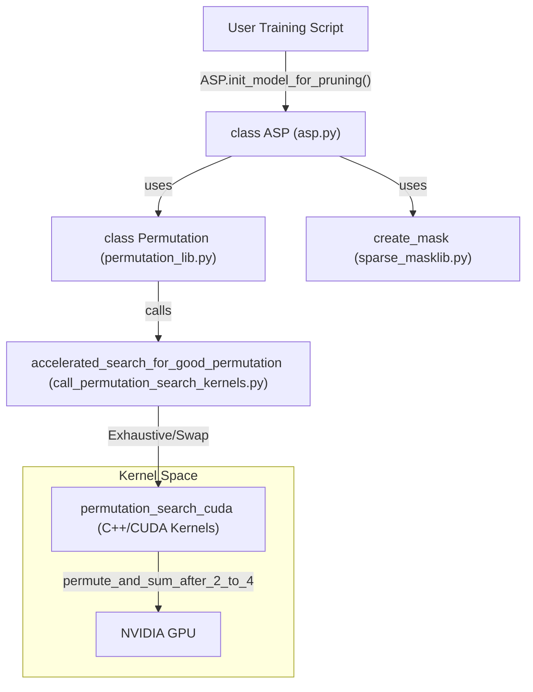
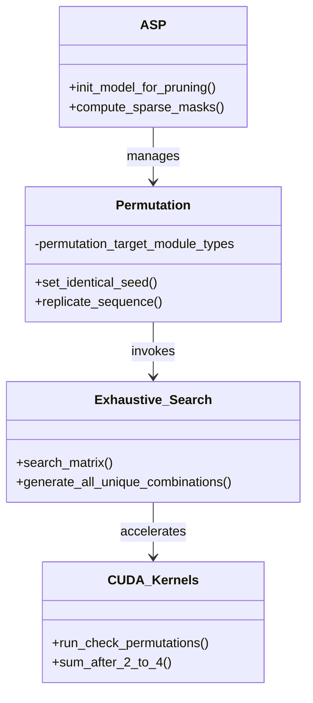

<!-- source: DeepWiki mcp.deepwiki.com · repo NVIDIA/apex · page 7 Sparsity and Weight Pruning · fetched 2026-10-26 -->

# Sparsity and Weight Pruning

Relevant source files

The following files were used as context for generating this wiki page:

- [apex/contrib/sparsity/COPYRIGHT](apex/contrib/sparsity/COPYRIGHT)
- [apex/contrib/sparsity/README.md](apex/contrib/sparsity/README.md)
- [apex/contrib/sparsity/asp.py](apex/contrib/sparsity/asp.py)
- [apex/contrib/sparsity/permutation_lib.py](apex/contrib/sparsity/permutation_lib.py)
- [apex/contrib/sparsity/permutation_search_kernels/CUDA_kernels/permutation_search_kernels.cu](apex/contrib/sparsity/permutation_search_kernels/CUDA_kernels/permutation_search_kernels.cu)
- [apex/contrib/sparsity/permutation_search_kernels/__init__.py](apex/contrib/sparsity/permutation_search_kernels/__init__.py)
- [apex/contrib/sparsity/permutation_search_kernels/call_permutation_search_kernels.py](apex/contrib/sparsity/permutation_search_kernels/call_permutation_search_kernels.py)
- [apex/contrib/sparsity/permutation_search_kernels/channel_swap.py](apex/contrib/sparsity/permutation_search_kernels/channel_swap.py)
- [apex/contrib/sparsity/permutation_search_kernels/exhaustive_search.py](apex/contrib/sparsity/permutation_search_kernels/exhaustive_search.py)
- [apex/contrib/sparsity/permutation_search_kernels/permutation_utilities.py](apex/contrib/sparsity/permutation_search_kernels/permutation_utilities.py)
- [apex/contrib/sparsity/permutation_tests/README.md](apex/contrib/sparsity/permutation_tests/README.md)
- [apex/contrib/sparsity/permutation_tests/ablation_studies.sh](apex/contrib/sparsity/permutation_tests/ablation_studies.sh)
- [apex/contrib/sparsity/permutation_tests/permutation_test.py](apex/contrib/sparsity/permutation_tests/permutation_test.py)
- [apex/contrib/sparsity/permutation_tests/runtime_table.sh](apex/contrib/sparsity/permutation_tests/runtime_table.sh)
- [apex/contrib/sparsity/permutation_tests/unstructured_study.sh](apex/contrib/sparsity/permutation_tests/unstructured_study.sh)
- [apex/contrib/sparsity/test/checkpointing_test_part1.py](apex/contrib/sparsity/test/checkpointing_test_part1.py)
- [apex/contrib/sparsity/test/checkpointing_test_part2.py](apex/contrib/sparsity/test/checkpointing_test_part2.py)
- [apex/contrib/sparsity/test/checkpointing_test_reference.py](apex/contrib/sparsity/test/checkpointing_test_reference.py)
- [apex/contrib/sparsity/test/test_permutation_application.py](apex/contrib/sparsity/test/test_permutation_application.py)

The APEX Sparsity and Weight Pruning toolkit provides utilities for implementing **Automatic SParsity (ASP)**. It is designed to accelerate deep learning models by leveraging NVIDIA Ampere Architecture's **Sparse Tensor Cores**, which provide a speedup for matrices following a **2:4 structured sparsity** pattern (two non-zero values for every four-element block).

The toolkit includes high-level APIs for pruning trained models, low-level mask generation utilities, and advanced permutation search algorithms to minimize accuracy loss during the pruning process.

### Core Capabilities
*   **Structured Pruning**: Automated 2:4 sparsity mask generation and application [apex/contrib/sparsity/asp.py:42-56]().
*   **Permutation Search**: Advanced channel permutation algorithms (Exhaustive, Channel Swap) to find optimal weight orderings that preserve high-magnitude weights under 2:4 constraints [apex/contrib/sparsity/permutation_search_kernels/call_permutation_search_kernels.py:25-60]().
*   **Optimizer Integration**: Utilities to ensure gradients are masked consistently with weights during fine-tuning [apex/contrib/sparsity/asp.py:186-213]().
*   **CUDA Acceleration**: Optimized kernels for searching permutations and calculating sparse magnitudes [apex/contrib/sparsity/permutation_search_kernels/CUDA_kernels/permutation_search_kernels.cu:46-93]().

---

## System Architecture

The following diagram illustrates the relationship between the high-level `ASP` interface and the underlying permutation and kernel logic.

### ASP Logic Flow

**Sources:** [apex/contrib/sparsity/asp.py:27-56](), [apex/contrib/sparsity/permutation_lib.py:88-112](), [apex/contrib/sparsity/permutation_search_kernels/call_permutation_search_kernels.py:6-23](), [apex/contrib/sparsity/permutation_search_kernels/CUDA_kernels/permutation_search_kernels.cu:46-50]()

---

## Automatic SParsity (ASP)

The `ASP` class is the primary entry point for users. It automates the process of identifying "eligible" layers (e.g., `torch.nn.Linear`, `torch.nn.Conv2d`), calculating masks, and modifying the optimizer to maintain sparsity during training [apex/contrib/sparsity/asp.py:17-24]().

### Key Methods
| Method | Description |
| :--- | :--- |
| `init_model_for_pruning` | Augments the model with buffers for sparse masks and identifies layers in the `whitelist` [apex/contrib/sparsity/asp.py:38-56](). |
| `init_optimizer_for_pruning` | Wraps the optimizer's `step` method to apply masks to gradients and weights [apex/contrib/sparsity/asp.py:186-195](). |
| `compute_sparse_masks` | Calculates the 2:4 masks based on weight magnitudes and optionally performs permutation search [apex/contrib/sparsity/asp.py:246-260](). |
| `prune_trained_model` | A convenience helper that combines initialization and mask computation for existing dense models [apex/contrib/sparsity/README.md:15-19](). |

For details on the pruning workflow and checkpointing, see **[ASP: Automatic SParsity](#7.1)**.

**Sources:** [apex/contrib/sparsity/asp.py:38-260](), [apex/contrib/sparsity/README.md:9-19]()

---

## Permutation Search

Standard 2:4 pruning can discard significant weight magnitudes if they happen to cluster within the same 4-element block. APEX addresses this by permuting the input channels of a layer (and the output channels of the preceding layer) to redistribute high-magnitude weights into different blocks [apex/contrib/sparsity/README.md:80-84]().

### Search Strategies
1.  **Exhaustive Search**: Evaluates unique combinations of column groupings to find the global or local maximum magnitude [apex/contrib/sparsity/permutation_search_kernels/exhaustive_search.py:114-123]().
2.  **Progressive Channel Swap**: Randomly swaps channels and retains swaps that improve the total magnitude after 2:4 pruning [apex/contrib/sparsity/permutation_search_kernels/call_permutation_search_kernels.py:60-78]().

### Entity Mapping: Permutation Search

**Sources:** [apex/contrib/sparsity/asp.py:27-56](), [apex/contrib/sparsity/permutation_lib.py:88-155](), [apex/contrib/sparsity/permutation_search_kernels/exhaustive_search.py:76-95](), [apex/contrib/sparsity/permutation_search_kernels/CUDA_kernels/permutation_search_kernels.cu:139-149]()

For details on permutation search and the mathematical foundations of N:M sparsity, see **[ASP: Automatic SParsity](#7.1)**.

---

## Child Pages

*   **[ASP: Automatic SParsity](#7.1)**: Detailed guide to using the ASP module for 2:4 structured sparsity pruning, including the pruning workflow, mask generation, checkpointing, and permutation search for optimal sparsity patterns.

---

