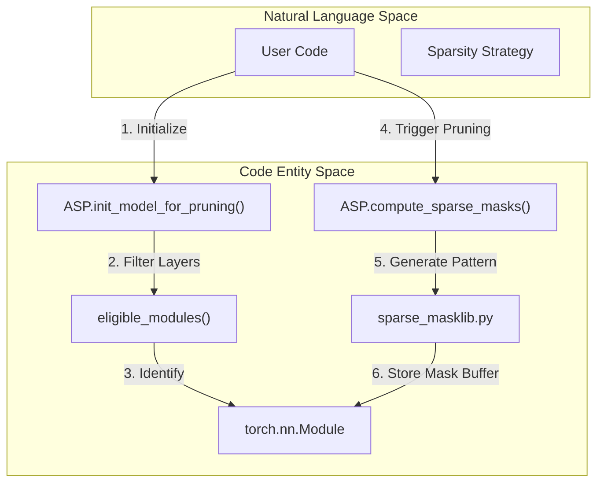
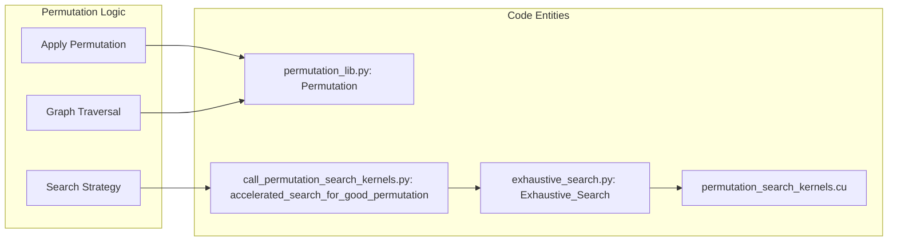

<!-- source: DeepWiki mcp.deepwiki.com · repo NVIDIA/apex · page 7.1 ASP: Automatic SParsity · fetched 2026-10-26 -->

# ASP: Automatic SParsity

Relevant source files

The following files were used as context for generating this wiki page:

- [apex/contrib/sparsity/COPYRIGHT](apex/contrib/sparsity/COPYRIGHT)
- [apex/contrib/sparsity/README.md](apex/contrib/sparsity/README.md)
- [apex/contrib/sparsity/asp.py](apex/contrib/sparsity/asp.py)
- [apex/contrib/sparsity/permutation_lib.py](apex/contrib/sparsity/permutation_lib.py)
- [apex/contrib/sparsity/permutation_search_kernels/CUDA_kernels/permutation_search_kernels.cu](apex/contrib/sparsity/permutation_search_kernels/CUDA_kernels/permutation_search_kernels.cu)
- [apex/contrib/sparsity/permutation_search_kernels/__init__.py](apex/contrib/sparsity/permutation_search_kernels/__init__.py)
- [apex/contrib/sparsity/permutation_search_kernels/call_permutation_search_kernels.py](apex/contrib/sparsity/permutation_search_kernels/call_permutation_search_kernels.py)
- [apex/contrib/sparsity/permutation_search_kernels/channel_swap.py](apex/contrib/sparsity/permutation_search_kernels/channel_swap.py)
- [apex/contrib/sparsity/permutation_search_kernels/exhaustive_search.py](apex/contrib/sparsity/permutation_search_kernels/exhaustive_search.py)
- [apex/contrib/sparsity/permutation_search_kernels/permutation_utilities.py](apex/contrib/sparsity/permutation_search_kernels/permutation_utilities.py)
- [apex/contrib/sparsity/permutation_tests/README.md](apex/contrib/sparsity/permutation_tests/README.md)
- [apex/contrib/sparsity/permutation_tests/ablation_studies.sh](apex/contrib/sparsity/permutation_tests/ablation_studies.sh)
- [apex/contrib/sparsity/permutation_tests/permutation_test.py](apex/contrib/sparsity/permutation_tests/permutation_test.py)
- [apex/contrib/sparsity/permutation_tests/runtime_table.sh](apex/contrib/sparsity/permutation_tests/runtime_table.sh)
- [apex/contrib/sparsity/permutation_tests/unstructured_study.sh](apex/contrib/sparsity/permutation_tests/unstructured_study.sh)
- [apex/contrib/sparsity/sparse_masklib.py](apex/contrib/sparsity/sparse_masklib.py)
- [apex/contrib/sparsity/test/checkpointing_test_part1.py](apex/contrib/sparsity/test/checkpointing_test_part1.py)
- [apex/contrib/sparsity/test/checkpointing_test_part2.py](apex/contrib/sparsity/test/checkpointing_test_part2.py)
- [apex/contrib/sparsity/test/checkpointing_test_reference.py](apex/contrib/sparsity/test/checkpointing_test_reference.py)
- [apex/contrib/sparsity/test/test_permutation_application.py](apex/contrib/sparsity/test/test_permutation_application.py)

The **Automatic SParsity (ASP)** module in APEX is a toolkit designed to enable structured sparsity in PyTorch models with minimal code changes. It specifically targets the **2:4 structured sparsity** pattern supported by NVIDIA Ampere Architecture Sparse Tensor Cores. ASP provides utilities for pruning trained models, recomputing masks during training, and searching for optimal channel permutations to minimize accuracy loss.

### Key Features
*   **2:4 Structured Sparsity**: Automatically prunes weights such that in every block of 4 values, at least 2 are zero [apex/contrib/sparsity/README.md:40-46]().
*   **One-Line Integration**: Prune and fine-tune models by adding `ASP.prune_trained_model(model, optimizer)` [apex/contrib/sparsity/README.md:15-19]().
*   **Channel Permutation**: Searches for weight permutations that align high-magnitude weights into the 2:4 pattern, preserving more information [apex/contrib/sparsity/README.md:80-84]().
*   **Checkpoint Compatibility**: Seamlessly saves and restores sparse masks and pruned weights [apex/contrib/sparsity/asp.py:56-74]().

---

## Pruning Workflow and Architecture

The ASP workflow typically involves initializing the model for pruning, computing the sparse masks, and then fine-tuning the model to recover accuracy.

### ASP Initialization and Mask Generation
The `ASP` class manages the state of sparsity across the model. It identifies "eligible" modules (like `nn.Linear` or `nn.Conv2d`) and augments them with buffers to store masks.

**ASP Workflow Data Flow**
"This diagram illustrates how the ASP class interacts with PyTorch model components to transition from a dense to a sparse state."

Sources: [apex/contrib/sparsity/asp.py:38-92](), [apex/contrib/sparsity/asp.py:17-24](), [apex/contrib/sparsity/sparse_masklib.py:176-181]()

### Key Functions
| Function | Description |
| :--- | :--- |
| `init_model_for_pruning` | Configures the model, sets the mask calculator (e.g., `m4n2_1d`), and registers hooks/buffers. [apex/contrib/sparsity/asp.py:38-56]() |
| `compute_sparse_masks` | Iterates through all registered parameters and applies the sparsity mask. [apex/contrib/sparsity/asp.py:438-442]() |
| `prune_trained_model` | A convenience wrapper that calls initialization and mask computation in one step. [apex/contrib/sparsity/asp.py:656-665]() |
| `init_optimizer_for_pruning` | Wraps the optimizer to ensure that pruned weights remain zero during gradient updates. [apex/contrib/sparsity/asp.py:537-542]() |

---

## Sparse Mask Generation (`sparse_masklib`)

The `sparse_masklib.py` file contains the logic for calculating the optimal 2:4 mask for various tensor dimensions.

*   **1D Masking**: Reshapes tensors into $(N, 4)$ blocks and selects the two largest magnitudes in each block [apex/contrib/sparsity/sparse_masklib.py:52-62]().
*   **2D Masking**: Targeted at accelerating the DGRAD step during training. It ensures the weight tensor is 2:4 sparse along both rows and columns [apex/contrib/sparsity/sparse_masklib.py:69-81]().
*   **Pattern Support**: Supports `m4n2_1d` (standard 2:4) and `m4n2_2d_best` (optimal 2D pattern search) [apex/contrib/sparsity/sparse_masklib.py:176-181]().

---

## Channel Permutation Search

Channel permutation is an advanced technique to improve the accuracy of sparse models. By reordering the input channels of a weight matrix, ASP can group larger weights together into the 2:4 blocks, preventing them from being pruned.

### Permutation Architecture
Permutations must be "propagated" through the model graph to ensure mathematical equivalence. For example, if the input channels of a `Linear` layer are permuted, the output channels of the preceding layer must be permuted identically.

**Permutation System Entities**
"This diagram maps the permutation search and application logic to the corresponding code entities."

Sources: [apex/contrib/sparsity/permutation_lib.py:88-112](), [apex/contrib/sparsity/permutation_search_kernels/call_permutation_search_kernels.py:6-10](), [apex/contrib/sparsity/permutation_search_kernels/exhaustive_search.py:114-122]()

### Search Strategies
ASP supports multiple strategies for finding the best permutation:
1.  **Exhaustive Search**: Evaluates all unique permutations for small channel groups (e.g., groups of 8 channels) [apex/contrib/sparsity/permutation_search_kernels/exhaustive_search.py:7-12]().
2.  **Progressive Channel Swap**: Randomly swaps channels and keeps changes that increase the total magnitude of weights preserved by the 2:4 mask [apex/contrib/sparsity/permutation_search_kernels/call_permutation_search_kernels.py:60-78]().

### CUDA Acceleration
For performance, ASP provides CUDA kernels to calculate the "sum after 2:4 pruning" efficiently across many permutation candidates [apex/contrib/sparsity/permutation_search_kernels/CUDA_kernels/permutation_search_kernels.cu:46-62](). This is enabled via the `--permutation_search` build flag [apex/contrib/sparsity/README.md:88-90]().

---

## Checkpointing and Persistence

ASP integrates with PyTorch's `state_dict` mechanism to ensure that sparsity masks are preserved across training sessions.

1.  **Buffers**: Masks are stored as module buffers (e.g., `weight_mask`), meaning they are automatically included in `model.state_dict()` [apex/contrib/sparsity/asp.py:237-240]().
2.  **Restoration**: When a model is loaded from a checkpoint, `ASP.init_model_for_pruning` must be called *before* `load_state_dict` to ensure the mask buffers exist to receive the saved values [apex/contrib/sparsity/asp.py:68-74]().
3.  **Optimizer State**: The `ASP.init_optimizer_for_pruning` call ensures that the optimizer's internal states (like momentum) are also correctly handled for sparse parameters [apex/contrib/sparsity/asp.py:537-550]().

Sources: [apex/contrib/sparsity/test/checkpointing_test_part1.py:64-74](), [apex/contrib/sparsity/test/checkpointing_test_part2.py:62-73]()

---

