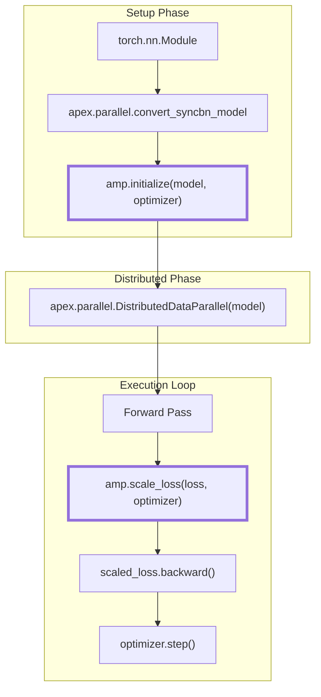
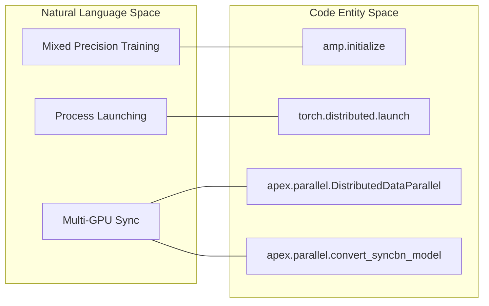

<!-- source: DeepWiki mcp.deepwiki.com · repo NVIDIA/apex · page 8 Examples and Usage Patterns · fetched 2026-10-26 -->

# Examples and Usage Patterns

Relevant source files

The following files were used as context for generating this wiki page:

- [examples/imagenet/README.md](examples/imagenet/README.md)
- [examples/imagenet/main_amp.py](examples/imagenet/main_amp.py)
- [examples/simple/distributed/README.md](examples/simple/distributed/README.md)
- [examples/simple/distributed/distributed_data_parallel.py](examples/simple/distributed/distributed_data_parallel.py)
- [examples/simple/distributed/run.sh](examples/simple/distributed/run.sh)

The APEX library provides a suite of examples to demonstrate how to integrate Automatic Mixed Precision (AMP), distributed training, and optimized kernels into standard PyTorch workflows. These examples range from minimal scripts illustrating specific API calls to full-scale training pipelines for ImageNet.

The primary goal of these examples is to showcase how to achieve "speed of light" performance on NVIDIA GPUs while maintaining numerical stability and convergence.

### Core Usage Patterns

Most APEX integrations follow a consistent initialization pattern. For example, when using AMP and Distributed Data Parallel (DDP) together, the order of operations is critical: the model and optimizer must be initialized with AMP before being wrapped for distributed training [examples/simple/distributed/distributed_data_parallel.py:43-48]().

| Feature | Primary Entry Point | Integration Requirement |
| :--- | :--- | :--- |
| **AMP** | `amp.initialize` | Must occur before DDP wrapping [examples/simple/distributed/README.md:6-8]() |
| **DDP** | `apex.parallel.DistributedDataParallel` | Drop-in for `torch.nn.parallel.DistributedDataParallel` [examples/imagenet/README.md:132-142]() |
| **SyncBN** | `apex.parallel.convert_syncbn_model` | Applied to the model before AMP initialization [examples/imagenet/main_amp.py:139-142]() |

### System Integration Diagram

The following diagram illustrates how the various APEX entities interact within a typical training script.

**APEX Training Workflow Integration**

Sources: [examples/imagenet/main_amp.py:139-154](), [examples/simple/distributed/distributed_data_parallel.py:43-62]()

### ImageNet Training Example

The ImageNet example (`main_amp.py`) serves as the reference implementation for high-performance computer vision training. It demonstrates the use of different `opt_level` settings (O0, O1, O2, O3) to balance speed and precision. It also includes performance optimizations like `fast_collate` for data loading [examples/imagenet/main_amp.py:25-38]() and `channels_last` memory formats [examples/imagenet/main_amp.py:126-129]().

For details, see [ImageNet Training Example](#8.1).

### Other Examples and Distributed Patterns

Beyond ImageNet, APEX includes simpler scripts to isolate specific features. This includes:
* **Simple Distributed Data Parallel**: A minimal script showing the interaction between `amp` and `DistributedDataParallel` using the `torch.distributed.launch` utility [examples/simple/distributed/distributed_data_parallel.py:1-66]().
* **DCGAN and Language Models**: Implementations showing how AMP handles GAN stability and sequential data processing.

For details, see [Other Examples](#8.2).

### API to Code Entity Mapping

This diagram maps natural language concepts used in the documentation to the specific code entities found in the `examples/` directory.

**Concept to Entity Mapping**

Sources: [examples/imagenet/README.md:4-14](), [examples/simple/distributed/run.sh:2](), [examples/simple/distributed/distributed_data_parallel.py:6-48]()

---
**Sources:**
* [examples/imagenet/README.md:1-142]()
* [examples/imagenet/main_amp.py:25-170]()
* [examples/simple/distributed/README.md:1-14]()
* [examples/simple/distributed/distributed_data_parallel.py:1-66]()
* [examples/simple/distributed/run.sh:1-3]()

---

