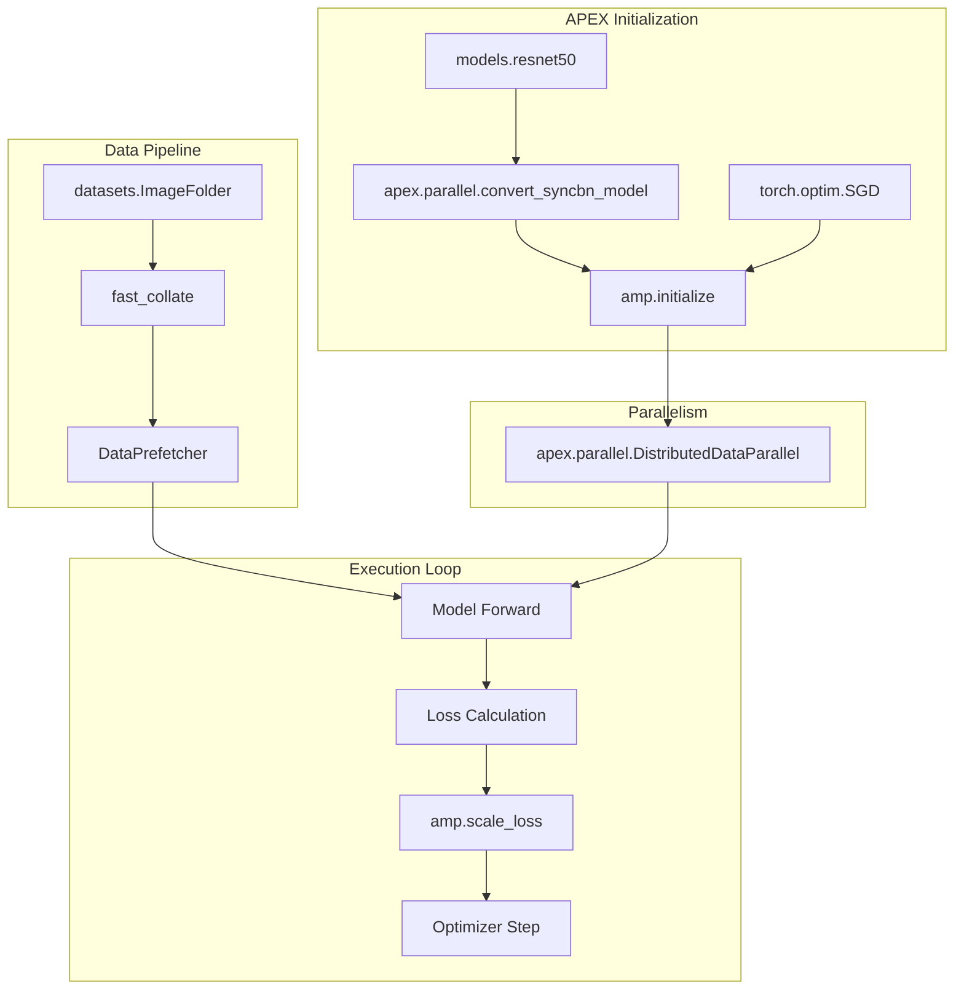
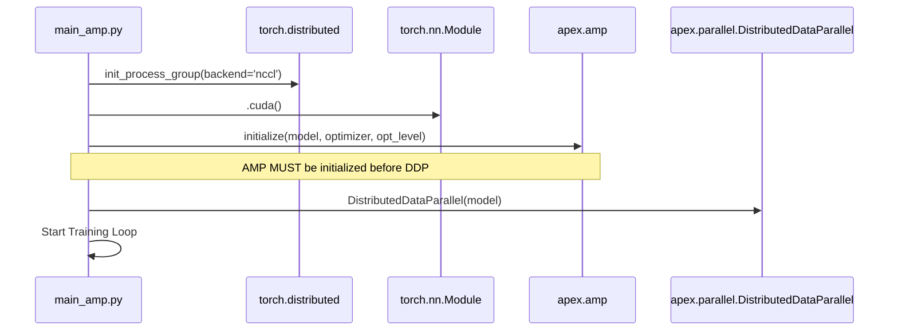

<!-- source: DeepWiki mcp.deepwiki.com · repo NVIDIA/apex · page 8.1 ImageNet Training Example · fetched 2026-10-26 -->

# ImageNet Training Example

Relevant source files

The following files were used as context for generating this wiki page:

- [examples/imagenet/README.md](examples/imagenet/README.md)
- [examples/imagenet/main_amp.py](examples/imagenet/main_amp.py)
- [examples/simple/distributed/README.md](examples/simple/distributed/README.md)
- [examples/simple/distributed/distributed_data_parallel.py](examples/simple/distributed/distributed_data_parallel.py)
- [examples/simple/distributed/run.sh](examples/simple/distributed/run.sh)

The ImageNet training example, primarily implemented in `main_amp.py`, serves as the reference implementation for integrating APEX features into a high-performance computer vision pipeline. It demonstrates the use of Automatic Mixed Precision (AMP), Distributed Data Parallel (DDP), and Synchronized Batch Normalization to accelerate ResNet training on the ImageNet dataset.

Sources: [examples/imagenet/README.md:1-4](), [examples/imagenet/main_amp.py:1-21]()

## Core Implementation Overview

The example extends the standard PyTorch ImageNet training script by injecting APEX-specific optimizations. The workflow follows a standard pattern: environment initialization, model and optimizer construction, AMP initialization, and a distributed training loop.

### System Architecture and Data Flow

The following diagram illustrates how the `main_amp.py` script coordinates data loading, model optimization via AMP, and distributed synchronization.

**ImageNet Training Flow**

Sources: [examples/imagenet/main_amp.py:131-158](), [examples/imagenet/main_amp.py:220-250](), [examples/imagenet/main_amp.py:252-290]()

## Optimization Levels (opt-level)

The example uses the `--opt-level` flag to control the precision of operations and weights. This flag is passed directly to `amp.initialize` [examples/imagenet/main_amp.py:186-191]().

| Level | Description | Key Characteristics |
| :--- | :--- | :--- |
| `O0` | Pure FP32 | Standard IEEE single precision. No APEX patches applied. |
| `O1` | Mixed Precision (Recommended) | Patches Torch functions via whitelist/blacklist. Tensor Core ops (GEMMs, Convolutions) use FP16; sensitive ops (Softmax, BatchNorm) stay in FP32. |
| `O2` | "Almost FP16" | Casts model weights to FP16 but maintains FP32 master weights. Keeps BatchNorm in FP32. |
| `O3` | Pure FP16 | Establishes "speed of light" baseline. May not converge without manual overrides. |

### Performance Tuning with O3
For ResNet architectures, using `--opt-level O3 --keep-batchnorm-fp32 True` is often cited as the "speed of light" configuration [examples/imagenet/README.md:83-85](). Keeping BatchNorm in FP32 allows the use of optimized cuDNN kernels, which significantly increases throughput [examples/imagenet/README.md:77-79]().

Sources: [examples/imagenet/README.md:63-126](), [examples/imagenet/main_amp.py:85-87]()

## Distributed Training Integration

The example supports multi-GPU training using `torch.distributed.launch`. It demonstrates that APEX's `DistributedDataParallel` is a drop-in replacement for the native PyTorch version, with specific initialization requirements when used with AMP.

**Distributed and AMP Initialization Sequence**

Sources: [examples/simple/distributed/distributed_data_parallel.py:43-48](), [examples/imagenet/main_amp.py:117-123](), [examples/imagenet/main_amp.py:186-210]()

### Synchronized Batch Normalization
When training with small per-GPU batch sizes, `apex.parallel.convert_syncbn_model` is used to synchronize BatchNorm statistics across all processes [examples/imagenet/main_amp.py:139-142](). This is critical for maintaining accuracy in distributed settings.

## Performance Optimization Techniques

### Fast Data Loading
The script implements a `fast_collate` function and a `DataPrefetcher` class to minimize CPU-to-GPU bottlenecks.

*   **`fast_collate`**: Efficiently bundles images into a single tensor using `numpy` and `torch.from_numpy` to avoid the overhead of default PyTorch collation [examples/imagenet/main_amp.py:25-38]().
*   **`DataPrefetcher`**: Overlaps data transfers to the GPU with the execution of the model. It handles normalization and conversion to the target precision (FP16 or FP32) asynchronously [examples/imagenet/main_amp.py:220-250]().

### Memory Formats
The example supports `channels_last` (NHWC) memory format via the `--channels-last` flag [examples/imagenet/main_amp.py:88](). This format is highly optimized for Tensor Cores on NVIDIA Volta and newer architectures [examples/imagenet/main_amp.py:126-129]().

## Key Code Entities

| Entity | File | Role |
| :--- | :--- | :--- |
| `main` | [examples/imagenet/main_amp.py:92]() | Orchestrates the entire training lifecycle. |
| `amp.initialize` | [examples/imagenet/main_amp.py:186]() | Wraps model and optimizer for mixed precision. |
| `amp.scale_loss` | [examples/imagenet/main_amp.py:330]() | Context manager for dynamic/static loss scaling. |
| `convert_syncbn_model` | [examples/imagenet/main_amp.py:142]() | Replaces standard BN layers with synchronized versions. |
| `DataPrefetcher` | [examples/imagenet/main_amp.py:220]() | Handles asynchronous GPU data transfer and normalization. |

Sources: [examples/imagenet/main_amp.py:1-350]()

---

