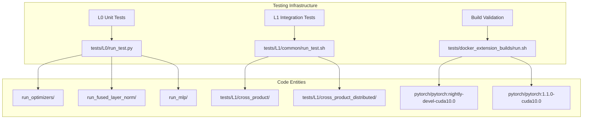
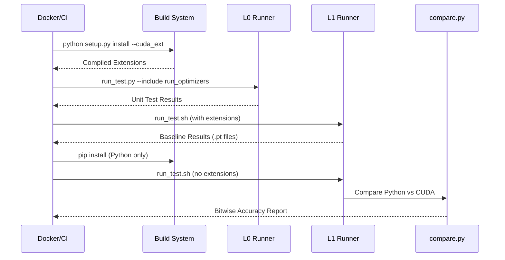

<!-- source: DeepWiki mcp.deepwiki.com · repo NVIDIA/apex · page 9 Testing Infrastructure · fetched 2026-10-26 -->

# Testing Infrastructure

Relevant source files

The following files were used as context for generating this wiki page:

- [tests/L0/run_test.py](tests/L0/run_test.py)
- [tests/L1/common/run_test.sh](tests/L1/common/run_test.sh)
- [tests/L1/cross_product/run.sh](tests/L1/cross_product/run.sh)
- [tests/L1/cross_product_distributed/run.sh](tests/L1/cross_product_distributed/run.sh)
- [tests/docker_extension_builds/run.sh](tests/docker_extension_builds/run.sh)

APEX employs a multi-tiered testing strategy designed to ensure the stability of its optimized CUDA kernels, the correctness of its Mixed Precision (AMP) logic, and compatibility across various PyTorch and CUDA environments. The infrastructure ranges from fast-running unit tests to comprehensive integration tests and multi-container build validation.

### Testing Strategy Overview

The testing infrastructure is divided into two primary levels of granularity, supplemented by environment-specific validation tools:

*   **L0 Tests**: High-speed unit tests that focus on individual components like optimizers and layer normalization. These are intended for rapid developer feedback.
*   **L1 Tests**: Integration tests that validate APEX features (like AMP and FusedAdam) within full training loops, often using models like ResNet-50.
*   **Docker Build Validation**: A matrix-based testing system that verifies the compilation of C++ and CUDA extensions across multiple versions of PyTorch and CUDA.
*   **Distributed Utilities**: Specialized infrastructure for launching and verifying multi-GPU operations.

For details on executing these suites and CI configuration, see [Test Suites and CI](#9.1).
For details on multi-GPU testing, see [Distributed Test Utilities](#9.2).

### Testing Components Mapping

The following diagram maps the logical testing tiers to the specific scripts and directories within the `tests/` directory.

**Testing Tier to Code Entity Mapping**

**Sources:** [tests/L0/run_test.py:20-30](), [tests/L1/common/run_test.sh:19-27](), [tests/docker_extension_builds/run.sh:15-21]()

---

### Test Suites and CI

APEX uses a tiered approach to ensure code quality. The **L0 suite** is the primary entry point for developers, utilizing a central runner `run_test.py` to discover and execute tests for core modules like `fused_layer_norm` and `optimizers` [tests/L0/run_test.py:21-30](). It supports generating JUnit XML reports for integration with CI systems [tests/L0/run_test.py:45-56]().

The **L1 suite** focuses on "cross-product" testing, which validates the intersection of different AMP `opt_level` settings (O0, O1, O2, O3) and loss scaling configurations [tests/L1/common/run_test.sh:44-49](). A critical feature of L1 is verifying **bitwise accuracy** between the Python-only implementations and the optimized C++/CUDA extensions [tests/L1/common/run_test.sh:118-138]().

To ensure that APEX remains buildable across the ecosystem, the `docker_extension_builds` script automates the installation of APEX with `--cuda_ext` and `--cpp_ext` across a matrix of official PyTorch Docker images [tests/docker_extension_builds/run.sh:32-49]().

For details, see [Test Suites and CI](#9.1).

**Sources:** [tests/L0/run_test.py:1-12](), [tests/L1/common/run_test.sh:56-60](), [tests/docker_extension_builds/run.sh:1-21]()

---

### Distributed Test Utilities

Testing distributed components requires specialized orchestration. APEX provides shell utilities and Python launchers to validate features like `DistributedDataParallel` and distributed optimizers. The infrastructure supports both single-node multi-GPU and multi-node configurations.

The L1 distributed suite uses `torch.distributed.launch` to execute training scripts (e.g., `main_amp.py`) across multiple processes [tests/L1/common/run_test.sh:24-27](). These tests verify that gradients are correctly synchronized and that the `DistributedFusedAdam` optimizer maintains parity with its non-distributed counterparts.

For details, see [Distributed Test Utilities](#9.2).

**Sources:** [tests/L1/common/run_test.sh:24-27](), [tests/L1/cross_product_distributed/run.sh:1-5]()

---

### Integration Workflow

The following diagram illustrates how the different testing layers interact during a typical validation cycle, from environment setup to accuracy verification.

**Validation Flow: From Build to Bitwise Accuracy**

**Sources:** [tests/L1/common/run_test.sh:56-144](), [tests/docker_extension_builds/run.sh:39-40](), [tests/L0/run_test.py:83-105]()

---

