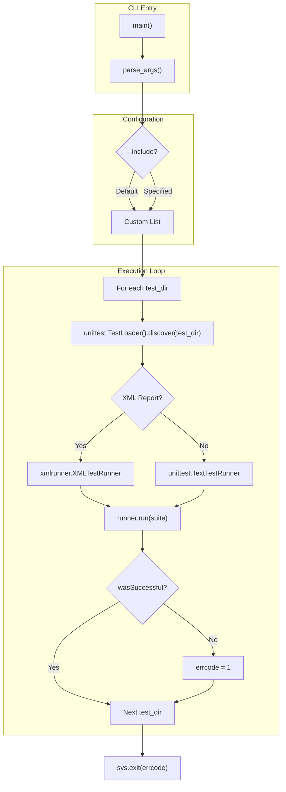
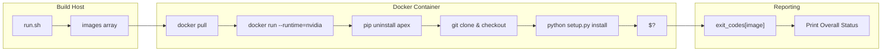
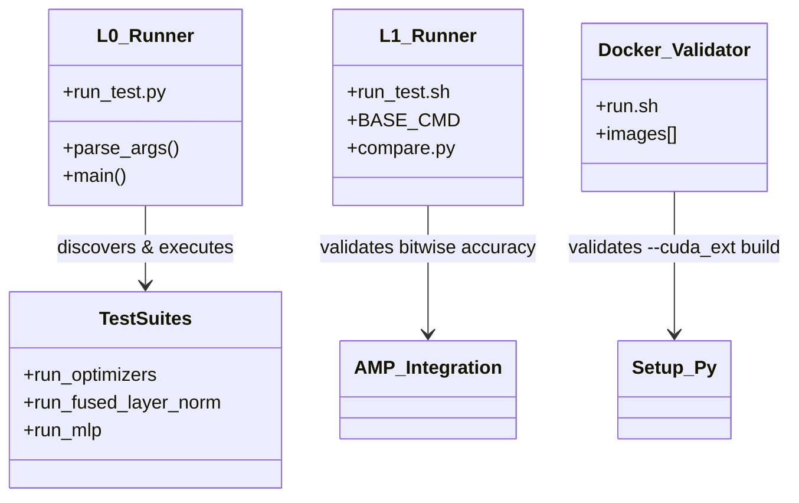

<!-- source: DeepWiki mcp.deepwiki.com · repo NVIDIA/apex · page 9.1 Test Suites and CI · fetched 2026-10-26 -->

# Test Suites and CI

Relevant source files

The following files were used as context for generating this wiki page:

- [tests/L0/run_test.py](tests/L0/run_test.py)
- [tests/L1/common/run_test.sh](tests/L1/common/run_test.sh)
- [tests/L1/cross_product/run.sh](tests/L1/cross_product/run.sh)
- [tests/L1/cross_product_distributed/run.sh](tests/L1/cross_product_distributed/run.sh)
- [tests/docker_extension_builds/run.sh](tests/docker_extension_builds/run.sh)

The APEX repository employs a multi-tiered testing strategy to ensure the stability of its optimized CUDA kernels, distributed training components, and Automatic Mixed Precision (AMP) features. The infrastructure is divided into low-level unit tests (L0), integration-level cross-product tests (L1), and Docker-based build validation to ensure compatibility across various PyTorch and CUDA versions.

## L0 Test Suite

The L0 suite represents the primary unit testing layer for APEX. These tests focus on individual components such as optimizers, fused layer normalization, and multi-layer perceptron (MLP) modules.

### Runner Implementation
The L0 suite is managed by a centralized Python runner [tests/L0/run_test.py:1-12](). It utilizes the standard `unittest` framework and provides support for generating JUnit XML reports via `xmlrunner` [tests/L0/run_test.py:72-75]().

The runner discovers and executes tests from specific subdirectories defined in the `TEST_DIRS` list [tests/L0/run_test.py:21-25]().

| Test Category | Directory | Description |
| :--- | :--- | :--- |
| **Optimizers** | `run_optimizers` | Validates `FusedAdam`, `FusedLAMB`, and other optimized optimizers. |
| **Normalization** | `run_fused_layer_norm` | Tests `FusedLayerNorm` and its variants. |
| **MLP** | `run_mlp` | Validates the fused MLP module implementations. |

### Execution Flow
The `main` function in the L0 runner iterates through the requested test directories, uses `unittest.TestLoader().discover()` to find test cases, and executes them using either `TextTestRunner` or `XMLTestRunner` [tests/L0/run_test.py:84-100]().

### L0 Runner Logic
The following diagram illustrates the data flow and execution logic of the L0 test runner.

**L0 Test Discovery and Execution**

Sources: [tests/L0/run_test.py:33-105]()

## L1 Test Suite

The L1 suite consists of "cross-product" integration tests. These tests are designed to validate the bitwise accuracy and functional correctness of APEX components (specifically AMP) across a wide matrix of configurations.

### Integration Matrix
The L1 tests execute an ImageNet training script (`main_amp.py`) using a ResNet50 model [tests/L1/common/run_test.sh:21](). The "cross-product" refers to the exhaustive testing of combinations of:
1. **Optimization Levels**: O0, O1, O2, O3 [tests/L1/common/run_test.sh:44-49]().
2. **Loss Scaling**: None, 1.0, 128.0, and dynamic [tests/L1/common/run_test.sh:37-42]().
3. **Batch Normalization**: FP32 vs. FP16 (keep-batchnorm-fp32) [tests/L1/common/run_test.sh:31-35]().
4. **Extension Status**: Comparison between C++/CUDA extension builds and pure-Python fallbacks [tests/L1/common/run_test.sh:118-138]().

### Bitwise Accuracy Validation
A critical component of the L1 suite is `compare.py`. The shell script `run_test.sh` performs the following sequence:
1. Installs APEX with `--cuda_ext` and `--cpp_ext` [tests/L1/common/run_test.sh:56-60]().
2. Runs the training matrix to generate baselines.
3. Reinstalls APEX without extensions [tests/L1/common/run_test.sh:93-97]().
4. Runs the training matrix again.
5. Invokes `compare.py` to ensure that the results between the extension-enabled and Python-only versions are bitwise identical [tests/L1/common/run_test.sh:134]().

### L1 Execution Modes
L1 tests can be run in two primary modes:
* **Single GPU**: Invoked via `tests/L1/cross_product/run.sh` [tests/L1/cross_product/run.sh:6]().
* **Distributed**: Invoked via `tests/L1/cross_product_distributed/run.sh`, which uses `torch.distributed.launch` with 2 processes per node [tests/L1/cross_product_distributed/run.sh:4](), [tests/L1/common/run_test.sh:26]().

Sources: [tests/L1/common/run_test.sh:19-145](), [tests/L1/cross_product/run.sh:1-7](), [tests/L1/cross_product_distributed/run.sh:1-5]()

## Docker Extension Build Validation

To ensure that APEX remains buildable across different environments, a Docker-based validation script is provided. This script tests the installation of APEX extensions (`--cuda_ext --cpp_ext`) against a matrix of official PyTorch Docker images.

### Build Matrix
The script `tests/docker_extension_builds/run.sh` iterates through several PyTorch versions and CUDA environments:
* `pytorch/pytorch:nightly-devel-cuda10.0-cudnn7`
* `pytorch/pytorch:1.1.0-cuda10.0-cudnn7.5-devel`
* `pytorch/pytorch:1.0.1-cuda10.0-cudnn7-devel`
* `pytorch/pytorch:1.0-cuda10.0-cudnn7-devel`
* `pytorch/pytorch:nightly-devel-cuda9.2-cudnn7`

### Build Process
For each image in the matrix, the script:
1. Pulls the Docker image [tests/docker_extension_builds/run.sh:36]().
2. Uninstalls any existing APEX versions.
3. Clones the repository and checks out the target branch (defaulting to `master`) [tests/docker_extension_builds/run.sh:39]().
4. Attempts a full extension build using `python setup.py install --cuda_ext --cpp_ext` [tests/docker_extension_builds/run.sh:39]().
5. Records the exit code to determine the overall status of the build matrix [tests/docker_extension_builds/run.sh:40-49]().

**Build Validation Workflow**

Sources: [tests/docker_extension_builds/run.sh:15-71]()

## CI Configuration

APEX utilizes GitHub Actions for automated CI. The CI configuration mirrors the logic found in the test runners, primarily focusing on the L0 suite and build validation.

### Data Flow for CI Testing
The following diagram maps the relationship between the shell/Python scripts and the testing infrastructure.

**CI Entity Relationship**

Sources: [tests/L0/run_test.py:21-30](), [tests/L1/common/run_test.sh:19-27](), [tests/docker_extension_builds/run.sh:39]()

---

