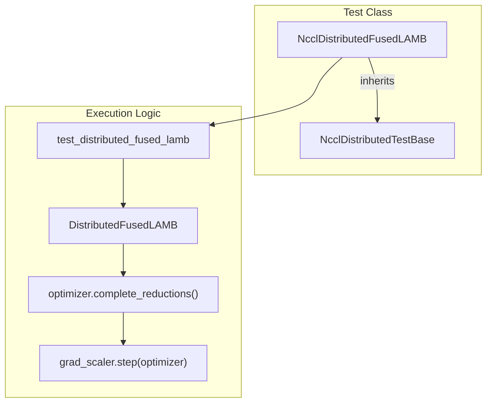

<!-- source: DeepWiki mcp.deepwiki.com · repo NVIDIA/apex · page 9.2 Distributed Test Utilities · fetched 2026-10-26 -->

# Distributed Test Utilities

<details>
<summary>Relevant source files</summary>

The following files were used as context for generating this wiki page:

- [apex/contrib/test/bottleneck/test_bottleneck_module.py](apex/contrib/test/bottleneck/test_bottleneck_module.py)
- [apex/contrib/test/optimizers/test_distributed_fused_lamb.py](apex/contrib/test/optimizers/test_distributed_fused_lamb.py)
- [apex/contrib/test/peer_memory/test_peer_halo_exchange_module.py](apex/contrib/test/peer_memory/test_peer_halo_exchange_module.py)
- [apex/distributed_testing/__init__.py](apex/distributed_testing/__init__.py)
- [apex/distributed_testing/_ucc_util.py](apex/distributed_testing/_ucc_util.py)
- [apex/distributed_testing/distributed_test_base.py](apex/distributed_testing/distributed_test_base.py)
- [requirements.txt](requirements.txt)

</details>


Distributed testing utilities in APEX provide a standardized framework for validating multi-GPU kernels and distributed algorithms. By extending PyTorch's internal testing infrastructure, these utilities automate the boilerplate of process spawning, process group initialization, and device management, allowing developers to focus on the correctness of distributed operations like halo exchanges or sharded optimizers.

## Core Infrastructure

The testing infrastructure is built upon `torch.testing._internal.common_distributed.MultiProcessTestCase`, which handles the complexities of spawning multiple Python processes to simulate a distributed environment on a single node.

### DistributedTestBase
The `DistributedTestBase` class is the primary abstraction for all distributed tests in APEX. It manages the lifecycle of a distributed test run, including pre-spawn configuration, process initialization, and cleanup.

| Feature | Implementation Detail |
| :--- | :--- |
| **Process Spawning** | Managed via `_spawn_processes` in the `setUp` phase [apex/distributed_testing/distributed_test_base.py:28-32](). |
| **World Size** | Defaults to the minimum of available CUDA devices or 4 [apex/distributed_testing/distributed_test_base.py:38-40](). |
| **Process Group** | Initialized using `dist.init_process_group` with the specified `DISTRIBUTED_BACKEND` [apex/distributed_testing/distributed_test_base.py:61-66](). |
| **Device Assignment** | Automatically sets the CUDA device based on the process rank [apex/distributed_testing/distributed_test_base.py:73-73](). |

### Backend Specializations
APEX provides specialized base classes for different communication backends:
*   **`NcclDistributedTestBase`**: Sets `DISTRIBUTED_BACKEND = "nccl"` for standard NVIDIA collective testing [apex/distributed_testing/distributed_test_base.py:86-87]().
*   **`UccDistributedTestBase`**: Sets `DISTRIBUTED_BACKEND = "ucc"`. It includes additional logic to configure `UCX_TLS` (defaulting to `tcp,cuda`) and manage `MASTER_PORT` for the Unified Collective Communication (UCC) framework [apex/distributed_testing/distributed_test_base.py:99-121]().

**Sources:** [apex/distributed_testing/distributed_test_base.py:24-101](), [apex/distributed_testing/__init__.py:3-13]()

## UCC Utilities

APEX includes specific checks for UCC compatibility, as it requires specific NVIDIA driver versions and environment configurations to function correctly within the PyTorch ecosystem.

### Compatibility Checks
The system verifies UCC availability through `dist.is_ucc_available()` or by attempting to import `torch_ucc` [apex/distributed_testing/_ucc_util.py:3-10](). Furthermore, `UccDistributedTestBase` is skipped unless the NVIDIA driver version is at least `470.42.01`, avoiding known issues with older drivers [apex/distributed_testing/distributed_test_base.py:14-21]().

**Sources:** [apex/distributed_testing/_ucc_util.py:1-11](), [apex/distributed_testing/distributed_test_base.py:14-21]()

## Implementation Flow

The following diagram illustrates the lifecycle of a distributed test, from the test runner spawning processes to the execution of the actual test logic on individual GPUs.

**Distributed Test Lifecycle**
```mermaid
sequenceDiagram
    participant TR as Test Runner (Main)
    participant P0 as Process Rank 0 (GPU 0)
    participant P1 as Process Rank 1 (GPU 1)
    
    TR->>TR: setUp()
    TR->>TR: _spawn_processes()
    create participant P0
    TR->>P0: _run(rank=0)
    create participant P1
    TR->>P1: _run(rank=1)
    
    par Rank 0 Initialization
        P0->>P0: dist.init_process_group(backend="nccl")
        P0->>P0: torch.cuda.set_device(0)
    and Rank 1 Initialization
        P1->>P1: dist.init_process_group(backend="nccl")
        P1->>P1: torch.cuda.set_device(1)
    end
    
    P0->>P1: dist.barrier()
    
    Note over P0,P1: run_test(test_name)
    
    P0->>P1: dist.barrier()
    P0->>P0: dist.destroy_process_group()
    P1->>P1: dist.destroy_process_group()
```
**Sources:** [apex/distributed_testing/distributed_test_base.py:51-80]()

## Writing Multi-GPU Tests

To write a distributed test, a class must inherit from `NcclDistributedTestBase` and implement test methods that use standard `torch.distributed` collectives.

### Example: Distributed Optimizer Validation
Tests for complex components like `DistributedFusedLAMB` use the base class to ensure that gradients are correctly reduced across ranks and that the loss decreases consistently across iterations.

**Code Entity Mapping: Optimizer Testing**


In `test_distributed_fused_lamb`, the test performs the following steps:
1.  **Model Sync**: Broadcasts initial weights from Rank 0 to all other ranks using `torch.distributed.broadcast` [apex/contrib/test/optimizers/test_distributed_fused_lamb.py:131-135]().
2.  **Distributed Step**: Calls `optimizer.complete_reductions()` to finalize the asynchronous gradient aggregation across GPUs [apex/contrib/test/optimizers/test_distributed_fused_lamb.py:147-147]().
3.  **Convergence Check**: Validates that the loss list is sorted in descending order, ensuring the distributed optimizer is effectively training the model [apex/contrib/test/optimizers/test_distributed_fused_lamb.py:155-155]().

### Example: Halo Exchange Validation
For spatial parallelism, tests compare the output of optimized peer-memory kernels against a "Ground Truth" implementation that uses standard NCCL `all_gather` calls [apex/contrib/test/peer_memory/test_peer_halo_exchange_module.py:19-23]().

**Sources:** [apex/contrib/test/optimizers/test_distributed_fused_lamb.py:45-155](), [apex/contrib/test/peer_memory/test_peer_halo_exchange_module.py:19-73]()

## Utility Functions for Comparison

APEX distributed tests frequently use helper functions to verify numerical consistency across ranks:

| Function | Purpose |
| :--- | :--- |
| `rel_diff` | Calculates the relative difference between two tensors or collections of tensors [apex/contrib/test/bottleneck/test_bottleneck_module.py:55-61](). |
| `has_nan` | Recursively checks for `NaN` values in tensors, lists, or dictionaries [apex/contrib/test/bottleneck/test_bottleneck_module.py:35-46](). |
| `compare` | Iterates through ranks and prints the relative differences for forward/backward results to identify specific rank failures [apex/contrib/test/bottleneck/test_bottleneck_module.py:137-149](). |

**Sources:** [apex/contrib/test/bottleneck/test_bottleneck_module.py:35-149]()

---

