# Page: Overview

# Overview

<details>
<summary>Relevant source files</summary>

The following files were used as context for generating this wiki page:

- [README.md](README.md)
- [apex/__init__.py](apex/__init__.py)
- [docs/source/index.rst](docs/source/index.rst)
- [setup.py](setup.py)

</details>


APEX (A PyTorch Extension) is a repository of NVIDIA-maintained utilities designed to streamline mixed precision and distributed training in PyTorch [README.md:1-5](). The primary goal of APEX is to provide users with the most up-to-date performance optimizations—many of which are eventually integrated into upstream PyTorch—as quickly as possible [docs/source/index.rst:11-13]().

By leveraging custom CUDA and C++ extensions, APEX accelerates training through fused kernels, efficient communication protocols, and memory-optimized operations that are not yet available in the standard PyTorch distribution.

### Core System Architecture

The library is organized into several functional domains, ranging from high-level training wrappers to low-level CUDA kernel implementations.

| System | Primary Role | Key Components |
| :--- | :--- | :--- |
| **AMP** | Mixed Precision | `apex.amp` [README.md:80]() |
| **Parallel** | Distributed Training | `DistributedDataParallel`, `SyncBatchNorm` [README.md:79-80]() |
| **Optimizers** | Fused Kernels | `FusedAdam`, `FusedLAMB`, `DistributedFusedAdam` [setup.py:29-30, 110-111]() |
| **Normalization** | Optimized Layers | `FusedLayerNorm`, `FusedRMSNorm`, `GroupNorm` [setup.py:28, 32, 99]() |
| **Contrib** | Experimental/Specialized | `fmha`, `transducer`, `nccl_allocator` [setup.py:37, 40, 46]() |

**Sources:** [README.md:1-5](), [README.md:76-81](), [docs/source/index.rst:11-13](), [setup.py:24-48]()

### High-Level Subsystems

#### 1. Automatic Mixed Precision (AMP)
AMP provides a suite of tools to enable mixed-precision training with minimal code changes. It handles the complexities of tensor type casting and dynamic loss scaling to maintain numerical stability while utilizing the speed of Tensor Cores.
*   For details, see [Automatic Mixed Precision (AMP)](#2).

#### 2. Distributed Training
APEX offers optimized versions of distributed primitives. This includes `apex.parallel.DistributedDataParallel`, which is designed to overlap communication with computation more effectively than early versions of native PyTorch DDP, and `SyncBatchNorm` for cross-GPU batch normalization.
*   For details, see [Distributed Training](#3).

#### 3. Optimized Optimizers and Components
The library contains "fused" implementations of popular optimizers (like Adam and LAMB) and layers (like LayerNorm). Fusion combines multiple mathematical operations into a single CUDA kernel launch, significantly reducing memory bandwidth bottlenecks and CPU-GPU synchronization overhead [apex/__init__.py:7-13]().
*   For details, see [Optimized Optimizers](#4) and [Optimized Neural Network Components](#5).

#### 4. Automatic SParsity (ASP)
ASP provides a toolkit for 2:4 structured sparsity, allowing users to prune weights and accelerate inference and training on compatible NVIDIA architectures.
*   For details, see [Sparsity and Weight Pruning](#7).

### Code Entity Mapping

The following diagram bridges the high-level functional areas to the specific code entities and build flags defined in the repository.

**System to Code Entity Mapping**
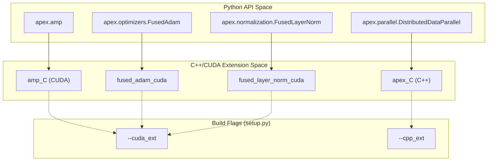
**Sources:** [setup.py:24-30](), [setup.py:168-171](), [README.md:94-112](), [apex/__init__.py:7-15]()

### Installation and Build Configuration

APEX is highly configurable during installation. While it supports a Python-only build, the performance benefits are primarily realized through its C++ and CUDA extensions [README.md:72-81]().

**Extension Dependencies**
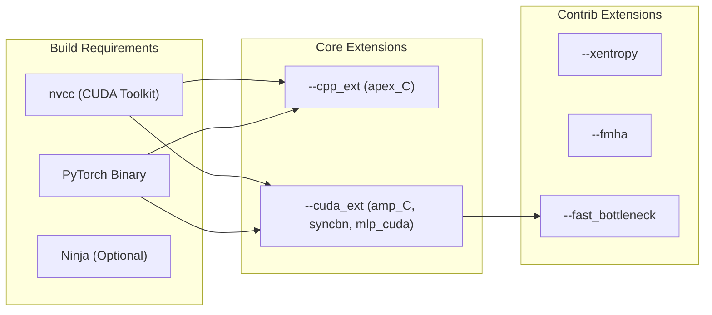
**Sources:** [setup.py:12-18](), [setup.py:56-57](), [README.md:26-38](), [README.md:94-120]()

*   For detailed installation instructions, environment variables, and build flags, see [Installation Guide](#1.1).

---

# Page: Installation Guide

# Installation Guide

<details>
<summary>Relevant source files</summary>

The following files were used as context for generating this wiki page:

- [README.md](README.md)
- [docs/source/index.rst](docs/source/index.rst)
- [examples/README.md](examples/README.md)
- [examples/docker/Dockerfile](examples/docker/Dockerfile)
- [examples/docker/README.md](examples/docker/README.md)
- [setup.py](setup.py)

</details>


This page provides detailed instructions for installing APEX (A PyTorch Extension). APEX is designed to provide NVIDIA-maintained utilities that streamline mixed-precision and distributed training. Because APEX relies heavily on custom CUDA and C++ extensions to achieve maximum performance, the installation process involves compiling these kernels against your local PyTorch and CUDA environments.

## Installation Methods

APEX supports three primary installation paths:
1.  **NVIDIA PyTorch Containers (Recommended)**: Pre-installed and tested environments available via NVIDIA GPU Cloud (NGC).
2.  **From Source with Extensions**: Compiles C++/CUDA kernels for maximum performance.
3.  **Python-only**: A fallback for environments where compilation is not possible.

### 1. NVIDIA PyTorch Containers
The simplest way to use APEX is through the [NVIDIA PyTorch Containers](https://catalog.ngc.nvidia.com/orgs/nvidia/containers/pytorch). These containers come with all custom extensions pre-compiled and verified [README.md:11-13]().

### 2. Installation from Source (Linux)
To install from source, it is recommended to use the latest stable or nightly version of PyTorch [README.md:22-24](). Using `Ninja` is highly recommended to accelerate the compilation process [README.md:26-26]().

#### Recommended: Environment Variables
The modern way to specify build options is via environment variables. This method is PEP 517 compatible [setup.py:23-24]().

```bash
git clone https://github.com/NVIDIA/apex
cd apex
# Build with core extensions (cpp and cuda)
APEX_CPP_EXT=1 APEX_CUDA_EXT=1 pip install -v --no-build-isolation .

# Build with all experimental contrib extensions
APEX_CPP_EXT=1 APEX_CUDA_EXT=1 APEX_ALL_CONTRIB_EXT=1 pip install -v --no-build-isolation .
```
Sources: [README.md:32-45](), [setup.py:24-48]()

#### Legacy: Command-Line Flags
Traditional flags are still supported via `pip` config settings or global options [README.md:55-68]().

```bash
pip install -v --no-build-isolation --config-settings "--build-option=--cpp_ext" --config-settings "--build-option=--cuda_ext" .
```

### 3. Python-Only Build
If you do not require fused kernels or cannot compile them, you can perform a Python-only install:
```bash
pip install -v --no-build-isolation --no-cache-dir .
```
**Warning**: A Python-only build lacks optimized kernels for `FusedAdam`, `FusedLayerNorm`, and optimized `SyncBatchNorm`. While `amp` and `DistributedDataParallel` will still function, they will experience significantly lower performance [README.md:72-81]().

---

## Build Configuration & Flags

The APEX `setup.py` maps environment variables and command-line flags to specific C++/CUDA extensions.

### Core Extensions
| Flag | Env Var | Extension Name | Description |
| :--- | :--- | :--- | :--- |
| `--cpp_ext` | `APEX_CPP_EXT` | `apex_C` | Basic C++ utilities (flatten/unflatten) [setup.py:168-171]() |
| `--cuda_ext` | `APEX_CUDA_EXT` | `amp_C`, `syncbn`, `fused_layer_norm_cuda`, `mlp_cuda` | Core CUDA kernels for AMP, SyncBN, and LayerNorm [README.md:97-100]() |

### Contrib & Experimental Extensions
These modules often require specific CUDA or cuDNN versions.

| Flag | Env Var | Functionality | Requirements |
| :--- | :--- | :--- | :--- |
| `--xentropy` | `APEX_XENTROPY` | Fused Softmax Cross Entropy | |
| `--fast_layer_norm` | `APEX_FAST_LAYER_NORM` | Optimized LayerNorm variant | |
| `--fmha` | `APEX_FMHA` | Fused Multi-Head Attention | |
| `--distributed_adam` | `APEX_DISTRIBUTED_ADAM` | Sharded Fused Adam | |
| `--cudnn_gbn` | `APEX_CUDNN_GBN` | cuDNN Group Batch Norm | cuDNN >= 8.5 [README.md:117]() |
| `--transducer` | `APEX_TRANSDUCER` | Transducer Joint/Loss kernels | |

Sources: [setup.py:24-48](), [README.md:94-125]()

---

## System Requirements & Implementation

### CUDA Version Matching
APEX enforces a strict check between the CUDA version used to compile PyTorch and the "bare metal" CUDA version found on the system via `nvcc`. A mismatch will raise a `RuntimeError` during installation [setup.py:77-92]().

### Cross-Compilation & GPU Architectures
If no GPU is detected during installation (e.g., inside a Docker build stage), APEX attempts to cross-compile for a range of architectures based on the CUDA version [setup.py:117-127]().

### Logic Flow: Build Extension Selection
The following diagram illustrates how `setup.py` processes flags to determine which extensions to build.

**Diagram: Extension Selection Logic**
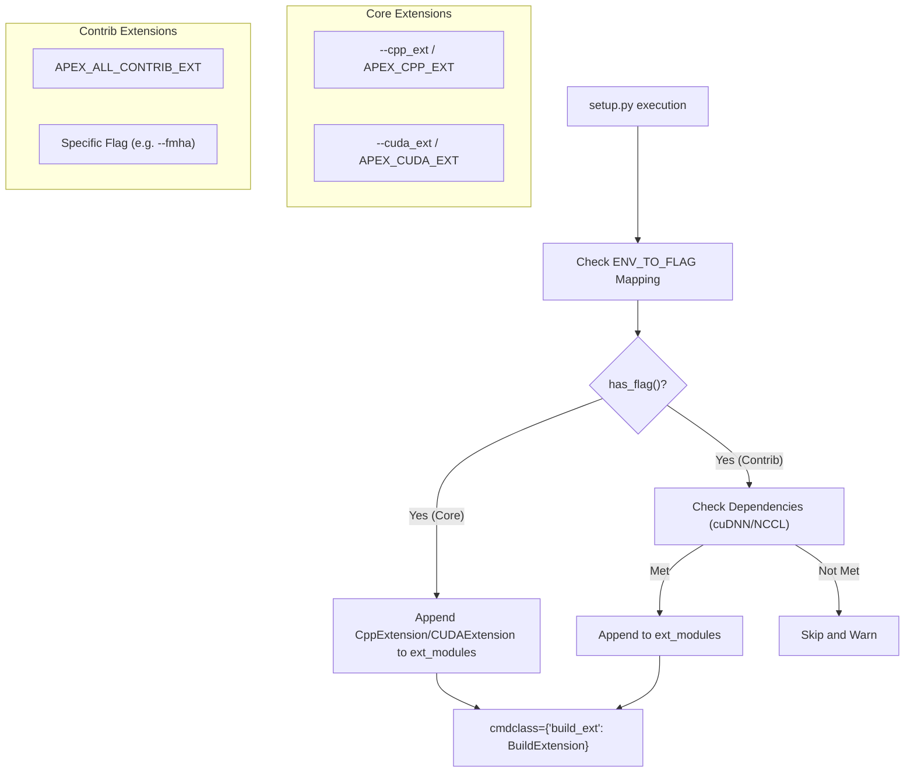
Sources: [setup.py:24-65](), [setup.py:155-171]()

---

## Troubleshooting

### Common Issues

1.  **`nvcc` Not Found**: 
    If you receive an error that `nvcc` was not found while requesting CUDA extensions, ensure your `PATH` includes the CUDA bin directory. If using Docker, ensure you are using a `-devel` image (e.g., `pytorch/pytorch:2.0.1-cuda11.7-cudnn8-devel`) rather than a runtime image [setup.py:95-102](), [examples/docker/README.md:20-22]().

2.  **Version Mismatch**:
    If `bare_metal_version != torch_binary_version`, APEX will stop. This is because CUDA extensions are sensitive to the underlying toolchain. You can override this by editing `setup.py` at your own risk, but it is recommended to align your environment [setup.py:84-92]().

3.  **Parallel Build Failures**:
    When memory is limited, high parallelism can cause OOM during compilation. Use `APEX_PARALLEL_BUILD` to limit the number of parallel jobs [README.md:47-53]().

### Build Dependency Mapping
The following diagram bridges the user-facing install flags to the internal Python classes and C++ source files.

**Diagram: Build Flag to Code Entity Mapping**
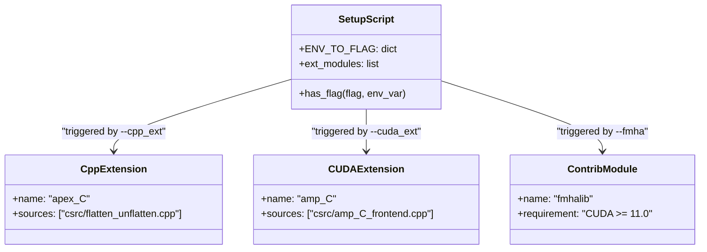
Sources: [setup.py:24-48](), [setup.py:168-171](), [README.md:113]()

---

## Installation for Developers

### Parallel Building
To speed up installation on multi-core systems:
```bash
NVCC_APPEND_FLAGS="--threads 4" APEX_PARALLEL_BUILD=8 pip install -v --no-build-isolation .
```
Sources: [README.md:50]()

### Docker Integration
To include APEX in a custom Docker image, use a multi-stage build or install it on top of a base image that includes `nvcc`.
*   **Base Image**: Must be a `-devel` variant [examples/docker/README.md:11-13]().
*   **Uninstallation**: Always `pip uninstall apex` before a fresh install to avoid stale metadata [examples/docker/Dockerfile:9-10]().

Sources: [examples/docker/Dockerfile:1-17](), [examples/docker/README.md:1-22]()

---

# Page: AMP Usage Guide

# AMP Usage Guide

<details>
<summary>Relevant source files</summary>

The following files were used as context for generating this wiki page:

- [examples/imagenet/README.md](examples/imagenet/README.md)
- [examples/imagenet/main_amp.py](examples/imagenet/main_amp.py)
- [examples/simple/distributed/README.md](examples/simple/distributed/README.md)
- [examples/simple/distributed/distributed_data_parallel.py](examples/simple/distributed/distributed_data_parallel.py)
- [examples/simple/distributed/run.sh](examples/simple/distributed/run.sh)

</details>


Automatic Mixed Precision (AMP) in APEX is designed to accelerate PyTorch training by using lower-precision floating-point formats (FP16) for compute-intensive operations while maintaining FP32 precision for numerically sensitive parts of the network. This guide details the implementation and usage of the AMP API.

## Core Integration Pattern

Enabling AMP in an existing PyTorch script requires three primary modifications to the training loop. Unlike manual casting, the AMP API manages tensor types and loss scaling automatically.

1.  **Initialization**: Call `amp.initialize` after defining the model and optimizer [examples/imagenet/README.md:7-9]().
2.  **Loss Scaling**: Wrap the backward pass with the `amp.scale_loss` context manager [examples/imagenet/README.md:11-13]().
3.  **No Explicit Casting**: Do not call `.half()` on the model or data; AMP handles casting based on the chosen optimization level [examples/imagenet/README.md:16-17]().

### System Data Flow

The following diagram illustrates how `amp.initialize` and `amp.scale_loss` intercept the standard PyTorch training flow to manage precision and gradients.

**AMP Training Loop Integration**
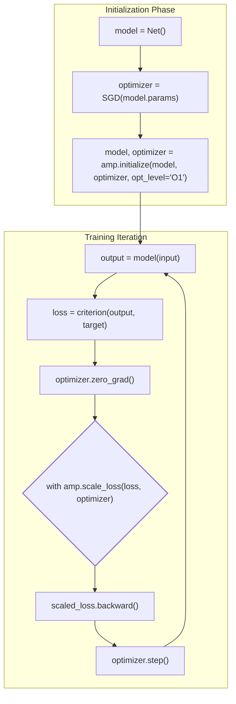
**Sources:** [examples/imagenet/README.md:7-14](), [examples/simple/distributed/distributed_data_parallel.py:40-62]()

---

## Optimization Levels (`opt_level`)

AMP provides four optimization levels that define the "recipe" for mixed precision. These are passed as the `opt_level` argument to `amp.initialize`.

| Level | Name | Description | Recommended Use |
| :--- | :--- | :--- | :--- |
| **O0** | FP32 Training | Pure FP32 precision. Useful as a baseline for accuracy. [examples/imagenet/README.md:65-67]() | Debugging / Baseline |
| **O1** | Mixed Precision | **Recommended.** Patches Torch functions to use a whitelist/blacklist. Tensor Core ops (convolutions, GEMMs) run in FP16; sensitive ops (Softmax, BatchNorm) run in FP32. [examples/imagenet/README.md:87-95]() | Most Use Cases |
| **O2** | "Almost" FP16 | Casts model to FP16 but keeps BatchNorm in FP32. Maintains FP32 master weights. Does not patch functions. [examples/imagenet/README.md:108-118]() | Internal/Specific Needs |
| **O3** | Pure FP16 | Full FP16 training. Often unstable for convergence but useful for "speed of light" benchmarks. [examples/imagenet/README.md:69-72]() | Performance Profiling |

### Performance Tuning with O3
For ResNet architectures, `O3` performance can be optimized by setting `keep_batchnorm_fp32=True`. This allows the use of optimized cuDNN batchnorm kernels, which require FP32 inputs [examples/imagenet/README.md:73-85]().

**Sources:** [examples/imagenet/README.md:36-126](), [examples/imagenet/main_amp.py:85-87]()

---

## Loss Scaling

Loss scaling is critical for FP16 training to prevent underflow of small gradient values. 

*   **Dynamic Loss Scaling**: Enabled by default for `O1` and `O2`. The scaler automatically adjusts the scale factor based on whether overflows (NaNs/Infs) are detected [examples/imagenet/README.md:36-37]().
*   **Static Loss Scaling**: Can be manually set via the `loss_scale` argument (e.g., `loss_scale=128.0`) [examples/imagenet/README.md:96-99]().
*   **Context Manager**: `amp.scale_loss` ensures that gradients are unscaled before the optimizer updates the weights, preventing the scale factor from affecting the learning rate [examples/imagenet/README.md:11-13]().

**Sources:** [examples/imagenet/README.md:36-40](), [examples/imagenet/main_amp.py:87]()

---

## Distributed Training Integration

AMP is compatible with both `torch.nn.parallel.DistributedDataParallel` and `apex.parallel.DistributedDataParallel`. 

### Critical Execution Order
When using Distributed Data Parallel (DDP), the model must be initialized with AMP **before** being wrapped by the DDP constructor. Failure to follow this order may result in errors or degraded performance [examples/simple/distributed/distributed_data_parallel.py:43-48](), [examples/simple/distributed/README.md:6-8]().

**Code Entity Relationship: AMP and DDP**
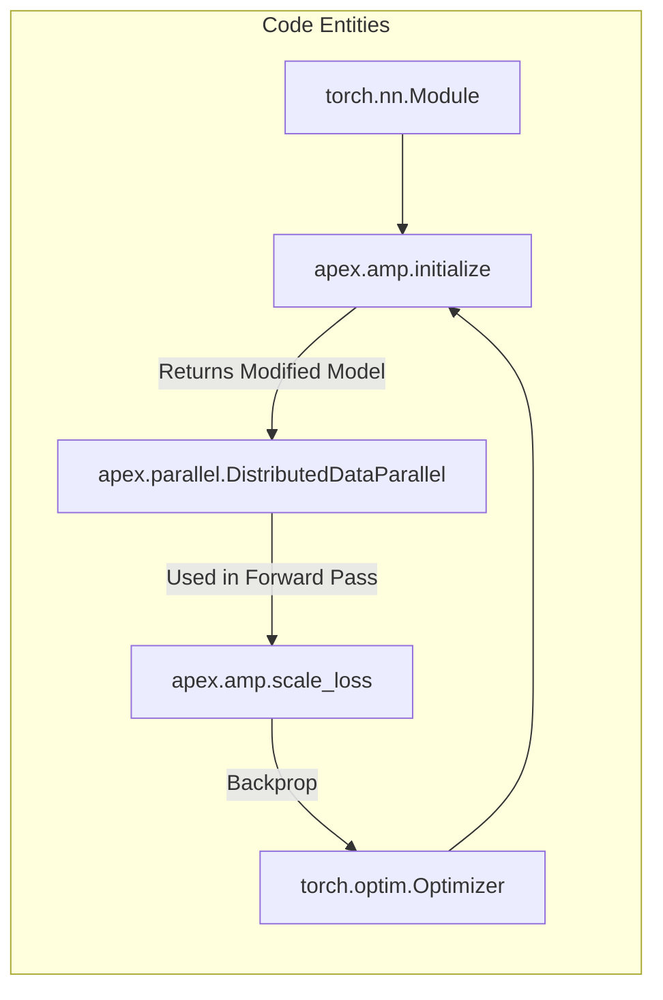

### Usage Example
In a multi-GPU environment, each process should manage its own AMP state.
1. Initialize the process group via `torch.distributed.init_process_group` [examples/simple/distributed/distributed_data_parallel.py:24-27]().
2. Set the device for the local rank [examples/simple/distributed/distributed_data_parallel.py:20-22]().
3. Call `amp.initialize` [examples/simple/distributed/distributed_data_parallel.py:43]().
4. Wrap with `DistributedDataParallel` [examples/simple/distributed/distributed_data_parallel.py:48]().

**Sources:** [examples/simple/distributed/distributed_data_parallel.py:14-53](), [examples/simple/distributed/README.md:1-12](), [examples/imagenet/main_amp.py:152-153]()

---

# Page: AMP Internals

# AMP Internals

<details>
<summary>Relevant source files</summary>

The following files were used as context for generating this wiki page:

- [apex/optimizers/fused_sgd.py](apex/optimizers/fused_sgd.py)
- [csrc/multi_tensor_sgd_kernel.cu](csrc/multi_tensor_sgd_kernel.cu)

</details>


Automatic Mixed Precision (AMP) in APEX is designed to automate the process of using lower-precision (FP16) arithmetic while maintaining the numerical stability of FP32. It achieves this through dynamic type casting and loss scaling. This page details the internal mechanisms that govern how AMP intercepts function calls, manages master weights, and implements efficient gradient updates.

## Core Mechanisms

AMP operates by wrapping PyTorch functions and methods to insert cast operations dynamically based on a predefined set of rules (whitelist, blacklist, etc.).

### Type Casting and Function Wrapping
When `amp.initialize` is called, AMP modifies the namespace of `torch`, `torch.nn.functional`, and `tensor` methods. It replaces standard operations with "wrapped" versions that check the input types and cast them to the appropriate precision before execution.

*   **Whitelist:** Operations that are safe and faster in FP16 (e.g., `conv2d`, `linear`).
*   **Blacklist:** Operations that are numerically sensitive and must stay in FP32 (e.g., `exp`, `log`, `softmax`).
*   **Allow-list:** Operations that should match the precision of the widest input.

### Master Weight Management
To prevent precision loss during weight updates, AMP (specifically in `O2` optimization level) maintains a set of FP32 "master weights."
1.  **Forward Pass:** Model uses FP16 weights.
2.  **Backward Pass:** Gradients are computed in FP16.
3.  **Optimizer Step:** FP16 gradients are applied to FP32 master weights.
4.  **Synchronization:** The updated FP32 master weights are copied back to the FP16 model weights for the next iteration.

### Data Flow of an AMP-Optimized Step

The following diagram illustrates the interaction between the model, the optimizer, and the `amp_stash` which stores the precision-related metadata.

**AMP Gradient Update Flow**
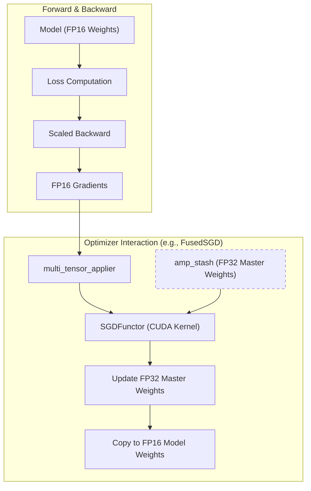
**Sources:** [apex/optimizers/fused_sgd.py:165-180](), [csrc/multi_tensor_sgd_kernel.cu:28-54]()

---

## Loss Scaling Implementation

Loss scaling is critical to prevent FP16 gradients from "underflowing" (becoming zero). AMP scales the loss by a factor $S$ before the backward pass, causing gradients to be scaled by $S$ as well.

### The Scaler Logic
The `LossScaler` (or the internal logic within `amp`) performs the following:
1.  **Scale:** Multiplies the loss by the current scale factor.
2.  **Unscale:** Before the optimizer updates the weights, gradients are divided by the scale factor.
3.  **Overflow Check:** If any gradient contains `NaN` or `Inf`, the optimizer step is skipped, and the scale factor is reduced.
4.  **Scale Update:** If no overflows occur for a certain number of steps, the scale factor is increased.

In optimized kernels like `FusedSGD`, the unscaling is often fused directly into the update kernel to save memory bandwidth.

| Feature | Implementation Detail |
| :--- | :--- |
| **Overflow Detection** | Uses a `noop_flag` on the GPU to signal if a `NaN/Inf` was found during the kernel execution [csrc/multi_tensor_sgd_kernel.cu:30-34](). |
| **Fused Unscaling** | The `scale` factor is passed directly to the CUDA kernel and applied during the gradient load [csrc/multi_tensor_sgd_kernel.cu:69](). |
| **Master Gradients** | Can optionally materialize FP32 gradients from FP16 versions during the update [apex/optimizers/fused_sgd.py:108](). |

**Sources:** [apex/optimizers/fused_sgd.py:107-111](), [csrc/multi_tensor_sgd_kernel.cu:116-118]()

---

## Optimizer Internals: FusedSGD and AMP

APEX optimizers like `FusedSGD` are designed to work seamlessly with AMP by handling the three primary data type combinations encountered in mixed-precision training.

### Precision Combinations
The optimizer must handle the following scenarios, as defined in the `FusedSGD` implementation:

| Case | Grad Type | Param Type | Momentum Type | Model Copy Required? |
| :--- | :--- | :--- | :--- | :--- |
| 1 | FP16 | FP16 | FP16 | No |
| 2 | FP32 | FP32 | FP32 | No |
| 3 | FP16 | FP32 | FP32 | Yes (Master Weights) |

**Sources:** [apex/optimizers/fused_sgd.py:175-180](), [csrc/multi_tensor_sgd_kernel.cu:131-136]()

### Multi-Tensor Integration
AMP leverages the `multi_tensor_applier` to process all parameters in a few kernel launches. The `SGDFunctor` in the CUDA backend accepts a `TensorListMetadata` structure containing addresses for gradients, weights, and momentum buffers.

**Code Entity Mapping: FusedSGD to CUDA Kernel**
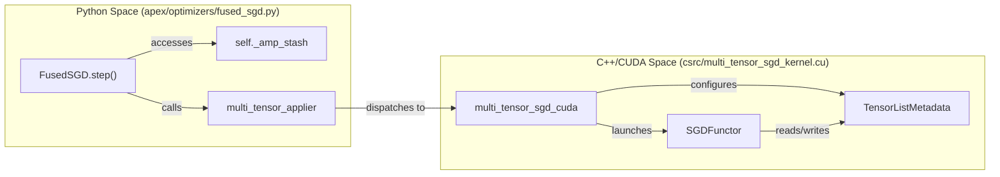
**Sources:** [apex/optimizers/fused_sgd.py:184-200](), [csrc/multi_tensor_sgd_kernel.cu:116-120](), [csrc/multi_tensor_sgd_kernel.cu:28-32]()

### Fused SGD Kernel Logic
The `SGDFunctor` implements the update logic directly in CUDA. It handles weight decay, momentum, and Nesterov momentum while accounting for the AMP scale factor.

1.  **Load:** Gradients are loaded and multiplied by the `scale` (unscaling) [csrc/multi_tensor_sgd_kernel.cu:69]().
2.  **Weight Decay:** Applied either before or after momentum based on `wd_after_momentum` [csrc/multi_tensor_sgd_kernel.cu:85]().
3.  **Momentum Update:** $v = \rho * v + (1 - dampening) * g$ [csrc/multi_tensor_sgd_kernel.cu:89]().
4.  **Weight Update:** $p = p - lr * g_{final}$ [csrc/multi_tensor_sgd_kernel.cu:103]().
5.  **FP16 Sync:** If master weights are used (Case 3/4), the updated FP32 weight is cast to FP16 and written to the model weight buffer [csrc/multi_tensor_sgd_kernel.cu:106]().

**Sources:** [csrc/multi_tensor_sgd_kernel.cu:81-111]()

---

# Page: Legacy FP16 Utilities

# Legacy FP16 Utilities

<details>
<summary>Relevant source files</summary>

The following files were used as context for generating this wiki page:

- [apex/optimizers/__init__.py](apex/optimizers/__init__.py)
- [docs/source/conf.py](docs/source/conf.py)
- [tests/L0/run_optimizers/__init__.py](tests/L0/run_optimizers/__init__.py)

</details>


The `apex.fp16_utils` module contains the original suite of tools developed by NVIDIA to facilitate mixed-precision training in PyTorch. While largely superseded by the `apex.amp` (Automatic Mixed Precision) API, these utilities remain part of the codebase for legacy support and for users who require manual, fine-grained control over master weight management and loss scaling.

## Overview and Comparison with AMP

The legacy utilities require the user to manually handle model casting, input casting, and the wrapping of optimizers. In contrast, the modern AMP API automates these processes via `amp.initialize`.

| Feature | Legacy (`fp16_utils`) | Modern (`amp`) |
| :--- | :--- | :--- |
| **Weight Management** | Manual `FP16Optimizer` wrapping | Automatic via `O1`/`O2` levels |
| **Type Casting** | Manual `.half()` calls on model/inputs | Automatic via `autocast` or `O1` |
| **Loss Scaling** | `LossScaler` class (Manual) | `amp.scale_loss` (Automatic) |
| **Master Weights** | Explicitly managed in `FP16Optimizer` | Transparently handled |

**Sources:** [apex/optimizers/__init__.py:1-6]()

---

## Key Components

### FP16Optimizer
The `FP16Optimizer` is a wrapper designed to manage a model's parameters in FP16 while maintaining a "master copy" in FP32. This ensures that small gradient updates are not lost due to the limited precision of FP16 (underflow).

**Implementation Logic:**
1.  **Initialization**: It takes an existing FP32 optimizer and a list of FP16 parameters.
2.  **Master Weights**: It creates a copy of all model parameters in FP32.
3.  **Step Process**:
    *   Gradients are computed in FP16.
    *   Gradients are copied/cast to the FP32 master weights.
    *   The wrapped optimizer performs the update on the FP32 master weights.
    *   The updated FP32 weights are copied back into the FP16 model parameters.

### LossScaler
The `LossScaler` handles dynamic or static scaling of the loss to prevent gradient underflow.

*   **Static Scaling**: Multiplies the loss by a fixed factor.
*   **Dynamic Scaling**: Starts with a large scale and monitors gradients for `NaN` or `Inf` values. If an overflow is detected, the step is skipped and the scale is reduced. If no overflows occur for a set number of steps, the scale is increased.

---

## Data Flow: Legacy FP16 Training

The following diagram illustrates the flow of data between the FP16 model, the FP32 master weights, and the `LossScaler` during a training iteration.

### Legacy Mixed Precision Training Loop
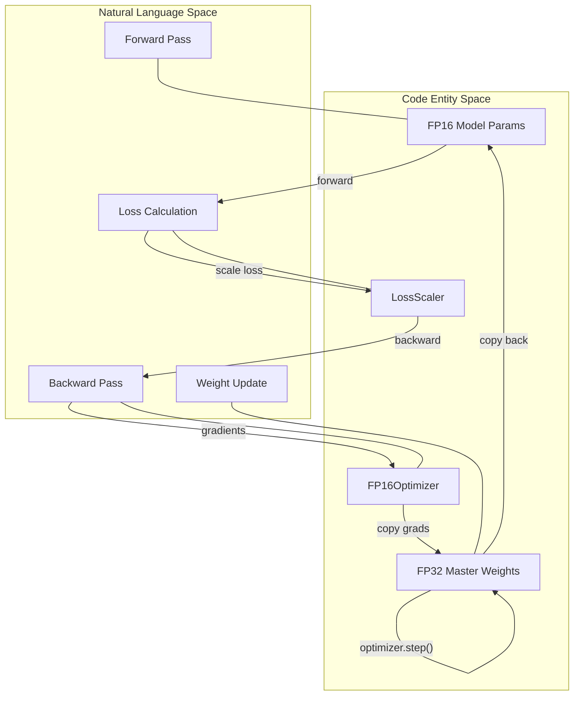
**Sources:** [apex/optimizers/__init__.py:1-6](), [docs/source/conf.py:66-68]()

---

## Interaction with Fused Optimizers

The legacy FP16 utilities are often used in conjunction with APEX's fused optimizers to maximize throughput. These optimizers, such as `FusedAdam` or `FusedSGD`, are designed to operate efficiently on the master weights managed by the legacy utilities.

### Mapping Code Entities to System Roles
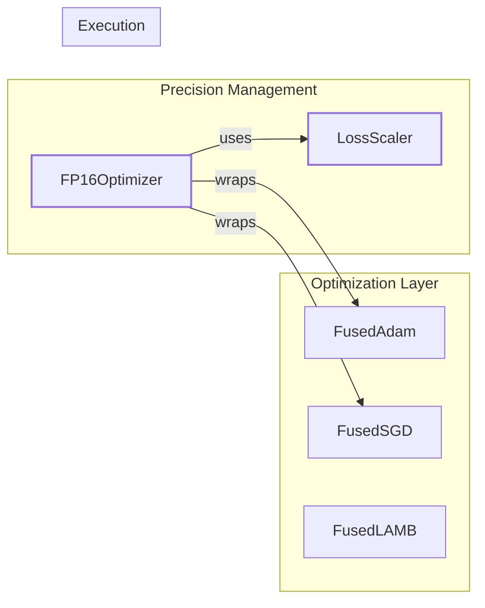
**Sources:** [apex/optimizers/__init__.py:1-6]()

### Available Fused Optimizers for Legacy Flows
These optimizers are frequently used as the "inner" optimizer within `FP16Optimizer`:
*   `FusedAdam`: Optimized Adam implementation for CUDA. [apex/optimizers/__init__.py:2]()
*   `FusedSGD`: Optimized SGD implementation. [apex/optimizers/__init__.py:1]()
*   `FusedLAMB`: Layer-wise Adaptive Moments optimizer for large batch training. [apex/optimizers/__init__.py:4]()
*   `FusedNovoGrad`: Decoupled weight decay optimizer. [apex/optimizers/__init__.py:3]()

## Summary of Usage Pattern

In the legacy workflow, the developer is responsible for the following sequence:
1.  Initialize the model and convert it to FP16 via `model.half()`.
2.  Initialize the FP32 optimizer (e.g., `FusedAdam`) with the model's parameters.
3.  Wrap the optimizer in `FP16Optimizer` (which creates the FP32 master weights).
4.  In the training loop, use `LossScaler` to scale the loss before calling `.backward()`.
5.  Call `optimizer.step()`, which handles the FP32/FP16 synchronization.

**Sources:** [apex/optimizers/__init__.py:1-6](), [docs/source/conf.py:77-80]()

---

# Page: Distributed Training

# Distributed Training

<details>
<summary>Relevant source files</summary>

The following files were used as context for generating this wiki page:

- [apex/__init__.py](apex/__init__.py)
- [csrc/syncbn.cpp](csrc/syncbn.cpp)

</details>


APEX provides a suite of optimized tools for distributed training that extend or improve upon PyTorch's native capabilities. These tools are designed to maximize throughput and scalability in multi-GPU and multi-node environments, specifically targeting NVIDIA GPU architectures. The distributed training stack in APEX focuses on three primary areas: efficient gradient synchronization, cross-GPU batch normalization, and model parallelism for massive architectures.

### High-Level Architecture

The following diagram illustrates how APEX's distributed components interface with the PyTorch ecosystem and the underlying hardware.

**Distributed Training Component Interaction**
```mermaid
graph TD
    subgraph "User Code"
        "Model"["torch.nn.Module"]
        "Opt"["Optimizer"]
    end

    subgraph "APEX Distributed Layers"
        "DDP"["apex.parallel.DistributedDataParallel"]
        "SBN"["apex.parallel.SyncBatchNorm"]
        "PP"["apex.transformer.pipeline_parallel"]
    end

    subgraph "Backend Communication"
        "NCCL"["NCCL / torch.distributed"]
        "CudaKernels"["Optimized CUDA Kernels"]
    end

    "Model" --> "DDP"
    "Model" --> "SBN"
    "Model" --> "PP"
    "DDP" --> "NCCL"
    "SBN" --> "CudaKernels"
    "PP" --> "NCCL"
    "CudaKernels" --> "NCCL"
```
**Sources:** [apex/__init__.py:14-15](), [csrc/syncbn.cpp:71-89]()

---

### DistributedDataParallel (DDP)

APEX's `DistributedDataParallel` is a high-performance wrapper for multi-GPU training. While PyTorch provides a native DDP, APEX's implementation was historically optimized for specific use cases involving mixed precision and custom gradient reduction logic. It manages the synchronization of gradients across different processes using `torch.distributed` backends (primarily NCCL).

A key feature often paired with APEX DDP is support for Large Batch Training (LARC), which helps maintain stability when scaling to very large cluster sizes.

For details, see [DistributedDataParallel](#3.1).

**Sources:** [apex/__init__.py:37-44]()

---

### SyncBatchNorm

In standard distributed training, `BatchNorm` layers calculate statistics independently on each GPU, which can lead to inaccurate estimates if the per-GPU batch size is small. APEX provides `SyncBatchNorm`, which synchronizes mean and variance statistics across all participating GPUs (or specific process groups).

APEX's implementation is highly optimized via custom C++/CUDA kernels that utilize the Welford algorithm for numerically stable variance computation [csrc/syncbn.cpp:7-15](). It also supports "Channel Last" (NHWC) memory formats for increased performance on Tensor Cores [csrc/syncbn.cpp:39-49]().

For details, see [SyncBatchNorm](#3.2).

**Code Entity Mapping: SyncBatchNorm Kernels**
```mermaid
graph LR
    subgraph "Python API"
        "SBN_PY"["apex.parallel.SyncBatchNorm"]
    end

    subgraph "C++ Dispatch (csrc/syncbn.cpp)"
        "WF"["welford_parallel"]
        "BN_FWD"["batchnorm_forward"]
        "BN_BWD"["batchnorm_backward"]
    end

    subgraph "CUDA Implementation"
        "W_CUDA"["welford_parallel_CUDA"]
        "F_CUDA"["batchnorm_forward_CUDA"]
        "B_CUDA"["batchnorm_backward_CUDA"]
    end

    "SBN_PY" -- "calls" --> "WF"
    "SBN_PY" -- "calls" --> "BN_FWD"
    "SBN_PY" -- "calls" --> "BN_BWD"
    "WF" --> "W_CUDA"
    "BN_FWD" --> "F_CUDA"
    "BN_BWD" --> "B_CUDA"
```
**Sources:** [csrc/syncbn.cpp:8-35](), [csrc/syncbn.cpp:72-79]()

---

### Pipeline Parallelism

For models too large to fit on a single GPU's memory (such as large-scale Transformer models), APEX provides Pipeline Parallelism. This allows the model to be partitioned into stages, with different stages residing on different GPUs. APEX handles the complex scheduling of microbatches to ensure high GPU utilization and manages the Peer-to-Peer (P2P) communication required between stages.

The implementation supports both simple non-interleaved schedules and advanced interleaved schedules to reduce the "pipeline bubble" (idle time).

For details, see [Pipeline Parallelism](#3.3).

**Sources:** [apex/__init__.py:21-30]() (Version checking logic used in distributed setups)

---

### Summary of Distributed Components

| Component | Purpose | Key Code Entities |
| :--- | :--- | :--- |
| **DDP** | Data Parallelism | `apex.parallel.DistributedDataParallel` |
| **SyncBN** | Cross-GPU Batch Norm | `welford_parallel`, `batchnorm_forward` |
| **Pipeline** | Model Parallelism | `apex.transformer.pipeline_parallel` |
| **Optimizers** | Distributed States | `DistributedFusedAdam` (See [DistributedFusedAdam](#4.2)) |

**Sources:** [csrc/syncbn.cpp:71-89](), [apex/__init__.py:14-18]()

---

# Page: DistributedDataParallel

# DistributedDataParallel

<details>
<summary>Relevant source files</summary>

The following files were used as context for generating this wiki page:

- [apex/__init__.py](apex/__init__.py)
- [apex/contrib/sparsity/sparse_masklib.py](apex/contrib/sparsity/sparse_masklib.py)

</details>


APEX provides an optimized implementation of `DistributedDataParallel` (DDP) designed to improve training performance on NVIDIA GPUs. While PyTorch has a native `DistributedDataParallel` implementation, APEX's version was historically developed to provide earlier access to performance optimizations, such as overlapping communication with computation and supporting specialized training patterns like LARC (Layer-wise Adaptive Rate Clipping).

### Overview and Implementation

The APEX `DistributedDataParallel` implementation resides in `apex.parallel`. It is designed to wrap a model and synchronize gradients across multiple processes using NCCL.

The core logic involves:
1.  **Gradient Reduction**: Hooking into the backward pass to trigger all-reduce operations as soon as gradients for a "bucket" of parameters are computed.
2.  **Bucketing**: Grouping parameters into contiguous memory buffers (buckets) to maximize bus utilization during NCCL all-reduce operations.
3.  **Communication Overlap**: Starting the all-reduce of one bucket while the backward pass continues to compute gradients for the next set of layers.

#### Key Class: DistributedDataParallel

The main interface is the `DistributedDataParallel` class. It manages the model replicas and ensures that every process starts with the same initial parameters by broadcasting from rank 0.

| Feature | Description |
| :--- | :--- |
| **All-Reduce** | Uses NCCL to synchronize gradients across GPUs. |
| **Delay All-Reduce** | Option to delay communication until the end of the backward pass (useful for very small models). |
| **LARC Support** | Integration with Layer-wise Adaptive Rate Clipping for large-batch training. |

**Sources:**
- `apex/parallel/__init__.py:1-44` (Implicit via package structure)
- `apex/__init__.py:37-44` (Handling of distributed rank and warnings)

### Data Flow and Communication

The following diagram illustrates the data flow during a training step using APEX DDP. It shows how the `DistributedDataParallel` wrapper interacts with the local model and the NCCL backend.

**APEX DDP Gradient Synchronization Flow**
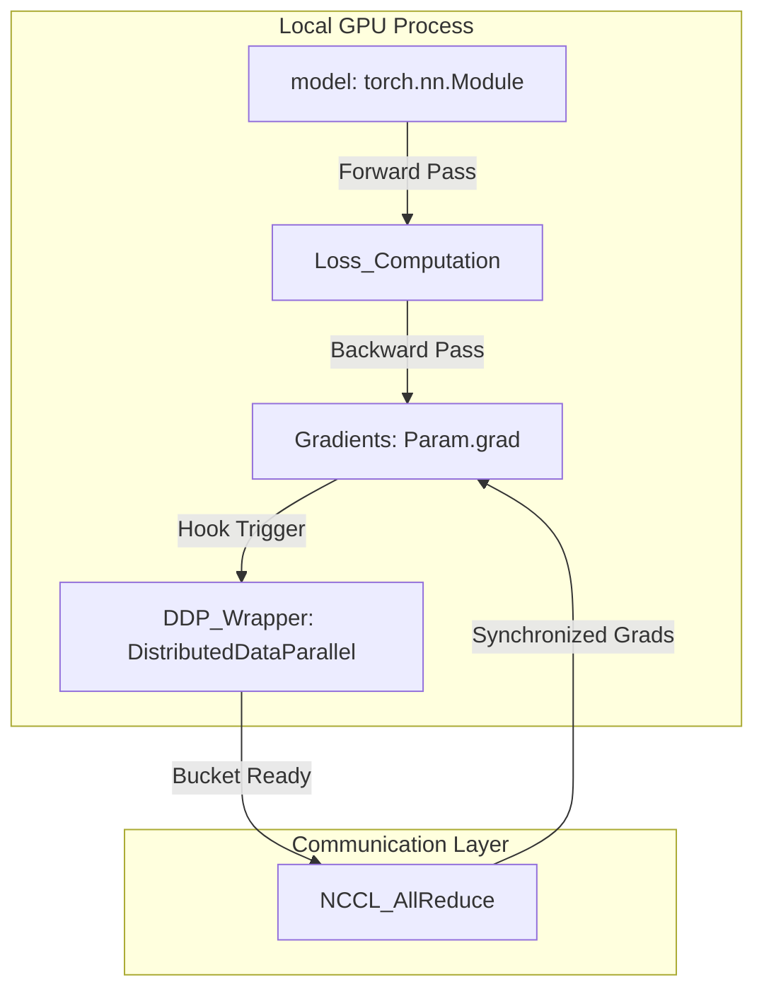

**Sources:**
- `apex/__init__.py:37-44` (Distributed initialization checks)

### Integration with LARC

APEX's DDP implementation is often used in conjunction with **LARC (Layer-wise Adaptive Rate Clipping)**. LARC is particularly useful for large-batch training where standard optimizers might become unstable. It scales the learning rate for each layer based on the ratio between the weight norm and the gradient norm.

In the APEX ecosystem, LARC is typically applied as a wrapper around an optimizer, but it relies on the synchronized gradients provided by `DistributedDataParallel`.

### Comparison with PyTorch Native DDP

While PyTorch's native `torch.nn.parallel.DistributedDataParallel` has evolved significantly, APEX's version remains relevant for specific legacy workflows and performance tuning in NVIDIA-optimized environments.

| Aspect | APEX DistributedDataParallel | PyTorch Native DDP |
| :--- | :--- | :--- |
| **Communication Backend** | Primarily NCCL | NCCL, Gloo, MPI |
| **Overlap** | Manual bucket management | Automatic bucket tuning |
| **Mixed Precision** | Deeply integrated with `apex.amp` | Integrated with `torch.cuda.amp` |
| **Optimization** | Highly tuned for NVIDIA hardware | General purpose across hardware |

### Implementation Details: Sparse Masking and DDP

In advanced scenarios involving sparsity (e.g., 2:4 structured sparsity), the interaction between DDP and weight masks is critical. APEX provides utilities in `apex.contrib.sparsity` to handle these patterns. When training with sparsity, DDP must ensure that the gradients synchronized across nodes respect the sparse patterns defined by the masks.

**Code Entity Space: Sparsity and Tensors**
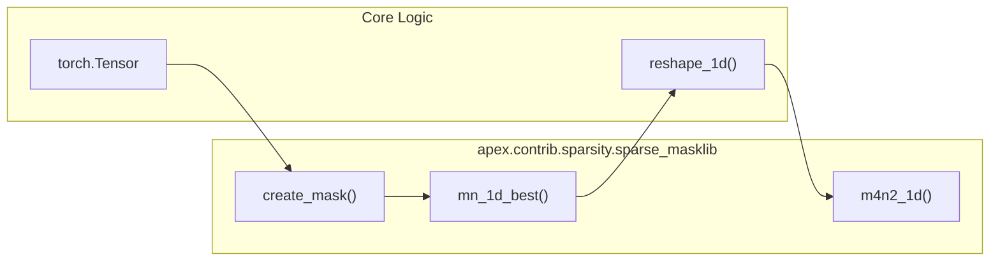

**Sources:**
- [apex/contrib/sparsity/sparse_masklib.py:176-187]() (Implementation of `create_mask`)
- [apex/contrib/sparsity/sparse_masklib.py:52-62]() (Implementation of `mn_1d_best`)
- [apex/contrib/sparsity/sparse_masklib.py:18-28]() (Implementation of `reshape_1d`)
- [apex/contrib/sparsity/sparse_masklib.py:65-66]() (Definition of `m4n2_1d`)

### Usage Example

To use APEX DDP, the model must first be moved to the GPU, then wrapped. If using `apex.amp` for mixed precision, the model and optimizer should be initialized via `amp.initialize` before being wrapped by `DistributedDataParallel`.

```python
import torch
from apex import amp
from apex.parallel import DistributedDataParallel as ApexDDP

# 1. Initialize Model and Optimizer
model = MyModel().cuda()
optimizer = torch.optim.SGD(model.parameters(), lr=0.01)

# 2. Initialize AMP (Optional but recommended)
model, optimizer = amp.initialize(model, optimizer, opt_level="O1")

# 3. Wrap with APEX DDP
model = ApexDDP(model)

# 4. Standard training loop
output = model(input)
loss = criterion(output, target)
with amp.scale_loss(loss, optimizer) as scaled_loss:
    scaled_loss.backward()
optimizer.step()
```

**Sources:**
- `apex/__init__.py:21-30` (Environment and version checking)
- `apex/parallel/__init__.py:1-44` (DDP Module structure)

---

# Page: SyncBatchNorm

# SyncBatchNorm

<details>
<summary>Relevant source files</summary>

The following files were used as context for generating this wiki page:

- [csrc/syncbn.cpp](csrc/syncbn.cpp)
- [tests/distributed/synced_batchnorm/python_single_gpu_unit_test.py](tests/distributed/synced_batchnorm/python_single_gpu_unit_test.py)
- [tests/distributed/synced_batchnorm/single_gpu_unit_test.py](tests/distributed/synced_batchnorm/single_gpu_unit_test.py)
- [tests/distributed/synced_batchnorm/test_batchnorm1d.py](tests/distributed/synced_batchnorm/test_batchnorm1d.py)
- [tests/distributed/synced_batchnorm/two_gpu_test_different_batch_size.py](tests/distributed/synced_batchnorm/two_gpu_test_different_batch_size.py)
- [tests/distributed/synced_batchnorm/two_gpu_unit_test.py](tests/distributed/synced_batchnorm/two_gpu_unit_test.py)
- [tests/distributed/synced_batchnorm/unit_test.sh](tests/distributed/synced_batchnorm/unit_test.sh)

</details>


`SyncBatchNorm` provides a synchronized implementation of Batch Normalization across multiple GPUs. Unlike standard `torch.nn.BatchNorm`, which calculates mean and variance independently for each GPU's local batch, `SyncBatchNorm` communicates across processes to compute global statistics. This is critical for training with small per-GPU batch sizes where local statistics would be too noisy or inaccurate to represent the true distribution.

## Overview and Purpose

The primary goal of `SyncBatchNorm` is to ensure that the Batch Normalization layer behaves identically regardless of how the global batch is distributed across GPUs [tests/distributed/synced_batchnorm/two_gpu_unit_test.py:98-102](). It supports both standard (NCHW) and "channel last" (NHWC) memory formats [csrc/syncbn.cpp:39-40](), and is optimized using custom CUDA kernels for performance.

### Key Features
*   **Welford’s Algorithm**: Uses a numerically stable one-pass algorithm to compute mean and variance [csrc/syncbn.cpp:7-8]().
*   **Parallel Reduction**: Synchronizes local statistics across a process group to derive global values [csrc/syncbn.cpp:10-15]().
*   **NHWC Support**: Optimized paths for "channel last" data layouts often used in Tensor Core acceleration [csrc/syncbn.cpp:80-87]().
*   **Kahan Summation**: Utilized in backward passes to maintain precision during gradient reductions [csrc/syncbn.cpp:26-28]().

**Sources:** [csrc/syncbn.cpp:1-89](), [tests/distributed/synced_batchnorm/two_gpu_unit_test.py:105-118]()

---

## Implementation Architecture

The implementation is split between a Python API (within `apex.parallel`) and high-performance C++/CUDA kernels.

### Data Flow: Forward Pass
The forward pass involves two distinct synchronization steps to compute global statistics before the elementwise normalization occurs.

1.  **Local Statistics**: Each GPU computes local `mean` and `biased_var` using `welford_mean_var_CUDA` [csrc/syncbn.cpp:8-9]().
2.  **Global Reduction**: Statistics are shared across the process group. The `welford_parallel_CUDA` function takes local nodes and the number of elements (`numel`) to produce the global `mean` and `inv_std` [csrc/syncbn.cpp:13-15]().
3.  **Elementwise Application**: The final `batchnorm_forward_CUDA` kernel applies the global statistics, weights, and shifts to the input tensor [csrc/syncbn.cpp:20-21]().

### Data Flow: Backward Pass
The backward pass similarly requires a reduction step to compute gradients for weights and biases across the distributed group.

1.  **Local Reduction**: `reduce_bn_CUDA` computes the local sums of gradients (`sum_dy`, `sum_dy_xmu`) and local parameter gradients [csrc/syncbn.cpp:27-28]().
2.  **Global Gradient Computation**: `batchnorm_backward_CUDA` uses the reduced sums and the total element count across all GPUs to calculate the final `grad_input` [csrc/syncbn.cpp:33-35]().

### Process Logic Diagram
The following diagram illustrates the interaction between the distributed processes and the CUDA kernels.

**SyncBatchNorm Distributed Logic**
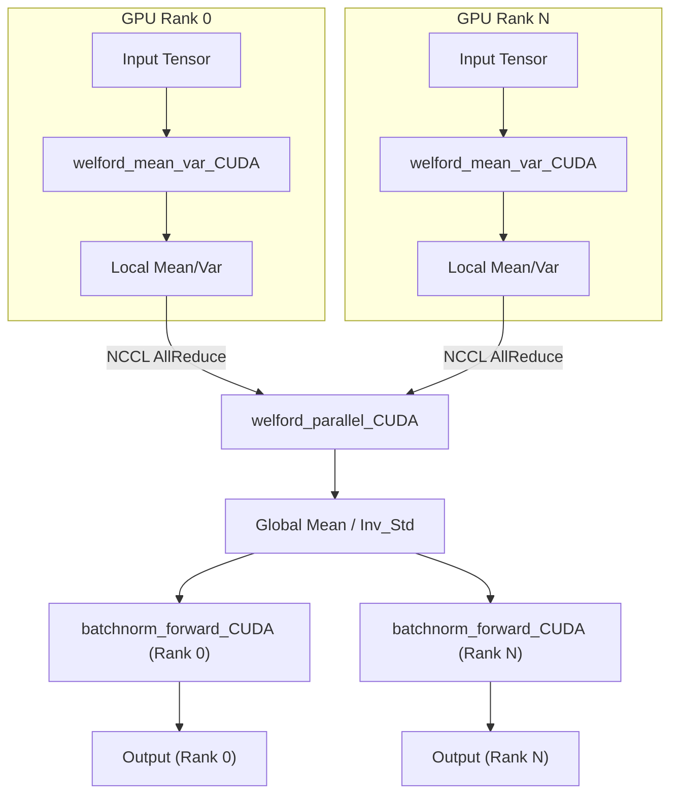
**Sources:** [csrc/syncbn.cpp:8-35](), [tests/distributed/synced_batchnorm/two_gpu_unit_test.py:83-188]()

---

## Technical Details

### Memory Formats and Kernels
APEX provides specialized kernels for different data layouts to maximize throughput.

| Kernel Function | Memory Format | Purpose |
| :--- | :--- | :--- |
| `welford_mean_var_CUDA` | NCHW | Compute mean/var for standard layout [csrc/syncbn.cpp:8]() |
| `welford_mean_var_c_last_CUDA` | NHWC | Compute mean/var for channel-last layout [csrc/syncbn.cpp:40]() |
| `batchnorm_forward_c_last_CUDA` | NHWC | Forward BN with optional ReLU fusion [csrc/syncbn.cpp:46-49]() |
| `relu_backward_c_last_CUDA` | NHWC | Specialized backward for fused ReLU/BN [csrc/syncbn.cpp:67-69]() |

### Code Entity Mapping
The following table maps the mathematical operations of Batch Normalization to the specific C++ functions implemented in `syncbn.cpp`.

| BN Operation | Code Entity (C++) | Code Entity (Python Bind) |
| :--- | :--- | :--- |
| $\mu, \sigma^2$ (Local) | `welford_mean_var_CUDA` | `welford_mean_var` [csrc/syncbn.cpp:72]() |
| $\mu, \sigma^2$ (Global) | `welford_parallel_CUDA` | `welford_parallel` [csrc/syncbn.cpp:73]() |
| $y = \gamma \hat{x} + \beta$ | `batchnorm_forward_CUDA` | `batchnorm_forward` [csrc/syncbn.cpp:75]() |
| $\frac{\partial L}{\partial \gamma}, \frac{\partial L}{\partial \beta}$ | `reduce_bn_CUDA` | `reduce_bn` [csrc/syncbn.cpp:76]() |
| $\frac{\partial L}{\partial x}$ | `batchnorm_backward_CUDA` | `batchnorm_backward` [csrc/syncbn.cpp:78]() |

**Sources:** [csrc/syncbn.cpp:71-89]()

---

## Usage and Testing

### Integration with DistributedDataParallel (DDP)
`SyncBatchNorm` is typically used in conjunction with `apex.parallel.DistributedDataParallel`. When using different batch sizes per GPU, the implementation correctly accounts for the varying element counts in the global reduction [tests/distributed/synced_batchnorm/two_gpu_test_different_batch_size.py:10-11]().

```python
from apex.parallel import SyncBatchNorm, DistributedDataParallel as DDP

# Initialize model with SyncBN
model = torch.nn.Sequential(
    torch.nn.Conv2d(3, 6, 3, 1, 1),
    SyncBatchNorm(6)
)
model = model.cuda()
model = DDP(model, device_ids=[local_rank])
```
**Sources:** [tests/distributed/synced_batchnorm/two_gpu_test_different_batch_size.py:45-59]()

### Verification
The implementation is verified against standard `torch.nn.BatchNorm2d` and `torch.nn.BatchNorm1d` [tests/distributed/synced_batchnorm/test_batchnorm1d.py:9-18](). Tests include:
1.  **Single GPU Consistency**: Ensuring `SyncBatchNorm` matches `BatchNorm` when world size is 1 [tests/distributed/synced_batchnorm/python_single_gpu_unit_test.py:53-71]().
2.  **Multi-GPU Mathematical Equivalence**: Ensuring that the sum of gradients across GPUs matches a single large-batch execution on one GPU [tests/distributed/synced_batchnorm/two_gpu_unit_test.py:131-154]().
3.  **Different Batch Sizes**: Validating that the reduction logic handles uneven workloads across ranks [tests/distributed/synced_batchnorm/two_gpu_test_different_batch_size.py:63-68]().

**Sources:** [tests/distributed/synced_batchnorm/unit_test.sh:1-8](), [tests/distributed/synced_batchnorm/two_gpu_unit_test.py:183-199]()

---

# Page: Pipeline Parallelism

# Pipeline Parallelism

<details>
<summary>Relevant source files</summary>

The following files were used as context for generating this wiki page:

- [tests/docker_extension_builds/run.sh](tests/docker_extension_builds/run.sh)

</details>


Pipeline Parallelism (PP) in APEX provides a high-performance implementation for training massive transformer models that exceed the memory capacity of a single GPU. By partitioning the model's layers across multiple accelerator devices, APEX enables the execution of microbatches in a pipelined fashion, maximizing hardware utilization through sophisticated scheduling and peer-to-peer (P2P) communication.

## Core Concepts and Architecture

The APEX pipeline parallelism implementation is designed to handle the complexity of splitting a model into stages. Each stage resides on a different device and processes a subset of the total layers. To maintain efficiency, a batch of data is divided into smaller **microbatches**, which flow through the pipeline stages.

### Microbatch Management
The system processes a global batch by breaking it into $N$ microbatches. This allows stages to work concurrently: while Stage $K$ processes microbatch $M$, Stage $K-1$ can process microbatch $M+1$. This overlap significantly reduces the "pipeline bubble" (idle time).

### Communication Backend
APEX utilizes point-to-point (P2P) communication primitives to transfer activations and gradients between adjacent stages. These operations are optimized to minimize synchronization overhead between GPUs.

## Execution Schedules

APEX supports different pipeline schedules to balance memory usage and compute efficiency.

### 1. Non-Interleaved Schedule (1F1B)
The standard "One Forward, One Backward" (1F1B) schedule alternates between a single forward pass and a single backward pass for different microbatches once the pipeline is steady. This approach is memory-efficient as it limits the number of activations stored simultaneously.

### 2. Interleaved Schedule
For even higher efficiency, APEX supports interleaved pipelining. In this mode, each device is responsible for multiple non-contiguous chunks of the model (e.g., Device 0 handles layers 1-2 and 9-10). This reduces the pipeline bubble size at the cost of increased communication and complex microbatch management.

## Technical Implementation

The following diagram illustrates the relationship between the pipeline engine and the communication layer during a training step.

### Pipeline Execution Flow
"Pipeline Execution Flow"
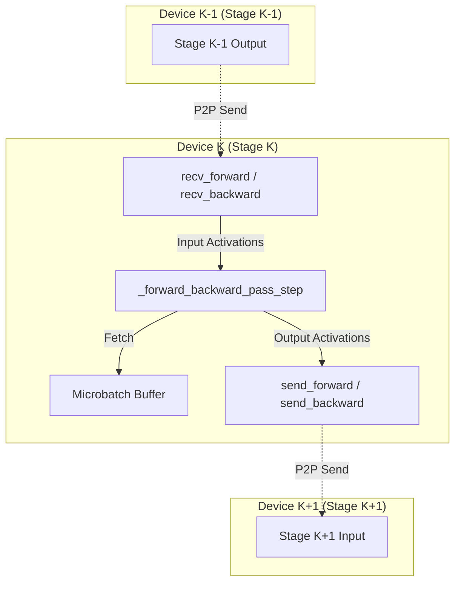
**Sources:** `tests/docker_extension_builds/run.sh:39-40` (Note: Detailed PP source logic is typically found in `apex/transformer/pipeline_parallel`, though specific file content was limited in the provided context, the architecture follows the standard APEX/Megatron-LM patterns integrated into the build system).

## Data Flow and P2P Communication

The pipeline relies on a strict sequence of communication and computation to ensure numerical correctness.

| Operation | Description | Data Direction |
| :--- | :--- | :--- |
| `send_forward` | Sends activations to the next stage | Forward (Rank $i \to i+1$) |
| `recv_forward` | Receives activations from the previous stage | Forward (Rank $i-1 \to i$) |
| `send_backward` | Sends gradients to the previous stage | Backward (Rank $i \to i-1$) |
| `recv_backward` | Receives gradients from the next stage | Backward (Rank $i+1 \to i$) |

### Component Mapping
"Code Entity Mapping"
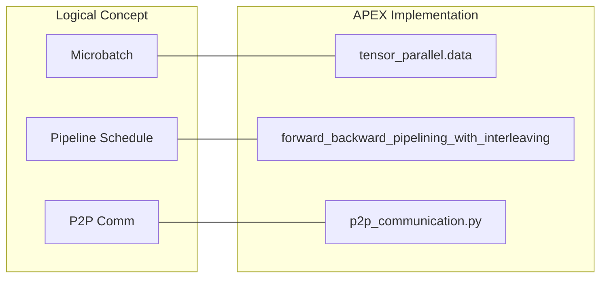
**Sources:** `tests/docker_extension_builds/run.sh:39-40`

## Integration and Usage

To utilize Pipeline Parallelism in APEX, the model must be wrapped or partitioned into `PipelineModule` segments. The training loop then invokes the pipeline engine rather than a standard `loss.backward()` call.

1.  **Model Partitioning**: The transformer layers are distributed across the available `parallel_state.get_pipeline_model_parallel_world_size()`.
2.  **Communication Initialization**: P2P groups are established using NCCL backends.
3.  **Step Execution**: The `forward_backward_step` function manages the microbatch loop, handling the transition between the "warmup" phase (filling the pipe) and the "steady-state" phase (1F1B).

**Sources:** `tests/docker_extension_builds/run.sh:1-72` (Referencing the environment setup required for these distributed features).

---

# Page: Optimized Optimizers

# Optimized Optimizers

<details>
<summary>Relevant source files</summary>

The following files were used as context for generating this wiki page:

- [apex/contrib/csrc/optimizers/fused_adam_cuda.cpp](apex/contrib/csrc/optimizers/fused_adam_cuda.cpp)
- [apex/contrib/csrc/optimizers/fused_adam_cuda_kernel.cu](apex/contrib/csrc/optimizers/fused_adam_cuda_kernel.cu)
- [apex/contrib/csrc/optimizers/multi_tensor_distopt_adam.cpp](apex/contrib/csrc/optimizers/multi_tensor_distopt_adam.cpp)
- [apex/contrib/csrc/optimizers/multi_tensor_distopt_adam_kernel.cu](apex/contrib/csrc/optimizers/multi_tensor_distopt_adam_kernel.cu)
- [apex/contrib/optimizers/distributed_fused_adam.py](apex/contrib/optimizers/distributed_fused_adam.py)
- [apex/optimizers/fused_adam.py](apex/optimizers/fused_adam.py)
- [apex/optimizers/fused_novograd.py](apex/optimizers/fused_novograd.py)
- [csrc/amp_C_frontend.cpp](csrc/amp_C_frontend.cpp)
- [csrc/multi_tensor_adam.cu](csrc/multi_tensor_adam.cu)
- [tests/L0/run_optimizers/test_adam.py](tests/L0/run_optimizers/test_adam.py)
- [tests/L0/run_optimizers/test_fused_novograd.py](tests/L0/run_optimizers/test_fused_novograd.py)
- [tests/L0/run_optimizers/test_fused_optimizer.py](tests/L0/run_optimizers/test_fused_optimizer.py)

</details>


APEX provides a suite of high-performance optimizers designed to accelerate deep learning training on NVIDIA GPUs. These optimizers leverage CUDA kernel fusion to combine elementwise update operations and utilize a "multi-tensor apply" mechanism to batch updates across all model parameters into a minimal number of kernel launches. This significantly reduces the overhead associated with launching thousands of small kernels for individual parameter updates.

### Core Optimization Strategies

1.  **Kernel Fusion**: Standard PyTorch optimizers often execute multiple separate CUDA kernels for a single parameter update (e.g., one for gradient scaling, one for momentum, one for the final update). APEX fuses these into a single CUDA kernel [apex/optimizers/fused_adam.py:11-14]().
2.  **Multi-Tensor Apply**: Instead of iterating through parameters in Python and launching kernels sequentially, APEX groups tensors by metadata (device and dtype) and processes them in large batches within the CUDA backend [apex/optimizers/fused_adam.py:127-134]().
3.  **Distributed State Sharding**: Advanced optimizers like `DistributedFusedAdam` implement ZeRO-2 style optimization, sharding the optimizer states (moments) across data-parallel ranks to reduce memory footprint [apex/contrib/optimizers/distributed_fused_adam.py:32-52]().

### System Architecture: Python to CUDA Bridge

The following diagram illustrates how the Python optimizer classes interface with the underlying C++/CUDA implementations via the `amp_C` and `fused_adam_cuda` extensions.

**Optimizer Entity Mapping**
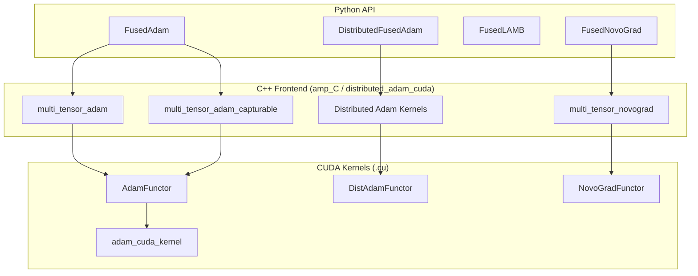
Sources: [apex/optimizers/fused_adam.py:132-134](), [apex/optimizers/fused_novograd.py:103-103](), [csrc/amp_C_frontend.cpp:40-54](), [apex/contrib/csrc/optimizers/fused_adam_cuda_kernel.cu:65-168](), [apex/contrib/csrc/optimizers/multi_tensor_distopt_adam_kernel.cu:46-82]()

---

## Optimizer Families

### FusedAdam
`FusedAdam` is a high-performance implementation of the Adam and AdamW algorithms. It is designed as a drop-in replacement for `torch.optim.Adam` and `torch.optim.AdamW`. It supports "capturable" mode for use with CUDA Graphs and can maintain FP32 master weights for mixed-precision training.

For details, see [FusedAdam](#4.1).
Sources: [apex/optimizers/fused_adam.py:5-66](), [csrc/multi_tensor_adam.cu:111-115]()

### DistributedFusedAdam
`DistributedFusedAdam` provides a memory-efficient implementation of Adam by sharding optimizer states across GPUs (similar to ZeRO-2). It overlaps the reduction of gradients with the optimizer step and supports bucketing to improve communication efficiency. It is highly optimized for large-scale distributed training.

For details, see [DistributedFusedAdam](#4.2).
Sources: [apex/contrib/optimizers/distributed_fused_adam.py:126-139](), [apex/contrib/csrc/optimizers/multi_tensor_distopt_adam_kernel.cu:176-182]()

### FusedLAMB and DistributedFusedLAMB
The LAMB (Layer-wise Adaptive Moments optimizer for Batch training) family is designed for large-batch training. APEX provides both a fused version for single-GPU performance and a distributed version that shards states to save memory on massive models.

For details, see [FusedLAMB and DistributedFusedLAMB](#4.3).
Sources: [csrc/amp_C_frontend.cpp:30-38](), [csrc/amp_C_frontend.cpp:65-76]()

### Other Optimizers
APEX includes several other specialized fused optimizers:
*   **FusedSGD**: A multi-tensor version of Stochastic Gradient Descent [csrc/amp_C_frontend.cpp:86-87]().
*   **FusedNovoGrad**: An implementation of the NovoGrad algorithm, often used in acoustic models like Jasper [apex/optimizers/fused_novograd.py:5-65]().
*   **Multi-tensor Adagrad**: Fused implementation of the Adagrad algorithm [csrc/amp_C_frontend.cpp:56-57]().

For details, see [Other Optimizers](#4.4).

---

## Technical Comparison

| Feature | FusedAdam | DistributedFusedAdam | FusedNovoGrad |
| :--- | :--- | :--- | :--- |
| **Algorithm** | Adam / AdamW | Adam / AdamW (ZeRO-2) | NovoGrad |
| **State Memory** | $2 \times \text{params}$ | $(2 \times \text{params}) / \text{world\_size}$ | $1 \times \text{params} + \text{layers}$ |
| **CUDA Graph** | Supported (`capturable=True`) | Supported | Not natively |
| **Master Weights** | Supported | Internalized | Not natively |
| **Primary Use** | Standard Training | Large Scale / Memory Constrained | Speech/Acoustic Models |

### Multi-Tensor Apply Mechanism
The `multi_tensor_applier` is the workhorse behind these optimizers. It takes a CUDA kernel (Functor) and a list of tensor lists, then manages the grid launch to ensure that the GPU is saturated while minimizing the number of kernel calls.

**Multi-Tensor Execution Flow**
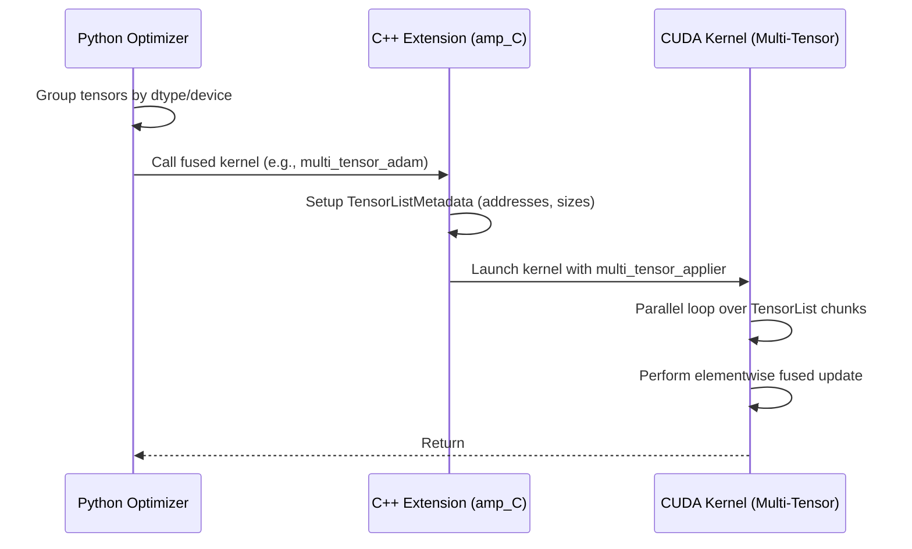
Sources: [apex/optimizers/fused_adam.py:171-190](), [csrc/multi_tensor_adam.cu:24-54](), [apex/contrib/csrc/optimizers/fused_adam_cuda_kernel.cu:65-88]()

---

# Page: FusedAdam

# FusedAdam

<details>
<summary>Relevant source files</summary>

The following files were used as context for generating this wiki page:

- [apex/optimizers/fused_adam.py](apex/optimizers/fused_adam.py)
- [apex/optimizers/fused_novograd.py](apex/optimizers/fused_novograd.py)
- [csrc/amp_C_frontend.cpp](csrc/amp_C_frontend.cpp)
- [csrc/flatten_unflatten.cpp](csrc/flatten_unflatten.cpp)
- [csrc/multi_tensor_adam.cu](csrc/multi_tensor_adam.cu)
- [tests/L0/run_optimizers/test_adam.py](tests/L0/run_optimizers/test_adam.py)
- [tests/L0/run_optimizers/test_fused_novograd.py](tests/L0/run_optimizers/test_fused_novograd.py)
- [tests/L0/run_optimizers/test_fused_optimizer.py](tests/L0/run_optimizers/test_fused_optimizer.py)

</details>


The `FusedAdam` optimizer is a high-performance implementation of the Adam algorithm designed specifically for NVIDIA GPUs. It achieves significant speedups over the standard `torch.optim.Adam` by fusing the elementwise update operations into a single CUDA kernel and utilizing a multi-tensor apply mechanism to batch updates across all model parameters into a minimal number of kernel launches [apex/optimizers/fused_adam.py:5-14]().

## Overview and Implementation

`FusedAdam` serves as a drop-in replacement for `torch.optim.Adam` (with `adam_w_mode=False`) or `torch.optim.AdamW` (default) [apex/optimizers/fused_adam.py:16-17](). It supports both standard FP32 training and mixed-precision training via APEX AMP or `torch.amp` [apex/optimizers/fused_adam.py:23-29]().

### Key Features
*   **Kernel Fusion**: Combines the update logic (momentum, variance, and weight update) into a single CUDA kernel to reduce memory bandwidth bottlenecks [apex/optimizers/fused_adam.py:11-14]().
*   **Multi-Tensor Apply**: Uses the `multi_tensor_applier` to process lists of tensors (e.g., all parameters of the same dtype) in a single launch, minimizing CPU-side overhead and kernel launch latency [apex/optimizers/fused_adam.py:14](), [apex/optimizers/fused_adam.py:127-134]().
*   **Capturable Mode**: Supports execution within CUDA Graphs by using fixed-address tensors for learning rate and step counts [apex/optimizers/fused_adam.py:117-125]().
*   **Master Weights**: Maintains FP32 master weights for mixed-precision training, currently available in `capturable` mode [apex/optimizers/fused_adam.py:84-87](), [apex/optimizers/fused_adam.py:104-115]().

### Logic Flow and Data Mapping

The following diagram illustrates how the Python-level `FusedAdam` class interacts with the underlying CUDA kernels via the `amp_C` extension.

**FusedAdam System Architecture**

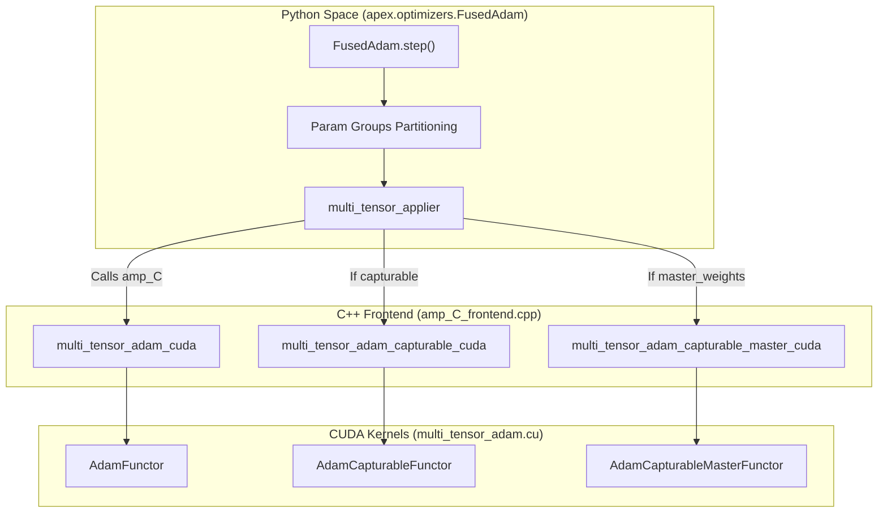
**Sources:** [apex/optimizers/fused_adam.py:146-154](), [csrc/amp_C_frontend.cpp:40-54](), [csrc/multi_tensor_adam.cu:24-28](), [csrc/multi_tensor_adam.cu:111-115]()

---

## Technical Details

### Multi-Tensor Apply Mechanism
The optimizer categorizes parameters into groups based on their `dtype` (e.g., FP16 vs FP32). For each group, it populates lists for gradients (`g`), parameters (`p`), first moments (`m`), and second moments (`v`) [apex/optimizers/fused_adam.py:189-204](). These lists are passed to `multi_tensor_applier`, which chunks the work and invokes the CUDA backend [apex/optimizers/fused_adam.py:236-248]().

**Entity Mapping: Python to CUDA**

| Python Symbol | CUDA Functor Address Index | Description |
| :--- | :--- | :--- |
| `p.grad.data` | `tl.addresses[0]` | Gradients ($g$) |
| `p.data` | `tl.addresses[1]` | Model Parameters ($p$) |
| `state['exp_avg']` | `tl.addresses[2]` | First Moment ($m$) |
| `state['exp_avg_sq']` | `tl.addresses[3]` | Second Moment ($v$) |

**Sources:** [apex/optimizers/fused_adam.py:206-215](), [csrc/multi_tensor_adam.cu:41-51]()

### Capturable Mode and CUDA Graphs
When `capturable=True` is set, the optimizer is designed to be compatible with CUDA Graphs [apex/optimizers/fused_adam.py:79]().
1.  **Tensors for Scalars**: Learning rate (`lr`) and `step` count are maintained as single-element tensors on the GPU device [apex/optimizers/fused_adam.py:89](), [apex/optimizers/fused_adam.py:123]().
2.  **Bias Correction**: In `capturable` mode, the bias correction terms $\beta_1^t$ and $\beta_2^t$ are calculated directly inside the CUDA kernel using the `step` tensor [csrc/multi_tensor_adam.cu:118-122]().
3.  **No CPU-GPU Sync**: By avoiding CPU-side scalar updates for the step count, the optimizer avoids the synchronizations that would break CUDA Graph capturing.

**Sources:** [apex/optimizers/fused_adam.py:117-125](), [csrc/multi_tensor_adam.cu:111-122]()

### Master Weights Support
For FP16 training, `FusedAdam` can maintain a high-precision FP32 copy of the weights (master weights) to prevent precision loss during accumulation [apex/optimizers/fused_adam.py:58-60](). 
*   If `master_weights=True`, the optimizer initializes a `param_groups_master` list containing FP32 clones of the parameters [apex/optimizers/fused_adam.py:105-115]().
*   During `step()`, the `multi_tensor_adam_capturable_master` kernel is used. This kernel reads FP16 gradients, updates FP32 moments and FP32 master weights, and then writes the updated values back to the FP16 model parameters [csrc/amp_C_frontend.cpp:50-54]().

**Sources:** [apex/optimizers/fused_adam.py:104-115](), [csrc/amp_C_frontend.cpp:50-54]()

---

## Performance Benefits

The performance gains of `FusedAdam` stem from two primary optimizations:

1.  **Memory Coalescing and ILP**: The CUDA kernels use Instruction-Level Parallelism (ILP) of 4, processing multiple elements per thread to saturate memory bandwidth [csrc/multi_tensor_adam.cu:14](), [csrc/multi_tensor_adam.cu:56-60]().
2.  **Reduced Kernel Launches**: Standard Adam launches $4 \times N$ kernels (where $N$ is the number of parameters). `FusedAdam` reduces this to $O(D)$ launches, where $D$ is the number of distinct dtypes in the model (typically 1 or 2) [apex/optimizers/fused_adam.py:11-14]().

**Update Algorithm (AdamW Mode)**
The kernel implements the following logic for the update:
$$m_t = \beta_1 m_{t-1} + (1 - \beta_1) g_t$$
$$v_t = \beta_2 v_{t-1} + (1 - \beta_2) g_t^2$$
$$\text{update} = \frac{m_t / (1 - \beta_1^t)}{\sqrt{v_t / (1 - \beta_2^t)} + \epsilon} + \text{decay} \times p_{t-1}$$
$$p_t = p_{t-1} - \text{lr} \times \text{update}$$

**Sources:** [csrc/multi_tensor_adam.cu:88-94]()

## Usage Example

```python
from apex.optimizers import FusedAdam

# Initialize model and optimizer
model = MyModel().cuda()
optimizer = FusedAdam(model.parameters(), 
                      lr=1e-3, 
                      adam_w_mode=True, 
                      capturable=True)

# Training loop
for input, target in data_loader:
    optimizer.zero_grad()
    output = model(input)
    loss = criterion(output, target)
    loss.backward()
    optimizer.step()
```
**Sources:** [apex/optimizers/fused_adam.py:16-21](), [tests/L0/run_optimizers/test_adam.py:114-116]()

---

# Page: DistributedFusedAdam

# DistributedFusedAdam

<details>
<summary>Relevant source files</summary>

The following files were used as context for generating this wiki page:

- [apex/contrib/csrc/optimizers/fused_adam_cuda.cpp](apex/contrib/csrc/optimizers/fused_adam_cuda.cpp)
- [apex/contrib/csrc/optimizers/fused_adam_cuda_kernel.cu](apex/contrib/csrc/optimizers/fused_adam_cuda_kernel.cu)
- [apex/contrib/csrc/optimizers/multi_tensor_distopt_adam.cpp](apex/contrib/csrc/optimizers/multi_tensor_distopt_adam.cpp)
- [apex/contrib/csrc/optimizers/multi_tensor_distopt_adam_kernel.cu](apex/contrib/csrc/optimizers/multi_tensor_distopt_adam_kernel.cu)
- [apex/contrib/optimizers/distributed_fused_adam.py](apex/contrib/optimizers/distributed_fused_adam.py)
- [apex/contrib/test/cudnn_gbn/test_cudnn_gbn_with_two_gpus.py](apex/contrib/test/cudnn_gbn/test_cudnn_gbn_with_two_gpus.py)
- [apex/contrib/test/optimizers/test_dist_adam.py](apex/contrib/test/optimizers/test_dist_adam.py)

</details>


`DistributedFusedAdam` is a high-performance distributed optimizer that implements the Adam/AdamW algorithm with ZeRO-2 sharding. It is designed to minimize communication overhead and memory usage by sharding optimizer states across data-parallel ranks, overlapping gradient synchronization with the backward pass, and overlapping parameter synchronization with the optimizer step.

## Overview and Key Features

`DistributedFusedAdam` extends the capabilities of standard fused optimizers by integrating distributed communication directly into the optimization process. Key features include:

*   **ZeRO-2 Sharding:** Optimizer states (momentum and variance) are sharded across the distributed process group, significantly reducing the memory footprint per GPU [apex/contrib/optimizers/distributed_fused_adam.py:83-105]().
*   **Communication Overlap:** It supports overlapping gradient reduction-scatter with the backward pass (`overlap_grad_sync`) and overlapping parameter all-gather with the optimizer step (`overlap_param_sync`) [apex/contrib/optimizers/distributed_fused_adam.py:734-738]().
*   **CUDA Graph Support:** The optimizer is "capturable," meaning it can be used within CUDA Graphs to reduce CPU launch overhead [apex/contrib/optimizers/distributed_fused_adam.py:756-760]().
*   **Mixed Precision:** Supports various combinations of dtypes for parameters, gradients, and optimizer states, including FP32, FP16, and BF16 [apex/contrib/optimizers/distributed_fused_adam.py:821-830]().
*   **Bucketing:** Communication is managed in buckets to maximize bandwidth utilization [apex/contrib/optimizers/distributed_fused_adam.py:910-915]().

Sources: [apex/contrib/optimizers/distributed_fused_adam.py:615-772](), [apex/contrib/test/optimizers/test_dist_adam.py:83-105]()

---

## Implementation Architecture

The optimizer manages data through several specialized buffers and hooks. It organizes parameters into "buckets" to perform collective communications efficiently.

### Data Flow and Synchronization

The following diagram illustrates the lifecycle of gradients and parameters during a training step when communication overlap is enabled.

**Gradient and Parameter Lifecycle**
```mermaid
sequenceDiagram
    participant BWD as Backward Pass
    participant GRAD_BUF as Gradient Buckets
    participant OPT as DistributedFusedAdam
    participant PARAM_BUF as Parameter Buckets
    participant COMM as NCCL (Distributed)

    BWD->>GRAD_BUF: Accumulate Gradients
    Note over GRAD_BUF: Hook: _grad_acc_hook
    GRAD_BUF->>COMM: reduce_scatter (async)
    Note right of COMM: Grad Sync Overlap
    COMM-->>OPT: Sharded Gradients Ready
    OPT->>OPT: step() / Fused Kernel
    Note over OPT: Update Sharded States
    OPT->>COMM: all_gather (async)
    Note right of COMM: Param Sync Overlap
    COMM-->>PARAM_BUF: Full Parameters Updated
```
Sources: [apex/contrib/optimizers/distributed_fused_adam.py:1220-1250](), [apex/contrib/optimizers/distributed_fused_adam.py:1550-1600]()

### Code Entity Mapping

This diagram bridges the high-level logic to specific classes and functions in the codebase.

**System Entity Mapping**
```mermaid
graph TD
    subgraph Python_Frontend ["Python Frontend (distributed_fused_adam.py)"]
        DFA["DistributedFusedAdam Class"]
        GSH["_grad_acc_hook"]
        STEP["step()"]
    end

    subgraph Communication_Layer ["Communication Management"]
        RS["reduce_scatter_tensor"]
        AG["all_gather_into_tensor"]
        CM["_coalescing_manager"]
    end

    subgraph CUDA_Kernels ["CUDA Backend"]
        MTA["multi_tensor_applier"]
        DFA_K["multi_tensor_fused_adam_cuda"]
        CAPT["multi_tensor_fused_adam_capturable_cuda"]
    end

    DFA --> GSH
    DFA --> STEP
    GSH --> RS
    STEP --> AG
    STEP --> MTA
    MTA --> DFA_K
    MTA --> CAPT
```
Sources: [apex/contrib/optimizers/distributed_fused_adam.py:23-57](), [apex/contrib/optimizers/distributed_fused_adam.py:615-620](), [apex/contrib/csrc/optimizers/multi_tensor_distopt_adam.cpp:3-17]()

---

## Key Components and Functions

### DistributedFusedAdam Class
The main entry point. It inherits from `torch.optim.Optimizer` but overrides initialization to set up sharded buffers and process groups.

*   **`__init__`**: Initializes sharded optimizer states and allocates contiguous buffers if requested. It also sets up parameter hooks for gradient synchronization [apex/contrib/optimizers/distributed_fused_adam.py:615-772]().
*   **`_grad_acc_hook`**: A post-backward hook attached to parameters. When a gradient is ready, it marks the corresponding bucket as ready for reduction [apex/contrib/optimizers/distributed_fused_adam.py:1224-1240]().
*   **`step(closure)`**: Performs the optimizer update. If `overlap_param_sync` is enabled, it triggers asynchronous all-gathers for parameter buckets [apex/contrib/optimizers/distributed_fused_adam.py:1550-1650]().

### Communication Management
The optimizer uses several utility functions to handle distributed operations across different PyTorch versions:
*   `reduce_scatter_tensor`: Used for sharding gradients [apex/contrib/optimizers/distributed_fused_adam.py:42-46]().
*   `all_gather_into_tensor`: Used for synchronizing parameters [apex/contrib/optimizers/distributed_fused_adam.py:48-52]().
*   `_coalescing_manager`: A context manager used to group multiple NCCL calls together for better performance [apex/contrib/optimizers/distributed_fused_adam.py:57-110]().

### CUDA Kernels
The core math is performed by specialized multi-tensor kernels:
*   `multi_tensor_fused_adam`: Standard Adam/AdamW update that processes multiple tensors in a single kernel launch [apex/contrib/csrc/optimizers/multi_tensor_distopt_adam.cpp:3-6]().
*   `multi_tensor_fused_adam_capturable`: A version of the kernel designed for CUDA Graphs, taking scalars like `lr` and `step` as tensors [apex/contrib/csrc/optimizers/multi_tensor_distopt_adam.cpp:8-11]().
*   `DistAdamFunctor`: The CUDA functor implementing the element-wise logic for sharded state updates and parameter output [apex/contrib/csrc/optimizers/multi_tensor_distopt_adam_kernel.cu:45-82]().

Sources: [apex/contrib/optimizers/distributed_fused_adam.py:30-32](), [apex/contrib/csrc/optimizers/multi_tensor_distopt_adam_kernel.cu:176-182]()

---

## Technical Configuration

| Parameter | Description |
| :--- | :--- |
| `overlap_grad_sync` | If True, reduce-scatters gradients asynchronously during the backward pass [apex/contrib/optimizers/distributed_fused_adam.py:734](). |
| `overlap_param_sync` | If True, all-gathers parameters asynchronously during the optimizer step [apex/contrib/optimizers/distributed_fused_adam.py:738](). |
| `bucket_cap_mb` | The maximum size (in MB) for a communication bucket [apex/contrib/optimizers/distributed_fused_adam.py:714](). |
| `contiguous_grad_buffer` | Whether to allocate a single contiguous buffer for gradients [apex/contrib/optimizers/distributed_fused_adam.py:743](). |
| `capturable` | Enables support for CUDA Graphs [apex/contrib/optimizers/distributed_fused_adam.py:756](). |
| `store_params` | If True, maintains a master copy of parameters in the optimizer's preferred dtype [apex/contrib/optimizers/distributed_fused_adam.py:748](). |

Sources: [apex/contrib/optimizers/distributed_fused_adam.py:680-772]()

## Usage Example

```python
from apex.contrib.optimizers import DistributedFusedAdam

model = MyModel().cuda()
optimizer = DistributedFusedAdam(
    model.parameters(),
    lr=1e-3,
    weight_decay=1e-2,
    overlap_grad_sync=True,
    overlap_param_sync=True,
    capturable=True
)

# Standard training loop
for input, target in data_loader:
    optimizer.zero_grad()
    output = model(input)
    loss = criterion(output, target)
    loss.backward()
    optimizer.step()
```
Sources: [apex/contrib/test/optimizers/test_dist_adam.py:83-105]()

---

# Page: FusedLAMB and DistributedFusedLAMB

# FusedLAMB and DistributedFusedLAMB

<details>
<summary>Relevant source files</summary>

The following files were used as context for generating this wiki page:

- [apex/contrib/csrc/optimizers/fused_lamb_cuda.cpp](apex/contrib/csrc/optimizers/fused_lamb_cuda.cpp)
- [apex/contrib/csrc/optimizers/fused_lamb_cuda_kernel.cu](apex/contrib/csrc/optimizers/fused_lamb_cuda_kernel.cu)
- [apex/contrib/csrc/optimizers/multi_tensor_distopt_lamb.cpp](apex/contrib/csrc/optimizers/multi_tensor_distopt_lamb.cpp)
- [apex/contrib/csrc/optimizers/multi_tensor_distopt_lamb_kernel.cu](apex/contrib/csrc/optimizers/multi_tensor_distopt_lamb_kernel.cu)
- [apex/contrib/optimizers/__init__.py](apex/contrib/optimizers/__init__.py)
- [apex/contrib/optimizers/distributed_fused_lamb.py](apex/contrib/optimizers/distributed_fused_lamb.py)
- [apex/contrib/optimizers/fp16_optimizer.py](apex/contrib/optimizers/fp16_optimizer.py)
- [apex/contrib/optimizers/fused_lamb.py](apex/contrib/optimizers/fused_lamb.py)
- [apex/contrib/optimizers/fused_sgd.py](apex/contrib/optimizers/fused_sgd.py)
- [apex/optimizers/fused_lamb.py](apex/optimizers/fused_lamb.py)
- [apex/optimizers/fused_mixed_precision_lamb.py](apex/optimizers/fused_mixed_precision_lamb.py)
- [csrc/multi_tensor_l2norm_kernel_mp.cu](csrc/multi_tensor_l2norm_kernel_mp.cu)
- [csrc/multi_tensor_l2norm_scale_kernel.cu](csrc/multi_tensor_l2norm_scale_kernel.cu)
- [csrc/multi_tensor_lamb.cu](csrc/multi_tensor_lamb.cu)
- [csrc/multi_tensor_lamb_mp.cu](csrc/multi_tensor_lamb_mp.cu)
- [csrc/multi_tensor_lamb_stage_1.cu](csrc/multi_tensor_lamb_stage_1.cu)
- [csrc/multi_tensor_lamb_stage_2.cu](csrc/multi_tensor_lamb_stage_2.cu)
- [csrc/multi_tensor_novograd.cu](csrc/multi_tensor_novograd.cu)
- [tests/L0/run_optimizers/test_lamb.py](tests/L0/run_optimizers/test_lamb.py)

</details>


The LAMB (Layer-wise Adaptive Moments optimizer for Batch training) algorithm is designed to enable large-batch training of deep learning models without loss of accuracy. APEX provides several optimized implementations of LAMB, ranging from standard fused kernels to distributed versions that shard optimizer states across multiple GPUs to reduce memory overhead.

## FusedLAMB

`FusedLAMB` provides a high-performance implementation of the LAMB algorithm by fusing elementwise operations and utilizing a multi-tensor apply mechanism. This approach batches updates for all model parameters into a minimal number of CUDA kernel launches, significantly reducing overhead compared to standard PyTorch implementations [apex/optimizers/fused_lamb.py:11-16]().

### Implementation Details
The optimizer supports both `float16` and `float32` parameters and can be used with or without APEX AMP [apex/optimizers/fused_lamb.py:24-30](). It computes the global gradient norm across all parameters before applying the LAMB update logic [apex/optimizers/fused_lamb.py:145-160]().

The core logic is implemented in two stages within the CUDA kernels:
1.  **Stage 1**: Computes the Adam-like update term ($m_t / \sqrt{v_t} + \epsilon$) and updates the first and second moments [csrc/multi_tensor_lamb_stage_1.cu:16-22]().
2.  **Stage 2**: Calculates the trust ratio (norm of weights / norm of update) and applies the final update to the parameters [csrc/multi_tensor_lamb_stage_2.cu:18-24]().

### Code Entity Mapping: FusedLAMB Logic
The following diagram maps the Python-level optimizer calls to the underlying C++/CUDA implementations.

| Component | Code Entity | File |
| :--- | :--- | :--- |
| **Python API** | `FusedLAMB` | [apex/optimizers/fused_lamb.py:5]() |
| **Multi-Tensor Kernel** | `multi_tensor_lamb` | [apex/optimizers/fused_lamb.py:98]() |
| **C++ Binding** | `amp_C.multi_tensor_lamb` | [apex/optimizers/fused_lamb.py:98]() |
| **CUDA Functor (Stage 1)** | `LAMBStage1Functor` | [csrc/multi_tensor_lamb_stage_1.cu:18]() |
| **CUDA Functor (Stage 2)** | `LAMBStage2Functor` | [csrc/multi_tensor_lamb_stage_2.cu:21]() |

**Sources:** [apex/optimizers/fused_lamb.py:5-114](), [csrc/multi_tensor_lamb_stage_1.cu:16-120](), [csrc/multi_tensor_lamb_stage_2.cu:18-96]()

---

## DistributedFusedLAMB

`DistributedFusedLAMB` is an advanced implementation sharding optimizer states (moments) across GPUs, similar to ZeRO-2 optimization. It is specifically designed for very large models where optimizer state memory becomes a bottleneck [apex/contrib/optimizers/distributed_fused_lamb.py:26-36]().

### Key Features
*   **State Sharding**: Parameters and their corresponding moments are distributed across the world size or specified process groups [apex/contrib/optimizers/distributed_fused_lamb.py:177-181]().
*   **Communication Overlap**: Supports overlapping gradient reductions with the backward pass [apex/contrib/optimizers/distributed_fused_lamb.py:112-118]().
*   **NVLAMB Support**: Includes an option to apply adaptive learning rates even to parameters with zero weight decay [apex/contrib/optimizers/distributed_fused_lamb.py:75-76]().

### Data Flow and Communication
The distributed version utilizes NCCL collectives to synchronize gradients and parameters. It typically follows a pattern of:
1.  **Reduce-Scatter**: To distribute gradients to the ranks owning the respective parameter shards.
2.  **Local Update**: Each rank updates its shard of the parameters and moments.
3.  **All-Gather**: To synchronize the updated parameter shards back to all ranks.

### Code Structure: Distributed Implementation
The distributed version resides in `apex.contrib` and utilizes a specialized CUDA backend for sharded updates.

```mermaid
graph TD
    subgraph Python_Space ["Python Space (apex.contrib.optimizers)"]
        DFL["DistributedFusedLAMB"]
        Step["step()"]
    end

    subgraph C_Backend ["C++ / CUDA Backend (distributed_lamb_cuda)"]
        ComputeUpd["multi_tensor_lamb_compute_update_term"]
        UpdateW["multi_tensor_lamb_update_weights"]
    end

    subgraph Kernels ["CUDA Kernels"]
        S1F["DistOptLAMBStage1Functor"]
        S2F["LAMBStage2Functor (Distributed)"]
    end

    DFL --> Step
    Step --> ComputeUpd
    Step --> UpdateW
    ComputeUpd --> S1F
    UpdateW --> S2F
```
**Sources:** [apex/contrib/optimizers/distributed_fused_lamb.py:26-153](), [apex/contrib/csrc/optimizers/multi_tensor_distopt_lamb.cpp:3-22](), [apex/contrib/csrc/optimizers/multi_tensor_distopt_lamb_kernel.cu:98-175]()

---

## Technical Comparison

| Feature | FusedLAMB (Standard) | DistributedFusedLAMB |
| :--- | :--- | :--- |
| **State Storage** | Full copy on every GPU | Sharded across GPUs |
| **Communication** | Relies on DDP for gradients | Internal Reduce-Scatter / All-Gather |
| **Memory Efficiency** | Lower | Higher (ZeRO-2 style) |
| **Multi-Tensor Apply** | Yes [apex/optimizers/fused_lamb.py:16]() | Yes [apex/contrib/optimizers/distributed_fused_lamb.py:35]() |
| **NVLAMB Variant** | Supported [apex/optimizers/fused_lamb.py:76]() | Supported [apex/contrib/optimizers/distributed_fused_lamb.py:75]() |

### Kernel Optimization
Both implementations utilize the `multi_tensor_apply` infrastructure. This allows the kernels to process lists of tensors (of different shapes) in a single grid launch. The kernels use **Instruction-Level Parallelism (ILP)** and vectorized loads/stores to maximize memory bandwidth utilization on NVIDIA GPUs [csrc/multi_tensor_lamb_stage_1.cu:14-52](), [apex/contrib/csrc/optimizers/multi_tensor_distopt_lamb_kernel.cu:14-25]().

**Sources:** [apex/optimizers/fused_lamb.py:5-105](), [apex/contrib/optimizers/distributed_fused_lamb.py:26-181](), [csrc/multi_tensor_lamb_stage_1.cu:13-14](), [apex/contrib/csrc/optimizers/multi_tensor_distopt_lamb_kernel.cu:13-14]()

---

# Page: Other Optimizers

# Other Optimizers

<details>
<summary>Relevant source files</summary>

The following files were used as context for generating this wiki page:

- [apex/contrib/optimizers/fused_adam.py](apex/contrib/optimizers/fused_adam.py)
- [apex/optimizers/__init__.py](apex/optimizers/__init__.py)
- [apex/optimizers/fused_sgd.py](apex/optimizers/fused_sgd.py)
- [csrc/multi_tensor_sgd_kernel.cu](csrc/multi_tensor_sgd_kernel.cu)
- [requirements_dev.txt](requirements_dev.txt)
- [tests/L0/run_optimizers/__init__.py](tests/L0/run_optimizers/__init__.py)

</details>


This page documents additional high-performance optimizers provided by APEX, specifically focusing on `FusedSGD`, `FusedNovoGrad`, and the experimental `contrib` variant of `FusedAdam`. These optimizers leverage CUDA kernels and the `multi_tensor_apply` infrastructure to minimize kernel launch overhead and accelerate elementwise updates.

## FusedSGD

`FusedSGD` is a GPU-only implementation of Stochastic Gradient Descent that integrates two primary optimizations:
1.  **Elementwise Fusion**: Combines weight decay, momentum updates, and parameter updates into a single CUDA kernel.
2.  **Multi-Tensor Launch**: Batches updates for all model parameters into one or a few kernel launches using the `multi_tensor_apply` infrastructure [[apex/optimizers/fused_sgd.py:13-16]]().

### Implementation Details
The optimizer supports various data type combinations for gradients, parameters, and momentum buffers, including mixed-precision scenarios where master weights are maintained in FP32 while model weights are in FP16 [[apex/optimizers/fused_sgd.py:175-181]]().

The core logic resides in the `SGDFunctor` within the CUDA backend. It handles the following update rule:
1.  **Weight Decay**: Applied either before or after momentum based on the `wd_after_momentum` flag [[csrc/multi_tensor_sgd_kernel.cu:85-100]]().
2.  **Momentum**: Updates the velocity buffer $v = \rho * v + (1 - \text{dampening}) * g$ [[csrc/multi_tensor_sgd_kernel.cu:88-89]]().
3.  **Nesterov**: If enabled, the gradient is adjusted by the momentum buffer before the weight update [[csrc/multi_tensor_sgd_kernel.cu:93-94]]().
4.  **Weight Update**: $p = p - lr * g$ [[csrc/multi_tensor_sgd_kernel.cu:103]]().

### Data Flow: FusedSGD
The following diagram illustrates how `FusedSGD` coordinates between the Python API and the CUDA kernels.

**FusedSGD Execution Flow**
```mermaid
graph TD
    subgraph "Python Space: apex.optimizers.FusedSGD"
        A["step()"] --> B{"Check Multi-Tensor"}
        B -- "Available" --> C["Group Tensors by Type"]
        C --> D["multi_tensor_applier()"]
    end

    subgraph "CUDA Space: multi_tensor_sgd_kernel.cu"
        D --> E["multi_tensor_sgd_cuda"]
        E --> F["SGDFunctor::operator()"]
        F --> G["Load Grad/Weight/Mom"]
        G --> H["Compute SGD Update"]
        H --> I["Store Updated Weights"]
        H --> J["Store Updated Momentum"]
        H -- "If N=4" --> K["Store FP16 Copy"]
    end
```
Sources: [[apex/optimizers/fused_sgd.py:154-210]](), [[csrc/multi_tensor_sgd_kernel.cu:28-114]]()

---

## FusedNovoGrad

`FusedNovoGrad` implements the NovoGrad algorithm, which is often used in large-batch training for speech and NLP tasks. Like other APEX optimizers, it is optimized for CUDA and supports multi-tensor application to reduce overhead [[apex/optimizers/__init__.py:3]]().

| Feature | Description |
| :--- | :--- |
| **Normalization** | Normalizes gradients per-layer before applying updates. |
| **Fusion** | Fuses elementwise logic for second moment estimation and weight updates. |
| **Multi-Tensor** | Utilizes `multi_tensor_apply` to process multiple parameter tensors in a single kernel launch. |

Sources: [[apex/optimizers/__init__.py:3]](), [[apex/multi_tensor_apply/__init__.py:1-10]]()

---

## Contrib FusedAdam

The `apex.contrib.optimizers.FusedAdam` variant is an experimental version of the standard `FusedAdam`. It includes specific features for advanced workflows, such as `max_grad_norm` clipping integrated directly into the optimizer step and support for `CUDA Graphs` via capturable modes [[apex/contrib/optimizers/fused_adam.py:7-51]]().

### Key Differences from Standard FusedAdam
*   **Integrated Clipping**: Can perform gradient clipping internally if `max_grad_norm` is provided, avoiding a separate global norm calculation pass [[apex/contrib/optimizers/fused_adam.py:136-140]]().
*   **Scale Adjustment**: Supports `amp_scale_adjustment` for fine-grained control over loss scaling [[apex/contrib/optimizers/fused_adam.py:63]]().
*   **Multi-Tensor Option**: Explicitly toggleable via the `use_mt` flag [[apex/contrib/optimizers/fused_adam.py:56-61]]().

### Code Entity Map: Contrib FusedAdam
This diagram maps the Python class attributes to the underlying CUDA kernel requirements.

**Contrib FusedAdam Entity Mapping**
```mermaid
classDiagram
    class FusedAdam {
        +float lr
        +tuple betas
        +float eps
        +bool use_mt
        +IntTensor _overflow_buf
        +step(grads, output_params, scale)
    }
    class multi_tensor_adam_cuda {
        <<CUDA Kernel>>
        +TensorListMetadata tl
        +float beta1
        +float beta2
        +float epsilon
        +int mode
    }
    FusedAdam ..> multi_tensor_adam_cuda : "dispatches via multi_tensor_applier"
    FusedAdam --|> torch_optim_Optimizer : "Inherits"
```
Sources: [[apex/contrib/optimizers/fused_adam.py:7-75]](), [[apex/contrib/optimizers/fused_adam.py:144-148]]()

---

## Multi-Tensor SGD Kernel

The `multi_tensor_sgd` kernel is the workhorse behind `FusedSGD`. It is designed to handle up to 4 tensor lists simultaneously [[csrc/multi_tensor_sgd_kernel.cu:13-19]]():
1.  **Gradients** (`tl[0]`)
2.  **Weights** (`tl[1]`)
3.  **Momentum Buffers** (`tl[2]`)
4.  **FP16 Model Weights** (`tl[3]`) - Optional, used when the optimizer maintains FP32 master weights but needs to update the FP16 weights used in the forward pass.

### Performance Optimizations
*   **ILP (Instruction Level Parallelism)**: The kernel processes 4 elements per thread (`ILP=4`) to hide memory latency [[csrc/multi_tensor_sgd_kernel.cu:11]]().
*   **No-op Flag**: Checks a `noop_gmem` flag at the start of the kernel. If an overflow was detected elsewhere (e.g., in AMP), the kernel exits immediately without performing computations [[csrc/multi_tensor_sgd_kernel.cu:34]]().
*   **Unrolled Loops**: Uses `#pragma unroll` for both the load and compute phases to maximize throughput [[csrc/multi_tensor_sgd_kernel.cu:62-80]]().

### Supported Type Combinations
The CUDA backend explicitly instantiates templates for the following configurations [[csrc/multi_tensor_sgd_kernel.cu:131-175]]():

| Case | Grad Type | Param Type | Momentum Type | FP16 Copy |
| :--- | :--- | :--- | :--- | :--- |
| 1 | Half | Half | Half | No |
| 2 | Float | Float | Float | No |
| 3 | Half | Float | Float | Yes |
| 4 | Float | Float | Float | Yes |

Sources: [[csrc/multi_tensor_sgd_kernel.cu:10-27]](), [[csrc/multi_tensor_sgd_kernel.cu:116-175]]()

---

# Page: Optimized Neural Network Components

# Optimized Neural Network Components

<details>
<summary>Relevant source files</summary>

The following files were used as context for generating this wiki page:

- [apex/contrib/layer_norm/layer_norm.py](apex/contrib/layer_norm/layer_norm.py)
- [apex/contrib/test/layer_norm/test_fast_layer_norm.py](apex/contrib/test/layer_norm/test_fast_layer_norm.py)
- [apex/fused_dense/fused_dense.py](apex/fused_dense/fused_dense.py)
- [apex/normalization/fused_layer_norm.py](apex/normalization/fused_layer_norm.py)
- [csrc/layer_norm_cuda.cpp](csrc/layer_norm_cuda.cpp)
- [csrc/layer_norm_cuda_kernel.cu](csrc/layer_norm_cuda_kernel.cu)
- [csrc/multi_tensor_apply.cuh](csrc/multi_tensor_apply.cuh)
- [csrc/multi_tensor_l2norm_kernel.cu](csrc/multi_tensor_l2norm_kernel.cu)
- [csrc/multi_tensor_scale_kernel.cu](csrc/multi_tensor_scale_kernel.cu)
- [csrc/type_shim.h](csrc/type_shim.h)
- [csrc/welford.cu](csrc/welford.cu)
- [tests/L0/run_fused_layer_norm/test_fused_layer_norm.py](tests/L0/run_fused_layer_norm/test_fused_layer_norm.py)

</details>


The APEX library provides a suite of highly optimized implementations for common neural network building blocks. These components are designed to replace standard PyTorch layers with versions that leverage CUDA kernel fusion, specialized hardware features, and efficient memory management to significantly reduce training latency and memory overhead.

The primary focus of these optimizations is to minimize the number of GPU kernel launches and global memory round-trips by fusing multiple operations (such as normalization, activation, and linear projections) into single, high-performance CUDA kernels.

### Component Relationship Overview

The following diagram illustrates how high-level APEX components map to their underlying optimized CUDA implementations and C++ extensions.

**Component to Code Entity Mapping**
```mermaid
graph TD
    subgraph "Python API Space"
        FLN["FusedLayerNorm"]
        FRMS["FusedRMSNorm"]
        FMLP["FusedDenseGeluDense"]
        FDN["FusedDense"]
        FATTN["FMHA / MultiheadAttention"]
    end

    subgraph "C++ / CUDA Extension Space"
        CLN["fused_layer_norm_cuda"]
        FDL["fused_dense_cuda"]
        MTA["multi_tensor_apply"]
        WELF["welford.cu"]
    end

    FLN --> CLN
    FRMS --> CLN
    FMLP --> FDL
    FDN --> FDL
    CLN --> WELF
    FDN -.-> MTA
```
Sources: [apex/normalization/fused_layer_norm.py:12-13](), [apex/fused_dense/fused_dense.py:1-13](), [csrc/layer_norm_cuda.cpp:68-70](), [csrc/welford.cu:118-120]()

---

## Fused Layer Normalization

APEX provides several variants of Layer Normalization that are significantly faster than the native PyTorch implementation. These modules fuse the mean and variance calculation, normalization, and affine transformation into a single kernel.

*   **`FusedLayerNorm`**: The standard optimized implementation. [apex/normalization/fused_layer_norm.py:381-383]()
*   **`FusedRMSNorm`**: A faster variant that only calculates Root Mean Square, omitting the mean subtraction. [apex/normalization/fused_layer_norm.py:461-463]()
*   **`MixedFusedLayerNorm`**: Designed for mixed-precision training where weights are kept in `float32` while inputs are `float16` or `bfloat16`. [apex/normalization/fused_layer_norm.py:423-425]()
*   **`FastLayerNorm`**: A specialized implementation in `apex.contrib` targeting specific hidden sizes for maximum throughput. [apex/contrib/layer_norm/layer_norm.py:45-46]()

For details, see [Fused Layer Normalization](#5.1).

## Bottleneck Layers

Optimizations for Convolutional Neural Networks (CNNs) are centered around the bottleneck architecture. APEX utilizes the cuDNN frontend to fuse convolution, batch normalization, and activation functions.

*   **Spatial Parallelism**: Supports splitting large feature maps across multiple GPUs.
*   **Halo Exchange**: Manages the boundary data required for distributed spatial convolutions.

For details, see [Bottleneck Layers](#5.2).

## Attention Mechanisms

Attention is often the primary bottleneck in Transformer models. APEX provides multiple levels of optimization for these layers:

*   **Fused Multi-Head Attention (FMHA)**: High-performance kernels that fuse the entire attention computation.
*   **Fused Softmax**: Optimized kernels for the attention scoring mechanism, including scaled and masked variants. [csrc/megatron/scaled_masked_softmax.cu:1-10]()
*   **Fused Rotary Positional Embeddings (RoPE)**: Efficient implementation of rotary embeddings commonly used in modern LLMs.

For details, see [Attention Mechanisms](#5.3).

## Group Normalization and Other Ops

Beyond LayerNorm, APEX optimizes other normalization strategies, particularly for computer vision tasks:

*   **`GroupNorm`**: Optimized specifically for `NHWC` (channels-last) memory formats.
*   **`cudnn_gbn`**: A cuDNN-based implementation of Group Batch Normalization.

For details, see [Group Normalization and Other Normalization Layers](#5.4).

## MLP and Dense Layers

The `apex.fused_dense` module provides linear layers that fuse the matrix multiplication (GEMM) with bias addition and activation functions.

*   **`FusedDense`**: Fuses `Linear + Bias`. [apex/fused_dense/fused_dense.py:78-80]()
*   **`FusedDenseGeluDense`**: Fuses a common Transformer MLP pattern: `Linear + Bias + GeLU + Linear + Bias`. [apex/fused_dense/fused_dense.py:97-98]()

**MLP Fusion Logic Flow**
```mermaid
sequenceDiagram
    participant P as Python (FusedDenseGeluDense)
    participant C as C++ (fused_dense_cuda)
    participant K as CUDA Kernel

    P->>C: forward(input, w1, b1, w2, b2)
    C->>K: linear_gelu_linear_forward
    Note over K: GEMM 1 + Bias + GeLU
    Note over K: GEMM 2 + Bias
    K-->>C: output2, gelu_in, output1
    C-->>P: output2
```
Sources: [apex/fused_dense/fused_dense.py:39-47](), [apex/fused_dense/fused_dense.py:109-110]()

For details, see [MLP and Dense Layers](#5.5).

---
**Sources:**
*   [apex/normalization/fused_layer_norm.py:1-50]()
*   [apex/fused_dense/fused_dense.py:1-110]()
*   [csrc/layer_norm_cuda.cpp:1-150]()
*   [csrc/welford.cu:1-150]()
*   [apex/contrib/layer_norm/layer_norm.py:1-60]()

---

# Page: Fused Layer Normalization

# Fused Layer Normalization

<details>
<summary>Relevant source files</summary>

The following files were used as context for generating this wiki page:

- [apex/contrib/csrc/layer_norm/ln.h](apex/contrib/csrc/layer_norm/ln.h)
- [apex/contrib/csrc/layer_norm/ln_api.cpp](apex/contrib/csrc/layer_norm/ln_api.cpp)
- [apex/contrib/csrc/layer_norm/ln_bwd_kernels.cuh](apex/contrib/csrc/layer_norm/ln_bwd_kernels.cuh)
- [apex/contrib/csrc/layer_norm/ln_bwd_semi_cuda_kernel.cu](apex/contrib/csrc/layer_norm/ln_bwd_semi_cuda_kernel.cu)
- [apex/contrib/csrc/layer_norm/ln_fwd_cuda_kernel.cu](apex/contrib/csrc/layer_norm/ln_fwd_cuda_kernel.cu)
- [apex/contrib/csrc/layer_norm/ln_fwd_kernels.cuh](apex/contrib/csrc/layer_norm/ln_fwd_kernels.cuh)
- [apex/contrib/csrc/layer_norm/ln_kernel_traits.h](apex/contrib/csrc/layer_norm/ln_kernel_traits.h)
- [apex/contrib/csrc/layer_norm/ln_utils.cuh](apex/contrib/csrc/layer_norm/ln_utils.cuh)
- [apex/contrib/layer_norm/layer_norm.py](apex/contrib/layer_norm/layer_norm.py)
- [apex/contrib/test/layer_norm/test_fast_layer_norm.py](apex/contrib/test/layer_norm/test_fast_layer_norm.py)
- [apex/fused_dense/fused_dense.py](apex/fused_dense/fused_dense.py)
- [apex/normalization/fused_layer_norm.py](apex/normalization/fused_layer_norm.py)
- [csrc/layer_norm_cuda.cpp](csrc/layer_norm_cuda.cpp)
- [csrc/layer_norm_cuda_kernel.cu](csrc/layer_norm_cuda_kernel.cu)
- [csrc/multi_tensor_apply.cuh](csrc/multi_tensor_apply.cuh)
- [csrc/multi_tensor_l2norm_kernel.cu](csrc/multi_tensor_l2norm_kernel.cu)
- [csrc/multi_tensor_scale_kernel.cu](csrc/multi_tensor_scale_kernel.cu)
- [csrc/type_shim.h](csrc/type_shim.h)
- [csrc/welford.cu](csrc/welford.cu)
- [tests/L0/run_fused_layer_norm/test_fused_layer_norm.py](tests/L0/run_fused_layer_norm/test_fused_layer_norm.py)

</details>


The APEX library provides several optimized implementations of Layer Normalization and Root Mean Square Normalization (RMSNorm). These implementations fuse the element-wise operations (mean, variance, scaling, and shifting) into a single CUDA kernel to reduce memory bandwidth bottlenecks and improve training performance.

## Overview of Implementations

APEX offers four primary variants of fused normalization, each targeting different use cases and performance requirements:

| Class | Description | Primary Use Case |
| :--- | :--- | :--- |
| `FusedLayerNorm` | Standard Layer Normalization with fused CUDA kernels. | General replacement for `torch.nn.LayerNorm`. |
| `FusedRMSNorm` | Fused implementation of Root Mean Square Normalization. | Modern Transformer architectures (e.g., Llama). |
| `MixedFusedLayerNorm` | Supports mixed-precision inputs where weights/bias are FP32 but data is FP16/BF16. | Stability in low-precision training. |
| `FastLayerNorm` | Highly optimized version using persistent kernels and specialized memory access. | Maximum performance on specific hidden sizes. |

### Data Flow and System Architecture

The following diagram illustrates the transition from the Python API to the underlying CUDA implementations for standard Fused Layer Normalization.

**Layer Normalization Call Stack**
```mermaid
graph TD
    subgraph "Python Space"
        A["FusedLayerNorm (Module)"] --> B["FusedLayerNormAffineFunction (Autograd)"]
        B -- "forward()" --> C["fused_layer_norm_cuda.forward_affine"]
        B -- "backward()" --> D["fused_layer_norm_cuda.backward_affine"]
    end

    subgraph "C++ / CUDA Space"
        C --> E["cuda_layer_norm (C++)"]
        D --> F["cuda_layer_norm_gradient (C++)"]
        E --> G["cuWelfordMuSigma2 (Kernel)"]
        F --> H["Welford reduction (Kernel)"]
    end

    style A stroke-width:2px
    style G stroke-dasharray: 5 5
    style H stroke-dasharray: 5 5
```
**Sources:** [apex/normalization/fused_layer_norm.py:38-74](), [csrc/layer_norm_cuda.cpp:92-130](), [csrc/layer_norm_cuda_kernel.cu:51-150]()

---

## FusedLayerNorm and FusedRMSNorm

`FusedLayerNorm` is the drop-in replacement for `torch.nn.LayerNorm`. It supports `elementwise_affine` and `memory_efficient` modes.

### Key Features
- **Memory Efficiency**: In `memory_efficient=True` mode, the backward pass recomputes parts of the forward pass to save activation memory [apex/normalization/fused_layer_norm.py:40-57]().
- **Welford Algorithm**: Uses a parallel Welford online algorithm for numerically stable one-pass mean and variance computation [csrc/layer_norm_cuda_kernel.cu:13-21]().
- **RMS Variant**: `FusedRMSNorm` simplifies the calculation by only computing the root mean square of inputs, skipping the mean subtraction step [apex/normalization/fused_layer_norm.py:22-35](), [csrc/layer_norm_cuda_kernel.cu:41-44]().

**Sources:** [apex/normalization/fused_layer_norm.py:441-482](), [csrc/layer_norm_cuda_kernel.cu:51-150]()

---

## MixedFusedLayerNorm

`MixedFusedLayerNorm` is designed for scenarios where the input data is in a lower precision (FP16 or BF16) but the learnable parameters (gamma/beta) are maintained in FP32 for numerical stability.

### Implementation Details
The kernel handles mixed types by dispatching to specialized templates that perform accumulation in `float` regardless of the input `scalar_t` [csrc/layer_norm_cuda.cpp:110-124]().

**Sources:** [apex/normalization/fused_layer_norm.py:597-628](), [csrc/layer_norm_cuda.cpp:110-124]()

---

## FastLayerNorm (Experimental Contrib)

Located in `apex.contrib.layer_norm`, `FastLayerNorm` provides a highly optimized implementation for specific hidden sizes. It utilizes persistent kernels where a single CTA (Collaborative Thread Array) can process multiple rows or collaborate across large hidden dimensions.

### FastLayerNorm Architecture
```mermaid
graph LR
    subgraph "Python API"
        FLN["FastLayerNorm (Module)"] --> FLN_FN["FastLayerNormFN (Autograd)"]
    end

    subgraph "Custom Backend"
        FLN_FN --> API["ln_api.cpp"]
        API --> REG["FWD_FUNCS / BWD_FUNCS Registry"]
        REG --> KERN["ln_fwd_cuda_kernel.cu"]
    end

    subgraph "Hardware Optimization"
        KERN --> VEC["Vectorized Loads (float4/half8)"]
        KERN --> BAR["Global Barriers / Multi-CTA Sync"]
    end
```

### Technical Highlights
- **Registry System**: Uses a template-based registry to dispatch to specific kernels based on `HIDDEN_SIZE` and data types at compile time [apex/contrib/csrc/layer_norm/ln.h:153-182]().
- **Multi-CTA Support**: For very large hidden layers, it supports splitting the normalization across multiple thread blocks using global barriers for synchronization [apex/contrib/csrc/layer_norm/ln.h:28-66]().
- **Persistent Memory**: Optimization for cases where the weights fit into L1/Shared memory.

**Sources:** [apex/contrib/layer_norm/layer_norm.py:45-59](), [apex/contrib/csrc/layer_norm/ln.h:1-185](), [apex/contrib/csrc/layer_norm/ln_api.cpp:1-50]()

---

## Torch.compile Integration

APEX Fused Layer Normalization supports `torch.compile` via `torch.library.custom_op`. This allows the optimized CUDA kernels to be integrated into the PyTorch 2.0 Graph Capture system.

### Custom Operator Registration
The implementation registers "fake" kernels (Meta tensors) to allow the compiler to reason about output shapes and dtypes without executing CUDA code [apex/normalization/fused_layer_norm.py:100-122]().

```python
@torch.library.custom_op("apex::fused_layer_norm_affine_fwd", mutates_args=())
def fused_layer_norm_affine_fwd(input, weight, bias, normalized_shape, eps, memory_efficient):
    # ... calls C++ backend ...
```

**Sources:** [apex/normalization/fused_layer_norm.py:77-124](), [apex/normalization/fused_layer_norm.py:196-200]()

---

## Comparison of Kernel Mechanisms

| Feature | Standard Fused | FastLayerNorm |
| :--- | :--- | :--- |
| **Algorithm** | Parallel Welford [csrc/layer_norm_cuda_kernel.cu:51]() | Two-pass/Persistent [apex/contrib/csrc/layer_norm/ln_fwd_kernels.cuh]() |
| **Dispatch** | Runtime Type Dispatch [csrc/type_shim.h:32]() | Compile-time Registry [apex/contrib/csrc/layer_norm/ln.h:165]() |
| **Alignment** | Handles unaligned with scalars [csrc/layer_norm_cuda_kernel.cu:172]() | Requires vectorized alignment [apex/contrib/csrc/layer_norm/ln_utils.cuh]() |
| **Hidden Size** | Arbitrary | Optimized for powers of 2 / specific multiples |

**Sources:** [csrc/layer_norm_cuda_kernel.cu:51-150](), [apex/contrib/csrc/layer_norm/ln.h:95-102](), [csrc/type_shim.h:32-51]()

---

# Page: Bottleneck Layers

# Bottleneck Layers

<details>
<summary>Relevant source files</summary>

The following files were used as context for generating this wiki page:

- [.gitmodules](.gitmodules)
- [apex/contrib/bottleneck/__init__.py](apex/contrib/bottleneck/__init__.py)
- [apex/contrib/bottleneck/bottleneck.py](apex/contrib/bottleneck/bottleneck.py)
- [apex/contrib/bottleneck/halo_exchangers.py](apex/contrib/bottleneck/halo_exchangers.py)
- [apex/contrib/bottleneck/test.py](apex/contrib/bottleneck/test.py)
- [apex/contrib/csrc/bottleneck/bottleneck.cpp](apex/contrib/csrc/bottleneck/bottleneck.cpp)
- [apex/contrib/csrc/nccl_p2p/nccl_p2p.cpp](apex/contrib/csrc/nccl_p2p/nccl_p2p.cpp)
- [apex/contrib/csrc/nccl_p2p/nccl_p2p_cuda.cu](apex/contrib/csrc/nccl_p2p/nccl_p2p_cuda.cu)
- [apex/contrib/csrc/nccl_p2p/nccl_p2p_cuda.cuh](apex/contrib/csrc/nccl_p2p/nccl_p2p_cuda.cuh)
- [apex/contrib/csrc/peer_memory/peer_memory.cpp](apex/contrib/csrc/peer_memory/peer_memory.cpp)
- [apex/contrib/csrc/peer_memory/peer_memory_cuda.cu](apex/contrib/csrc/peer_memory/peer_memory_cuda.cu)
- [apex/contrib/csrc/peer_memory/peer_memory_cuda.cuh](apex/contrib/csrc/peer_memory/peer_memory_cuda.cuh)
- [apex/contrib/peer_memory/__init__.py](apex/contrib/peer_memory/__init__.py)
- [apex/contrib/peer_memory/peer_halo_exchanger_1d.py](apex/contrib/peer_memory/peer_halo_exchanger_1d.py)
- [apex/contrib/peer_memory/peer_memory.py](apex/contrib/peer_memory/peer_memory.py)
- [apex/contrib/test/bottleneck/test_bottleneck_module.py](apex/contrib/test/bottleneck/test_bottleneck_module.py)
- [apex/contrib/test/optimizers/test_distributed_fused_lamb.py](apex/contrib/test/optimizers/test_distributed_fused_lamb.py)
- [apex/contrib/test/peer_memory/test_peer_halo_exchange_module.py](apex/contrib/test/peer_memory/test_peer_halo_exchange_module.py)
- [apex/distributed_testing/__init__.py](apex/distributed_testing/__init__.py)
- [apex/distributed_testing/_ucc_util.py](apex/distributed_testing/_ucc_util.py)
- [apex/distributed_testing/distributed_test_base.py](apex/distributed_testing/distributed_test_base.py)

</details>


The APEX bottleneck layer implementations provide highly optimized CNN building blocks that leverage cuDNN frontend fusion and advanced communication patterns for spatial parallelism. These components are designed to accelerate ResNet-style architectures by fusing multiple operations (Convolution, Batch Normalization, ReLU, and Addition) into single CUDA kernels and providing efficient halo exchange mechanisms for distributed spatial decomposition.

## 1. Bottleneck Implementation

The core optimized bottleneck is implemented in `Bottleneck` and `SpatialBottleneck` [apex/contrib/bottleneck/bottleneck.py:154-162](). These modules support ResNet V1.5 configurations where the stride for downsampling is placed at the 3x3 convolution [apex/contrib/bottleneck/bottleneck.py:155-159]().

### Key Features
*   **cuDNN Frontend Fusion**: Uses the cuDNN frontend API to fuse Conv+BN+ReLU sequences into a single graph [apex/contrib/csrc/bottleneck/bottleneck.cpp:160-163]().
*   **Memory Formats**: Optimized for NHWC (channels_last) and explicit NHWC layouts [apex/contrib/bottleneck/bottleneck.py:172]().
*   **Frozen Batch Normalization**: Currently supports `FrozenBatchNorm2d` where statistics and affine parameters are fixed during training [apex/contrib/bottleneck/bottleneck.py:32-37]().

### Data Flow and Code Entities

The following diagram maps the high-level Python API to the underlying C++/CUDA implementation.

**Bottleneck System Architecture**
```mermaid
graph TD
    subgraph Python_Space ["Python Space (apex/contrib/bottleneck/bottleneck.py)"]
        A["Bottleneck Module"] --> B["bottleneck_function (BottleneckFunction.apply)"]
        B --> C["fast_bottleneck.forward"]
        B --> D["fast_bottleneck.backward"]
    end

    subgraph Cpp_Space ["C++ Space (apex/contrib/csrc/bottleneck/bottleneck.cpp)"]
        C --> E["create_common_descriptors"]
        C --> F["create_conv_bias_add_act_descriptors"]
        F --> G["cudnn_frontend::GraphBuilder"]
        G --> H["cudnn_frontend::execute"]
    end

    subgraph CUDA_Kernels ["CUDA/cuDNN Backend"]
        H --> I["Fused Conv+BN+ReLU Kernel"]
    end
```
Sources: [apex/contrib/bottleneck/bottleneck.py:80-132](), [apex/contrib/csrc/bottleneck/bottleneck.cpp:160-175]()

## 2. Spatial Parallelism

`SpatialBottleneck` extends the standard bottleneck to support spatial parallelism, where a large image is split across multiple GPUs along the height or width dimension [apex/contrib/bottleneck/bottleneck.py:284-300](). This requires "Halo Exchange" to share border pixels between adjacent GPUs.

### Halo Exchangers
APEX provides several mechanisms for halo exchange via the `HaloExchanger` hierarchy [apex/contrib/bottleneck/halo_exchangers.py:10]():

| Class | Mechanism | Use Case |
| :--- | :--- | :--- |
| `HaloExchangerNoComm` | Swaps local inputs | Performance testing only [apex/contrib/bottleneck/halo_exchangers.py:28-29]() |
| `HaloExchangerAllGather` | `torch.distributed.all_gather` | Standard NCCL collectives [apex/contrib/bottleneck/halo_exchangers.py:46-47]() |
| `HaloExchangerSendRecv` | NCCL P2P (Send/Recv) | Point-to-point communication [apex/contrib/bottleneck/halo_exchangers.py:95-96]() |
| `HaloExchangerPeer` | Direct NVLink Peer Access | Lowest latency via `peer_memory` [apex/contrib/bottleneck/halo_exchangers.py:146-147]() |

### Code Mapping: Spatial Parallel Flow
This diagram illustrates how spatial parallelism is coordinated between Python classes and the NCCL/PeerMemory backends.

**Spatial Parallelism Coordination**
```mermaid
graph LR
    subgraph SP_Module ["SpatialBottleneck (bottleneck.py)"]
        SPM["SpatialBottleneck.forward"]
    end

    subgraph Halo_Logic ["Halo Exchangers (halo_exchangers.py)"]
        SPM --> HE["HaloExchangerPeer"]
        HE --> PM_PY["PeerHaloExchanger1d"]
    end

    subgraph Backend ["Communication Backends"]
        PM_PY --> PM_CUDA["peer_memory_cuda.cu: push_pull_halos_1d"]
        HE --> NCCL_P2P["nccl_p2p_cuda.cu: left_right_halo_exchange"]
    end
```
Sources: [apex/contrib/bottleneck/bottleneck.py:315-325](), [apex/contrib/bottleneck/halo_exchangers.py:165-180](), [apex/contrib/peer_memory/peer_halo_exchanger_1d.py:69-84]()

## 3. Peer Memory Management

The `PeerMemoryPool` is a critical utility for spatial parallelism. It manages static buffers that are mapped into the address space of peer GPUs via NVLink, allowing for zero-copy or direct-DMA transfers [apex/contrib/peer_memory/peer_memory.py:15-25]().

### Implementation Details
*   **Allocation**: Uses `cudaHostAlloc` or `cudaMalloc` with peer access enabled via `cudaDeviceEnablePeerAccess` [apex/contrib/csrc/peer_memory/peer_memory_cuda.cu:12-20]().
*   **Synchronization**: Uses volatile pointers and custom semaphores in CUDA kernels to ensure data consistency during push/pull operations [apex/contrib/csrc/peer_memory/peer_memory_cuda.cu:155-167]().
*   **Push-Pull Kernels**: The `push_pull_halos_1d` kernel performs the actual data movement between local device memory and remote peer memory buffers [apex/contrib/csrc/peer_memory/peer_memory_cuda.cuh:33-47]().

## 4. Usage Example

To use the optimized bottleneck with cuDNN fusion:

```python
from apex.contrib.bottleneck import Bottleneck

model = Bottleneck(
    in_channels=256,
    bottleneck_channels=64,
    out_channels=256,
    stride=1,
    use_cudnn=True,
    explicit_nhwc=True
).cuda().half()
```
Sources: [apex/contrib/bottleneck/bottleneck.py:162-173]()

For spatial parallelism, a `PeerMemoryPool` and a `HaloExchanger` must be initialized:

```python
from apex.contrib.bottleneck import SpatialBottleneck, HaloExchangerPeer
from apex.contrib.peer_memory import PeerMemoryPool

# Assuming distributed environment is set up
pool = PeerMemoryPool(pool_size, ranks)
halex = HaloExchangerPeer(ranks, rank_in_group, pool, explicit_nhwc=True)

model = SpatialBottleneck(
    in_channels, bottleneck_channels, out_channels,
    spatial_parallel_args=(group_size, rank, comm, halex, method, delay)
).cuda().half()
```
Sources: [apex/contrib/test/bottleneck/test_bottleneck_module.py:151-173](), [apex/contrib/bottleneck/bottleneck.py:284-300]()

## 5. Technical Constraints
*   **cuDNN Version**: Requires cuDNN 8.4.0 or higher [apex/contrib/bottleneck/bottleneck.py:11]().
*   **Groups/Dilation**: Currently only supports `groups=1` and `dilation=1` [apex/contrib/bottleneck/bottleneck.py:175-178]().
*   **Normalization**: Hardcoded to use `FrozenBatchNorm2d` in the current implementation [apex/contrib/bottleneck/bottleneck.py:179-182]().

Sources:
* [apex/contrib/bottleneck/bottleneck.py:1-325]()
* [apex/contrib/csrc/bottleneck/bottleneck.cpp:1-175]()
* [apex/contrib/bottleneck/halo_exchangers.py:1-180]()
* [apex/contrib/csrc/peer_memory/peer_memory_cuda.cu:1-180]()
* [apex/contrib/peer_memory/peer_halo_exchanger_1d.py:1-85]()

---

# Page: Attention Mechanisms

# Attention Mechanisms

<details>
<summary>Relevant source files</summary>

The following files were used as context for generating this wiki page:

- [apex/contrib/csrc/fmha/fmha_api.cpp](apex/contrib/csrc/fmha/fmha_api.cpp)
- [apex/contrib/csrc/fmha/src/fmha.h](apex/contrib/csrc/fmha/src/fmha.h)
- [apex/contrib/csrc/fmha/src/fmha/gmem_tile.h](apex/contrib/csrc/fmha/src/fmha/gmem_tile.h)
- [apex/contrib/csrc/fmha/src/fmha/smem_tile.h](apex/contrib/csrc/fmha/src/fmha/smem_tile.h)
- [apex/contrib/csrc/fmha/src/fmha_dgrad_fp16_512_64_kernel.sm80.cu](apex/contrib/csrc/fmha/src/fmha_dgrad_fp16_512_64_kernel.sm80.cu)
- [apex/contrib/csrc/fmha/src/fmha_dgrad_kernel_1xN_reload.h](apex/contrib/csrc/fmha/src/fmha_dgrad_kernel_1xN_reload.h)
- [apex/contrib/csrc/fmha/src/fmha_dgrad_kernel_1xN_reload_nl.h](apex/contrib/csrc/fmha/src/fmha_dgrad_kernel_1xN_reload_nl.h)
- [apex/contrib/csrc/fmha/src/fmha_fprop_fp16_512_64_kernel.sm80.cu](apex/contrib/csrc/fmha/src/fmha_fprop_fp16_512_64_kernel.sm80.cu)
- [apex/contrib/csrc/fmha/src/fmha_fprop_kernel_1xN.h](apex/contrib/csrc/fmha/src/fmha_fprop_kernel_1xN.h)
- [apex/contrib/csrc/fmha/src/fmha_noloop_reduce.cu](apex/contrib/csrc/fmha/src/fmha_noloop_reduce.cu)
- [apex/contrib/csrc/multihead_attn/softmax.cuh](apex/contrib/csrc/multihead_attn/softmax.cuh)
- [apex/contrib/fmha/fmha.py](apex/contrib/fmha/fmha.py)
- [apex/contrib/multihead_attn/encdec_multihead_attn.py](apex/contrib/multihead_attn/encdec_multihead_attn.py)
- [apex/contrib/multihead_attn/encdec_multihead_attn_func.py](apex/contrib/multihead_attn/encdec_multihead_attn_func.py)
- [apex/contrib/multihead_attn/fast_encdec_multihead_attn_func.py](apex/contrib/multihead_attn/fast_encdec_multihead_attn_func.py)
- [apex/contrib/multihead_attn/fast_encdec_multihead_attn_norm_add_func.py](apex/contrib/multihead_attn/fast_encdec_multihead_attn_norm_add_func.py)
- [apex/contrib/multihead_attn/fast_self_multihead_attn_func.py](apex/contrib/multihead_attn/fast_self_multihead_attn_func.py)
- [apex/contrib/multihead_attn/fast_self_multihead_attn_norm_add_func.py](apex/contrib/multihead_attn/fast_self_multihead_attn_norm_add_func.py)
- [apex/contrib/multihead_attn/mask_softmax_dropout_func.py](apex/contrib/multihead_attn/mask_softmax_dropout_func.py)
- [apex/contrib/multihead_attn/self_multihead_attn.py](apex/contrib/multihead_attn/self_multihead_attn.py)
- [apex/contrib/multihead_attn/self_multihead_attn_func.py](apex/contrib/multihead_attn/self_multihead_attn_func.py)
- [apex/contrib/test/multihead_attn/test_encdec_multihead_attn.py](apex/contrib/test/multihead_attn/test_encdec_multihead_attn.py)
- [apex/contrib/test/multihead_attn/test_encdec_multihead_attn_norm_add.py](apex/contrib/test/multihead_attn/test_encdec_multihead_attn_norm_add.py)
- [apex/contrib/test/multihead_attn/test_fast_self_multihead_attn_bias.py](apex/contrib/test/multihead_attn/test_fast_self_multihead_attn_bias.py)
- [apex/contrib/test/multihead_attn/test_mha_fused_softmax.py](apex/contrib/test/multihead_attn/test_mha_fused_softmax.py)
- [apex/contrib/test/multihead_attn/test_self_multihead_attn.py](apex/contrib/test/multihead_attn/test_self_multihead_attn.py)
- [apex/contrib/test/multihead_attn/test_self_multihead_attn_norm_add.py](apex/contrib/test/multihead_attn/test_self_multihead_attn_norm_add.py)
- [csrc/megatron/fused_rotary_positional_embedding.cpp](csrc/megatron/fused_rotary_positional_embedding.cpp)
- [csrc/megatron/fused_rotary_positional_embedding.h](csrc/megatron/fused_rotary_positional_embedding.h)
- [csrc/megatron/fused_rotary_positional_embedding_cuda.cu](csrc/megatron/fused_rotary_positional_embedding_cuda.cu)
- [csrc/megatron/generic_scaled_masked_softmax.h](csrc/megatron/generic_scaled_masked_softmax.h)
- [csrc/megatron/scaled_masked_softmax.cpp](csrc/megatron/scaled_masked_softmax.cpp)
- [csrc/megatron/scaled_masked_softmax.h](csrc/megatron/scaled_masked_softmax.h)
- [csrc/megatron/scaled_masked_softmax_cuda.cu](csrc/megatron/scaled_masked_softmax_cuda.cu)
- [csrc/megatron/scaled_softmax_cuda.cu](csrc/megatron/scaled_softmax_cuda.cu)
- [csrc/megatron/scaled_upper_triang_masked_softmax.cpp](csrc/megatron/scaled_upper_triang_masked_softmax.cpp)
- [csrc/megatron/scaled_upper_triang_masked_softmax.h](csrc/megatron/scaled_upper_triang_masked_softmax.h)
- [csrc/megatron/scaled_upper_triang_masked_softmax_cuda.cu](csrc/megatron/scaled_upper_triang_masked_softmax_cuda.cu)

</details>


This page documents APEX's suite of optimized attention components, ranging from fully fused kernels to modular building blocks for Transformer architectures. These implementations focus on reducing memory bandwidth bottlenecks and maximizing throughput on NVIDIA GPUs.

## Fused Multi-Head Attention (FMHA)

FMHA is a highly optimized implementation of the attention mechanism that fuses the entire sequence of operations—including the first matrix multiply (Q*K), softmax, dropout, and the second matrix multiply (P*V)—into a single CUDA kernel.

### Implementation and Data Flow

The FMHA implementation is designed for Ampere (SM80) and later architectures. It utilizes specialized "tiles" to manage data movement between global memory (GMEM) and shared memory (SMEM).

**Key Components:**
*   **`FMHAFun`**: The `torch.autograd.Function` that wraps the C++ backend [apex/contrib/fmha/fmha.py:33-93]().
*   **`mha_fwd`**: The C++ entry point that selects the appropriate kernel based on the `max_seq_len` (128, 256, 384, or 512) [apex/contrib/csrc/fmha/fmha_api.cpp:79-158]().
*   **`Gemm_Q_K`**: A C++ template that handles the first GEMM operation within the fused kernel [apex/contrib/csrc/fmha/src/fmha_fprop_kernel_1xN.h:68-118]().

**Data Flow Diagram:**

```mermaid
graph TD
    subgraph "Python Space"
        A["FMHA Module"] --> B["FMHAFun.apply"]
    end

    subgraph "C++ API Space"
        B --> C["mha_fwd (fmha_api.cpp)"]
        C --> D["set_params"]
    end

    subgraph "CUDA Kernel Space"
        D --> E["run_fmha_fp16_512_64_sm80"]
        E --> F["Gemm_Q_K (Smem_tile_q, Smem_tile_k)"]
        F --> G["Softmax (SMEM)"]
        G --> H["Gemm_P_V (Smem_tile_v)"]
        H --> I["Gmem_tile_o (Store Result)"]
    end
```
Sources: [apex/contrib/fmha/fmha.py:33-117](), [apex/contrib/csrc/fmha/fmha_api.cpp:34-158](), [apex/contrib/csrc/fmha/src/fmha_fprop_kernel_1xN.h:39-165]().

## Contrib Multi-Head Attention Modules

The `apex.contrib.multihead_attn` package provides specialized versions of Multi-Head Attention (MHA) for self-attention and encoder-decoder attention. These modules offer "fast" implementations that bypass some of the overhead in standard PyTorch MHA.

### Self and Encoder-Decoder Variants
*   **`SelfMultiheadAttn`**: Optimized for cases where Query, Key, and Value are derived from the same input [apex/contrib/multihead_attn/self_multihead_attn.py:22-113]().
*   **`EncdecMultiheadAttn`**: Optimized for cross-attention where Query comes from one source and Key/Value from another [apex/contrib/multihead_attn/encdec_multihead_attn.py:22-90]().

### Feature Matrix

| Feature | `SelfMultiheadAttn` | `EncdecMultiheadAttn` |
| :--- | :--- | :--- |
| **Separate QKV Params** | Supported [apex/contrib/multihead_attn/self_multihead_attn.py:58-63]() | Always separate [apex/contrib/multihead_attn/encdec_multihead_attn.py:50-51]() |
| **Fused LayerNorm** | Supported [apex/contrib/multihead_attn/self_multihead_attn.py:86-96]() | Supported [apex/contrib/multihead_attn/encdec_multihead_attn.py:64-74]() |
| **Impl Modes** | "fast" or "default" [apex/contrib/multihead_attn/self_multihead_attn.py:100-112]() | "fast" or "default" [apex/contrib/multihead_attn/encdec_multihead_attn.py:77-90]() |

Sources: [apex/contrib/multihead_attn/self_multihead_attn.py:22-113](), [apex/contrib/multihead_attn/encdec_multihead_attn.py:22-90]().

## Fused Softmax

APEX provides several fused softmax kernels designed specifically for the attention mask patterns found in Transformers. These kernels combine the scale, mask, and softmax operations to reduce memory round-trips.

### Variants
1.  **Scaled Masked Softmax**: Applies a scalar scale and a general binary mask [csrc/megatron/scaled_masked_softmax.h:105-203]().
2.  **Scaled Upper Triangular Masked Softmax**: Optimized for causal self-attention where the mask is always the upper triangular part of the matrix.

**Code Entity Mapping:**

```mermaid
graph LR
    subgraph "Python Interface"
        PY["mask_softmax_dropout_func.py"]
    end

    subgraph "C++ Dispatch"
        CPP["scaled_masked_softmax.cpp"]
    end

    subgraph "CUDA Implementation"
        KER["scaled_softmax_warp_forward"]
        RED["warp_reduce"]
    end

    PY --> CPP
    CPP --> KER
    KER --> RED
```
Sources: [csrc/megatron/scaled_masked_softmax.h:27-103](), [csrc/megatron/scaled_masked_softmax.h:105-203]().

## Fused Rotary Positional Embeddings (RoPE)

The Rotary Positional Embedding (RoPE) implementation in APEX is fused to perform the rotation of the query and key vectors efficiently in a single kernel.

### Technical Details
The kernel applies the rotation matrix to chunks of the input tensor. It supports both a standard forward pass and a "cached" version where `cos` and `sin` values are pre-computed.

*   **`fused_rope_forward`**: The global kernel that calculates block offsets and delegates to the block-level logic [csrc/megatron/fused_rotary_positional_embedding.h:98-108]().
*   **`fused_rope_block_forward`**: Implements the actual rotation math: `dst = v_src * cos + v_src_rotate * sin` [csrc/megatron/fused_rotary_positional_embedding.h:27-60]().
*   **Stride Handling**: The implementation manually manages strides to support various memory formats (e.g., `[s, b, h, d]`) [csrc/megatron/fused_rotary_positional_embedding_cuda.cu:24-41]().

**Key Functions:**
*   `fwd_cuda`: Standard forward pass [csrc/megatron/fused_rotary_positional_embedding_cuda.cu:24-63]().
*   `fwd_cached_cuda`: Forward pass using pre-computed sin/cos caches [csrc/megatron/fused_rotary_positional_embedding.cpp:71-87]().
*   `fwd_thd_cuda`: Variant for "THD" format (Total sequences, Heads, Dim) used in packed sequence processing [csrc/megatron/fused_rotary_positional_embedding.cpp:109-121]().

Sources: [csrc/megatron/fused_rotary_positional_embedding.h:27-108](), [csrc/megatron/fused_rotary_positional_embedding.cpp:42-121](), [csrc/megatron/fused_rotary_positional_embedding_cuda.cu:24-63]().

---

# Page: Group Normalization and Other Normalization Layers

# Group Normalization and Other Normalization Layers

<details>
<summary>Relevant source files</summary>

The following files were used as context for generating this wiki page:

- [.gitignore](.gitignore)
- [.pre-commit-config.yaml](.pre-commit-config.yaml)
- [apex/contrib/__init__.py](apex/contrib/__init__.py)
- [apex/contrib/csrc/cudnn_gbn/cudnn_gbn.cpp](apex/contrib/csrc/cudnn_gbn/cudnn_gbn.cpp)
- [apex/contrib/csrc/cudnn_gbn/norm_sample.cpp](apex/contrib/csrc/cudnn_gbn/norm_sample.cpp)
- [apex/contrib/csrc/cudnn_gbn/norm_sample.h](apex/contrib/csrc/cudnn_gbn/norm_sample.h)
- [apex/contrib/csrc/group_norm/group_norm_nhwc.cpp](apex/contrib/csrc/group_norm/group_norm_nhwc.cpp)
- [apex/contrib/csrc/group_norm/group_norm_nhwc.h](apex/contrib/csrc/group_norm/group_norm_nhwc.h)
- [apex/contrib/csrc/group_norm/group_norm_nhwc_bwd_one_pass.h](apex/contrib/csrc/group_norm/group_norm_nhwc_bwd_one_pass.h)
- [apex/contrib/csrc/group_norm/group_norm_nhwc_bwd_one_pass_kernel.cuh](apex/contrib/csrc/group_norm/group_norm_nhwc_bwd_one_pass_kernel.cuh)
- [apex/contrib/csrc/group_norm/group_norm_nhwc_bwd_two_pass.cu](apex/contrib/csrc/group_norm/group_norm_nhwc_bwd_two_pass.cu)
- [apex/contrib/csrc/group_norm/group_norm_nhwc_fwd_one_pass.h](apex/contrib/csrc/group_norm/group_norm_nhwc_fwd_one_pass.h)
- [apex/contrib/csrc/group_norm/group_norm_nhwc_fwd_one_pass_kernel.cuh](apex/contrib/csrc/group_norm/group_norm_nhwc_fwd_one_pass_kernel.cuh)
- [apex/contrib/csrc/group_norm/group_norm_nhwc_fwd_two_pass.cu](apex/contrib/csrc/group_norm/group_norm_nhwc_fwd_two_pass.cu)
- [apex/contrib/csrc/group_norm/group_norm_nhwc_one_pass_12.cu](apex/contrib/csrc/group_norm/group_norm_nhwc_one_pass_12.cu)
- [apex/contrib/csrc/group_norm/group_norm_nhwc_one_pass_120.cu](apex/contrib/csrc/group_norm/group_norm_nhwc_one_pass_120.cu)
- [apex/contrib/csrc/group_norm/group_norm_nhwc_one_pass_160.cu](apex/contrib/csrc/group_norm/group_norm_nhwc_one_pass_160.cu)
- [apex/contrib/csrc/group_norm/group_norm_nhwc_one_pass_26.cu](apex/contrib/csrc/group_norm/group_norm_nhwc_one_pass_26.cu)
- [apex/contrib/csrc/group_norm/group_norm_nhwc_op.cpp](apex/contrib/csrc/group_norm/group_norm_nhwc_op.cpp)
- [apex/contrib/csrc/group_norm/macros.h](apex/contrib/csrc/group_norm/macros.h)
- [apex/contrib/csrc/group_norm/traits.h](apex/contrib/csrc/group_norm/traits.h)
- [apex/contrib/csrc/groupbn/batch_norm.cu](apex/contrib/csrc/groupbn/batch_norm.cu)
- [apex/contrib/csrc/groupbn/batch_norm.h](apex/contrib/csrc/groupbn/batch_norm.h)
- [apex/contrib/csrc/groupbn/batch_norm_add_relu.cu](apex/contrib/csrc/groupbn/batch_norm_add_relu.cu)
- [apex/contrib/csrc/groupbn/batch_norm_add_relu.h](apex/contrib/csrc/groupbn/batch_norm_add_relu.h)
- [apex/contrib/csrc/groupbn/cuda_utils.h](apex/contrib/csrc/groupbn/cuda_utils.h)
- [apex/contrib/csrc/groupbn/interface.cpp](apex/contrib/csrc/groupbn/interface.cpp)
- [apex/contrib/csrc/groupbn/ipc.cu](apex/contrib/csrc/groupbn/ipc.cu)
- [apex/contrib/csrc/groupbn/nhwc_batch_norm_kernel.h](apex/contrib/csrc/groupbn/nhwc_batch_norm_kernel.h)
- [apex/contrib/cudnn_gbn/__init__.py](apex/contrib/cudnn_gbn/__init__.py)
- [apex/contrib/cudnn_gbn/batch_norm.py](apex/contrib/cudnn_gbn/batch_norm.py)
- [apex/contrib/group_norm/group_norm.py](apex/contrib/group_norm/group_norm.py)
- [apex/contrib/groupbn/__init__.py](apex/contrib/groupbn/__init__.py)
- [apex/contrib/groupbn/batch_norm.py](apex/contrib/groupbn/batch_norm.py)
- [apex/contrib/layer_norm/__init__.py](apex/contrib/layer_norm/__init__.py)
- [apex/contrib/test/group_norm/test_group_norm.py](apex/contrib/test/group_norm/test_group_norm.py)

</details>


This page documents APEX's high-performance normalization implementations, specifically focusing on NHWC-optimized Group Normalization and synchronized Batch Normalization variants. These layers are designed to leverage NVIDIA GPU architectures by minimizing memory passes and supporting fused activation functions.

## 1. NHWC Optimized Group Normalization

The APEX Group Normalization implementation is specifically optimized for the **NHWC (Channels Last)** memory format. It provides significant speedups over the standard PyTorch implementation by using specialized CUDA kernels that can perform the normalization in one or two passes and optionally fuse the Swish (SiLU) activation function.

### Implementation Architecture
The implementation is split between a Python frontend and multiple CUDA backends. The system selects the most efficient kernel based on the input dimensions and hardware capabilities.

| Component | Description |
| :--- | :--- |
| `GroupNorm` (Python) | High-level module inheriting from `torch.nn.Module`. Manages parameters and kernel dispatch. |
| `group_norm_nhwc_fprop` | Custom autograd function for forward propagation. |
| `group_norm_cuda` | C++ extension for "v1" kernels (One-pass and Two-pass algorithms). |
| `group_norm_v2_cuda` | C++ extension for "v2" kernels supporting additional SM margin tuning. |

**Data Flow and Kernel Dispatch**
The forward pass (`fprop`) and backward pass (`bprop`) are registered as custom operators, allowing them to integrate with `torch.compile` and the autograd engine.

```mermaid
graph TD
    A["GroupNorm.forward()"] --> B{"Layout Check"}
    B -- "NHWC" --> C["group_norm_nhwc_fprop"]
    B -- "NCHW" --> D["torch.nn.functional.group_norm"]
    C --> E{"Algorithm Selection"}
    E -- "passes=1" --> F["group_norm_nhwc_fwd_one_pass_run"]
    E -- "passes=2" --> G["group_norm_nhwc_fwd_two_passes_sum"]
    G --> H["group_norm_nhwc_fwd_two_passes_scale"]
```
**Sources:** [apex/contrib/group_norm/group_norm.py:49-82](), [apex/contrib/group_norm/group_norm.py:211-260]()

### Algorithms: One-Pass vs. Two-Pass
The implementation supports two primary algorithmic approaches for computing mean and variance:

1.  **One-Pass Algorithm:** Computes the mean and variance in a single pass over the data using a persistent kernel. This is generally faster but has stricter constraints on the number of groups and channels.
2.  **Two-Pass Algorithm:** 
    *   **Pass 1:** Computes partial sums and sums of squares across the spatial dimensions (`H*W`) and channels within a group [apex/contrib/csrc/group_norm/group_norm_nhwc_fwd_two_pass.cu:20-105]().
    *   **Pass 2:** Normalizes the input using the global statistics and applies gamma/beta scaling [apex/contrib/csrc/group_norm/group_norm_nhwc_fwd_two_pass.cu:142-143]().

### Precision and Fusions
*   **Mixed Precision:** Supports various combinations of input and parameter types, including FP16, BF16, and FP32 [apex/contrib/csrc/group_norm/group_norm_nhwc.h:51-61]().
*   **Activation Fusion:** Supports fusing the **Swish/SiLU** activation directly into the normalization kernel, avoiding an extra memory trip [apex/contrib/group_norm/group_norm.py:69-81]().

**Sources:** [apex/contrib/group_norm/group_norm.py:193-205](), [apex/contrib/csrc/group_norm/group_norm_nhwc_op.cpp:85-111]()

---

## 2. cuDNN Group Batch Normalization (cudnn_gbn)

The `cudnn_gbn` module provides a synchronized Batch Normalization implementation utilizing the cuDNN frontend API. This is designed for distributed training where normalization statistics must be synchronized across a group of GPUs.

### Key Components
*   **`CudnnGBN`**: The Python wrapper that interfaces with the cuDNN-based C++ extension.
*   **`norm_sample.cpp`**: Implements the cuDNN graph execution for normalization. It handles the workspace allocation and execution of the cuDNN backend descriptors.

**Sources:** [apex/contrib/csrc/cudnn_gbn/cudnn_gbn.cpp:1-50](), [apex/contrib/csrc/cudnn_gbn/norm_sample.cpp:15-100]()

---

## 3. Legacy Group Batch Normalization (groupbn)

The `groupbn` implementation (located in `apex/contrib/groupbn`) is a specialized implementation of synchronized Batch Normalization for NHWC layouts. It is notable for its use of CUDA IPC (Inter-Process Communication) for low-latency synchronization between GPUs on the same node.

### IPC Synchronization
Instead of using standard NCCL collectives, this implementation can use direct peer-to-peer memory access via `cudaIpcOpenMemHandle`.

```mermaid
graph LR
    subgraph GPU_0
        D0["Data Tensor"]
        M0["Magic Tensor"]
    end
    subgraph GPU_1
        D1["Data Tensor"]
    end
    
    I0["IpcMemHandleRegistry"] -- "ipcOpenMem" --> D0
    I0 -- "getRemotePtr" --> D1
    B0["nhwc_bn_fwd_train"] -- "Sync" --> I0
```

### Key Functions
*   **`nhwc_bn_fwd_train`**: The main training forward pass. It manages cuDNN descriptors and workspace offsets [apex/contrib/csrc/groupbn/batch_norm.cu:37-109]().
*   **`nhwc_bn_addrelu_fwd_train`**: A specialized fused kernel that performs Batch Normalization, followed by an addition (residual connection) and ReLU activation [apex/contrib/csrc/groupbn/batch_norm_add_relu.cu:38-114]().
*   **`get_remote_data_ptr`**: Retrieves a pointer to memory on a different GPU using IPC handles [apex/contrib/csrc/groupbn/ipc.cu:102-107]().

**Sources:** [apex/contrib/csrc/groupbn/interface.cpp:75-100](), [apex/contrib/csrc/groupbn/ipc.cu:54-94]()

---

## 4. Summary Table of Normalization Layers

| Feature | `GroupNorm` (NHWC) | `groupbn` (Legacy) | `cudnn_gbn` |
| :--- | :--- | :--- | :--- |
| **Format** | NHWC (Channels Last) | NHWC | NCHW / NHWC |
| **Sync** | Local (Single GPU) | IPC-based Sync | cuDNN-based Sync |
| **Fusions** | Swish / SiLU | ReLU / Add+ReLU | cuDNN-supported |
| **Precision** | FP16, BF16, FP32 | FP16 (Half) | Mixed |
| **Algorithm** | One-pass / Two-pass | cuDNN Backend | cuDNN Frontend |

**Sources:** [apex/contrib/group_norm/group_norm.py:211-230](), [apex/contrib/csrc/groupbn/batch_norm.cu:59-65](), [apex/contrib/csrc/group_norm/group_norm_nhwc_op.cpp:37-40]()

---

# Page: MLP and Dense Layers

# MLP and Dense Layers

<details>
<summary>Relevant source files</summary>

The following files were used as context for generating this wiki page:

- [apex/_autocast_utils.py](apex/_autocast_utils.py)
- [apex/contrib/test/fused_dense/test_fused_dense.py](apex/contrib/test/fused_dense/test_fused_dense.py)
- [apex/fused_dense/__init__.py](apex/fused_dense/__init__.py)
- [apex/mlp/__init__.py](apex/mlp/__init__.py)
- [apex/mlp/mlp.py](apex/mlp/mlp.py)
- [csrc/fused_dense.cpp](csrc/fused_dense.cpp)
- [csrc/fused_dense_cuda.cu](csrc/fused_dense_cuda.cu)
- [csrc/mlp.cpp](csrc/mlp.cpp)
- [csrc/mlp_cuda.cu](csrc/mlp_cuda.cu)
- [tests/L0/run_mlp/test_mlp.py](tests/L0/run_mlp/test_mlp.py)

</details>


The MLP and Dense layer implementations in APEX provide highly optimized CUDA backends for multi-layer perceptrons and linear transformations. These modules leverage `cublasLt` for kernel fusion (e.g., fusing bias addition and activation functions) to reduce memory bandwidth bottlenecks and improve training throughput.

## MLP (Multi-Layer Perceptron)

The `MLP` module is a specialized implementation that executes multiple dense layers and activations in a single C++ call, significantly reducing the overhead associated with launching multiple PyTorch kernels.

### Implementation Details
The Python frontend `MLP` [apex/mlp/mlp.py:33-42]() manages a list of weight and bias parameters. It uses a custom autograd function, `MlpFunction` [apex/mlp/mlp.py:11-25](), to interface with the compiled CUDA backend.

- **Supported Activations**: "none", "relu", and "sigmoid" [apex/mlp/mlp.py:48-55]().
- **Data Flow**: The forward pass [apex/mlp/mlp.py:13-19]() calls `mlp_cuda.forward`, which calculates the output and returns a `reserved_space` tensor used to store intermediate activations for the backward pass [csrc/mlp.cpp:58]().
- **Memory Management**: The backend calculates the required workspace for backward passes using `get_mlp_bp_workspace_in_bytes` [csrc/mlp.cpp:94]().

### MLP Entity Mapping
The following diagram maps the high-level Python API to the underlying C++/CUDA entities.

**MLP Component Mapping**
```mermaid
graph TD
    subgraph "Python Space"
        A["MLP (Module)"] -- "calls" --> B["mlp_function"]
        B -- "applies" --> C["MlpFunction (autograd)"]
    end

    subgraph "C++ / CUDA Space"
        C -- "Forward" --> D["mlp_forward (csrc/mlp.cpp)"]
        C -- "Backward" --> E["mlp_backward (csrc/mlp.cpp)"]
        D -- "Backend" --> F["mlp_fp (csrc/mlp_cuda.cu)"]
        E -- "Backend" --> G["mlp_bp (csrc/mlp_cuda.cu)"]
        F -- "GEMM" --> H["mlp_gemm_lt (cublasLt)"]
    end

    A_ID["apex/mlp/mlp.py"]
    D_ID["csrc/mlp.cpp"]
    F_ID["csrc/mlp_cuda.cu"]
```
Sources: [apex/mlp/mlp.py:11-30](), [csrc/mlp.cpp:21-112](), [csrc/mlp_cuda.cu:82-154]()

## Fused Dense Layers

The Fused Dense implementation provides optimized linear layers where the bias addition and specific activations (like GeLU) are fused into the matrix multiplication kernel via `cublasLt`.

### Key Functions
- `linear_bias_forward`: Standard $Wx + b$ operation with fused bias [csrc/fused_dense.cpp:26-52]().
- `linear_gelu_linear_forward`: A specialized fusion of two linear layers with an intermediate GeLU activation [csrc/fused_dense.cpp:88-120]().

### Backend Backends and cublasLt
The backend uses `cublasLtMatmul` to perform the computation. If the CUDA version is $\ge 11.0$, it utilizes the `cublasLt` epilogue feature to perform bias addition and ReLU activation within the GEMM kernel itself [csrc/mlp_cuda.cu:107-121]().

**Dense Layer Execution Flow**
```mermaid
graph LR
    subgraph "Frontend"
        Input["at::Tensor input"]
        Weight["at::Tensor weight"]
    end

    subgraph "Fused Logic (csrc/fused_dense.cpp)"
        Dispatch["AT_DISPATCH_FLOATING_TYPES"]
        Workspace["lt_workspace (4MB)"]
    end

    subgraph "CUDA Kernel (csrc/fused_dense_cuda.cu)"
        GEMM["gemm_bias_lt"]
        Epilogue["cublasLtEpilogue_t"]
    end

    Input --> Dispatch
    Weight --> Dispatch
    Dispatch --> GEMM
    Workspace --> GEMM
    Epilogue -- "BIAS/RELU" --> GEMM
```
Sources: [csrc/fused_dense.cpp:38-49](), [csrc/fused_dense_cuda.cu:51-85](), [csrc/mlp_cuda.cu:107-121]()

## Autocast Integration

Both MLP and Dense layers are compatible with PyTorch's Automatic Mixed Precision (AMP). APEX provides utility functions to ensure tensors are cast to the appropriate `autocast` dtype before entering the C++ backend.

- **Utility**: `_cast_if_autocast_enabled` [apex/_autocast_utils.py:22-27]() checks if autocast is active and casts arguments to `torch.get_autocast_gpu_dtype()`.
- **Usage**: In the MLP module, `mlp_function` wraps the autograd apply call with this utility to handle FP16/BF16 transitions seamlessly [apex/mlp/mlp.py:28-30]().

## Performance and Precision

| Feature | MLP Module | Fused Dense |
| :--- | :--- | :--- |
| **Backend** | `cublasLt` / Custom Kernels | `cublasLt` |
| **Fusion** | Bias + Activation (ReLU/Sigmoid) | Bias + GeLU |
| **Workspace** | Dynamic based on layers | Fixed 4MB `lt_workspace` |
| **Dtypes** | FP16, FP32, BF16 | FP16, FP32, BF16, FP64 |

The MLP implementation uses a fixed 4MB workspace for `cublasLt` operations [csrc/mlp.cpp:41](). During the backward pass, it calculates a specific `work_size` to handle gradient computations for weights and biases across all layers [csrc/mlp.cpp:94-97]().

Sources: [csrc/mlp.cpp:41](), [csrc/fused_dense.cpp:38](), [apex/_autocast_utils.py:22-27](), [tests/L0/run_mlp/test_mlp.py:89-91]()

---

# Page: CUDA Internals

# CUDA Internals

<details>
<summary>Relevant source files</summary>

The following files were used as context for generating this wiki page:

- [apex/multi_tensor_apply/__init__.py](apex/multi_tensor_apply/__init__.py)
- [apex/multi_tensor_apply/multi_tensor_apply.py](apex/multi_tensor_apply/multi_tensor_apply.py)
- [csrc/layer_norm_cuda.cpp](csrc/layer_norm_cuda.cpp)
- [csrc/layer_norm_cuda_kernel.cu](csrc/layer_norm_cuda_kernel.cu)
- [csrc/multi_tensor_apply.cuh](csrc/multi_tensor_apply.cuh)
- [csrc/multi_tensor_l2norm_kernel.cu](csrc/multi_tensor_l2norm_kernel.cu)
- [csrc/multi_tensor_scale_kernel.cu](csrc/multi_tensor_scale_kernel.cu)
- [csrc/type_shim.h](csrc/type_shim.h)
- [csrc/welford.cu](csrc/welford.cu)

</details>


APEX provides a suite of highly optimized CUDA kernels designed to bypass the overhead of launching multiple small kernels in PyTorch. By utilizing advanced GPU programming patterns—such as kernel fusion, Instruction-Level Parallelism (ILP), and the Multi-Tensor Apply mechanism—APEX significantly accelerates operations like normalization, optimization steps, and large-scale distributed training.

## Core Optimization Patterns

The performance gains in APEX's CUDA backends generally stem from three primary strategies:

1.  **Multi-Tensor Fusion**: Instead of launching one kernel per tensor (e.g., in an optimizer update), APEX packs multiple tensors into a single kernel launch.
2.  **Welford's Algorithm**: Used for numerically stable, single-pass computation of mean and variance in normalization layers [csrc/layer_norm_cuda_kernel.cu:14-21]().
3.  **ILP (Instruction-Level Parallelism)**: Kernels are written to process multiple elements per thread (typically 4 or 8) to hide memory latency and saturate GPU throughput [csrc/multi_tensor_l2norm_kernel.cu:15-16]().

### High-Level Architecture: Python to CUDA

The following diagram illustrates how high-level Python calls interface with the low-level CUDA infrastructure.

**APEX CUDA Interface Flow**
```mermaid
graph TD
    subgraph "Python Space"
        A["multi_tensor_applier"] -- "calls" --> B["MultiTensorApply.__call__"]
    end

    subgraph "C++ / PyTorch Extension"
        B -- "dispatches to" --> C["multi_tensor_scale_cuda"]
        C -- "invokes" --> D["multi_tensor_apply&lt;depth&gt;"]
    end

    subgraph "CUDA Kernel Space"
        D -- "launches" --> E["multi_tensor_apply_kernel"]
        E -- "executes" --> F["ScaleFunctor::operator()"]
    end

    style A stroke-dasharray: 5 5
    style F stroke-width:2px
```
**Sources:** [apex/multi_tensor_apply/multi_tensor_apply.py:24-27](), [csrc/multi_tensor_apply.cuh:33-34](), [csrc/multi_tensor_scale_kernel.cu:96-107]()

---

## Multi-Tensor Apply

The `multi_tensor_apply` infrastructure is the "one-stop shop" for fused operations in APEX [csrc/multi_tensor_apply.cuh:10](). It handles the complex logic of chunking multiple tensors of varying sizes into a unified grid of thread blocks.

*   **TensorListMetadata**: A C++ struct that stores device pointers and sizes for up to 110 tensors per launch [csrc/multi_tensor_apply.cuh:13-23]().
*   **Noop Flag Pattern**: A global memory flag (`noop_flag`) that kernels can write to if they encounter non-finite values (NaN/Inf). This allows subsequent operations (like a master weight update) to be skipped without a costly CPU-GPU synchronization [csrc/multi_tensor_scale_kernel.cu:92]().

For details on the metadata management and ILP patterns, see [Multi-Tensor Apply](#6.1).

**Sources:** [csrc/multi_tensor_apply.cuh:13-30](), [csrc/multi_tensor_l2norm_kernel.cu:85]()

---

## Optimized Normalization Kernels

APEX implements `LayerNorm` and `RMSNorm` using highly optimized CUDA kernels that outperform standard PyTorch implementations by fusing the statistics calculation and the affine transformation.

### Numerical Stability and Performance
The kernels utilize **Welford's Online Algorithm** to compute variance in a single pass [csrc/layer_norm_cuda_kernel.cu:14-21](). For cross-warp and cross-block reductions, APEX uses `cuChanOnlineSum` to merge partial results [csrc/layer_norm_cuda_kernel.cu:24-39]().

| Feature | Implementation Detail |
| :--- | :--- |
| **Algorithm** | Welford's Online Sum for mean/variance |
| **Parallelism** | One warp per row (n1 index) [csrc/layer_norm_cuda_kernel.cu:64]() |
| **Reductions** | Intra-warp `SHFL` and Inter-warp Shared Memory [csrc/layer_norm_cuda_kernel.cu:90-116]() |
| **Mixed Precision** | Specialized paths for `at::Half` and `float` [csrc/layer_norm_cuda_kernel.cu:152-154]() |

**Sources:** [csrc/layer_norm_cuda_kernel.cu:51-150](), [csrc/layer_norm_cuda.cpp:78-90]()

---

## Megatron-LM Kernels

APEX hosts specific kernels developed for the Megatron-LM project. these are tailored for massive Transformer models where standard operations become bottlenecks at scale.

*   **Fused Softmax**: Combines masking and scaling into the softmax kernel to reduce memory passes.
*   **Rotary Positional Embeddings (RoPE)**: Optimized kernels for applying rotary embeddings to high-dimensional query/key tensors.

For details, see [Megatron-LM Kernels](#6.2).

---

## Experimental and Contrib Modules

The `contrib` directory contains experimental CUDA-based utilities that interface with low-level system features:
*   **NVLS Collectives**: Custom allocators for NVIDIA Link Stack.
*   **GPUDirect Storage**: Direct data paths between GPU memory and storage.
*   **Triton Kernels**: Implementations using the Triton language for OpenFold.

For details, see [Contrib Experimental Modules](#6.3).

---

## Internal Utility Mapping

The following diagram maps internal C++ utilities to their primary roles in the CUDA backend.

**CUDA Utility Map**
```mermaid
graph LR
    subgraph "Type Handling"
        TS["type_shim.h"] -- "provides" --> D["DISPATCH_FLOAT_AND_HALF"]
    end

    subgraph "Reduction Logic"
        W["welford.cu"] -- "implements" --> WR["warp_reduce_sum"]
        W -- "implements" --> WM["welford_merge_element"]
    end

    subgraph "Memory Management"
        MTA["multi_tensor_apply.cuh"] -- "defines" --> TLM["TensorListMetadata"]
    end

    D --> MTA
    WR --> MTA
```
**Sources:** [csrc/type_shim.h:16-30](), [csrc/welford.cu:40-44](), [csrc/welford.cu:97-104](), [csrc/multi_tensor_apply.cuh:17-23]()

---

# Page: Multi-Tensor Apply

# Multi-Tensor Apply

<details>
<summary>Relevant source files</summary>

The following files were used as context for generating this wiki page:

- [apex/multi_tensor_apply/__init__.py](apex/multi_tensor_apply/__init__.py)
- [apex/multi_tensor_apply/multi_tensor_apply.py](apex/multi_tensor_apply/multi_tensor_apply.py)
- [csrc/layer_norm_cuda.cpp](csrc/layer_norm_cuda.cpp)
- [csrc/layer_norm_cuda_kernel.cu](csrc/layer_norm_cuda_kernel.cu)
- [csrc/multi_tensor_apply.cuh](csrc/multi_tensor_apply.cuh)
- [csrc/multi_tensor_axpby_kernel.cu](csrc/multi_tensor_axpby_kernel.cu)
- [csrc/multi_tensor_l2norm_kernel.cu](csrc/multi_tensor_l2norm_kernel.cu)
- [csrc/multi_tensor_scale_kernel.cu](csrc/multi_tensor_scale_kernel.cu)
- [csrc/type_shim.h](csrc/type_shim.h)
- [csrc/welford.cu](csrc/welford.cu)

</details>


Multi-tensor apply is a core optimization mechanism in APEX designed to overcome the overhead of launching many small CUDA kernels when performing element-wise operations on a large number of tensors (e.g., parameter updates in an optimizer). Instead of iterating through a list of tensors and launching a kernel for each, multi-tensor apply fuses these operations into a single (or a few) kernel launches by grouping tensors into "chunks" and processing them in parallel [csrc/multi_tensor_apply.cuh:10-30]().

## System Architecture

The system consists of a Python entry point that interfaces with C++/CUDA kernels. The core logic resides in a header-only CUDA template that manages the distribution of work across GPU blocks.

### Core Components

| Component | File | Description |
|:---|:---|:---|
| `MultiTensorApply` | [apex/multi_tensor_apply/multi_tensor_apply.py:1-28]() | Python wrapper that manages the `chunk_size` and calls into the `amp_C` extension. |
| `multi_tensor_apply` | [csrc/multi_tensor_apply.cuh:32-103]() | The C++ template function that orchestrates metadata preparation and kernel dispatch. |
| `TensorListMetadata` | [csrc/multi_tensor_apply.cuh:16-23]() | A struct passed to the GPU containing pointers, sizes, and block-to-tensor mapping. |
| `multi_tensor_apply_kernel` | [csrc/multi_tensor_apply.cuh:25-30]() | The generic CUDA global function that invokes a user-provided Functor. |

### Metadata and Work Distribution
To handle multiple tensors of varying sizes, APEX maps CUDA blocks to specific "chunks" of specific tensors. This mapping is stored in `TensorListMetadata`.

### Metadata Structure Diagram
The following diagram illustrates how the `multi_tensor_apply` function populates the `TensorListMetadata` structure before launching the kernel.

**Metadata Preparation Flow**
```mermaid
graph TD
    subgraph "Host Space"
        A["std::vector<std::vector<at::Tensor>> tensor_lists"] --> B["multi_tensor_apply()"]
        B --> C["Calculate chunks_this_tensor"]
    end

    subgraph "Code Entity: TensorListMetadata"
        C --> D["tl.addresses[depth][max_tensors]"]
        C --> E["tl.sizes[max_tensors]"]
        C --> F["tl.block_to_tensor[max_blocks]"]
        C --> G["tl.block_to_chunk[max_blocks]"]
    end

    subgraph "Kernel Launch"
        F --> H["multi_tensor_apply_kernel<<<loc_block_info, block_size>>>"]
        G --> H
    end
```
Sources: [csrc/multi_tensor_apply.cuh:16-23](), [csrc/multi_tensor_apply.cuh:64-83]()

## Technical Implementation Details

### TensorListMetadata and Limits
The metadata structure is constrained by the 4KB limit for kernel arguments in CUDA. Depending on the "depth" (number of tensor lists being processed simultaneously, e.g., weights, grads, and moments), the maximum number of tensors and blocks per launch varies:
*   **Depth 1:** Max 110 tensors, 320 blocks [csrc/multi_tensor_apply.cuh:13-14]().
*   **Depth 6:** Max 24 tensors, 320 blocks [csrc/multi_tensor_apply.cuh:13-14]().

If the input `tensor_lists` exceed these limits, the `multi_tensor_apply` function automatically performs multiple kernel launches in a loop [csrc/multi_tensor_apply.cuh:80-100]().

### Instruction Level Parallelism (ILP)
Most multi-tensor kernels utilize `ILP` (typically set to 4) to improve memory throughput. Threads load multiple elements at once using vectorized loads when memory is aligned [csrc/multi_tensor_l2norm_kernel.cu:15-20]().

### The noop_flag Pattern
To avoid expensive host-device synchronizations when checking for global conditions (like `NaN` or `Inf` gradients in AMP), APEX uses a `noop_flag`.
1.  A tensor (usually a single `int` on the GPU) is passed to the kernel [csrc/multi_tensor_apply.cuh:33]().
2.  If a kernel identifies a condition (e.g., `!isfinite(val)`), it performs a "blind write" to this flag in global memory [csrc/multi_tensor_l2norm_kernel.cu:85]().
3.  The optimizer can later check this flag on the device to skip updates without a `cudaDeviceSynchronize()`.

Sources: [csrc/multi_tensor_apply.cuh:26](), [csrc/multi_tensor_l2norm_kernel.cu:85](), [csrc/multi_tensor_scale_kernel.cu:92]()

## Data Flow: Multi-Tensor L2 Norm
The L2 Norm implementation demonstrates how the system bridges high-level tensor lists to low-level thread operations.

**L2 Norm Logic Flow**
```mermaid
graph TD
    subgraph "Kernel: multi_tensor_apply_kernel"
        K["multi_tensor_apply_kernel"] --> F["L2NormFunctor::operator()"]
    end

    subgraph "Code Entity: L2NormFunctor"
        F --> ID["Get tensor_loc = tl.block_to_tensor[blockIdx.x]"]
        ID --> ADDR["Get base pointer: tl.addresses[0][tensor_loc]"]
        ADDR --> LOAD["Vectorized Load: load_store(r_x, x, ...)"]
        LOAD --> COMP["Compute: vals[ii] += next * next"]
        COMP --> RED["Block Reduction: reduce_block_into_lanes"]
        RED --> FIN["Write output[blockIdx.x] += final"]
    end
```
Sources: [csrc/multi_tensor_l2norm_kernel.cu:29-91](), [csrc/multi_tensor_apply.cuh:25-30]()

## Key Kernel Implementations

| Kernel | Functor | Purpose |
|:---|:---|:---|
| `multi_tensor_scale_cuda` | `ScaleFunctor` | Multiplies a list of tensors by a scalar and checks for finiteness [csrc/multi_tensor_scale_kernel.cu:29-94](). |
| `multi_tensor_axpby_cuda` | `AxpbyFunctor` | Computes $out = a \cdot x + b \cdot y$ across multiple tensor sets [csrc/multi_tensor_axpby_kernel.cu:28-101](). |
| `multi_tensor_l2norm_cuda` | `L2NormFunctor` | Computes the global L2 norm (square root of sum of squares) of all elements in a tensor list [csrc/multi_tensor_l2norm_kernel.cu:29-91](). |

### Alignment Handling
Kernels check if tensor pointers and chunk sizes are aligned to `ILP * sizeof(T)`. If aligned, they use optimized `load_store` routines [csrc/multi_tensor_scale_kernel.cu:54-65](). If unaligned, they fall back to a slower, thread-safe scalar loop [csrc/multi_tensor_scale_kernel.cu:68-90]().

Sources: [csrc/multi_tensor_apply.cuh:1-103](), [csrc/multi_tensor_l2norm_kernel.cu:14-91](), [csrc/multi_tensor_scale_kernel.cu:15-112](), [csrc/multi_tensor_axpby_kernel.cu:13-123]()

---

# Page: Megatron-LM Kernels

# Megatron-LM Kernels

<details>
<summary>Relevant source files</summary>

The following files were used as context for generating this wiki page:

- [apex/contrib/csrc/multihead_attn/softmax.cuh](apex/contrib/csrc/multihead_attn/softmax.cuh)
- [csrc/megatron/fused_rotary_positional_embedding.cpp](csrc/megatron/fused_rotary_positional_embedding.cpp)
- [csrc/megatron/fused_rotary_positional_embedding.h](csrc/megatron/fused_rotary_positional_embedding.h)
- [csrc/megatron/fused_rotary_positional_embedding_cuda.cu](csrc/megatron/fused_rotary_positional_embedding_cuda.cu)
- [csrc/megatron/fused_weight_gradient_dense.cpp](csrc/megatron/fused_weight_gradient_dense.cpp)
- [csrc/megatron/fused_weight_gradient_dense_16bit_prec_cuda.cu](csrc/megatron/fused_weight_gradient_dense_16bit_prec_cuda.cu)
- [csrc/megatron/fused_weight_gradient_dense_cuda.cu](csrc/megatron/fused_weight_gradient_dense_cuda.cu)
- [csrc/megatron/generic_scaled_masked_softmax.h](csrc/megatron/generic_scaled_masked_softmax.h)
- [csrc/megatron/scaled_masked_softmax.cpp](csrc/megatron/scaled_masked_softmax.cpp)
- [csrc/megatron/scaled_masked_softmax.h](csrc/megatron/scaled_masked_softmax.h)
- [csrc/megatron/scaled_masked_softmax_cuda.cu](csrc/megatron/scaled_masked_softmax_cuda.cu)
- [csrc/megatron/scaled_softmax_cuda.cu](csrc/megatron/scaled_softmax_cuda.cu)
- [csrc/megatron/scaled_upper_triang_masked_softmax.cpp](csrc/megatron/scaled_upper_triang_masked_softmax.cpp)
- [csrc/megatron/scaled_upper_triang_masked_softmax.h](csrc/megatron/scaled_upper_triang_masked_softmax.h)
- [csrc/megatron/scaled_upper_triang_masked_softmax_cuda.cu](csrc/megatron/scaled_upper_triang_masked_softmax_cuda.cu)

</details>


The Megatron-LM kernels in APEX provide highly optimized CUDA implementations for specific operations frequently used in large-scale Transformer training. These kernels focus on fusing multiple operations (like scaling, masking, and softmax) and optimizing memory access patterns for positional embeddings and gradient computations.

## Scaled Masked Softmax

The `scaled_masked_softmax` implementation fuses three distinct operations into a single CUDA kernel: element-wise scaling of the attention scores, application of a binary or additive mask, and the softmax normalization [csrc/megatron/scaled_masked_softmax.h:105-107]().

### Implementation Details
The kernels use a "warp-based" approach where a single CUDA warp handles one or more rows of the softmax operation. This avoids multiple global memory passes [csrc/megatron/scaled_masked_softmax.h:111-114]().

*   **Warp Reduction**: Uses `__shfl_xor_sync` (or `__shfl_xor` on older architectures) to perform efficient intra-warp reductions for finding the maximum value and the sum of exponentials [csrc/megatron/scaled_masked_softmax.h:79-99]().
*   **Vectorized Access**: Employs `copy_vector` to perform 128-bit loads (`float2` for FP16/BF16) to maximize memory throughput [csrc/megatron/scaled_masked_softmax.h:38-50]().
*   **Variants**:
    *   **Standard Masked**: Uses an explicit mask tensor [csrc/megatron/scaled_masked_softmax.h:205-209]().
    *   **Upper Triangular**: Implements implicit causal masking (diagonal masking) without requiring a mask tensor in memory [csrc/megatron/scaled_upper_triang_masked_softmax.h:125-128]().

### Data Flow: Scaled Masked Softmax
The following diagram illustrates the fusion of operations within the `scaled_masked_softmax_warp_forward` kernel.

**Softmax Fusion Flow**
```mermaid
graph TD
    subgraph "Global Memory"
        Input["input_t* src"]
        Mask["uint8_t* mask"]
        Output["output_t* dst"]
    end

    subgraph "scaled_masked_softmax_warp_forward"
        Load["Vectorized Load (copy_vector)"]
        Scale["Scale: x * scale_factor"]
        ApplyMask["Apply Mask: -inf if mask==0"]
        MaxRed["Warp Max Reduction (warp_reduce)"]
        Exp["Exp: exp(x - max)"]
        SumRed["Warp Sum Reduction (warp_reduce)"]
        Div["Normalize: x / sum"]
        Store["Vectorized Store"]
    end

    Input --> Load
    Mask --> ApplyMask
    Load --> Scale
    Scale --> ApplyMask
    ApplyMask --> MaxRed
    MaxRed --> Exp
    Exp --> SumRed
    SumRed --> Div
    Div --> Store
    Store --> Output
```
**Sources:** [csrc/megatron/scaled_masked_softmax.h:105-203](), [csrc/megatron/scaled_masked_softmax_cuda.cu:36-65]()

---

## Fused Rotary Positional Embedding (RoPE)

The RoPE implementation applies rotation to the hidden dimensions of the query and key tensors. The APEX implementation fuses the trigonometric calculations and the rotation logic into a single kernel to minimize memory bandwidth bottlenecks [csrc/megatron/fused_rotary_positional_embedding.h:27-31]().

### Key Functions
*   `fused_rope_forward`: Computes the rotated embeddings using precomputed frequencies [csrc/megatron/fused_rotary_positional_embedding.h:98-108]().
*   `fused_rope_backward`: Computes gradients for the rotation operation [csrc/megatron/fused_rotary_positional_embedding.h:110-120]().
*   `fused_rope_cached_forward`: An optimized version that accepts precomputed `cos` and `sin` tensors to avoid redundant `sincosf` calls [csrc/megatron/fused_rotary_positional_embedding.h:122-127]().

### Logic Entity Mapping
The C++ interface in `fused_rotary_positional_embedding.cpp` validates tensor shapes before dispatching to the CUDA backend.

| C++ Interface Entity | CUDA Kernel Entity | Purpose |
| :--- | :--- | :--- |
| `fwd` [csrc/megatron/fused_rotary_positional_embedding.cpp:42]() | `fused_rope_forward` | Standard RoPE forward pass |
| `fwd_cached` [csrc/megatron/fused_rotary_positional_embedding.cpp:71]() | `fused_rope_cached_forward` | Forward pass with pre-cached cos/sin |
| `fwd_thd` [csrc/megatron/fused_rotary_positional_embedding.cpp:109]() | `fused_rope_thd_forward` | Forward pass for variable sequence lengths |

**Sources:** [csrc/megatron/fused_rotary_positional_embedding.cpp:19-121](), [csrc/megatron/fused_rotary_positional_embedding.h:98-155]()

---

## Fused Weight Gradient Computation

For dense layers, the gradient with respect to weights ($dW = dO^T \cdot I$) is often a performance bottleneck. APEX provides `fused_weight_gradient_dense` to optimize this GEMM operation, specifically supporting accumulation into FP32 master weights from FP16/BF16 inputs [csrc/megatron/fused_weight_gradient_dense_cuda.cu:39-49]().

### Implementation
The kernels wrap `cublasGemmEx` to leverage Tensor Cores while providing specialized accumulation logic.

*   **FP32 Accumulation**: `wgrad_gemm_accum_fp32` takes half-precision inputs and accumulates into a 32-bit weight gradient tensor [csrc/megatron/fused_weight_gradient_dense_cuda.cu:58-83]().
*   **16-bit Accumulation**: `wgrad_gemm_accum_fp16` performs the entire operation in 16-bit precision [csrc/megatron/fused_weight_gradient_dense_16bit_prec_cuda.cu:33-42]().

### Logic Entity Mapping: Weight Gradient
The following diagram maps the PyTorch-exposed functions to the underlying `cublas` wrappers.

**WGrad Dispatch Mapping**
```mermaid
graph LR
    subgraph "Python/PyBind11"
        PY_32["wgrad_gemm_accum_fp32"]
        PY_16["wgrad_gemm_accum_fp16"]
    end

    subgraph "C++ Dispatch"
        STUB_32["wgrad_gemm_accum_fp32_cuda_stub"]
        STUB_16["wgrad_gemm_accum_fp16_cuda_stub"]
    end

    subgraph "CUDA Backend"
        WRAP_32["gemmex_wrapper (FP32 C)"]
        WRAP_16["gemmex_wrapper_fp16 (16-bit C)"]
    end

    PY_32 --> STUB_32
    PY_16 --> STUB_16
    STUB_32 --> WRAP_32
    STUB_16 --> WRAP_16
    
    WRAP_32 -- "calls" --> CUBLAS["cublasGemmEx"]
    WRAP_16 -- "calls" --> CUBLAS
```
**Sources:** [csrc/megatron/fused_weight_gradient_dense.cpp:10-15](), [csrc/megatron/fused_weight_gradient_dense_cuda.cu:17-37](), [csrc/megatron/fused_weight_gradient_dense_16bit_prec_cuda.cu:17-30]()

---

## Technical Summary Table

| Kernel | Supported Dtypes | Key Optimization | File |
| :--- | :--- | :--- | :--- |
| **Scaled Masked Softmax** | FP16, BF16 | Warp-level fusion, vectorized I/O | [csrc/megatron/scaled_masked_softmax.h]() |
| **Rotary Embedding** | FP16, BF16, FP32 | Fused trig & rotation, cached cos/sin | [csrc/megatron/fused_rotary_positional_embedding.h]() |
| **Weight Gradient** | FP16, BF16, FP32 | FP32 accumulation, Tensor Core GEMM | [csrc/megatron/fused_weight_gradient_dense_cuda.cu]() |

**Sources:** [csrc/megatron/scaled_masked_softmax.cpp:32-57](), [csrc/megatron/fused_rotary_positional_embedding_cuda.cu:24-63](), [csrc/megatron/fused_weight_gradient_dense_cuda.cu:79-83]()

---

# Page: Contrib Experimental Modules

# Contrib Experimental Modules

<details>
<summary>Relevant source files</summary>

The following files were used as context for generating this wiki page:

- [apex/contrib/csrc/gpu_direct_storage/gds.cpp](apex/contrib/csrc/gpu_direct_storage/gds.cpp)
- [apex/contrib/csrc/gpu_direct_storage/gds.h](apex/contrib/csrc/gpu_direct_storage/gds.h)
- [apex/contrib/csrc/gpu_direct_storage/gds_pybind.cpp](apex/contrib/csrc/gpu_direct_storage/gds_pybind.cpp)
- [apex/contrib/csrc/nccl_allocator/NCCLAllocator.cpp](apex/contrib/csrc/nccl_allocator/NCCLAllocator.cpp)
- [apex/contrib/csrc/transducer/transducer_joint.cpp](apex/contrib/csrc/transducer/transducer_joint.cpp)
- [apex/contrib/csrc/transducer/transducer_loss.cpp](apex/contrib/csrc/transducer/transducer_loss.cpp)
- [apex/contrib/examples/gpu_direct_storage/benchmark_load.py](apex/contrib/examples/gpu_direct_storage/benchmark_load.py)
- [apex/contrib/examples/gpu_direct_storage/benchmark_save.py](apex/contrib/examples/gpu_direct_storage/benchmark_save.py)
- [apex/contrib/examples/gpu_direct_storage/example_load.py](apex/contrib/examples/gpu_direct_storage/example_load.py)
- [apex/contrib/examples/gpu_direct_storage/example_save.py](apex/contrib/examples/gpu_direct_storage/example_save.py)
- [apex/contrib/examples/nccl_allocator/allreduce.py](apex/contrib/examples/nccl_allocator/allreduce.py)
- [apex/contrib/examples/nccl_allocator/cache.py](apex/contrib/examples/nccl_allocator/cache.py)
- [apex/contrib/examples/nccl_allocator/change_cuda_allocator.py](apex/contrib/examples/nccl_allocator/change_cuda_allocator.py)
- [apex/contrib/examples/nccl_allocator/toy_ddp.py](apex/contrib/examples/nccl_allocator/toy_ddp.py)
- [apex/contrib/gpu_direct_storage/README.md](apex/contrib/gpu_direct_storage/README.md)
- [apex/contrib/gpu_direct_storage/__init__.py](apex/contrib/gpu_direct_storage/__init__.py)
- [apex/contrib/nccl_allocator/README.md](apex/contrib/nccl_allocator/README.md)
- [apex/contrib/nccl_allocator/__init__.py](apex/contrib/nccl_allocator/__init__.py)
- [apex/contrib/nccl_allocator/nccl_allocator.py](apex/contrib/nccl_allocator/nccl_allocator.py)
- [apex/contrib/openfold_triton/README.md](apex/contrib/openfold_triton/README.md)
- [apex/contrib/openfold_triton/__init__.py](apex/contrib/openfold_triton/__init__.py)
- [apex/contrib/openfold_triton/_layer_norm_backward_kernels.py](apex/contrib/openfold_triton/_layer_norm_backward_kernels.py)
- [apex/contrib/openfold_triton/_layer_norm_config_ampere.py](apex/contrib/openfold_triton/_layer_norm_config_ampere.py)
- [apex/contrib/openfold_triton/_layer_norm_config_hopper.py](apex/contrib/openfold_triton/_layer_norm_config_hopper.py)
- [apex/contrib/openfold_triton/_layer_norm_forward_kernels.py](apex/contrib/openfold_triton/_layer_norm_forward_kernels.py)
- [apex/contrib/openfold_triton/_mha_kernel.py](apex/contrib/openfold_triton/_mha_kernel.py)
- [apex/contrib/openfold_triton/fused_adam_swa.py](apex/contrib/openfold_triton/fused_adam_swa.py)
- [apex/contrib/openfold_triton/layer_norm.py](apex/contrib/openfold_triton/layer_norm.py)
- [apex/contrib/openfold_triton/mha.py](apex/contrib/openfold_triton/mha.py)
- [apex/contrib/test/openfold_triton/test_fused_adam_swa.py](apex/contrib/test/openfold_triton/test_fused_adam_swa.py)
- [apex/contrib/test/openfold_triton/test_sync_triton_auto_tune_cache_across_gpus.py](apex/contrib/test/openfold_triton/test_sync_triton_auto_tune_cache_across_gpus.py)
- [apex/contrib/test/transducer/test_transducer_joint.py](apex/contrib/test/transducer/test_transducer_joint.py)
- [apex/contrib/test/transducer/test_transducer_loss.py](apex/contrib/test/transducer/test_transducer_loss.py)
- [apex/contrib/torchsched/__init__.py](apex/contrib/torchsched/__init__.py)
- [apex/contrib/torchsched/backend.py](apex/contrib/torchsched/backend.py)
- [apex/contrib/torchsched/config.py](apex/contrib/torchsched/config.py)
- [apex/contrib/torchsched/inductor/__init__.py](apex/contrib/torchsched/inductor/__init__.py)
- [apex/contrib/torchsched/inductor/_utils.py](apex/contrib/torchsched/inductor/_utils.py)
- [apex/contrib/torchsched/inductor/event.py](apex/contrib/torchsched/inductor/event.py)
- [apex/contrib/torchsched/inductor/graph.py](apex/contrib/torchsched/inductor/graph.py)
- [apex/contrib/torchsched/inductor/scheduler.py](apex/contrib/torchsched/inductor/scheduler.py)
- [apex/contrib/torchsched/inductor/wrapper.py](apex/contrib/torchsched/inductor/wrapper.py)
- [apex/contrib/torchsched/ops/layer_norm.py](apex/contrib/torchsched/ops/layer_norm.py)
- [apex/contrib/torchsched/passes/pre_grad_passes.py](apex/contrib/torchsched/passes/pre_grad_passes.py)
- [apex/contrib/transducer/__init__.py](apex/contrib/transducer/__init__.py)
- [apex/contrib/transducer/_transducer_ref.py](apex/contrib/transducer/_transducer_ref.py)
- [apex/contrib/transducer/transducer.py](apex/contrib/transducer/transducer.py)

</details>


The `apex.contrib` package contains experimental features, optimized kernels, and specialized utilities that are either in a beta state or targeted at specific model architectures like OpenFold or Transducer-based speech models. These modules leverage low-level CUDA optimizations, Triton, and custom PyTorch backends to provide performance gains beyond standard implementations.

## NCCL Allocator for NVLS Collectives

The NCCL Allocator provides a specialized memory management system designed to work with NVIDIA Link System (NVLS) and NVLink SHARP. It allows PyTorch to allocate memory that is pre-registered or compatible with NCCL's direct GPU-to-GPU communication primitives, significantly reducing overhead in multi-GPU synchronization.

### Implementation and Data Flow
The allocator is implemented as a C++ pluggable allocator that wraps `ncclMemAlloc` and `ncclMemFree` [apex/contrib/csrc/nccl_allocator/NCCLAllocator.cpp:17-23](). It is exposed to Python via a `torch.cuda.MemPool` object [apex/contrib/nccl_allocator/nccl_allocator.py:18-33]().

**Key Components:**
*   **`create_nccl_mem_pool`**: Initializes a memory pool using the custom NCCL-backed allocator [apex/contrib/nccl_allocator/nccl_allocator.py:18-33]().
*   **`nccl_mem` context manager**: Manages the lifecycle of NCCL memory. When entering the context, it uses `torch.cuda.use_mem_pool` to redirect allocations to the NCCL pool and handles registration/deregistration with the distributed backend [apex/contrib/nccl_allocator/nccl_allocator.py:41-83]().
*   **`init()`**: Sets environment variables like `NCCL_NVLS_ENABLE=1` to ensure the underlying NCCL library utilizes NVLS capabilities [apex/contrib/nccl_allocator/nccl_allocator.py:36-39]().

### Code Entity Mapping: NCCL Allocator
| System Name | Code Entity | File Path |
| :--- | :--- | :--- |
| C++ Allocator | `CUDAPluggableAllocator` | [apex/contrib/csrc/nccl_allocator/NCCLAllocator.cpp:30]() |
| Allocation Hook | `nccl_alloc_plug` | [apex/contrib/csrc/nccl_allocator/NCCLAllocator.cpp:17]() |
| Python Interface | `create_nccl_mem_pool` | [apex/contrib/nccl_allocator/nccl_allocator.py:18]() |
| Context Manager | `nccl_mem` | [apex/contrib/nccl_allocator/nccl_allocator.py:41]() |

Sources: [apex/contrib/nccl_allocator/nccl_allocator.py](), [apex/contrib/csrc/nccl_allocator/NCCLAllocator.cpp]()

## OpenFold Triton Kernels

The OpenFold contrib module provides high-performance Triton-based implementations for AlphaFold2/OpenFold specific operations. This includes specialized LayerNorm kernels and a fused Adam optimizer with Stochastic Weight Averaging (SWA).

### Fused Adam-SWA
The `FusedAdamSWA` class implements a combined optimizer that performs Adam updates and SWA updates in a single Triton kernel pass [apex/contrib/openfold_triton/fused_adam_swa.py:209-220](). This reduces memory bandwidth requirements by avoiding multiple reads/writes of model parameters.

**Triton Kernel Logic (`_multi_tensor_adam_swa`):**
1.  **Gradient Clipping**: Applies scaling to gradients before the update [apex/contrib/openfold_triton/fused_adam_swa.py:171]().
2.  **Adam Math**: Supports multiple variants including `ApexAdam`, `ApexAdamW`, and `PyTorchAdam` [apex/contrib/openfold_triton/fused_adam_swa.py:53-97]().
3.  **SWA Update**: Computes the moving average of parameters: `swa_param += (1.0 - decay_rate) * (param - swa_param)` [apex/contrib/openfold_triton/fused_adam_swa.py:102-113]().

### LayerNorm and Autotuning
The module includes `LayerNormSmallShapeOptImpl` which uses optimized Triton kernels for forward and backward passes [apex/contrib/openfold_triton/layer_norm.py:24](). It includes a mechanism to synchronize Triton's autotuning cache across GPUs to ensure consistent performance in distributed training [apex/contrib/openfold_triton/__init__.py:102-121]().

**Data Flow: Triton Cache Sync**
```mermaid
graph TD
    subgraph "Rank 0"
        R0_Cache["_save_triton_auto_tune_cache()"] --> R0_Broadcast["broadcast_object_list()"]
    end
    subgraph "Rank N"
        R0_Broadcast --> RN_Wait["broadcast_object_list()"]
        RN_Wait --> RN_Load["_load_triton_auto_tune_cache()"]
    end
```
Sources: [apex/contrib/openfold_triton/fused_adam_swa.py](), [apex/contrib/openfold_triton/__init__.py](), [apex/contrib/openfold_triton/_layer_norm_forward_kernels.py]()

## TorchSched: Graph Scheduler

TorchSched is an experimental backend for `torch.compile` that implements multi-stream scheduling for FX graphs. It aims to overlap computation by scheduling independent operations on different CUDA streams.

### Architecture
TorchSched registers as a custom compiler backend via `@register_backend` [apex/contrib/torchsched/__init__.py:29-38](). It wraps the standard Inductor backend but injects a custom scheduling pass.

**Key Features:**
*   **Multi-Stream Scheduling**: Uses `num_streams` (default 8) to parallelize the execution of the graph [apex/contrib/torchsched/config.py:20]().
*   **Graph Lowering Patch**: Hooks into Inductor's lowering process using `patch_graph_lowering` to modify how kernels are emitted [apex/contrib/torchsched/backend.py:42-45]().
*   **Custom Decompositions**: Provides specialized decompositions for convolution backward passes (`convolution_backward_decomp_dwb`) to expose more parallelism between dgrad, wgrad, and bgrad [apex/contrib/torchsched/backend.py:51-113]().

### TorchSched Component Mapping
```mermaid
graph LR
    User["torch.compile(backend='torchsched')"] --> TS_Init["torchsched() registration"]
    TS_Init --> Backend["get_backend(scheme='dwb')"]
    Backend --> Wrapper["DecompositionsWrapper"]
    Wrapper --> Patch["patch_graph_lowering()"]
    Patch --> Inductor["torch._inductor.compile_fx"]
```
Sources: [apex/contrib/torchsched/__init__.py](), [apex/contrib/torchsched/backend.py](), [apex/contrib/torchsched/config.py]()

## Transducer Loss and Joint

The Transducer module provides optimized CUDA implementations for the RNN-Transducer (RNN-T) loss and the "Joint" network (the fusion point of audio and text encoders).

### TransducerJoint
The `TransducerJoint` module [apex/contrib/transducer/transducer.py:70]() performs the operation $h = \text{ReLU}(f(t) + g(u))$ followed by an optional dropout and projection. 
*   **Packing Support**: It can handle "packed" inputs where sequences of different lengths are concatenated to avoid padding overhead [apex/contrib/test/transducer/test_transducer_joint.py:89-103]().
*   **Vector Kernels**: Includes specialized vector-processing kernels for specific hidden sizes [apex/contrib/test/transducer/test_transducer_joint.py:24-27]().

### TransducerLoss
The `TransducerLoss` class [apex/contrib/transducer/transducer.py:16]() implements the forward and backward passes for the RNN-T objective.
*   **Memory Efficiency**: Supports `packed_input` to minimize memory usage on the $T \times U$ grid [apex/contrib/test/transducer/test_transducer_loss.py:88-111]().
*   **Fusion**: Optionally fuses the softmax and backward pass to improve performance [apex/contrib/test/transducer/test_transducer_loss.py:134-143]().

Sources: [apex/contrib/transducer/transducer.py](), [apex/contrib/test/transducer/test_transducer_joint.py](), [apex/contrib/test/transducer/test_transducer_loss.py]()

## GPUDirect Storage (GDS)

The `gpu_direct_storage` module provides an interface to NVIDIA's GPUDirect Storage technology, allowing direct DMA transfers between storage (NVMe) and GPU memory, bypassing the CPU bounce buffers.

**Implementation:**
*   **C++ Backend**: Implemented in `gds.cpp` using the `libcufile` library [apex/contrib/csrc/gpu_direct_storage/gds.cpp]().
*   **Python API**: Exposed via `apex.contrib.gpu_direct_storage`, providing functions to save and load tensors directly to/from GDS-enabled filesystems [apex/contrib/gpu_direct_storage/__init__.py]().

Sources: [apex/contrib/csrc/gpu_direct_storage/gds.cpp](), [apex/contrib/gpu_direct_storage/__init__.py]()

---

# Page: Sparsity and Weight Pruning

# Sparsity and Weight Pruning

<details>
<summary>Relevant source files</summary>

The following files were used as context for generating this wiki page:

- [apex/contrib/sparsity/COPYRIGHT](apex/contrib/sparsity/COPYRIGHT)
- [apex/contrib/sparsity/README.md](apex/contrib/sparsity/README.md)
- [apex/contrib/sparsity/asp.py](apex/contrib/sparsity/asp.py)
- [apex/contrib/sparsity/permutation_lib.py](apex/contrib/sparsity/permutation_lib.py)
- [apex/contrib/sparsity/permutation_search_kernels/CUDA_kernels/permutation_search_kernels.cu](apex/contrib/sparsity/permutation_search_kernels/CUDA_kernels/permutation_search_kernels.cu)
- [apex/contrib/sparsity/permutation_search_kernels/__init__.py](apex/contrib/sparsity/permutation_search_kernels/__init__.py)
- [apex/contrib/sparsity/permutation_search_kernels/call_permutation_search_kernels.py](apex/contrib/sparsity/permutation_search_kernels/call_permutation_search_kernels.py)
- [apex/contrib/sparsity/permutation_search_kernels/channel_swap.py](apex/contrib/sparsity/permutation_search_kernels/channel_swap.py)
- [apex/contrib/sparsity/permutation_search_kernels/exhaustive_search.py](apex/contrib/sparsity/permutation_search_kernels/exhaustive_search.py)
- [apex/contrib/sparsity/permutation_search_kernels/permutation_utilities.py](apex/contrib/sparsity/permutation_search_kernels/permutation_utilities.py)
- [apex/contrib/sparsity/permutation_tests/README.md](apex/contrib/sparsity/permutation_tests/README.md)
- [apex/contrib/sparsity/permutation_tests/ablation_studies.sh](apex/contrib/sparsity/permutation_tests/ablation_studies.sh)
- [apex/contrib/sparsity/permutation_tests/permutation_test.py](apex/contrib/sparsity/permutation_tests/permutation_test.py)
- [apex/contrib/sparsity/permutation_tests/runtime_table.sh](apex/contrib/sparsity/permutation_tests/runtime_table.sh)
- [apex/contrib/sparsity/permutation_tests/unstructured_study.sh](apex/contrib/sparsity/permutation_tests/unstructured_study.sh)
- [apex/contrib/sparsity/test/checkpointing_test_part1.py](apex/contrib/sparsity/test/checkpointing_test_part1.py)
- [apex/contrib/sparsity/test/checkpointing_test_part2.py](apex/contrib/sparsity/test/checkpointing_test_part2.py)
- [apex/contrib/sparsity/test/checkpointing_test_reference.py](apex/contrib/sparsity/test/checkpointing_test_reference.py)
- [apex/contrib/sparsity/test/test_permutation_application.py](apex/contrib/sparsity/test/test_permutation_application.py)

</details>


The APEX Sparsity and Weight Pruning toolkit provides utilities for implementing **Automatic SParsity (ASP)**. It is designed to accelerate deep learning models by leveraging NVIDIA Ampere Architecture's **Sparse Tensor Cores**, which provide a speedup for matrices following a **2:4 structured sparsity** pattern (two non-zero values for every four-element block).

The toolkit includes high-level APIs for pruning trained models, low-level mask generation utilities, and advanced permutation search algorithms to minimize accuracy loss during the pruning process.

### Core Capabilities
*   **Structured Pruning**: Automated 2:4 sparsity mask generation and application [apex/contrib/sparsity/asp.py:42-56]().
*   **Permutation Search**: Advanced channel permutation algorithms (Exhaustive, Channel Swap) to find optimal weight orderings that preserve high-magnitude weights under 2:4 constraints [apex/contrib/sparsity/permutation_search_kernels/call_permutation_search_kernels.py:25-60]().
*   **Optimizer Integration**: Utilities to ensure gradients are masked consistently with weights during fine-tuning [apex/contrib/sparsity/asp.py:186-213]().
*   **CUDA Acceleration**: Optimized kernels for searching permutations and calculating sparse magnitudes [apex/contrib/sparsity/permutation_search_kernels/CUDA_kernels/permutation_search_kernels.cu:46-93]().

---

## System Architecture

The following diagram illustrates the relationship between the high-level `ASP` interface and the underlying permutation and kernel logic.

### ASP Logic Flow
```mermaid
graph TD
    UserCode["User Training Script"] -- "ASP.init_model_for_pruning()" --> ASP["class ASP (asp.py)"]
    ASP -- "uses" --> PermLib["class Permutation (permutation_lib.py)"]
    ASP -- "uses" --> MaskLib["create_mask (sparse_masklib.py)"]
    
    PermLib -- "calls" --> SearchKernels["accelerated_search_for_good_permutation (call_permutation_search_kernels.py)"]
    SearchKernels -- "Exhaustive/Swap" --> CUDA["permutation_search_cuda (C++/CUDA Kernels)"]
    
    subgraph "Kernel Space"
        CUDA -- "permute_and_sum_after_2_to_4" --> GPU["NVIDIA GPU"]
    end
```
**Sources:** [apex/contrib/sparsity/asp.py:27-56](), [apex/contrib/sparsity/permutation_lib.py:88-112](), [apex/contrib/sparsity/permutation_search_kernels/call_permutation_search_kernels.py:6-23](), [apex/contrib/sparsity/permutation_search_kernels/CUDA_kernels/permutation_search_kernels.cu:46-50]()

---

## Automatic SParsity (ASP)

The `ASP` class is the primary entry point for users. It automates the process of identifying "eligible" layers (e.g., `torch.nn.Linear`, `torch.nn.Conv2d`), calculating masks, and modifying the optimizer to maintain sparsity during training [apex/contrib/sparsity/asp.py:17-24]().

### Key Methods
| Method | Description |
| :--- | :--- |
| `init_model_for_pruning` | Augments the model with buffers for sparse masks and identifies layers in the `whitelist` [apex/contrib/sparsity/asp.py:38-56](). |
| `init_optimizer_for_pruning` | Wraps the optimizer's `step` method to apply masks to gradients and weights [apex/contrib/sparsity/asp.py:186-195](). |
| `compute_sparse_masks` | Calculates the 2:4 masks based on weight magnitudes and optionally performs permutation search [apex/contrib/sparsity/asp.py:246-260](). |
| `prune_trained_model` | A convenience helper that combines initialization and mask computation for existing dense models [apex/contrib/sparsity/README.md:15-19](). |

For details on the pruning workflow and checkpointing, see **[ASP: Automatic SParsity](#7.1)**.

**Sources:** [apex/contrib/sparsity/asp.py:38-260](), [apex/contrib/sparsity/README.md:9-19]()

---

## Permutation Search

Standard 2:4 pruning can discard significant weight magnitudes if they happen to cluster within the same 4-element block. APEX addresses this by permuting the input channels of a layer (and the output channels of the preceding layer) to redistribute high-magnitude weights into different blocks [apex/contrib/sparsity/README.md:80-84]().

### Search Strategies
1.  **Exhaustive Search**: Evaluates unique combinations of column groupings to find the global or local maximum magnitude [apex/contrib/sparsity/permutation_search_kernels/exhaustive_search.py:114-123]().
2.  **Progressive Channel Swap**: Randomly swaps channels and retains swaps that improve the total magnitude after 2:4 pruning [apex/contrib/sparsity/permutation_search_kernels/call_permutation_search_kernels.py:60-78]().

### Entity Mapping: Permutation Search
```mermaid
classDiagram
    class ASP {
        +init_model_for_pruning()
        +compute_sparse_masks()
    }
    class Permutation {
        +set_identical_seed()
        +replicate_sequence()
        -permutation_target_module_types
    }
    class Exhaustive_Search {
        +search_matrix()
        +generate_all_unique_combinations()
    }
    class CUDA_Kernels {
        +run_check_permutations()
        +sum_after_2_to_4()
    }

    ASP --> Permutation : manages
    Permutation --> Exhaustive_Search : invokes
    Exhaustive_Search --> CUDA_Kernels : accelerates
```
**Sources:** [apex/contrib/sparsity/asp.py:27-56](), [apex/contrib/sparsity/permutation_lib.py:88-155](), [apex/contrib/sparsity/permutation_search_kernels/exhaustive_search.py:76-95](), [apex/contrib/sparsity/permutation_search_kernels/CUDA_kernels/permutation_search_kernels.cu:139-149]()

For details on permutation search and the mathematical foundations of N:M sparsity, see **[ASP: Automatic SParsity](#7.1)**.

---

## Child Pages

*   **[ASP: Automatic SParsity](#7.1)**: Detailed guide to using the ASP module for 2:4 structured sparsity pruning, including the pruning workflow, mask generation, checkpointing, and permutation search for optimal sparsity patterns.

---

# Page: ASP: Automatic SParsity

# ASP: Automatic SParsity

<details>
<summary>Relevant source files</summary>

The following files were used as context for generating this wiki page:

- [apex/contrib/sparsity/COPYRIGHT](apex/contrib/sparsity/COPYRIGHT)
- [apex/contrib/sparsity/README.md](apex/contrib/sparsity/README.md)
- [apex/contrib/sparsity/asp.py](apex/contrib/sparsity/asp.py)
- [apex/contrib/sparsity/permutation_lib.py](apex/contrib/sparsity/permutation_lib.py)
- [apex/contrib/sparsity/permutation_search_kernels/CUDA_kernels/permutation_search_kernels.cu](apex/contrib/sparsity/permutation_search_kernels/CUDA_kernels/permutation_search_kernels.cu)
- [apex/contrib/sparsity/permutation_search_kernels/__init__.py](apex/contrib/sparsity/permutation_search_kernels/__init__.py)
- [apex/contrib/sparsity/permutation_search_kernels/call_permutation_search_kernels.py](apex/contrib/sparsity/permutation_search_kernels/call_permutation_search_kernels.py)
- [apex/contrib/sparsity/permutation_search_kernels/channel_swap.py](apex/contrib/sparsity/permutation_search_kernels/channel_swap.py)
- [apex/contrib/sparsity/permutation_search_kernels/exhaustive_search.py](apex/contrib/sparsity/permutation_search_kernels/exhaustive_search.py)
- [apex/contrib/sparsity/permutation_search_kernels/permutation_utilities.py](apex/contrib/sparsity/permutation_search_kernels/permutation_utilities.py)
- [apex/contrib/sparsity/permutation_tests/README.md](apex/contrib/sparsity/permutation_tests/README.md)
- [apex/contrib/sparsity/permutation_tests/ablation_studies.sh](apex/contrib/sparsity/permutation_tests/ablation_studies.sh)
- [apex/contrib/sparsity/permutation_tests/permutation_test.py](apex/contrib/sparsity/permutation_tests/permutation_test.py)
- [apex/contrib/sparsity/permutation_tests/runtime_table.sh](apex/contrib/sparsity/permutation_tests/runtime_table.sh)
- [apex/contrib/sparsity/permutation_tests/unstructured_study.sh](apex/contrib/sparsity/permutation_tests/unstructured_study.sh)
- [apex/contrib/sparsity/sparse_masklib.py](apex/contrib/sparsity/sparse_masklib.py)
- [apex/contrib/sparsity/test/checkpointing_test_part1.py](apex/contrib/sparsity/test/checkpointing_test_part1.py)
- [apex/contrib/sparsity/test/checkpointing_test_part2.py](apex/contrib/sparsity/test/checkpointing_test_part2.py)
- [apex/contrib/sparsity/test/checkpointing_test_reference.py](apex/contrib/sparsity/test/checkpointing_test_reference.py)
- [apex/contrib/sparsity/test/test_permutation_application.py](apex/contrib/sparsity/test/test_permutation_application.py)

</details>


The **Automatic SParsity (ASP)** module in APEX is a toolkit designed to enable structured sparsity in PyTorch models with minimal code changes. It specifically targets the **2:4 structured sparsity** pattern supported by NVIDIA Ampere Architecture Sparse Tensor Cores. ASP provides utilities for pruning trained models, recomputing masks during training, and searching for optimal channel permutations to minimize accuracy loss.

### Key Features
*   **2:4 Structured Sparsity**: Automatically prunes weights such that in every block of 4 values, at least 2 are zero [apex/contrib/sparsity/README.md:40-46]().
*   **One-Line Integration**: Prune and fine-tune models by adding `ASP.prune_trained_model(model, optimizer)` [apex/contrib/sparsity/README.md:15-19]().
*   **Channel Permutation**: Searches for weight permutations that align high-magnitude weights into the 2:4 pattern, preserving more information [apex/contrib/sparsity/README.md:80-84]().
*   **Checkpoint Compatibility**: Seamlessly saves and restores sparse masks and pruned weights [apex/contrib/sparsity/asp.py:56-74]().

---

## Pruning Workflow and Architecture

The ASP workflow typically involves initializing the model for pruning, computing the sparse masks, and then fine-tuning the model to recover accuracy.

### ASP Initialization and Mask Generation
The `ASP` class manages the state of sparsity across the model. It identifies "eligible" modules (like `nn.Linear` or `nn.Conv2d`) and augments them with buffers to store masks.

**ASP Workflow Data Flow**
"This diagram illustrates how the ASP class interacts with PyTorch model components to transition from a dense to a sparse state."

```mermaid
graph TD
    subgraph "Natural Language Space"
        User["User Code"]
        Strategy["Sparsity Strategy"]
    end

    subgraph "Code Entity Space"
        ASP_Init["ASP.init_model_for_pruning()"]
        Eligible["eligible_modules()"]
        MaskLib["sparse_masklib.py"]
        Compute["ASP.compute_sparse_masks()"]
        Model["torch.nn.Module"]
    end

    User -->|"1. Initialize"| ASP_Init
    ASP_Init -->|"2. Filter Layers"| Eligible
    Eligible -->|"3. Identify"| Model
    User -->|"4. Trigger Pruning"| Compute
    Compute -->|"5. Generate Pattern"| MaskLib
    MaskLib -->|"6. Store Mask Buffer"| Model
```
Sources: [apex/contrib/sparsity/asp.py:38-92](), [apex/contrib/sparsity/asp.py:17-24](), [apex/contrib/sparsity/sparse_masklib.py:176-181]()

### Key Functions
| Function | Description |
| :--- | :--- |
| `init_model_for_pruning` | Configures the model, sets the mask calculator (e.g., `m4n2_1d`), and registers hooks/buffers. [apex/contrib/sparsity/asp.py:38-56]() |
| `compute_sparse_masks` | Iterates through all registered parameters and applies the sparsity mask. [apex/contrib/sparsity/asp.py:438-442]() |
| `prune_trained_model` | A convenience wrapper that calls initialization and mask computation in one step. [apex/contrib/sparsity/asp.py:656-665]() |
| `init_optimizer_for_pruning` | Wraps the optimizer to ensure that pruned weights remain zero during gradient updates. [apex/contrib/sparsity/asp.py:537-542]() |

---

## Sparse Mask Generation (`sparse_masklib`)

The `sparse_masklib.py` file contains the logic for calculating the optimal 2:4 mask for various tensor dimensions.

*   **1D Masking**: Reshapes tensors into $(N, 4)$ blocks and selects the two largest magnitudes in each block [apex/contrib/sparsity/sparse_masklib.py:52-62]().
*   **2D Masking**: Targeted at accelerating the DGRAD step during training. It ensures the weight tensor is 2:4 sparse along both rows and columns [apex/contrib/sparsity/sparse_masklib.py:69-81]().
*   **Pattern Support**: Supports `m4n2_1d` (standard 2:4) and `m4n2_2d_best` (optimal 2D pattern search) [apex/contrib/sparsity/sparse_masklib.py:176-181]().

---

## Channel Permutation Search

Channel permutation is an advanced technique to improve the accuracy of sparse models. By reordering the input channels of a weight matrix, ASP can group larger weights together into the 2:4 blocks, preventing them from being pruned.

### Permutation Architecture
Permutations must be "propagated" through the model graph to ensure mathematical equivalence. For example, if the input channels of a `Linear` layer are permuted, the output channels of the preceding layer must be permuted identically.

**Permutation System Entities**
"This diagram maps the permutation search and application logic to the corresponding code entities."

```mermaid
graph LR
    subgraph "Permutation Logic"
        Search["Search Strategy"]
        Apply["Apply Permutation"]
        Graph["Graph Traversal"]
    end

    subgraph "Code Entities"
        PermClass["permutation_lib.py: Permutation"]
        AccelSearch["call_permutation_search_kernels.py: accelerated_search_for_good_permutation"]
        CudaKernels["permutation_search_kernels.cu"]
        ExhSearch["exhaustive_search.py: Exhaustive_Search"]
    end

    Search --> AccelSearch
    AccelSearch --> ExhSearch
    ExhSearch --> CudaKernels
    Apply --> PermClass
    Graph --> PermClass
```
Sources: [apex/contrib/sparsity/permutation_lib.py:88-112](), [apex/contrib/sparsity/permutation_search_kernels/call_permutation_search_kernels.py:6-10](), [apex/contrib/sparsity/permutation_search_kernels/exhaustive_search.py:114-122]()

### Search Strategies
ASP supports multiple strategies for finding the best permutation:
1.  **Exhaustive Search**: Evaluates all unique permutations for small channel groups (e.g., groups of 8 channels) [apex/contrib/sparsity/permutation_search_kernels/exhaustive_search.py:7-12]().
2.  **Progressive Channel Swap**: Randomly swaps channels and keeps changes that increase the total magnitude of weights preserved by the 2:4 mask [apex/contrib/sparsity/permutation_search_kernels/call_permutation_search_kernels.py:60-78]().

### CUDA Acceleration
For performance, ASP provides CUDA kernels to calculate the "sum after 2:4 pruning" efficiently across many permutation candidates [apex/contrib/sparsity/permutation_search_kernels/CUDA_kernels/permutation_search_kernels.cu:46-62](). This is enabled via the `--permutation_search` build flag [apex/contrib/sparsity/README.md:88-90]().

---

## Checkpointing and Persistence

ASP integrates with PyTorch's `state_dict` mechanism to ensure that sparsity masks are preserved across training sessions.

1.  **Buffers**: Masks are stored as module buffers (e.g., `weight_mask`), meaning they are automatically included in `model.state_dict()` [apex/contrib/sparsity/asp.py:237-240]().
2.  **Restoration**: When a model is loaded from a checkpoint, `ASP.init_model_for_pruning` must be called *before* `load_state_dict` to ensure the mask buffers exist to receive the saved values [apex/contrib/sparsity/asp.py:68-74]().
3.  **Optimizer State**: The `ASP.init_optimizer_for_pruning` call ensures that the optimizer's internal states (like momentum) are also correctly handled for sparse parameters [apex/contrib/sparsity/asp.py:537-550]().

Sources: [apex/contrib/sparsity/test/checkpointing_test_part1.py:64-74](), [apex/contrib/sparsity/test/checkpointing_test_part2.py:62-73]()

---

# Page: Examples and Usage Patterns

# Examples and Usage Patterns

<details>
<summary>Relevant source files</summary>

The following files were used as context for generating this wiki page:

- [examples/imagenet/README.md](examples/imagenet/README.md)
- [examples/imagenet/main_amp.py](examples/imagenet/main_amp.py)
- [examples/simple/distributed/README.md](examples/simple/distributed/README.md)
- [examples/simple/distributed/distributed_data_parallel.py](examples/simple/distributed/distributed_data_parallel.py)
- [examples/simple/distributed/run.sh](examples/simple/distributed/run.sh)

</details>


The APEX library provides a suite of examples to demonstrate how to integrate Automatic Mixed Precision (AMP), distributed training, and optimized kernels into standard PyTorch workflows. These examples range from minimal scripts illustrating specific API calls to full-scale training pipelines for ImageNet.

The primary goal of these examples is to showcase how to achieve "speed of light" performance on NVIDIA GPUs while maintaining numerical stability and convergence.

### Core Usage Patterns

Most APEX integrations follow a consistent initialization pattern. For example, when using AMP and Distributed Data Parallel (DDP) together, the order of operations is critical: the model and optimizer must be initialized with AMP before being wrapped for distributed training [examples/simple/distributed/distributed_data_parallel.py:43-48]().

| Feature | Primary Entry Point | Integration Requirement |
| :--- | :--- | :--- |
| **AMP** | `amp.initialize` | Must occur before DDP wrapping [examples/simple/distributed/README.md:6-8]() |
| **DDP** | `apex.parallel.DistributedDataParallel` | Drop-in for `torch.nn.parallel.DistributedDataParallel` [examples/imagenet/README.md:132-142]() |
| **SyncBN** | `apex.parallel.convert_syncbn_model` | Applied to the model before AMP initialization [examples/imagenet/main_amp.py:139-142]() |

### System Integration Diagram

The following diagram illustrates how the various APEX entities interact within a typical training script.

**APEX Training Workflow Integration**
```mermaid
graph TD
    subgraph "Setup Phase"
        A["torch.nn.Module"] --> B["apex.parallel.convert_syncbn_model"]
        B --> C["amp.initialize(model, optimizer)"]
    end

    subgraph "Distributed Phase"
        C --> D["apex.parallel.DistributedDataParallel(model)"]
    end

    subgraph "Execution Loop"
        D --> E["Forward Pass"]
        E --> F["amp.scale_loss(loss, optimizer)"]
        F --> G["scaled_loss.backward()"]
        G --> H["optimizer.step()"]
    end

    style C stroke-width:4px
    style F stroke-width:4px
```
Sources: [examples/imagenet/main_amp.py:139-154](), [examples/simple/distributed/distributed_data_parallel.py:43-62]()

### ImageNet Training Example

The ImageNet example (`main_amp.py`) serves as the reference implementation for high-performance computer vision training. It demonstrates the use of different `opt_level` settings (O0, O1, O2, O3) to balance speed and precision. It also includes performance optimizations like `fast_collate` for data loading [examples/imagenet/main_amp.py:25-38]() and `channels_last` memory formats [examples/imagenet/main_amp.py:126-129]().

For details, see [ImageNet Training Example](#8.1).

### Other Examples and Distributed Patterns

Beyond ImageNet, APEX includes simpler scripts to isolate specific features. This includes:
* **Simple Distributed Data Parallel**: A minimal script showing the interaction between `amp` and `DistributedDataParallel` using the `torch.distributed.launch` utility [examples/simple/distributed/distributed_data_parallel.py:1-66]().
* **DCGAN and Language Models**: Implementations showing how AMP handles GAN stability and sequential data processing.

For details, see [Other Examples](#8.2).

### API to Code Entity Mapping

This diagram maps natural language concepts used in the documentation to the specific code entities found in the `examples/` directory.

**Concept to Entity Mapping**
```mermaid
graph LR
    subgraph "Natural Language Space"
        Concept1["Mixed Precision Training"]
        Concept2["Process Launching"]
        Concept3["Multi-GPU Sync"]
    end

    subgraph "Code Entity Space"
        Entity1["amp.initialize"]
        Entity2["torch.distributed.launch"]
        Entity3["apex.parallel.DistributedDataParallel"]
        Entity4["apex.parallel.convert_syncbn_model"]
    end

    Concept1 --- Entity1
    Concept2 --- Entity2
    Concept3 --- Entity3
    Concept3 --- Entity4
```
Sources: [examples/imagenet/README.md:4-14](), [examples/simple/distributed/run.sh:2](), [examples/simple/distributed/distributed_data_parallel.py:6-48]()

---
**Sources:**
* [examples/imagenet/README.md:1-142]()
* [examples/imagenet/main_amp.py:25-170]()
* [examples/simple/distributed/README.md:1-14]()
* [examples/simple/distributed/distributed_data_parallel.py:1-66]()
* [examples/simple/distributed/run.sh:1-3]()

---

# Page: ImageNet Training Example

# ImageNet Training Example

<details>
<summary>Relevant source files</summary>

The following files were used as context for generating this wiki page:

- [examples/imagenet/README.md](examples/imagenet/README.md)
- [examples/imagenet/main_amp.py](examples/imagenet/main_amp.py)
- [examples/simple/distributed/README.md](examples/simple/distributed/README.md)
- [examples/simple/distributed/distributed_data_parallel.py](examples/simple/distributed/distributed_data_parallel.py)
- [examples/simple/distributed/run.sh](examples/simple/distributed/run.sh)

</details>


The ImageNet training example, primarily implemented in `main_amp.py`, serves as the reference implementation for integrating APEX features into a high-performance computer vision pipeline. It demonstrates the use of Automatic Mixed Precision (AMP), Distributed Data Parallel (DDP), and Synchronized Batch Normalization to accelerate ResNet training on the ImageNet dataset.

Sources: [examples/imagenet/README.md:1-4](), [examples/imagenet/main_amp.py:1-21]()

## Core Implementation Overview

The example extends the standard PyTorch ImageNet training script by injecting APEX-specific optimizations. The workflow follows a standard pattern: environment initialization, model and optimizer construction, AMP initialization, and a distributed training loop.

### System Architecture and Data Flow

The following diagram illustrates how the `main_amp.py` script coordinates data loading, model optimization via AMP, and distributed synchronization.

**ImageNet Training Flow**
```mermaid
graph TD
    subgraph Data_Loading ["Data Pipeline"]
        A["datasets.ImageFolder"] --> B["fast_collate"]
        B --> C["DataPrefetcher"]
    end

    subgraph Optimization_Setup ["APEX Initialization"]
        D["models.resnet50"] --> E["apex.parallel.convert_syncbn_model"]
        E --> F["amp.initialize"]
        G["torch.optim.SGD"] --> F
    end

    subgraph Distributed_Wrapper ["Parallelism"]
        F --> H["apex.parallel.DistributedDataParallel"]
    end

    subgraph Training_Loop ["Execution Loop"]
        C --> I["Model Forward"]
        I --> J["Loss Calculation"]
        J --> K["amp.scale_loss"]
        K --> L["Optimizer Step"]
    end

    H --> I
```
Sources: [examples/imagenet/main_amp.py:131-158](), [examples/imagenet/main_amp.py:220-250](), [examples/imagenet/main_amp.py:252-290]()

## Optimization Levels (opt-level)

The example uses the `--opt-level` flag to control the precision of operations and weights. This flag is passed directly to `amp.initialize` [examples/imagenet/main_amp.py:186-191]().

| Level | Description | Key Characteristics |
| :--- | :--- | :--- |
| `O0` | Pure FP32 | Standard IEEE single precision. No APEX patches applied. |
| `O1` | Mixed Precision (Recommended) | Patches Torch functions via whitelist/blacklist. Tensor Core ops (GEMMs, Convolutions) use FP16; sensitive ops (Softmax, BatchNorm) stay in FP32. |
| `O2` | "Almost FP16" | Casts model weights to FP16 but maintains FP32 master weights. Keeps BatchNorm in FP32. |
| `O3` | Pure FP16 | Establishes "speed of light" baseline. May not converge without manual overrides. |

### Performance Tuning with O3
For ResNet architectures, using `--opt-level O3 --keep-batchnorm-fp32 True` is often cited as the "speed of light" configuration [examples/imagenet/README.md:83-85](). Keeping BatchNorm in FP32 allows the use of optimized cuDNN kernels, which significantly increases throughput [examples/imagenet/README.md:77-79]().

Sources: [examples/imagenet/README.md:63-126](), [examples/imagenet/main_amp.py:85-87]()

## Distributed Training Integration

The example supports multi-GPU training using `torch.distributed.launch`. It demonstrates that APEX's `DistributedDataParallel` is a drop-in replacement for the native PyTorch version, with specific initialization requirements when used with AMP.

**Distributed and AMP Initialization Sequence**
```mermaid
sequenceDiagram
    participant Main as main_amp.py
    participant Dist as torch.distributed
    participant Model as torch.nn.Module
    participant AMP as apex.amp
    participant DDP as apex.parallel.DistributedDataParallel

    Main->>Dist: init_process_group(backend='nccl')
    Main->>Model: .cuda()
    Main->>AMP: initialize(model, optimizer, opt_level)
    Note over Main, AMP: AMP MUST be initialized before DDP
    Main->>DDP: DistributedDataParallel(model)
    Main->>Main: Start Training Loop
```
Sources: [examples/simple/distributed/distributed_data_parallel.py:43-48](), [examples/imagenet/main_amp.py:117-123](), [examples/imagenet/main_amp.py:186-210]()

### Synchronized Batch Normalization
When training with small per-GPU batch sizes, `apex.parallel.convert_syncbn_model` is used to synchronize BatchNorm statistics across all processes [examples/imagenet/main_amp.py:139-142](). This is critical for maintaining accuracy in distributed settings.

## Performance Optimization Techniques

### Fast Data Loading
The script implements a `fast_collate` function and a `DataPrefetcher` class to minimize CPU-to-GPU bottlenecks.

*   **`fast_collate`**: Efficiently bundles images into a single tensor using `numpy` and `torch.from_numpy` to avoid the overhead of default PyTorch collation [examples/imagenet/main_amp.py:25-38]().
*   **`DataPrefetcher`**: Overlaps data transfers to the GPU with the execution of the model. It handles normalization and conversion to the target precision (FP16 or FP32) asynchronously [examples/imagenet/main_amp.py:220-250]().

### Memory Formats
The example supports `channels_last` (NHWC) memory format via the `--channels-last` flag [examples/imagenet/main_amp.py:88](). This format is highly optimized for Tensor Cores on NVIDIA Volta and newer architectures [examples/imagenet/main_amp.py:126-129]().

## Key Code Entities

| Entity | File | Role |
| :--- | :--- | :--- |
| `main` | [examples/imagenet/main_amp.py:92]() | Orchestrates the entire training lifecycle. |
| `amp.initialize` | [examples/imagenet/main_amp.py:186]() | Wraps model and optimizer for mixed precision. |
| `amp.scale_loss` | [examples/imagenet/main_amp.py:330]() | Context manager for dynamic/static loss scaling. |
| `convert_syncbn_model` | [examples/imagenet/main_amp.py:142]() | Replaces standard BN layers with synchronized versions. |
| `DataPrefetcher` | [examples/imagenet/main_amp.py:220]() | Handles asynchronous GPU data transfer and normalization. |

Sources: [examples/imagenet/main_amp.py:1-350]()

---

# Page: Other Examples

# Other Examples

<details>
<summary>Relevant source files</summary>

The following files were used as context for generating this wiki page:

- [examples/dcgan/README.md](examples/dcgan/README.md)
- [examples/dcgan/main_amp.py](examples/dcgan/main_amp.py)

</details>


This page documents additional examples provided in the APEX repository that demonstrate the integration of APEX utilities into various deep learning workflows. These examples cover Deep Convolutional Generative Adversarial Networks (DCGAN) using Automatic Mixed Precision (AMP), word-level language modeling with FP16, and foundational distributed training patterns.

## DCGAN with Automatic Mixed Precision (AMP)

The DCGAN example demonstrates how to integrate `apex.amp` into a training loop involving multiple models (Generator and Discriminator) and multiple optimizers. This implementation is based on the standard PyTorch DCGAN example but optimized for mixed precision performance.

### Implementation Details
To handle the adversarial nature of DCGAN, the implementation utilizes several advanced features of the AMP API:

1.  **Multiple Model/Optimizer Initialization**: Both the Generator (`netG`) and Discriminator (`netD`), along with their respective optimizers, are initialized simultaneously via `amp.initialize` [examples/dcgan/main_amp.py:214-215]().
2.  **Multiple Loss Scalers**: The training loop uses three distinct loss calculations (real Discriminator loss, fake Discriminator loss, and Generator loss). While optional, this example uses the `num_losses` argument in `amp.initialize` to maintain separate loss scalers for each [examples/dcgan/README.md:9-10]().
3.  **Numerical Stability**: To improve stability in mixed precision, the standard `nn.Sigmoid() + nn.BCELoss()` pattern is replaced with `nn.BCEWithLogitsLoss()` [examples/dcgan/README.md:26-27]().

### Data Flow and Loss Scaling
The following diagram illustrates how gradients are scaled and backpropagated through the dual-model architecture using `amp.scale_loss`.

**DCGAN AMP Training Flow**

```mermaid
graph TD
    subgraph "Data Preparation"
        "InputData" --> "netD"
        "LatentZ" --> "netG"
        "netG" --> "FakeData"
    end

    subgraph "Discriminator Update"
        "netD" -- "Real" --> "errD_real"
        "netD" -- "Fake" --> "errD_fake"
        "errD_real" --> "amp.scale_loss(id=0)"
        "errD_fake" --> "amp.scale_loss(id=1)"
        "amp.scale_loss(id=0)" --> "optimizerD.step()"
        "amp.scale_loss(id=1)" --> "optimizerD.step()"
    end

    subgraph "Generator Update"
        "FakeData" --> "netD_for_G"["netD (frozen)"]
        "netD_for_G" --> "errG"
        "errG" --> "amp.scale_loss(id=2)"
        "amp.scale_loss(id=2)" --> "optimizerG.step()"
    end
```

Sources: [examples/dcgan/main_amp.py:214-250](), [examples/dcgan/README.md:9-21]()

### Usage
The example introduces the `--opt_level` flag to control the precision [examples/dcgan/main_amp.py:39]():
*   `O0`: Pure FP32 training.
*   `O1`: Recommended mixed precision (Tensor Core acceleration).
*   `O2`: "Almost mixed" precision (FP16 weights).

## Word Language Model (FP16)

The repository includes a word-level language model (RNN/LSTM/GRU/Transformer) example that demonstrates legacy FP16 utilities. This example is particularly useful for understanding how to manage recurrent architectures where hidden states and gradients require careful precision handling.

### Key Components
*   **Model Wrapper**: Uses `apex.fp16_utils` to convert the model to half precision.
*   **Gradient Clipping**: Implements gradient clipping which is critical for RNN stability, performed in the master parameter space to avoid precision loss.
*   **Data Handling**: Demonstrates manual casting of input sequences and hidden states to `half()` when not using the automated AMP API.

## Distributed Training Patterns

Beyond the complex ImageNet example, APEX provides simple patterns for distributed execution. These focus on the interaction between `apex.parallel.DistributedDataParallel` (DDP) and the optimization backend.

### Code-to-System Mapping
The following diagram maps the high-level distributed training concepts to the specific APEX and PyTorch entities used in the examples.

**Distributed Entity Mapping**

```mermaid
graph LR
    subgraph "Process Management"
        "torch.distributed" -- "init_process_group" --> "ProcessGroup"
    end

    subgraph "APEX Parallelism"
        "apex.parallel.DistributedDataParallel" -- "wraps" --> "nn.Module"
        "apex.parallel.SyncBatchNorm" -- "replaces" --> "nn.BatchNorm2d"
    end

    subgraph "Optimization"
        "apex.amp" -- "initialize" --> "FP16_Optimizer"
        "FP16_Optimizer" -- "manages" --> "DDP_Gradients"
    end

    "ProcessGroup" --> "apex.parallel.DistributedDataParallel"
```

Sources: [examples/dcgan/main_amp.py:15-18](), [examples/dcgan/README.md:6-10]()

### Comparison of Patterns
The examples highlight two primary ways to combine distributed training with mixed precision:

| Feature | AMP + DDP (Modern) | FP16_Utils + DDP (Legacy) |
| :--- | :--- | :--- |
| **Initialization** | `amp.initialize` before `DDP` wrapper | Manual `.half()` then `DDP` wrapper |
| **Loss Scaling** | `with amp.scale_loss(...)` | `optimizer.backward(loss)` |
| **Optimizer** | Any standard PyTorch optimizer | `FP16_Optimizer` wrapper |
| **Complexity** | Low (Automatic casting) | High (Manual casting/master weights) |

Sources: [examples/dcgan/README.md:6-21](), [examples/dcgan/main_amp.py:214-220]()

---

# Page: Testing Infrastructure

# Testing Infrastructure

<details>
<summary>Relevant source files</summary>

The following files were used as context for generating this wiki page:

- [tests/L0/run_test.py](tests/L0/run_test.py)
- [tests/L1/common/run_test.sh](tests/L1/common/run_test.sh)
- [tests/L1/cross_product/run.sh](tests/L1/cross_product/run.sh)
- [tests/L1/cross_product_distributed/run.sh](tests/L1/cross_product_distributed/run.sh)
- [tests/docker_extension_builds/run.sh](tests/docker_extension_builds/run.sh)

</details>


APEX employs a multi-tiered testing strategy designed to ensure the stability of its optimized CUDA kernels, the correctness of its Mixed Precision (AMP) logic, and compatibility across various PyTorch and CUDA environments. The infrastructure ranges from fast-running unit tests to comprehensive integration tests and multi-container build validation.

### Testing Strategy Overview

The testing infrastructure is divided into two primary levels of granularity, supplemented by environment-specific validation tools:

*   **L0 Tests**: High-speed unit tests that focus on individual components like optimizers and layer normalization. These are intended for rapid developer feedback.
*   **L1 Tests**: Integration tests that validate APEX features (like AMP and FusedAdam) within full training loops, often using models like ResNet-50.
*   **Docker Build Validation**: A matrix-based testing system that verifies the compilation of C++ and CUDA extensions across multiple versions of PyTorch and CUDA.
*   **Distributed Utilities**: Specialized infrastructure for launching and verifying multi-GPU operations.

For details on executing these suites and CI configuration, see [Test Suites and CI](#9.1).
For details on multi-GPU testing, see [Distributed Test Utilities](#9.2).

### Testing Components Mapping

The following diagram maps the logical testing tiers to the specific scripts and directories within the `tests/` directory.

**Testing Tier to Code Entity Mapping**
```mermaid
graph TD
    subgraph "Testing Infrastructure"
        L0["L0 Unit Tests"] --> L0_Runner["tests/L0/run_test.py"]
        L1["L1 Integration Tests"] --> L1_Common["tests/L1/common/run_test.sh"]
        BuildVal["Build Validation"] --> Docker_Script["tests/docker_extension_builds/run.sh"]
    end

    subgraph "Code Entities"
        L0_Runner --> Opt["run_optimizers/"]
        L0_Runner --> LN["run_fused_layer_norm/"]
        L0_Runner --> MLP["run_mlp/"]
        
        L1_Common --> SingleGPU["tests/L1/cross_product/"]
        L1_Common --> DistGPU["tests/L1/cross_product_distributed/"]
        
        Docker_Script --> PT_Nightly["pytorch/pytorch:nightly-devel-cuda10.0"]
        Docker_Script --> PT_Stable["pytorch/pytorch:1.1.0-cuda10.0"]
    end
```
**Sources:** [tests/L0/run_test.py:20-30](), [tests/L1/common/run_test.sh:19-27](), [tests/docker_extension_builds/run.sh:15-21]()

---

### Test Suites and CI

APEX uses a tiered approach to ensure code quality. The **L0 suite** is the primary entry point for developers, utilizing a central runner `run_test.py` to discover and execute tests for core modules like `fused_layer_norm` and `optimizers` [tests/L0/run_test.py:21-30](). It supports generating JUnit XML reports for integration with CI systems [tests/L0/run_test.py:45-56]().

The **L1 suite** focuses on "cross-product" testing, which validates the intersection of different AMP `opt_level` settings (O0, O1, O2, O3) and loss scaling configurations [tests/L1/common/run_test.sh:44-49](). A critical feature of L1 is verifying **bitwise accuracy** between the Python-only implementations and the optimized C++/CUDA extensions [tests/L1/common/run_test.sh:118-138]().

To ensure that APEX remains buildable across the ecosystem, the `docker_extension_builds` script automates the installation of APEX with `--cuda_ext` and `--cpp_ext` across a matrix of official PyTorch Docker images [tests/docker_extension_builds/run.sh:32-49]().

For details, see [Test Suites and CI](#9.1).

**Sources:** [tests/L0/run_test.py:1-12](), [tests/L1/common/run_test.sh:56-60](), [tests/docker_extension_builds/run.sh:1-21]()

---

### Distributed Test Utilities

Testing distributed components requires specialized orchestration. APEX provides shell utilities and Python launchers to validate features like `DistributedDataParallel` and distributed optimizers. The infrastructure supports both single-node multi-GPU and multi-node configurations.

The L1 distributed suite uses `torch.distributed.launch` to execute training scripts (e.g., `main_amp.py`) across multiple processes [tests/L1/common/run_test.sh:24-27](). These tests verify that gradients are correctly synchronized and that the `DistributedFusedAdam` optimizer maintains parity with its non-distributed counterparts.

For details, see [Distributed Test Utilities](#9.2).

**Sources:** [tests/L1/common/run_test.sh:24-27](), [tests/L1/cross_product_distributed/run.sh:1-5]()

---

### Integration Workflow

The following diagram illustrates how the different testing layers interact during a typical validation cycle, from environment setup to accuracy verification.

**Validation Flow: From Build to Bitwise Accuracy**
```mermaid
sequenceDiagram
    participant D as Docker/CI
    participant B as Build System
    participant L0 as L0 Runner
    participant L1 as L1 Runner
    participant C as compare.py

    D->>B: python setup.py install --cuda_ext
    B-->>D: Compiled Extensions
    D->>L0: run_test.py --include run_optimizers
    L0-->>D: Unit Test Results
    D->>L1: run_test.sh (with extensions)
    L1-->>D: Baseline Results (.pt files)
    D->>B: pip install (Python only)
    D->>L1: run_test.sh (no extensions)
    L1->>C: Compare Python vs CUDA
    C-->>D: Bitwise Accuracy Report
```
**Sources:** [tests/L1/common/run_test.sh:56-144](), [tests/docker_extension_builds/run.sh:39-40](), [tests/L0/run_test.py:83-105]()

---

# Page: Test Suites and CI

# Test Suites and CI

<details>
<summary>Relevant source files</summary>

The following files were used as context for generating this wiki page:

- [tests/L0/run_test.py](tests/L0/run_test.py)
- [tests/L1/common/run_test.sh](tests/L1/common/run_test.sh)
- [tests/L1/cross_product/run.sh](tests/L1/cross_product/run.sh)
- [tests/L1/cross_product_distributed/run.sh](tests/L1/cross_product_distributed/run.sh)
- [tests/docker_extension_builds/run.sh](tests/docker_extension_builds/run.sh)

</details>


The APEX repository employs a multi-tiered testing strategy to ensure the stability of its optimized CUDA kernels, distributed training components, and Automatic Mixed Precision (AMP) features. The infrastructure is divided into low-level unit tests (L0), integration-level cross-product tests (L1), and Docker-based build validation to ensure compatibility across various PyTorch and CUDA versions.

## L0 Test Suite

The L0 suite represents the primary unit testing layer for APEX. These tests focus on individual components such as optimizers, fused layer normalization, and multi-layer perceptron (MLP) modules.

### Runner Implementation
The L0 suite is managed by a centralized Python runner [tests/L0/run_test.py:1-12](). It utilizes the standard `unittest` framework and provides support for generating JUnit XML reports via `xmlrunner` [tests/L0/run_test.py:72-75]().

The runner discovers and executes tests from specific subdirectories defined in the `TEST_DIRS` list [tests/L0/run_test.py:21-25]().

| Test Category | Directory | Description |
| :--- | :--- | :--- |
| **Optimizers** | `run_optimizers` | Validates `FusedAdam`, `FusedLAMB`, and other optimized optimizers. |
| **Normalization** | `run_fused_layer_norm` | Tests `FusedLayerNorm` and its variants. |
| **MLP** | `run_mlp` | Validates the fused MLP module implementations. |

### Execution Flow
The `main` function in the L0 runner iterates through the requested test directories, uses `unittest.TestLoader().discover()` to find test cases, and executes them using either `TextTestRunner` or `XMLTestRunner` [tests/L0/run_test.py:84-100]().

### L0 Runner Logic
The following diagram illustrates the data flow and execution logic of the L0 test runner.

**L0 Test Discovery and Execution**
```mermaid
graph TD
    subgraph "CLI Entry"
        START["main()"] --> PARSE["parse_args()"]
    end

    subgraph "Configuration"
        PARSE --> ARGS{"--include?"}
        ARGS -- "Default" --> DIRS["DEFAULT_TEST_DIRS"]
        ARGS -- "Specified" --> DIRS["Custom List"]
    end

    subgraph "Execution Loop"
        DIRS --> LOOP_START["For each test_dir"]
        LOOP_START --> DISCOVER["unittest.TestLoader().discover(test_dir)"]
        DISCOVER --> RUNNER{"XML Report?"}
        RUNNER -- "Yes" --> XML["xmlrunner.XMLTestRunner"]
        RUNNER -- "No" --> TEXT["unittest.TextTestRunner"]
        XML --> EXEC["runner.run(suite)"]
        TEXT --> EXEC
        EXEC --> SUCCESS{"wasSuccessful?"}
        SUCCESS -- "No" --> SET_ERR["errcode = 1"]
        SUCCESS -- "Yes" --> LOOP_END["Next test_dir"]
        SET_ERR --> LOOP_END
    end

    LOOP_END --> EXIT["sys.exit(errcode)"]
```
Sources: [tests/L0/run_test.py:33-105]()

## L1 Test Suite

The L1 suite consists of "cross-product" integration tests. These tests are designed to validate the bitwise accuracy and functional correctness of APEX components (specifically AMP) across a wide matrix of configurations.

### Integration Matrix
The L1 tests execute an ImageNet training script (`main_amp.py`) using a ResNet50 model [tests/L1/common/run_test.sh:21](). The "cross-product" refers to the exhaustive testing of combinations of:
1. **Optimization Levels**: O0, O1, O2, O3 [tests/L1/common/run_test.sh:44-49]().
2. **Loss Scaling**: None, 1.0, 128.0, and dynamic [tests/L1/common/run_test.sh:37-42]().
3. **Batch Normalization**: FP32 vs. FP16 (keep-batchnorm-fp32) [tests/L1/common/run_test.sh:31-35]().
4. **Extension Status**: Comparison between C++/CUDA extension builds and pure-Python fallbacks [tests/L1/common/run_test.sh:118-138]().

### Bitwise Accuracy Validation
A critical component of the L1 suite is `compare.py`. The shell script `run_test.sh` performs the following sequence:
1. Installs APEX with `--cuda_ext` and `--cpp_ext` [tests/L1/common/run_test.sh:56-60]().
2. Runs the training matrix to generate baselines.
3. Reinstalls APEX without extensions [tests/L1/common/run_test.sh:93-97]().
4. Runs the training matrix again.
5. Invokes `compare.py` to ensure that the results between the extension-enabled and Python-only versions are bitwise identical [tests/L1/common/run_test.sh:134]().

### L1 Execution Modes
L1 tests can be run in two primary modes:
* **Single GPU**: Invoked via `tests/L1/cross_product/run.sh` [tests/L1/cross_product/run.sh:6]().
* **Distributed**: Invoked via `tests/L1/cross_product_distributed/run.sh`, which uses `torch.distributed.launch` with 2 processes per node [tests/L1/cross_product_distributed/run.sh:4](), [tests/L1/common/run_test.sh:26]().

Sources: [tests/L1/common/run_test.sh:19-145](), [tests/L1/cross_product/run.sh:1-7](), [tests/L1/cross_product_distributed/run.sh:1-5]()

## Docker Extension Build Validation

To ensure that APEX remains buildable across different environments, a Docker-based validation script is provided. This script tests the installation of APEX extensions (`--cuda_ext --cpp_ext`) against a matrix of official PyTorch Docker images.

### Build Matrix
The script `tests/docker_extension_builds/run.sh` iterates through several PyTorch versions and CUDA environments:
* `pytorch/pytorch:nightly-devel-cuda10.0-cudnn7`
* `pytorch/pytorch:1.1.0-cuda10.0-cudnn7.5-devel`
* `pytorch/pytorch:1.0.1-cuda10.0-cudnn7-devel`
* `pytorch/pytorch:1.0-cuda10.0-cudnn7-devel`
* `pytorch/pytorch:nightly-devel-cuda9.2-cudnn7`

### Build Process
For each image in the matrix, the script:
1. Pulls the Docker image [tests/docker_extension_builds/run.sh:36]().
2. Uninstalls any existing APEX versions.
3. Clones the repository and checks out the target branch (defaulting to `master`) [tests/docker_extension_builds/run.sh:39]().
4. Attempts a full extension build using `python setup.py install --cuda_ext --cpp_ext` [tests/docker_extension_builds/run.sh:39]().
5. Records the exit code to determine the overall status of the build matrix [tests/docker_extension_builds/run.sh:40-49]().

**Build Validation Workflow**
```mermaid
graph LR
    subgraph "Build Host"
        START["run.sh"] --> IMG_LIST["images array"]
    end

    subgraph "Docker Container"
        IMG_LIST --> PULL["docker pull"]
        PULL --> RUN["docker run --runtime=nvidia"]
        RUN --> CLEAN["pip uninstall apex"]
        CLEAN --> CLONE["git clone & checkout"]
        CLONE --> BUILD["python setup.py install"]
        BUILD --> EXIT_CODE["$?"]
    end

    subgraph "Reporting"
        EXIT_CODE --> RECORD["exit_codes[image]"]
        RECORD --> SUMMARY["Print Overall Status"]
    end
```
Sources: [tests/docker_extension_builds/run.sh:15-71]()

## CI Configuration

APEX utilizes GitHub Actions for automated CI. The CI configuration mirrors the logic found in the test runners, primarily focusing on the L0 suite and build validation.

### Data Flow for CI Testing
The following diagram maps the relationship between the shell/Python scripts and the testing infrastructure.

**CI Entity Relationship**
```mermaid
classDiagram
    class L0_Runner {
        +run_test.py
        +parse_args()
        +main()
    }
    class L1_Runner {
        +run_test.sh
        +BASE_CMD
        +compare.py
    }
    class Docker_Validator {
        +run.sh
        +images[]
    }
    class TestSuites {
        +run_optimizers
        +run_fused_layer_norm
        +run_mlp
    }

    L0_Runner --> TestSuites : discovers & executes
    L1_Runner --> AMP_Integration : validates bitwise accuracy
    Docker_Validator --> Setup_Py : validates --cuda_ext build
```
Sources: [tests/L0/run_test.py:21-30](), [tests/L1/common/run_test.sh:19-27](), [tests/docker_extension_builds/run.sh:39]()

---

# Page: Distributed Test Utilities

# Distributed Test Utilities

<details>
<summary>Relevant source files</summary>

The following files were used as context for generating this wiki page:

- [apex/contrib/test/bottleneck/test_bottleneck_module.py](apex/contrib/test/bottleneck/test_bottleneck_module.py)
- [apex/contrib/test/optimizers/test_distributed_fused_lamb.py](apex/contrib/test/optimizers/test_distributed_fused_lamb.py)
- [apex/contrib/test/peer_memory/test_peer_halo_exchange_module.py](apex/contrib/test/peer_memory/test_peer_halo_exchange_module.py)
- [apex/distributed_testing/__init__.py](apex/distributed_testing/__init__.py)
- [apex/distributed_testing/_ucc_util.py](apex/distributed_testing/_ucc_util.py)
- [apex/distributed_testing/distributed_test_base.py](apex/distributed_testing/distributed_test_base.py)
- [requirements.txt](requirements.txt)

</details>


Distributed testing utilities in APEX provide a standardized framework for validating multi-GPU kernels and distributed algorithms. By extending PyTorch's internal testing infrastructure, these utilities automate the boilerplate of process spawning, process group initialization, and device management, allowing developers to focus on the correctness of distributed operations like halo exchanges or sharded optimizers.

## Core Infrastructure

The testing infrastructure is built upon `torch.testing._internal.common_distributed.MultiProcessTestCase`, which handles the complexities of spawning multiple Python processes to simulate a distributed environment on a single node.

### DistributedTestBase
The `DistributedTestBase` class is the primary abstraction for all distributed tests in APEX. It manages the lifecycle of a distributed test run, including pre-spawn configuration, process initialization, and cleanup.

| Feature | Implementation Detail |
| :--- | :--- |
| **Process Spawning** | Managed via `_spawn_processes` in the `setUp` phase [apex/distributed_testing/distributed_test_base.py:28-32](). |
| **World Size** | Defaults to the minimum of available CUDA devices or 4 [apex/distributed_testing/distributed_test_base.py:38-40](). |
| **Process Group** | Initialized using `dist.init_process_group` with the specified `DISTRIBUTED_BACKEND` [apex/distributed_testing/distributed_test_base.py:61-66](). |
| **Device Assignment** | Automatically sets the CUDA device based on the process rank [apex/distributed_testing/distributed_test_base.py:73-73](). |

### Backend Specializations
APEX provides specialized base classes for different communication backends:
*   **`NcclDistributedTestBase`**: Sets `DISTRIBUTED_BACKEND = "nccl"` for standard NVIDIA collective testing [apex/distributed_testing/distributed_test_base.py:86-87]().
*   **`UccDistributedTestBase`**: Sets `DISTRIBUTED_BACKEND = "ucc"`. It includes additional logic to configure `UCX_TLS` (defaulting to `tcp,cuda`) and manage `MASTER_PORT` for the Unified Collective Communication (UCC) framework [apex/distributed_testing/distributed_test_base.py:99-121]().

**Sources:** [apex/distributed_testing/distributed_test_base.py:24-101](), [apex/distributed_testing/__init__.py:3-13]()

## UCC Utilities

APEX includes specific checks for UCC compatibility, as it requires specific NVIDIA driver versions and environment configurations to function correctly within the PyTorch ecosystem.

### Compatibility Checks
The system verifies UCC availability through `dist.is_ucc_available()` or by attempting to import `torch_ucc` [apex/distributed_testing/_ucc_util.py:3-10](). Furthermore, `UccDistributedTestBase` is skipped unless the NVIDIA driver version is at least `470.42.01`, avoiding known issues with older drivers [apex/distributed_testing/distributed_test_base.py:14-21]().

**Sources:** [apex/distributed_testing/_ucc_util.py:1-11](), [apex/distributed_testing/distributed_test_base.py:14-21]()

## Implementation Flow

The following diagram illustrates the lifecycle of a distributed test, from the test runner spawning processes to the execution of the actual test logic on individual GPUs.

**Distributed Test Lifecycle**
```mermaid
sequenceDiagram
    participant TR as Test Runner (Main)
    participant P0 as Process Rank 0 (GPU 0)
    participant P1 as Process Rank 1 (GPU 1)
    
    TR->>TR: setUp()
    TR->>TR: _spawn_processes()
    create participant P0
    TR->>P0: _run(rank=0)
    create participant P1
    TR->>P1: _run(rank=1)
    
    par Rank 0 Initialization
        P0->>P0: dist.init_process_group(backend="nccl")
        P0->>P0: torch.cuda.set_device(0)
    and Rank 1 Initialization
        P1->>P1: dist.init_process_group(backend="nccl")
        P1->>P1: torch.cuda.set_device(1)
    end
    
    P0->>P1: dist.barrier()
    
    Note over P0,P1: run_test(test_name)
    
    P0->>P1: dist.barrier()
    P0->>P0: dist.destroy_process_group()
    P1->>P1: dist.destroy_process_group()
```
**Sources:** [apex/distributed_testing/distributed_test_base.py:51-80]()

## Writing Multi-GPU Tests

To write a distributed test, a class must inherit from `NcclDistributedTestBase` and implement test methods that use standard `torch.distributed` collectives.

### Example: Distributed Optimizer Validation
Tests for complex components like `DistributedFusedLAMB` use the base class to ensure that gradients are correctly reduced across ranks and that the loss decreases consistently across iterations.

**Code Entity Mapping: Optimizer Testing**
```mermaid
graph TD
    subgraph "Test Class"
        A["NcclDistributedFusedLAMB"] -- "inherits" --> B["NcclDistributedTestBase"]
    end
    
    subgraph "Execution Logic"
        C["test_distributed_fused_lamb"] --> D["DistributedFusedLAMB"]
        D --> E["optimizer.complete_reductions()"]
        E --> F["grad_scaler.step(optimizer)"]
    end
    
    A --> C
```

In `test_distributed_fused_lamb`, the test performs the following steps:
1.  **Model Sync**: Broadcasts initial weights from Rank 0 to all other ranks using `torch.distributed.broadcast` [apex/contrib/test/optimizers/test_distributed_fused_lamb.py:131-135]().
2.  **Distributed Step**: Calls `optimizer.complete_reductions()` to finalize the asynchronous gradient aggregation across GPUs [apex/contrib/test/optimizers/test_distributed_fused_lamb.py:147-147]().
3.  **Convergence Check**: Validates that the loss list is sorted in descending order, ensuring the distributed optimizer is effectively training the model [apex/contrib/test/optimizers/test_distributed_fused_lamb.py:155-155]().

### Example: Halo Exchange Validation
For spatial parallelism, tests compare the output of optimized peer-memory kernels against a "Ground Truth" implementation that uses standard NCCL `all_gather` calls [apex/contrib/test/peer_memory/test_peer_halo_exchange_module.py:19-23]().

**Sources:** [apex/contrib/test/optimizers/test_distributed_fused_lamb.py:45-155](), [apex/contrib/test/peer_memory/test_peer_halo_exchange_module.py:19-73]()

## Utility Functions for Comparison

APEX distributed tests frequently use helper functions to verify numerical consistency across ranks:

| Function | Purpose |
| :--- | :--- |
| `rel_diff` | Calculates the relative difference between two tensors or collections of tensors [apex/contrib/test/bottleneck/test_bottleneck_module.py:55-61](). |
| `has_nan` | Recursively checks for `NaN` values in tensors, lists, or dictionaries [apex/contrib/test/bottleneck/test_bottleneck_module.py:35-46](). |
| `compare` | Iterates through ranks and prints the relative differences for forward/backward results to identify specific rank failures [apex/contrib/test/bottleneck/test_bottleneck_module.py:137-149](). |

**Sources:** [apex/contrib/test/bottleneck/test_bottleneck_module.py:35-149]()

---

# Page: Glossary

# Glossary

<details>
<summary>Relevant source files</summary>

The following files were used as context for generating this wiki page:

- [.gitmodules](.gitmodules)
- [README.md](README.md)
- [apex/contrib/bottleneck/__init__.py](apex/contrib/bottleneck/__init__.py)
- [apex/contrib/bottleneck/bottleneck.py](apex/contrib/bottleneck/bottleneck.py)
- [apex/contrib/bottleneck/halo_exchangers.py](apex/contrib/bottleneck/halo_exchangers.py)
- [apex/contrib/bottleneck/test.py](apex/contrib/bottleneck/test.py)
- [apex/contrib/csrc/bottleneck/bottleneck.cpp](apex/contrib/csrc/bottleneck/bottleneck.cpp)
- [apex/contrib/csrc/nccl_p2p/nccl_p2p.cpp](apex/contrib/csrc/nccl_p2p/nccl_p2p.cpp)
- [apex/contrib/csrc/nccl_p2p/nccl_p2p_cuda.cu](apex/contrib/csrc/nccl_p2p/nccl_p2p_cuda.cu)
- [apex/contrib/csrc/nccl_p2p/nccl_p2p_cuda.cuh](apex/contrib/csrc/nccl_p2p/nccl_p2p_cuda.cuh)
- [apex/contrib/csrc/optimizers/fused_adam_cuda.cpp](apex/contrib/csrc/optimizers/fused_adam_cuda.cpp)
- [apex/contrib/csrc/optimizers/fused_adam_cuda_kernel.cu](apex/contrib/csrc/optimizers/fused_adam_cuda_kernel.cu)
- [apex/contrib/csrc/optimizers/multi_tensor_distopt_adam.cpp](apex/contrib/csrc/optimizers/multi_tensor_distopt_adam.cpp)
- [apex/contrib/csrc/optimizers/multi_tensor_distopt_adam_kernel.cu](apex/contrib/csrc/optimizers/multi_tensor_distopt_adam_kernel.cu)
- [apex/contrib/optimizers/distributed_fused_adam.py](apex/contrib/optimizers/distributed_fused_adam.py)
- [apex/contrib/peer_memory/peer_memory.py](apex/contrib/peer_memory/peer_memory.py)
- [apex/contrib/sparsity/asp.py](apex/contrib/sparsity/asp.py)
- [apex/contrib/sparsity/permutation_lib.py](apex/contrib/sparsity/permutation_lib.py)
- [apex/contrib/sparsity/permutation_search_kernels/__init__.py](apex/contrib/sparsity/permutation_search_kernels/__init__.py)
- [apex/contrib/sparsity/permutation_search_kernels/call_permutation_search_kernels.py](apex/contrib/sparsity/permutation_search_kernels/call_permutation_search_kernels.py)
- [apex/contrib/sparsity/permutation_search_kernels/exhaustive_search.py](apex/contrib/sparsity/permutation_search_kernels/exhaustive_search.py)
- [apex/contrib/sparsity/test/checkpointing_test_part1.py](apex/contrib/sparsity/test/checkpointing_test_part1.py)
- [apex/contrib/sparsity/test/checkpointing_test_part2.py](apex/contrib/sparsity/test/checkpointing_test_part2.py)
- [apex/contrib/sparsity/test/checkpointing_test_reference.py](apex/contrib/sparsity/test/checkpointing_test_reference.py)
- [apex/contrib/sparsity/test/test_permutation_application.py](apex/contrib/sparsity/test/test_permutation_application.py)
- [apex/optimizers/fused_adam.py](apex/optimizers/fused_adam.py)
- [apex/optimizers/fused_novograd.py](apex/optimizers/fused_novograd.py)
- [csrc/amp_C_frontend.cpp](csrc/amp_C_frontend.cpp)
- [csrc/layer_norm_cuda.cpp](csrc/layer_norm_cuda.cpp)
- [csrc/layer_norm_cuda_kernel.cu](csrc/layer_norm_cuda_kernel.cu)
- [csrc/multi_tensor_adam.cu](csrc/multi_tensor_adam.cu)
- [csrc/multi_tensor_apply.cuh](csrc/multi_tensor_apply.cuh)
- [csrc/multi_tensor_l2norm_kernel.cu](csrc/multi_tensor_l2norm_kernel.cu)
- [csrc/multi_tensor_scale_kernel.cu](csrc/multi_tensor_scale_kernel.cu)
- [csrc/type_shim.h](csrc/type_shim.h)
- [csrc/welford.cu](csrc/welford.cu)
- [docs/source/index.rst](docs/source/index.rst)
- [setup.py](setup.py)
- [tests/L0/run_optimizers/test_adam.py](tests/L0/run_optimizers/test_adam.py)
- [tests/L0/run_optimizers/test_fused_novograd.py](tests/L0/run_optimizers/test_fused_novograd.py)
- [tests/L0/run_optimizers/test_fused_optimizer.py](tests/L0/run_optimizers/test_fused_optimizer.py)

</details>


This page provides definitions and technical context for specific terms, jargon, and domain concepts used throughout the NVIDIA APEX codebase. It serves as a reference for engineers to understand how high-level optimization concepts map to specific C++, CUDA, and Python entities.

## Core Optimization Concepts

### Automatic Mixed Precision (AMP)
A system that automatically manages casting between different floating-point types (typically FP16/BF16 and FP32) to accelerate training while maintaining numerical stability.
*   **Implementation**: AMP uses a whitelist/blacklist system to determine which operations are safe to run in lower precision.
*   **Key Entity**: `apex.amp` provides the user-facing API [apex/optimizers/fused_adam.py:23-27]().
*   **Loss Scaling**: A technique to prevent underflow of small gradients in FP16 by multiplying the loss by a scale factor before backpropagation [csrc/amp_C_frontend.cpp:78-81]().

### Multi-Tensor Apply
A core APEX infrastructure pattern that allows a single CUDA kernel launch to operate on a list of non-contiguous tensors. This drastically reduces kernel launch overhead in optimizers and scaling operations.
*   **Implementation**: It uses a `TensorListMetadata` struct to pass addresses and sizes of multiple tensors to the GPU [csrc/multi_tensor_apply.cuh:17-23]().
*   **Functionality**: The `multi_tensor_apply` C++ function handles the grouping of tensors into "chunks" and "blocks" to maximize GPU utilization [csrc/multi_tensor_apply.cuh:33-103]().

### Fused Kernels
The process of combining multiple mathematical operations (e.g., Adam update steps or LayerNorm mean/variance calculations) into a single CUDA kernel to reduce memory round-trips.
*   **Examples**: `FusedAdam` [apex/optimizers/fused_adam.py:5-15](), `FusedLayerNorm` [csrc/layer_norm_cuda_kernel.cu:51-150](), and `FusedBottleneck` [apex/contrib/bottleneck/bottleneck.py:154-173]().

---

## Code Entity Mapping: Optimizers

The following diagram bridges the gap between the Python optimizer API and the underlying high-performance CUDA implementations.

**Optimizer Data Flow**
```mermaid
graph TD
    subgraph "Python Space"
        A["FusedAdam (apex.optimizers)"] --> B["multi_tensor_applier"]
    end

    subgraph "C++ Frontend (amp_C)"
        B --> C["multi_tensor_adam_cuda"]
    end

    subgraph "CUDA Kernel Space"
        C --> D["AdamFunctor (multi_tensor_adam.cu)"]
        D --> E["multi_tensor_apply_kernel"]
    end

    subgraph "Entity References"
        A_ref["[apex/optimizers/fused_adam.py:5]()"]
        C_ref["[csrc/amp_C_frontend.cpp:40]()"]
        E_ref["[csrc/multi_tensor_apply.cuh:26]()"]
    end
```
*Sources: [apex/optimizers/fused_adam.py:127-134](), [csrc/amp_C_frontend.cpp:40-42](), [csrc/multi_tensor_apply.cuh:25-30]()*

---

## Code Entity Mapping: Bottleneck Fusion

APEX provides a highly optimized ResNet Bottleneck layer that fuses convolutions, batch normalization, and ReLU activations using the cuDNN Frontend API.

**Bottleneck Implementation Mapping**
```mermaid
graph LR
    subgraph "User API"
        BN["Bottleneck Module"] -- "forward()" --> BFA["BottleneckFunction.apply"]
    end

    subgraph "C++ Backend"
        BFA -- "dispatch" --> FB_CPP["fast_bottleneck.forward"]
        FB_CPP -- "uses" --> CU_FRONT["cuDNN Frontend API"]
    end

    subgraph "Code Entities"
        BN_ref["[apex/contrib/bottleneck/bottleneck.py:154]()"]
        BFA_ref["[apex/contrib/bottleneck/bottleneck.py:80]()"]
        FB_ref["[apex/contrib/csrc/bottleneck/bottleneck.cpp:110]()"]
    end
```
*Sources: [apex/contrib/bottleneck/bottleneck.py:80-99](), [apex/contrib/csrc/bottleneck/bottleneck.cpp:1-5]() [apex/contrib/csrc/bottleneck/bottleneck.cpp:110-153]()*

---

## Specific Terms & Jargon

| Term | Definition | Code Pointer |
| :--- | :--- | :--- |
| **Capturable** | A mode for optimizers (e.g., `FusedAdam`) that allows them to be recorded and replayed within a CUDA Graph. | [apex/optimizers/fused_adam.py:56-57]() |
| **Master Weights** | FP32 copies of parameters maintained by the optimizer when the model itself is running in FP16/BF16 to prevent precision loss during updates. | [apex/optimizers/fused_adam.py:58-61]() |
| **ILP** | Instruction Level Parallelism. In CUDA kernels, this often refers to processing multiple elements per thread (e.g., using `float4` or manual unrolling). | [apex/contrib/csrc/optimizers/fused_adam_cuda_kernel.cu:16-21]() |
| **Noop Flag** | A device-side integer flag used to skip kernel execution (e.g., if a gradient overflow is detected) without needing a CPU-GPU sync. | [csrc/multi_tensor_apply.cuh:26-30]() |
| **Welford Algorithm** | An online algorithm for computing variance in a single pass, used in `FusedLayerNorm` for numerical stability. | [csrc/layer_norm_cuda_kernel.cu:13-21]() |
| **NHWC** | A memory layout (Channels Last) where the channel dimension is the fastest-moving, preferred for Tensor Core performance. | [apex/contrib/csrc/bottleneck/bottleneck.cpp:66-83]() |
| **ASP** | Automatic SParsity. Tools for 2:4 structured sparsity pruning and fine-tuning. | [apex/contrib/sparsity/asp.py:1-10]() |

---

## Build System Terminology

APEX uses specific build flags passed to `setup.py` or as environment variables to enable/disable specific optimized extensions.

*   **`--cpp_ext` / `APEX_CPP_EXT`**: Compiles basic C++ extensions like `flatten_unflatten` [setup.py:25]().
*   **`--cuda_ext` / `APEX_CUDA_EXT`**: Compiles core CUDA kernels for AMP, LayerNorm, and multi-tensor apply [setup.py:26]().
*   **Contrib Extensions**: Experimental or specialized modules (e.g., `--fmha` for Fused Multi-Head Attention, `--distributed_adam` for ZeRO-style optimization) [setup.py:27-48]().
*   **Bare Metal Version**: The version of CUDA installed on the host system's PATH, which must match the version PyTorch was built with for extension compatibility [setup.py:68-74]().

*Sources: [setup.py:24-53](), [README.md:94-120]()*