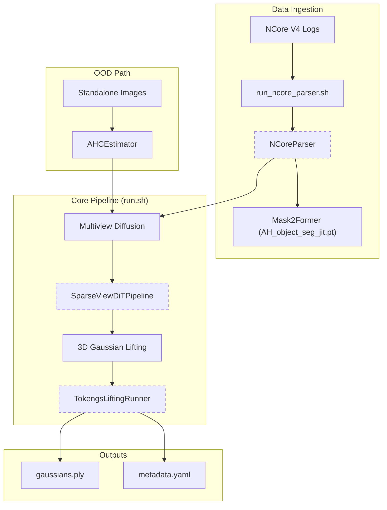
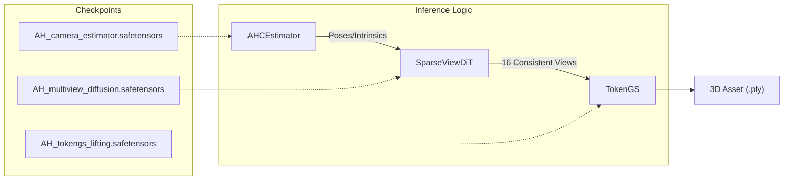

<!-- source: DeepWiki mcp.deepwiki.com · repo NVIDIA/asset-harvester · page 1 Asset Harvester Overview · fetched 2026-10-26 -->

# Asset Harvester Overview

Relevant source files

The following files were used as context for generating this wiki page:

- [README.md](README.md)
- [asset_harvester/__init__.py](asset_harvester/__init__.py)
- [docs/assets/teaser.gif](docs/assets/teaser.gif)
- [docs/end_to_end_example.md](docs/end_to_end_example.md)

Asset Harvester is an end-to-end system designed to convert sparse, in-the-wild object observations from autonomous driving logs into complete, simulation-ready 3D assets [README.md:15-18](). It addresses the challenge of neural scene reconstruction by producing high-fidelity 3D Gaussian Splatting (GS) assets for agents (vehicles, pedestrians, riders) even under heavy occlusion or noisy calibration [README.md:25-26]().

The system integrates large-scale curation of object-centric training data, geometry-aware preprocessing, and a robust training recipe that couples sparse-view multiview generation with feed-forward 3D lifting [README.md:17-18]().

### High-Level System Pipeline

The pipeline transforms raw sensor data into structured 3D assets through four primary stages:

1.  **NCore Parsing**: Extracts multi-view object crops and masks from NCore V4 driving logs [docs/end_to_end_example.md:27-29]().
2.  **Camera Estimation**: (Optional) Estimates poses and intrinsics for out-of-distribution (OOD) images where sensor calibration is missing [README.md:149-150]().
3.  **Multiview Diffusion (SparseViewDiT)**: Generates 16 geometrically consistent views from 1–3 input images [README.md:25-26]().
4.  **Gaussian Lifting (TokenGS)**: Lifts the generated views into a 3D Gaussian Splatting asset in seconds [README.md:25-26]().

### System Architecture and Code Mapping

The following diagram bridges the conceptual pipeline stages to the specific code entities and scripts that implement them.

**Diagram: Pipeline Data Flow and Code Entities**

**Sources:** [README.md:27-30](), [docs/end_to_end_example.md:31-33](), [docs/end_to_end_example.md:54-56](), [docs/end_to_end_example.md:76-78]().

---

### Major Subsystems

#### 1. NCore Parser
The ingestion engine for the pipeline. It processes NCore V4 clips—which bundle multi-camera images, lidar, and 3D cuboid tracks—to produce object-centric datasets [docs/end_to_end_example.md:21-25](). It utilizes a JIT-compiled Mask2Former model (`AH_object_seg_jit.pt`) for precise instance segmentation [docs/end_to_end_example.md:46]().

*   **Key Scripts**: `scripts/run_ncore_parser.sh`
*   **Key Classes**: `NCoreParser`, `NCoreObjectParser`
*   **For details, see [NCore Parser: Data Ingestion](#2)**.

#### 2. Multiview Diffusion (SparseViewDiT)
SparseViewDiT is a diffusion transformer explicitly designed to handle limited-angle views and real-world AV data challenges [README.md:17-18](). It takes sparse input views and generates a consistent 16-view orbit around the object [README.md:25-26]().

*   **Key Model**: `SparseViewDiTTransformer2DModelNative`
*   **Key Pipeline**: `SparseViewDiTPipeline`
*   **For details, see [SparseViewDiT: Multiview Diffusion](#3)**.

#### 3. TokenGS: 3D Gaussian Lifting
A feed-forward reconstructor that "lifts" the 16 views generated by the diffusion model into a 3D Gaussian Splatting representation [README.md:25-26](). Unlike traditional optimization-based GS, TokenGS performs this reconstruction in a single forward pass [README.md:25-26]().

*   **Key Model**: `TokenGS` (Transformer-based encoder-decoder)
*   **Key Runner**: `TokengsLiftingRunner`
*   **For details, see [TokenGS: 3D Gaussian Lifting](#4)**.

#### 4. Camera Estimator (AHCEstimator)
Used when processing "Out-of-Distribution" (OOD) images where camera intrinsics and extrinsics are unknown [README.md:149-150](). It estimates distance, FOV, and relative poses to provide the necessary geometric context for the diffusion and lifting stages.

*   **Key Class**: `AHCEstimator`
*   **For details, see [Camera Estimator (AHCEstimator)](#5)**.

---

### Component Interaction Diagram

This diagram illustrates how the different checkpoints and model components interact during a standard `run.sh` execution.

**Diagram: Model Component Interactions**

**Sources:** [README.md:96-101](), [README.md:116-121](), [README.md:152-160]().

---

### Child Pages

*   **[Getting Started: Installation and Setup](#1.1)**: Environment configuration, dependency management (PyTorch, gsplat), and checkpoint acquisition.
*   **[End-to-End Pipeline Walkthrough](#1.2)**: Step-by-step execution from raw NCore logs to simulation-ready assets, including `metadata.yaml` generation for NVIDIA Omniverse.
*   **[Data Samples Reference](#1.3)**: Overview of the bundled `data_samples/`, including rectified AV objects and OOD image formats.

**Sources:**
- Pipeline structure: [README.md:27-30](), [docs/end_to_end_example.md:1-4]()
- Checkpoint definitions: [README.md:96-101]()
- Script entry points: [docs/end_to_end_example.md:31-33](), [docs/end_to_end_example.md:54-56]()
- System purpose: [README.md:15-18]()

---

