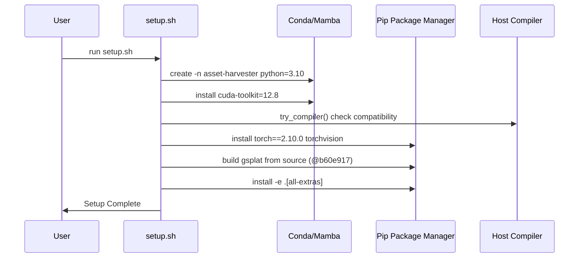
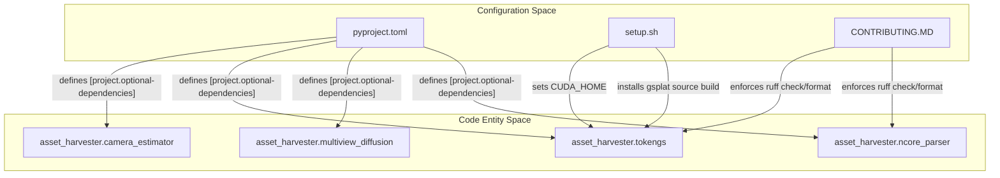

<!-- source: DeepWiki mcp.deepwiki.com · repo NVIDIA/asset-harvester · page 1.1 Getting Started: Installation and Setup · fetched 2026-10-26 -->

# Getting Started: Installation and Setup

<details>
<summary>Relevant source files</summary>

The following files were used as context for generating this wiki page:

- [CONTRIBUTING.MD](CONTRIBUTING.MD)
- [pyproject.toml](pyproject.toml)
- [setup.sh](setup.sh)

</details>


This page provides a technical guide for setting up the **Asset Harvester** environment. It covers hardware requirements, automated environment configuration via `setup.sh`, dependency management through `pyproject.toml` extras, and verification of the CUDA-accelerated components.

## System Requirements

The Asset Harvester pipeline requires specific hardware and software configurations to support high-fidelity 3D Gaussian Splatting and diffusion-based view generation.

*   **GPU:** NVIDIA GPU with at least **16 GB VRAM**. For lower VRAM configurations, CPU offloading can be enabled during inference [setup.sh:24-24]().
*   **Driver:** NVIDIA Driver version **>= 570** (required for CUDA 12.8 compatibility) [setup.sh:22-22]().
*   **Compiler:** GCC version **10–13** (tested with GCC 12.3) for building `gsplat` CUDA kernels [setup.sh:23-23]().
*   **Python:** Version **3.10** or higher [pyproject.toml:8-8]().

## Automated Installation

The project provides a `setup.sh` script that automates the creation of a Conda environment, installs the CUDA toolkit, builds the `gsplat` library from a pinned source commit, and installs the package in editable mode.

### Setup Execution Flow
The following diagram illustrates the sequence of operations performed by `setup.sh`.

**Figure 1: Environment Setup Sequence**

*Sources: [setup.sh:1-160]()*

### Usage
```bash
# Default installation (env name: asset-harvester, python: 3.10)
bash setup.sh

# Custom installation
bash setup.sh --env-name my-ah-env --python 3.11
```
*Sources: [setup.sh:28-45]()*

## Dependency Management

The project uses `pyproject.toml` to manage modular dependencies via optional extras. This allows users to install only the components necessary for their specific stage of the pipeline.

### Optional Extras
| Extra | Purpose | Key Dependencies |
| :--- | :--- | :--- |
| `ncore-parser` | Data ingestion from NCore V4 logs | `nvidia-ncore`, `pydantic`, `transformers` |
| `multiview_diffusion` | SparseViewDiT inference | `diffusers`, `accelerate`, `omegaconf` |
| `tokengs` | 3D Gaussian lifting and training | `gsplat`, `kiui`, `roma`, `lpips` |
| `camera-estimator` | Intrinsics/Extrinsics estimation for OOD images | `transformers`, `safetensors` |

*Sources: [pyproject.toml:19-81]()*

### Manual Installation of Extras
To install specific components manually:
```bash
pip install -e ".[ncore-parser,multiview_diffusion]"
```
*Sources: [pyproject.toml:83-86]()*

## Component Verification

### gsplat CUDA Backend
The `gsplat` library is a critical dependency for the `tokengs` module. It must be built from source to ensure compatibility with the local CUDA environment. The `setup.sh` script verifies the installation by attempting to load the C++ backend [setup.sh:142-142]().

### Code Quality Tools
The project uses `ruff` for linting and formatting [CONTRIBUTING.MD:11-11](). 
*   **Linting:** `ruff check asset_harvester` [CONTRIBUTING.MD:23-23]()
*   **Formatting:** `ruff format asset_harvester` [CONTRIBUTING.MD:38-38]()
*   **License Headers:** All source files must include the Apache-2.0 header, verified via `scripts/check_license_headers.py` [CONTRIBUTING.MD:43-49]().

## Data Flow: Setup to Runtime

The following diagram bridges the installation space to the code entities that manage the environment and execution.

**Figure 2: Setup Configuration Mapping**

*Sources: [pyproject.toml:19-81](), [setup.sh:138-144](), [CONTRIBUTING.MD:53-58]()*

## Contribution Prerequisites

Before submitting code, contributors must:
1.  **Sign-off Commits:** Use `git commit -s` to adhere to the Developer Certificate of Origin (DCO) [CONTRIBUTING.MD:64-77]().
2.  **Verify Headers:** Run `python scripts/check_license_headers.py` [CONTRIBUTING.MD:57-57]().
3.  **Lint/Format:** Ensure `ruff check` and `ruff format --check` pass [CONTRIBUTING.MD:55-56]().

*Sources: [CONTRIBUTING.MD:1-105]()*

---

