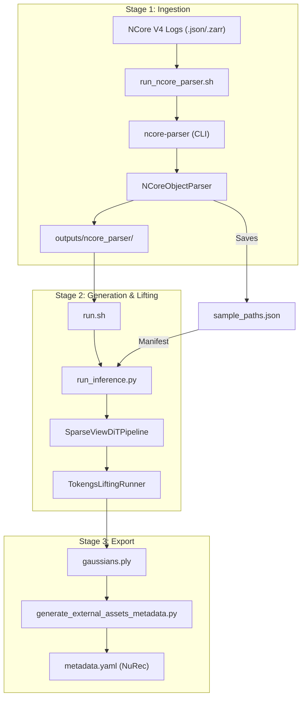
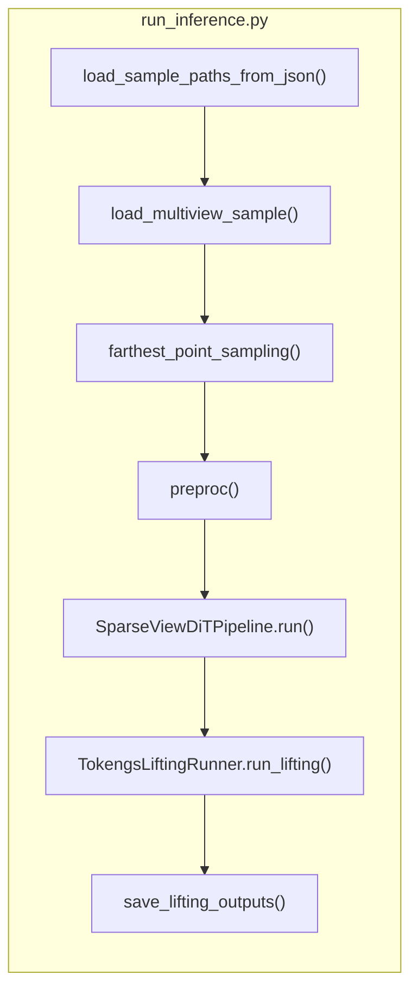

<!-- source: DeepWiki mcp.deepwiki.com · repo NVIDIA/asset-harvester · page 1.2 End-to-End Pipeline Walkthrough · fetched 2026-10-26 -->

# End-to-End Pipeline Walkthrough

<details>
<summary>Relevant source files</summary>

The following files were used as context for generating this wiki page:

- [docs/end_to_end_example.md](docs/end_to_end_example.md)
- [run.sh](run.sh)
- [run_inference.py](run_inference.py)
- [scripts/run_ncore_parser.sh](scripts/run_ncore_parser.sh)

</details>


This page provides a practical guide to the Asset Harvester pipeline, which transforms raw NCore V4 autonomous driving logs into simulation-ready 3D Gaussian Splatting (GS) assets. The pipeline consists of three primary stages: data ingestion and parsing, multiview diffusion generation, and feed-forward 3D lifting.

## Pipeline Overview

The pipeline follows a sequential flow from raw sensor data to a 3D asset. It is designed to be executed via a series of shell scripts that wrap the underlying Python logic.

### System Data Flow

The following diagram illustrates the flow of data from the NCore V4 source through the various code entities to the final PLY asset.

**Pipeline Entity Flow**

Sources: [docs/end_to_end_example.md:27-74](), [run_inference.py:30-48](), [scripts/run_ncore_parser.sh:98-104]()

---

## Step 1: NCore Parsing (Data Ingestion)

The first step uses `run_ncore_parser.sh` to extract object-centric crops from NCore V4 clips. This script invokes the `ncore-parser` entry point, which filters objects based on visibility and occlusion.

### Execution
```bash
bash scripts/run_ncore_parser.sh \
    --component-store "path/to/clip.json" \
    --output-path "outputs/ncore_parser/"
```
[scripts/run_ncore_parser.sh:31-34]()

### Key Arguments
| Argument | Default | Description |
|----------|---------|-------------|
| `--component-store` | *(required)* | Path to NCore V4 manifest or `.zarr.itar` globs. [scripts/run_ncore_parser.sh:30-31]() |
| `--output-path` | `outputs/ncore_parser/` | Target directory for parsed multi-view crops. [scripts/run_ncore_parser.sh:52]() |
| `--segmentation-ckpt` | `checkpoints/AH_object_seg_jit.pt` | JIT-compiled Mask2Former model for instance segmentation. [scripts/run_ncore_parser.sh:53]() |
| `--camera-ids` | 5 default cameras | Comma-separated list of NCore camera sensor IDs to process. [scripts/run_ncore_parser.sh:37-42]() |

### Output Structure
The parser generates a `sample_paths.json` manifest and subdirectories for each object:
```text
outputs/ncore_parser/
├── sample_paths.json           # Manifest for subsequent stages
└── <object_id>/
    └── input_views/
        ├── camera.json         # Poses, FOV, and LWH metadata
        ├── frame_000.png       # Rectified RGB crop
        └── mask_000.png        # Instance segmentation mask
```
Sources: [docs/end_to_end_example.md:42-49](), [run_inference.py:78-86](), [scripts/run_ncore_parser.sh:51-68]()

---

## Step 2: Diffusion and 3D Lifting

The `run.sh` script manages the core generative process. It first uses `SparseViewDiTPipeline` to generate 16 consistent views from 1-3 input images, then uses `TokengsLiftingRunner` to reconstruct the 3D Gaussian asset.

### Execution
```bash
bash run.sh --data-root ./outputs/ncore_parser --output-dir ./outputs/ncore_harvest
```
[run.sh:55-56]()

### Key Arguments
| Argument | Default | Description |
|----------|---------|-------------|
| `--data-root` | `outputs/ncore_parser/` | Input directory containing `sample_paths.json`. [run.sh:30-31]() |
| `--diffusion-ckpt` | `checkpoints/AH_multiview_diffusion.safetensors` | SparseViewDiT weights. [run.sh:33-34]() |
| `--lifting-ckpt` | `checkpoints/AH_tokengs_lifting.safetensors` | TokenGS weights. [run.sh:37-38]() |
| `--num-steps` | 30 | Diffusion denoising steps. [run.sh:40]() |
| `--skip-lifting` | `false` | If true, only generates 16-view images without 3D reconstruction. [run.sh:43]() |
| `--offload` | `false` | Offloads diffusion model to CPU during lifting to save VRAM. [run.sh:44]() |

### Implementation Details
`run.sh` internally calls `run_inference.py`, which performs the following:
1.  **Data Loading**: `load_sample_paths_from_json` reads the manifest [run_inference.py:51-76]().
2.  **View Selection**: If more than 3 views exist, `farthest_point_sampling` selects the most diverse views for conditioning [run_inference.py:37]().
3.  **Diffusion**: `SparseViewDiTPipeline` generates 16 images [run_inference.py:33]().
4.  **Lifting**: `TokengsLiftingRunner.run_lifting` takes the 16 views and outputs a `gaussians.ply` file [run_inference.py:40-46]().

**Inference Logic Diagram**

Sources: [run_inference.py:51-166](), [run.sh:179-189]()

---

## Step 3: Simulation Metadata Generation

For integration with NVIDIA Omniverse NuRec, a final metadata generation step is required. This converts the harvested assets into a format compatible with simulation workflows.

### Execution
```bash
python asset_harvester/utils/generate_external_assets_metadata.py --input-dir ./outputs/ncore_harvest
```
[docs/end_to_end_example.md:77]()

### Final Output Directory Structure
After the full pipeline, each object directory contains:
-   `multiview/`: The 16 images generated by SparseViewDiT.
-   `3d_lifted/`: Visualizations of the lifted Gaussian asset.
-   `gaussians.ply`: The final 3D Gaussian Splatting asset.
-   `multiview.mp4` & `3d_lifted.mp4`: Preview videos.
-   `metadata.yaml`: NuRec-compatible metadata (if Step 3 is run).

Sources: [docs/end_to_end_example.md:70-74](), [asset_harvester/utils/io.py:36]() (referenced in `run_inference.py`)

---

