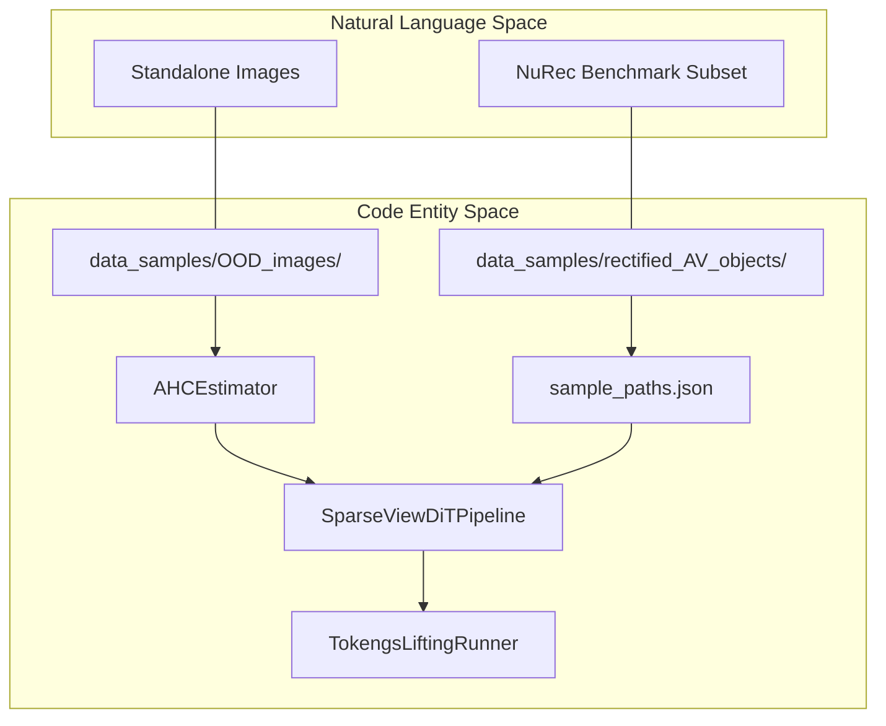
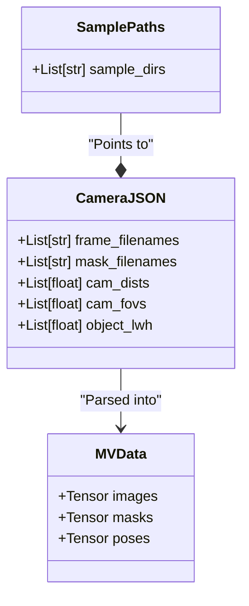

<!-- source: DeepWiki mcp.deepwiki.com · repo NVIDIA/asset-harvester · page 1.3 Data Samples Reference · fetched 2026-10-26 -->

# Data Samples Reference

<details>
<summary>Relevant source files</summary>

The following files were used as context for generating this wiki page:

- [README.md](README.md)
- [docs/end_to_end_example.md](docs/end_to_end_example.md)

</details>


The `data_samples/` directory contains curated examples used to demonstrate the Asset Harvester pipeline and verify installation. These samples represent two distinct data flows: rectified object-centric multi-view data (typically from the **NCore Parser**) and out-of-distribution (OOD) standalone images where camera parameters are unknown.

## Directory Structure and Data Types

The bundled data is organized into two primary subsets:

1.  **`rectified_AV_objects/`**: A subset of the [NuRec AV Object Benchmark](https://huggingface.co/datasets/nvidia/NuRec-AV-Object-Benchmark). This contains consumer vehicles and Vulnerable Road Users (VRU) such as pedestrians. These samples include precise camera intrinsics/extrinsics and object bounding box dimensions (LWH) [README.md:112-114]().
2.  **`OOD_images/`**: Standalone frame/mask pairs representing "in-the-wild" captures. These lack camera metadata, necessitating the use of the `AHCEstimator` (Camera Estimator) to predict distance, FOV, and poses before diffusion [README.md:152-156]().

### Data Flow for Samples

The following diagram illustrates how these data samples flow through the system components.

**Sample Processing Architecture**


Sources: [README.md:112-156](), [docs/end_to_end_example.md:60-70]()

---

## Input Views and Manifest Format

The Asset Harvester pipeline relies on a standardized directory structure and metadata format to process objects.

### sample_paths.json
The root of a processed dataset (like `rectified_AV_objects/`) contains a `sample_paths.json` manifest. This file acts as a registry for all object instances found within the directory [docs/end_to_end_example.md:60]().

### input_views/ Directory
Each object sample contains an `input_views/` subdirectory. This folder holds the raw sensor data and the critical `camera.json` file.

| File | Description |
| :--- | :--- |
| `frame_XXXXX.jpeg` | The RGB image crop centered on the object. |
| `mask_XXXXX.png` | A binary or bit-packed instance mask for the target object. |
| `camera.json` | The unified metadata file containing poses, intrinsics, and object dimensions. |

### camera.json Format
The `camera.json` is the core schema used by the `NCore Parser` and consumed by the `Multiview Diffusion` stage. It includes:

*   **frame_filenames**: List of RGB image paths.
*   **mask_filenames**: List of corresponding mask paths.
*   **normalized_cam_positions**: Camera positions relative to the object center.
*   **cam_dists**: Radial distance from the camera to the object center.
*   **cam_fovs**: Field of view for each camera.
*   **object_lwh**: The Length, Width, and Height of the object's 3D bounding box.

**Data Mapping: Manifest to Code Entities**


Sources: [docs/end_to_end_example.md:27-49](), [README.md:125-132]()

---

## OOD Image Requirements

For images in `data_samples/OOD_images/`, the system expects a specific flat structure if masks are already provided, or a structure compatible with the `image_segment` utility.

### Manual Preparation
If providing custom images, they must be resized to **512x512** and organized as follows [README.md:123-132]():
```text
YOUR_IMAGE_ROOT/
├─── SAMPLE_0
│    ├── frame.jpeg
│    └── mask.png
└─── SAMPLE_1
     ├── frame.jpeg
     └── mask.png
```

### Segmentation Utility
If masks are missing, the `asset_harvester.utils.image_segment` module (utilizing the `AH_object_seg_jit.pt` checkpoint) can be used to generate `mask.png` from `frame.jpeg` [README.md:138-145](). This utility implements a centering constraint to ensure the correct object is segmented in crowded driving scenes.

**OOD Processing Flow**
1.  **Segment**: `image_segment.py` generates masks [docs/end_to_end_example.md:80-90]().
2.  **Estimate**: `AHCEstimator` predicts the missing `camera.json` parameters (LWH, Distance, FOV) [README.md:149-156]().
3.  **Harvest**: `run_inference.py` executes the diffusion and lifting [README.md:116-121]().

Sources: [README.md:134-156](), [docs/end_to_end_example.md:80-95]()

---

