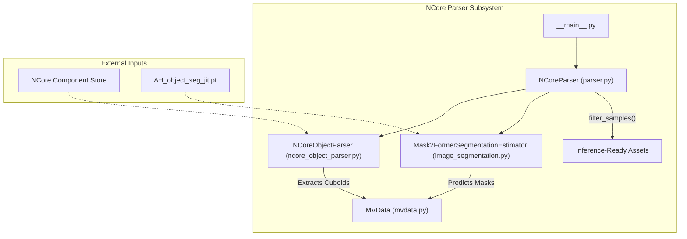
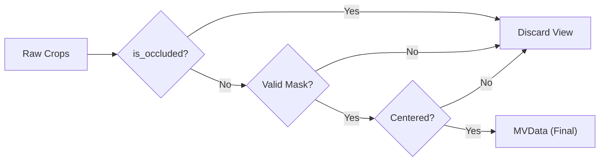

<!-- source: DeepWiki mcp.deepwiki.com · repo NVIDIA/asset-harvester · page 2 NCore Parser: Data Ingestion · fetched 2026-10-26 -->

# NCore Parser: Data Ingestion

Relevant source files

The following files were used as context for generating this wiki page:

- [asset_harvester/ncore_parser/__init__.py](asset_harvester/ncore_parser/__init__.py)
- [asset_harvester/ncore_parser/__main__.py](asset_harvester/ncore_parser/__main__.py)
- [asset_harvester/ncore_parser/parser.py](asset_harvester/ncore_parser/parser.py)

The `ncore_parser` subsystem is the primary entry point for the Asset Harvester pipeline when working with autonomous driving datasets. It is designed to ingest raw NCore V4 driving logs, identify specific object tracks (e.g., vehicles, pedestrians), and extract multi-view image crops along with their associated camera parameters and segmentation masks.

### System Purpose and Scope
The parser automates the transition from massive, world-coordinate sensor streams to object-centric data packets ready for 3D reconstruction. It handles coordinate transformations, view selection based on visibility, and integrates deep-learning-based segmentation to ensure the extracted assets are clean and centered.

## High-Level Architecture

The `ncore_parser` is organized around a main controller class that orchestrates extraction, segmentation, and filtering.

### Data Ingestion Flow
The following diagram illustrates how the `NCoreParser` coordinates between raw data extraction and the refinement of those views.

**Diagram: NCore Parser Execution Flow**

**Sources:** [asset_harvester/ncore_parser/parser.py:74-91](), [asset_harvester/ncore_parser/__main__.py:192-219]()

---

## Core Components

### NCoreParser (Controller)
The `NCoreParser` class [asset_harvester/ncore_parser/parser.py:74-75]() serves as the high-level API. It initializes the `NCoreObjectParser` for raw data handling and the `Mask2FormerSegmentationEstimator` for instance segmentation [asset_harvester/ncore_parser/parser.py:81-90](). Its `extract` method orchestrates the full pipeline from raw log paths to a dictionary of filtered `MVData` objects [asset_harvester/ncore_parser/parser.py:93-100]().

### NCoreObjectParser (Extractor)
This component handles the heavy lifting of reading NCore V4 component stores. It processes cuboid tracks, performs lidar-to-camera projections, and crops images to a target resolution [asset_harvester/ncore_parser/ncore_object_parser.py](). It is responsible for calculating initial occlusion rates and ensuring that the object is visible within the selected camera frames.
*   For details on extraction logic and track handling, see **[NCoreParser: Extraction and Filtering Logic](#2.1)**.

### Image Segmentation
The parser uses a JIT-compiled Mask2Former model to generate instance masks for every cropped view [asset_harvester/ncore_parser/parser.py:132-134](). These masks are critical for "best-fit" instance selection, where the system matches the predicted segmentation mask to the expected 3D cuboid projection [asset_harvester/ncore_parser/parser.py:34-41]().
*   For details on the segmentation model and bit-packed mask format, see **[Image Segmentation: Mask2Former Integration](#2.2)**.

---

## Data Filtering and Quality Control

The parser applies several heuristic filters to ensure that only high-quality, reconstructible views are passed to the SparseViewDiT model:
1.  **Occlusion Filtering:** Views with high occlusion rates (calculated via cuboid-to-lidar depth comparison) are discarded [asset_harvester/ncore_parser/parser.py:102-113]().
2.  **Centering Constraint:** The object must be relatively centered within the crop; views where the mask mean deviates significantly from the center are filtered out [asset_harvester/ncore_parser/parser.py:177-178]().
3.  **IoU Thresholding:** The system compares the segmentation mask with the target bounding box to ensure the correct object is being tracked [asset_harvester/ncore_parser/parser.py:63-71]().

**Diagram: View Filtering Logic**

**Sources:** [asset_harvester/ncore_parser/parser.py:152-182]()

---

## Configuration and Output Format

The behavior of the parser is governed by the `NCoreParserConfig` Pydantic schema [asset_harvester/ncore_parser/schemas.py](). This includes parameters for resolution, occlusion thresholds, and camera selection.

The final output is structured to be compatible with the downstream inference pipeline, producing a `sample_paths.json` manifest and a standardized directory structure for each object:
*   `input_views/`: Contains `frame_XX.jpeg`, `mask_XX.png`, and `camera.json`.
*   `metadata.json`: Contains clip and object IDs.

For details on the specific schemas and the directory hierarchy, see **[NCore Parser Schemas and Output Format](#2.3)**.

**Sources:** [asset_harvester/ncore_parser/__main__.py:53-67](), [asset_harvester/ncore_parser/__main__.py:93-102]()

---

