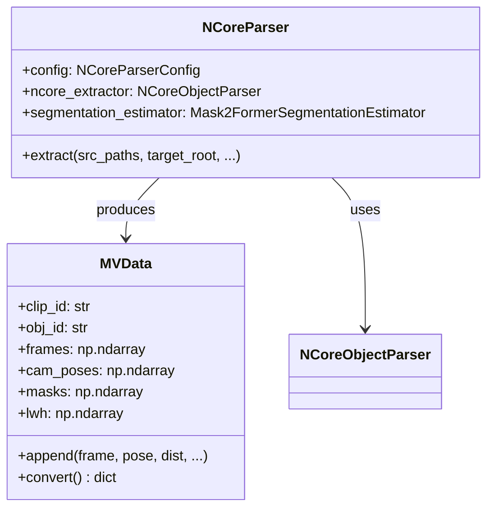

<!-- source: DeepWiki mcp.deepwiki.com · repo NVIDIA/asset-harvester · page 2.1 NCoreParser: Extraction and Filtering Logic · fetched 2026-10-26 -->

# NCoreParser: Extraction and Filtering Logic

<details>
<summary>Relevant source files</summary>

The following files were used as context for generating this wiki page:

- [asset_harvester/ncore_parser/mvdata.py](asset_harvester/ncore_parser/mvdata.py)
- [asset_harvester/ncore_parser/ncore_object_parser.py](asset_harvester/ncore_parser/ncore_object_parser.py)
- [asset_harvester/ncore_parser/parser.py](asset_harvester/ncore_parser/parser.py)
- [asset_harvester/ncore_parser/ray_aabb.py](asset_harvester/ncore_parser/ray_aabb.py)

</details>


The `NCoreParser` and `NCoreObjectParser` modules are responsible for the ingestion, extraction, and filtering of object-centric multi-view data from NCore V4 autonomous driving logs. This subsystem bridges raw sensor data and cuboid tracks into the `MVData` format required for downstream 3D asset generation.

## Overview and Data Flow

The extraction process transforms world-space cuboid tracks into normalized, cropped, and segmented image sequences. The logic is split between `NCoreObjectParser`, which handles the geometric extraction from NCore stores, and `NCoreParser`, which applies high-level segmentation-based filtering.

### System Data Flow

The following diagram illustrates the transformation of raw NCore V4 data into filtered `MVData` objects.

**Title: NCore Extraction Pipeline**
```mermaid
graph TD
    subgraph "NCore V4 Storage"
        [SequenceLoaderV4] --> [SequenceComponentGroupsReader]
        [SequenceComponentGroupsReader] --> [CuboidTrackObservation]
    end

    subgraph "NCoreObjectParser (Geometric Extraction)"
        [CuboidTrackObservation] --> |"build_tracks_from_observations"| [TrackData]
        [TrackData] --> |"extract"| [MVData_Raw]
        [MVData_Raw] --> |"compute_occlusion_rate"| [Occlusion_Metadata]
    end

    subgraph "NCoreParser (Filtering Logic)"
        [MVData_Raw] --> |"Mask2FormerSegmentationEstimator"| [Instance_Masks]
        [Instance_Masks] --> |"select_bestfit_instances"| [Filtered_Masks]
        [Filtered_Masks] --> |"_filter_samples"| [MVData_Final]
    end

    [MVData_Final] --> |"convert"| [Output_Dict]
```
Sources: [asset_harvester/ncore_parser/ncore_object_parser.py:29-42](), [asset_harvester/ncore_parser/parser.py:74-125](), [asset_harvester/ncore_parser/mvdata.py:40-101]()

---

## NCoreObjectParser: Geometric Extraction

The `NCoreObjectParser` [asset_harvester/ncore_parser/ncore_object_parser.py:197-200]() interfaces with the `ncore` library to retrieve sensor data and track information.

### Track Building and Interpolation
Raw observations are grouped by `track_id` and sorted by timestamp. If a track contains multiple observations, a `PoseInterpolator` is created to estimate the object's position at exact camera frame timestamps [asset_harvester/ncore_parser/ncore_object_parser.py:131-176]().

### Occlusion Rate Computation
The parser computes an occlusion rate to filter out views where the target object is hidden by LiDAR points (proxy for geometry).
1. It projects LiDAR points into the camera frame.
2. It uses `ray_aabb_intersect` [asset_harvester/ncore_parser/ray_aabb.py:50-111]() to determine if rays from the camera to the object's AABB (Axis-Aligned Bounding Box) are blocked by points closer to the camera than the object.
3. The `compute_occlusion_rate` function [asset_harvester/ncore_parser/ncore_object_parser.py:230-264]() returns a ratio of occluded vs. visible rays.

### View Normalization
For every extracted frame, the parser computes a canonical camera pose:
- **Look-at Vector**: The camera is oriented to look directly at the center of the object's 3D bounding box [asset_harvester/ncore_parser/ncore_object_parser.py:95-111]().
- **Up Vector**: Derived from the bounding box corners to ensure the "ground" is consistent across views [asset_harvester/ncore_parser/ncore_object_parser.py:113-118]().

Sources: [asset_harvester/ncore_parser/ncore_object_parser.py:131-176](), [asset_harvester/ncore_parser/ncore_object_parser.py:230-264](), [asset_harvester/ncore_parser/ray_aabb.py:50-111]()

---

## NCoreParser: Segmentation and Filtering

The `NCoreParser` [asset_harvester/ncore_parser/parser.py:74-76]() wraps the geometric extractor and adds semantic awareness using `Mask2Former`.

### Best-Fit Instance Selection
Because an image may contain multiple objects of the same class, the parser must identify which instance mask corresponds to the NCore track. The `select_bestfit_instances` function [asset_harvester/ncore_parser/parser.py:34-41]() performs this selection:
1. **Convex Hull**: It creates a target mask from the 2D projection of the 3D bounding box (`bbox_pix`) [asset_harvester/ncore_parser/parser.py:43-46]().
2. **IoU Thresholding**: It calculates the Intersection over Union (IoU) between the target mask and all instance masks produced by the segmentor [asset_harvester/ncore_parser/parser.py:63-67]().
3. **Exceed Constraint**: It rejects masks that extend significantly beyond the target bounding box (controlled by `mask_exceed_threshold`) [asset_harvester/ncore_parser/parser.py:60-61]().

### View Filtering Heuristics
The `_filter_samples` method [asset_harvester/ncore_parser/parser.py:152-154]() applies several constraints to ensure high-quality training data:
- **Occlusion**: Frames marked as occluded by the `NCoreObjectParser` are discarded [asset_harvester/ncore_parser/parser.py:167-168]().
- **Centering Constraint**: The object must be relatively centered in the crop. This is verified by checking if the mean of the mask coordinates $(y, x)$ is within a specific radius of the image center [asset_harvester/ncore_parser/parser.py:177-178]().
- **Minimum Pixels**: Masks with fewer than `min_instance_pixels` are rejected [asset_harvester/ncore_parser/parser.py:175-176]().

Sources: [asset_harvester/ncore_parser/parser.py:34-72](), [asset_harvester/ncore_parser/parser.py:152-185]()

---

## MVData Object

The `MVData` class [asset_harvester/ncore_parser/mvdata.py:40-62]() is the primary container for the extracted data. It stores:
- **Frames**: RGB crops of the object.
- **Cam Poses**: $4 \times 4$ matrices representing the camera-to-world transformation.
- **Dists**: The distance from the camera to the object center.
- **FOV**: The field of view used for the crop.
- **Masks**: Binary instance masks.

### Conversion for Storage
The `convert()` method [asset_harvester/ncore_parser/mvdata.py:102-144]() serializes these fields into a dictionary of byte buffers, suitable for writing to disk as `.jpeg` and `.npy` files.

**Title: MVData Entity Relationship**

Sources: [asset_harvester/ncore_parser/mvdata.py:40-144](), [asset_harvester/ncore_parser/parser.py:74-125]()

---

