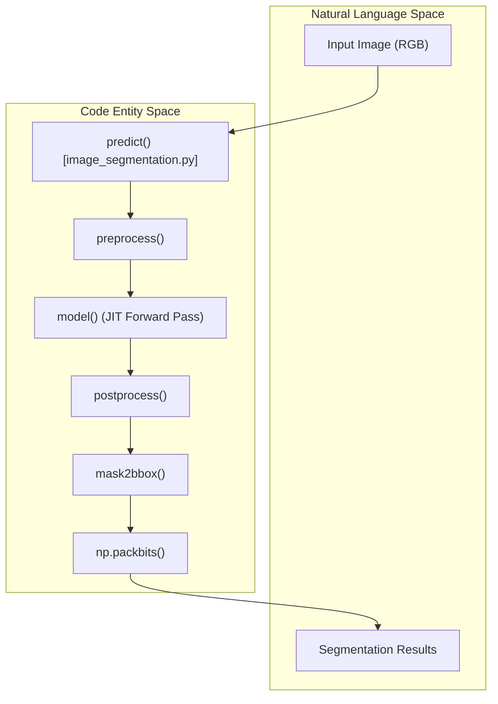
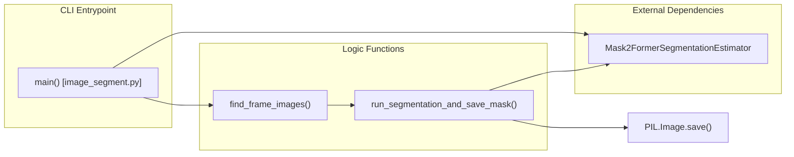

<!-- source: DeepWiki mcp.deepwiki.com · repo NVIDIA/asset-harvester · page 2.2 Image Segmentation: Mask2Former Integration · fetched 2026-10-26 -->

# Image Segmentation: Mask2Former Integration

Relevant source files

The following files were used as context for generating this wiki page:

- [asset_harvester/ncore_parser/image_segmentation.py](asset_harvester/ncore_parser/image_segmentation.py)
- [asset_harvester/utils/image_segment.py](asset_harvester/utils/image_segment.py)

The Asset Harvester utilizes a specialized **Mask2Former** instance segmentation model to generate high-quality binary masks for object extraction. This subsystem is responsible for identifying foreground objects in multi-view images, which is critical for the `ncore_parser` to filter out background noise and for the subsequent 3D Gaussian lifting stage to focus on the asset of interest.

## Mask2Former JIT Integration

The segmentation engine is implemented as a TorchScript JIT (Just-In-Time) module, allowing for high-performance inference without a heavy dependency on the original training framework. The core logic resides in the `Mask2FormerSegmentationEstimator` class [asset_harvester/ncore_parser/image_segmentation.py:42-43]().

### Configuration and Optimization
The estimator requires a pre-compiled JIT checkpoint, typically `AH_object_seg_jit.pt`. To ensure compatibility across different GPU architectures and prevent runtime failures, the module explicitly disables certain JIT optimizations:
*   **NVFuser Disable**: The environment variable `PYTORCH_NVFUSER_DISABLE` is set to `"1"` [asset_harvester/ncore_parser/image_segmentation.py:24]().
*   **Bailout Depth**: `torch._C._jit_set_bailout_depth(0)` is called to prevent incompatible re-compilations between subsequent calls [asset_harvester/ncore_parser/image_segmentation.py:23]().

### Segmentation Data Flow
The following diagram illustrates the flow from a raw image to the bit-packed instance masks.

**Mask2Former Inference Pipeline**

Sources: [asset_harvester/ncore_parser/image_segmentation.py:42-167]()

## Data Processing and Bit-Packing

To minimize memory footprint and disk I/O when handling large batches of multi-view images, the system uses a **bit-packed mask format**.

1.  **Preprocessing**: Images are converted to tensors, normalized, and resized to the model's expected `input_size` (typically 512x512) [asset_harvester/ncore_parser/image_segmentation.py:73-92]().
2.  **Inference**: The model returns a tuple containing panoptic segmentation, instance labels, masks, scores, and semantic segmentation [asset_harvester/ncore_parser/image_segmentation.py:96]().
3.  **Filtering**: Only instances with a score above `pred_score_thr` (default 0.3) are retained [asset_harvester/ncore_parser/image_segmentation.py:103]().
4.  **Bit-Packing**: Boolean instance masks are converted to `uint8` arrays using `np.packbits()`. This reduces the mask size by a factor of 8 [asset_harvester/ncore_parser/image_segmentation.py:108]().
5.  **Bounding Boxes**: Tight bounding boxes are computed from the masks using the `mask2bbox` helper function [asset_harvester/ncore_parser/image_segmentation.py:27-39]().

Sources: [asset_harvester/ncore_parser/image_segmentation.py:27-39](), [asset_harvester/ncore_parser/image_segmentation.py:94-112]()

## Standalone Utility: image_segment.py

For Out-of-Distribution (OOD) images or manual data correction, the `image_segment.py` utility provides a CLI to regenerate masks. This script is particularly useful when the `ncore_parser` has already extracted frames but masks need to be updated with different thresholds or a new model checkpoint.

### Object-Centric Selection Heuristic
When running in standalone mode, the utility assumes the image is centered on a single asset. It uses a **Largest-Area Heuristic** to select the target mask:
1.  Unpacks the bit-packed masks back to boolean arrays [asset_harvester/utils/image_segment.py:61]().
2.  Calculates the sum of pixels for every detected instance [asset_harvester/utils/image_segment.py:63]().
3.  Selects the instance with the maximum area (`np.argmax(areas)`) [asset_harvester/utils/image_segment.py:64]().
4.  Resizes this mask back to the original image dimensions using `Image.NEAREST` interpolation to preserve binary boundaries [asset_harvester/utils/image_segment.py:68]().

### CLI Usage
The utility recursively searches for images matching a specific filename (e.g., `frame.jpeg`) and saves the resulting mask in the same directory.

**CLI Component Interaction**

Sources: [asset_harvester/utils/image_segment.py:33-73](), [asset_harvester/utils/image_segment.py:76-159]()

## Key Functions and Classes

| Entity | Location | Role |
| :--- | :--- | :--- |
| `Mask2FormerSegmentationEstimator` | `image_segmentation.py` | Primary class for loading the JIT model and performing inference. |
| `mask2bbox` | `image_segmentation.py` | Utility to convert binary masks into `[x1, y1, x2, y2]` coordinates. |
| `predict_batch` | `image_segmentation.py` | Batched inference implementation for improved GPU throughput. |
| `run_segmentation_and_save_mask` | `image_segment.py` | Orchestrates image loading, prediction, area-based selection, and mask saving. |
| `np.packbits` / `np.unpackbits` | Internal (NumPy) | Used to compress/decompress masks for storage efficiency. |

Sources: [asset_harvester/ncore_parser/image_segmentation.py:42-167](), [asset_harvester/utils/image_segment.py:39-73]()

---

