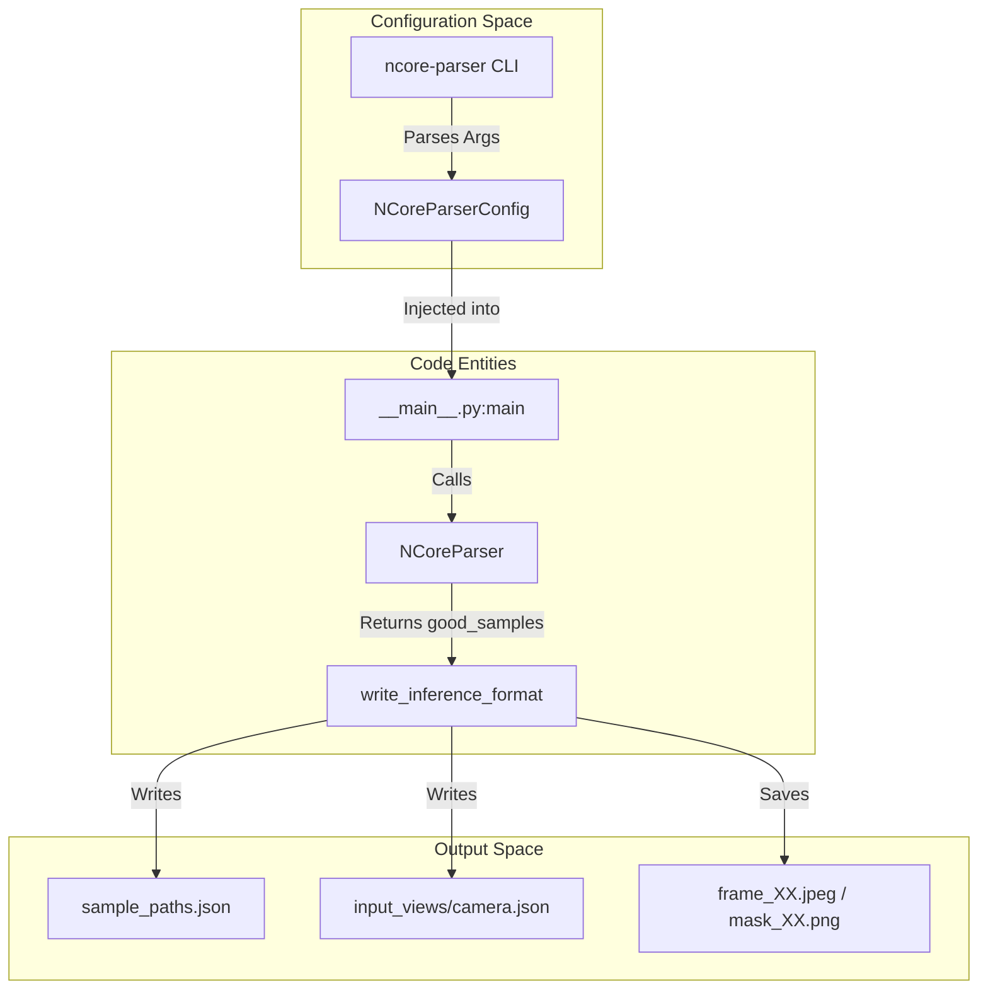
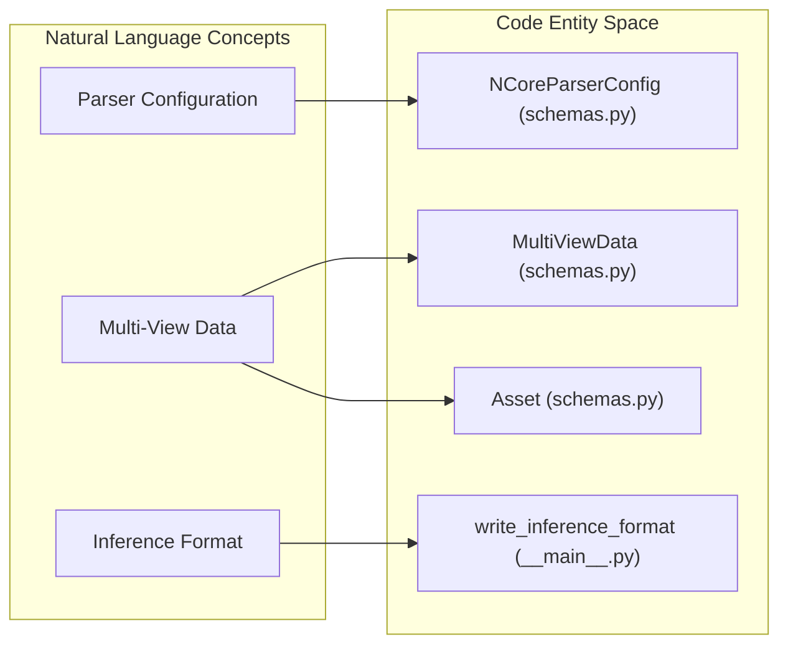

<!-- source: DeepWiki mcp.deepwiki.com · repo NVIDIA/asset-harvester · page 2.3 NCore Parser Schemas and Output Format · fetched 2026-10-26 -->

# NCore Parser Schemas and Output Format

<details>
<summary>Relevant source files</summary>

The following files were used as context for generating this wiki page:

- [asset_harvester/ncore_parser/__main__.py](asset_harvester/ncore_parser/__main__.py)
- [asset_harvester/ncore_parser/schemas.py](asset_harvester/ncore_parser/schemas.py)
- [scripts/run_ncore_parser.sh](scripts/run_ncore_parser.sh)

</details>


This page documents the data structures and output conventions used by the `ncore_parser` subsystem. The parser translates raw NCore V4 autonomous driving logs into a standardized, object-centric format compatible with the SparseViewDiT and TokenGS stages of the Asset Harvester pipeline.

## Pydantic Configuration Schemas

The `ncore_parser` utilizes Pydantic models to manage configuration and ensure data integrity during the extraction process. These schemas define the filtering logic, sensor selection, and metadata structure for harvested assets.

### NCoreParserConfig
The `NCoreParserConfig` class defines the operational parameters for the extraction pipeline, including thresholds for view filtering and sensor configuration [asset_harvester/ncore_parser/schemas.py:20-41]().

| Field | Type | Default | Description |
| :--- | :--- | :--- | :--- |
| `target_resolution` | `int` | `512` | Resolution for the exported image crops. |
| `num_lidar_ref_frames`| `int` | `10` | Max LiDAR frames sampled per track for geometry verification. |
| `cam_pose_flip` | `list[int]` | `[1, 1, -1]` | Factors to flip pose coordinates (x, y, z). |
| `occ_rate_threshold` | `float` | `0.5` | Max occlusion rate allowed before a view is discarded. |
| `crop_min_area_ratio` | `float` | `0.002` | Minimum bounding box area relative to image size. |
| `mask_overlap_threshold`| `float` | `0.3` | Threshold for instance segmentation overlap filtering. |
| `camera_ids` | `list[str]` | (Standard Surround) | List of NCore sensor IDs to process [asset_harvester/ncore_parser/schemas.py:32-41](). |
| `segmentation_ckpt` | `str` | N/A | Path to the Mask2Former JIT checkpoint. |

### Data Representation Schemas
The parser uses several auxiliary schemas to represent the state of an asset before it is written to disk:
*   **`MultiViewData`**: Holds the intrinsic and extrinsic camera data, distances, and object dimensions (LWH) for a set of frames [asset_harvester/ncore_parser/schemas.py:46-54]().
*   **`Asset`**: A container for a single track, including its `clip_id`, `track_id`, and associated `MultiViewData` [asset_harvester/ncore_parser/schemas.py:57-64]().
*   **`AssetHarvestingMetadata`**: The top-level schema representing a complete harvesting run, linking the configuration to the extracted assets [asset_harvester/ncore_parser/schemas.py:67-73]().

Sources: [asset_harvester/ncore_parser/schemas.py:20-73]()

## Output Directory Structure

The `write_inference_format` function in the CLI entry point dictates the directory structure of the output. This format is designed to be consumed directly by the inference scripts (`run.sh`) [asset_harvester/ncore_parser/__main__.py:53-67]().

### Directory Hierarchy
```text
output_dir/
├── sample_paths.json              # Global manifest of valid samples
└── <category>/                    # e.g., vehicle, pedestrian
    └── <track_id>/                # Unique object identifier
        ├── metadata.json          # Link back to source clip and ID
        └── input_views/           # Source data for diffusion
            ├── camera.json        # Unified camera/geometry data
            ├── frame_00.jpeg      # Object-centric crop
            ├── mask_00.png        # Instance segmentation mask
            └── ...
```

### Global Manifest: sample_paths.json
The `sample_paths.json` file contains a list of relative paths to every object directory successfully processed. This allows the subsequent pipeline stages to iterate over assets without traversing the entire filesystem [asset_harvester/ncore_parser/__main__.py:114-115]().

Sources: [asset_harvester/ncore_parser/__main__.py:53-115]()

## Camera and View Data Format

The core of the object representation is the `input_views/camera.json` file. This file provides the necessary geometric context for SparseViewDiT to perform consistent multi-view synthesis.

### camera.json Structure
The data is serialized from the `MultiViewData` object during the export phase [asset_harvester/ncore_parser/__main__.py:93-102]().

| Key | Description |
| :--- | :--- |
| `frame_filenames` | List of strings mapping to JPEG crops in the directory. |
| `mask_filenames` | List of strings mapping to PNG masks. |
| `normalized_cam_positions` | Camera positions in a coordinate system where the object is at the origin. |
| `cam_dists` | Scalar distance from the camera to the object center. |
| `cam_fovs` | Horizontal Field of View for each camera in degrees. |
| `object_lwh` | The Length, Width, and Height of the object bounding box. |

### View Filtering Logic
The parser does not export every frame. It applies the `occ_rate_threshold` and `crop_min_area_ratio` defined in `NCoreParserConfig` to ensure only high-quality, visible views are provided to the diffusion model [asset_harvester/ncore_parser/__main__.py:157-167]().

Sources: [asset_harvester/ncore_parser/__main__.py:93-102](), [asset_harvester/ncore_parser/schemas.py:20-41]()

## System Flow: Configuration to Output

The following diagram illustrates how the `NCoreParserConfig` drives the CLI and results in the standardized output format.

**Data Flow: NCore Parser Ingestion**

Sources: [asset_harvester/ncore_parser/__main__.py:192-219](), [asset_harvester/ncore_parser/__main__.py:53-115]()

## Code Entity Association

The following diagram maps the high-level concepts of the "Output Format" to the specific Pydantic classes and functions that generate them.

**Mapping: Logic to Code Entities**

Sources: [asset_harvester/ncore_parser/schemas.py:20-64](), [asset_harvester/ncore_parser/__main__.py:53-54]()

---

