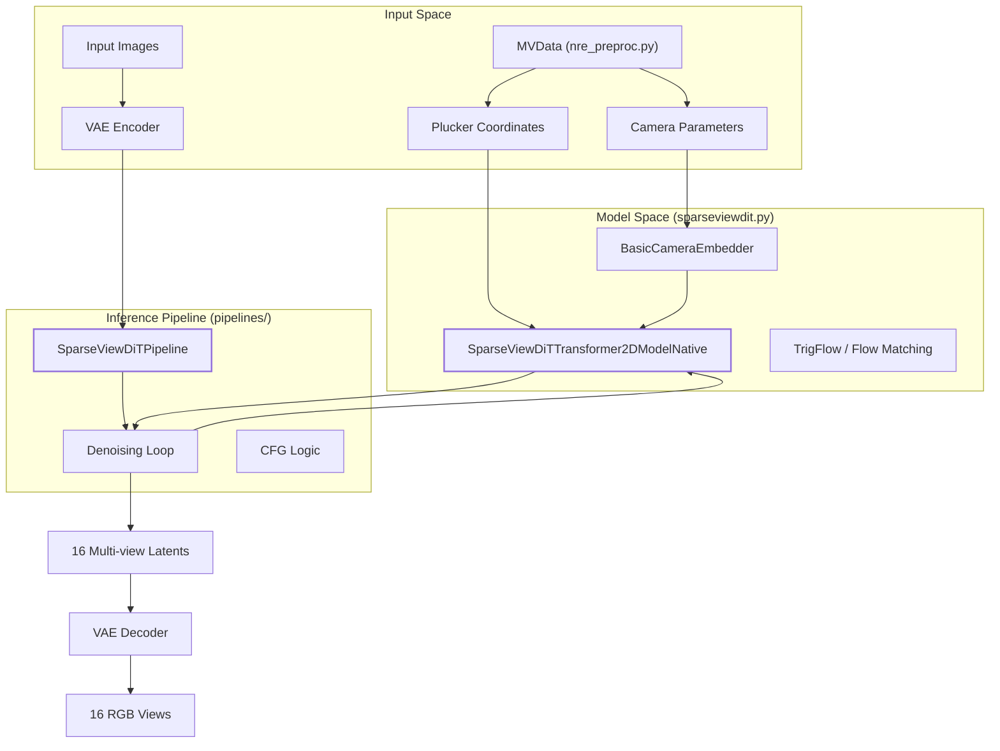

<!-- source: DeepWiki mcp.deepwiki.com · repo NVIDIA/asset-harvester · page 3 SparseViewDiT: Multiview Diffusion · fetched 2026-10-26 -->

# SparseViewDiT: Multiview Diffusion

Relevant source files

The following files were used as context for generating this wiki page:

- [asset_harvester/multiview_diffusion/__init__.py](asset_harvester/multiview_diffusion/__init__.py)
- [asset_harvester/multiview_diffusion/models/__init__.py](asset_harvester/multiview_diffusion/models/__init__.py)

The `multiview_diffusion` subsystem, centered around the **SparseViewDiT** architecture, is responsible for generating a set of 16 geometrically consistent multi-view images from a sparse set of 1–3 input views. This stage bridges the gap between 2D object crops extracted by the [NCore Parser: Data Ingestion](#2) and the 3D reconstruction performed by [TokenGS: 3D Gaussian Lifting](#4). By synthesizing missing perspectives, it provides the dense multi-view supervision necessary for high-quality feed-forward 3D lifting.

### System Overview

SparseViewDiT leverages a Diffusion Transformer (DiT) backbone to perform conditional image generation. It takes as input latent representations of the source images, their corresponding camera parameters, and a target set of 16 camera poses. The system outputs 16 latent frames that are subsequently decoded into RGB images.

The subsystem is organized into several key components:
*   **Models**: Transformer-based architectures (`SparseViewDiTTransformer2DModelNative`) that handle the multi-view denoising process.
*   **Pipelines**: Inference orchestrators (`SparseViewDiTPipeline`) that manage the diffusion schedule, VAE encoding/decoding, and Classifier-Free Guidance (CFG).
*   **Data Utilities**: Preprocessing logic for Plucker ray generation and camera sampling.

### Architecture and Data Flow

The following diagram illustrates how the multiview diffusion components interact within the codebase to transform input images into a consistent 16-view set.

**SparseViewDiT Data Flow and Entity Mapping**

Sources: [asset_harvester/multiview_diffusion/__init__.py:21-34](), [asset_harvester/multiview_diffusion/models/__init__.py:16-21]()

### Subsystem Components

#### SparseViewDiT Model Architecture
The core of the system is a 2D Transformer model adapted for multi-view consistency. It utilizes a `BasicCameraEmbedder` to inject 17-dimensional camera embeddings (derived from camera-to-world matrices and Field of View) and incorporates Plucker ray embeddings to provide spatial grounding for the generated views.
*   For details on the transformer blocks and camera embedding logic, see [SparseViewDiT Model Architecture](#3.1).

#### Inference Pipelines
Inference is managed through specialized Diffusers-compatible pipelines. The `SparseViewDiTPipeline` handles the standard denoising process, while the `SparseViewDiTSprintPipeline` is optimized for speed. These pipelines manage the `cond_mask` (identifying which of the 16 slots are provided as input) and `c-radio` image conditioning.
*   For details on the denoising loop and memory optimizations, see [SparseViewDiT Inference Pipelines](#3.2).

#### Data and Preprocessing
Before entering the diffusion model, data must be prepared via `nre_preproc.py`. This includes generating Plucker coordinates and performing farthest-point sampling to select the most diverse input views if more than three are available.
*   For details on camera sampling and coordinate generation, see [Multiview Diffusion Data and Preprocessing](#3.3).

#### Utilities and Model Builder
The `model_builder.py` module provides factory functions for initializing the DiT models and the `c-radio` conditioning backbone. Configuration is managed via `OmegaConf` to ensure reproducibility across different hardware setups.
*   For details on model initialization and utility helpers, see [Multiview Diffusion Utilities and Model Builder](#3.4).

### Code Entity Mapping

| Code Entity | File Path | Role |
| :--- | :--- | :--- |
| `SparseViewDiTTransformer2DModelNative` | [asset_harvester/multiview_diffusion/models/sparseviewdit.py]() | Primary DiT architecture for multi-view generation. |
| `SparseViewDiTTrigFlow` | [asset_harvester/multiview_diffusion/models/sparseview_trigflow.py]() | Flow-matching variant of the DiT model. |
| `BasicCameraEmbedder` | [asset_harvester/multiview_diffusion/models/sparseviewdit_embedders.py]() | Projects 6DoF poses and FOV into embedding space. |
| `SparseViewDiTPipeline` | [asset_harvester/multiview_diffusion/pipelines/pipeline_sparseviewdit.py]() | Standard inference pipeline for 16-view synthesis. |
| `get_models` | [asset_harvester/multiview_diffusion/utils/model_builder.py]() | Factory function to load and configure models from checkpoints. |

Sources: [asset_harvester/multiview_diffusion/__init__.py:21-35](), [asset_harvester/multiview_diffusion/models/__init__.py:16-22]()

---

