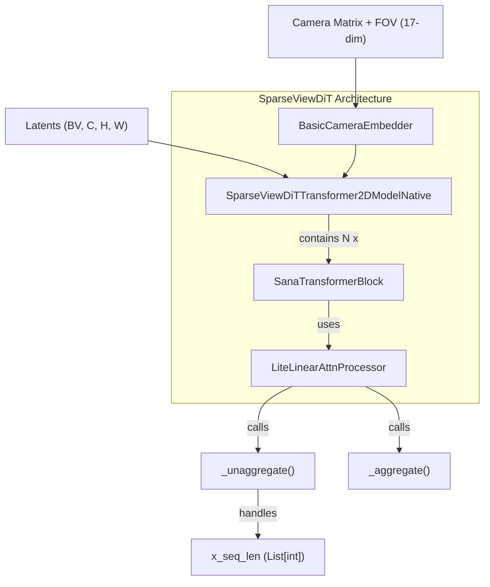
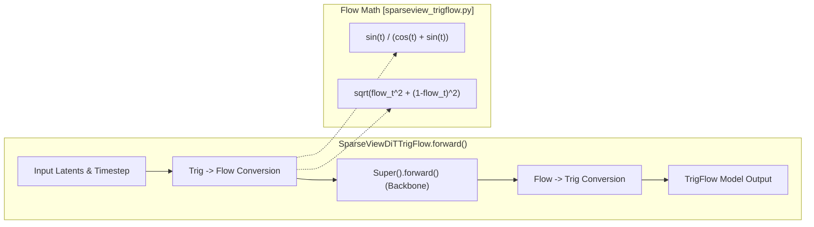

<!-- source: DeepWiki mcp.deepwiki.com · repo NVIDIA/asset-harvester · page 3.1 SparseViewDiT Model Architecture · fetched 2026-10-26 -->

# SparseViewDiT Model Architecture

Relevant source files

The following files were used as context for generating this wiki page:

- [asset_harvester/multiview_diffusion/models/sparseview_trigflow.py](asset_harvester/multiview_diffusion/models/sparseview_trigflow.py)
- [asset_harvester/multiview_diffusion/models/sparseviewdit.py](asset_harvester/multiview_diffusion/models/sparseviewdit.py)
- [asset_harvester/multiview_diffusion/models/sparseviewdit_embedders.py](asset_harvester/multiview_diffusion/models/sparseviewdit_embedders.py)
- [asset_harvester/multiview_diffusion/schedulers/__init__.py](asset_harvester/multiview_diffusion/schedulers/__init__.py)
- [asset_harvester/multiview_diffusion/schedulers/trigflow_scheduler.py](asset_harvester/multiview_diffusion/schedulers/trigflow_scheduler.py)

The SparseViewDiT (Sparse View Diffusion Transformer) architecture is the generative core of the Asset Harvester pipeline. It is responsible for generating 16 geometrically consistent views of an object from 1–3 input images. The model is built on the `SanaTransformer2DModel` [asset_harvester/multiview_diffusion/models/sparseviewdit.py:47-47]() and extended to support multiview-specific conditioning, including camera extrinsics, field-of-view (FOV), and Plucker ray embeddings.

## SparseViewDiTTransformer2DModelNative

The `SparseViewDiTTransformer2DModelNative` class is a native Diffusers implementation that integrates multiview conditioning directly into the transformer blocks. It maps original training components to standard Diffusers building blocks to ensure compatibility with features like LoRA and gradient checkpointing [asset_harvester/multiview_diffusion/models/sparseviewdit.py:25-36]().

### Data Flow and Conditioning
The model processes latents of shape `(BV, C, H, W)`, where `BV` represents the total number of views across the batch. Key conditioning inputs include:
*   **Camera Embeddings**: Injected via `BasicCameraEmbedder` [asset_harvester/multiview_diffusion/models/sparseviewdit_embedders.py:24-24]().
*   **Plucker Rays**: High-dimensional geometric embeddings added to the patch embeddings.
*   **Conditioning Mask (`cond_mask`)**: Identifies which views are provided as input (ground truth) versus those to be generated.
*   **Sequence Length (`x_seq_len`)**: A list of integers defining how many views belong to each batch item, used for linear attention packing [asset_harvester/multiview_diffusion/models/sparseviewdit.py:124-131]().

### Linear Attention Processing
To maintain efficiency across many views, the model utilizes `LiteLinearAttnProcessor`. This processor handles variable-length multiview sequences by padding them into a fixed-size batch during the attention mechanism [asset_harvester/multiview_diffusion/models/sparseviewdit.py:119-132]().

| Function | Role |
| :--- | :--- |
| `_unaggregate` | Pads `(BV, N, C)` packed tokens into `(B, max_views*N, C)` padded batch [asset_harvester/multiview_diffusion/models/sparseviewdit.py:56-65](). |
| `_aggregate` | Re-packs the padded batch back to the original `(BV, N, C)` format after attention [asset_harvester/multiview_diffusion/models/sparseviewdit.py:92-101](). |

**Sources:** [asset_harvester/multiview_diffusion/models/sparseviewdit.py:16-132](), [asset_harvester/multiview_diffusion/models/sparseviewdit_embedders.py:24-35]()

## TrigFlow Variant

The `SparseViewDiTTrigFlow` class is a specialized wrapper that implements **TrigFlow**, a flow-matching variant designed for improved distillation and sampling [asset_harvester/multiview_diffusion/models/sparseview_trigflow.py:21-21]().

### Flow Transformation Logic
The model converts standard timesteps into trigonometric flow timesteps before passing them to the transformer backbone.

1.  **TrigFlow to Flow**: The input `timestep` is transformed using sine and cosine functions:
    `flow_timestep = sin(t) / (cos(t) + sin(t))` [asset_harvester/multiview_diffusion/models/sparseview_trigflow.py:44-44]().
2.  **Latent Scaling**: Latents are scaled by the magnitude of the flow vector:
    `latent_model_input = latents * sqrt(flow_t^2 + (1 - flow_t)^2)` [asset_harvester/multiview_diffusion/models/sparseview_trigflow.py:47-47]().
3.  **Inverse Transformation**: After the forward pass, the model output is converted back from Flow space to TrigFlow space to provide the final prediction [asset_harvester/multiview_diffusion/models/sparseview_trigflow.py:71-74]().

**Sources:** [asset_harvester/multiview_diffusion/models/sparseview_trigflow.py:21-93](), [asset_harvester/multiview_diffusion/schedulers/trigflow_scheduler.py:49-120]()

## Camera and Ray Embeddings

### BasicCameraEmbedder
The `BasicCameraEmbedder` processes a 17-dimensional vector per view. This vector consists of:
*   **Camera-to-World (c2w)**: 16 values from the flattened 4x4 matrix.
*   **FOV**: 1 value representing the field of view.

The embedder uses a 2-layer MLP with SiLU activation to project these into the transformer's `hidden_size` [asset_harvester/multiview_diffusion/models/sparseviewdit_embedders.py:35-42]().

### Plucker Ray Embeddings
Plucker coordinates provide a view-independent representation of rays. In `SparseViewDiT`, these are computed during preprocessing and added to the visual features to provide the transformer with explicit geometric cues about the spatial location of each pixel/patch.

**Sources:** [asset_harvester/multiview_diffusion/models/sparseviewdit_embedders.py:24-53](), [asset_harvester/multiview_diffusion/models/sparseviewdit.py:32-35]()

## Architecture Overview Diagrams

### System Entity Mapping: Transformer Backbone
This diagram maps the high-level transformer components to their specific implementation classes in the codebase.

**Sources:** [asset_harvester/multiview_diffusion/models/sparseviewdit.py:47-132](), [asset_harvester/multiview_diffusion/models/sparseviewdit_embedders.py:24-42]()

### TrigFlow Data Flow
This diagram illustrates the mathematical transformation cycle within the `SparseViewDiTTrigFlow` wrapper.

**Sources:** [asset_harvester/multiview_diffusion/models/sparseview_trigflow.py:37-93]()

## Scheduler Integration

The `TrigFlowScheduler` manages the noise schedule specifically for the TrigFlow variant. It inherits from `SchedulerMixin` and `ConfigMixin` [asset_harvester/multiview_diffusion/schedulers/trigflow_scheduler.py:49-49]().

*   **Timestep Spacing**: Defaults to "leading" for inference [asset_harvester/multiview_diffusion/schedulers/trigflow_scheduler.py:118-118]().
*   **Prediction Type**: Set to `trigflow` [asset_harvester/multiview_diffusion/schedulers/trigflow_scheduler.py:113-113]().
*   **Output**: Returns a `TrigFlowSchedulerOutput` containing the `prev_sample` and the predicted `denoised` latent [asset_harvester/multiview_diffusion/schedulers/trigflow_scheduler.py:33-47]().

**Sources:** [asset_harvester/multiview_diffusion/schedulers/trigflow_scheduler.py:1-127]()

---

