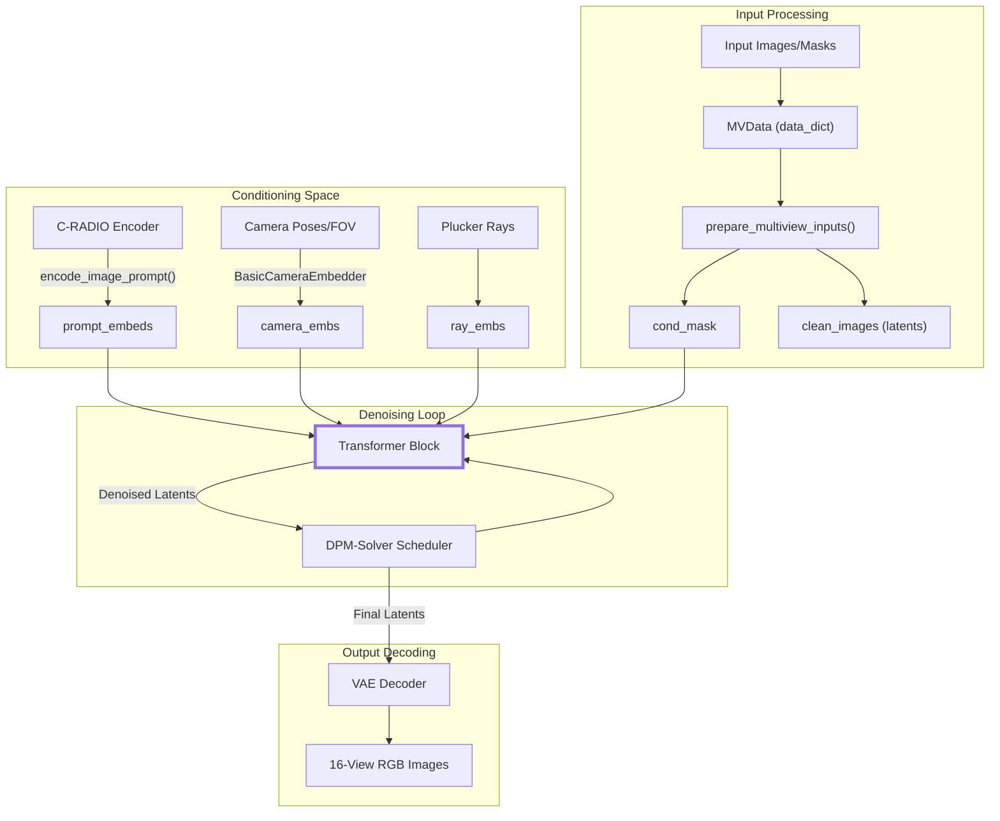
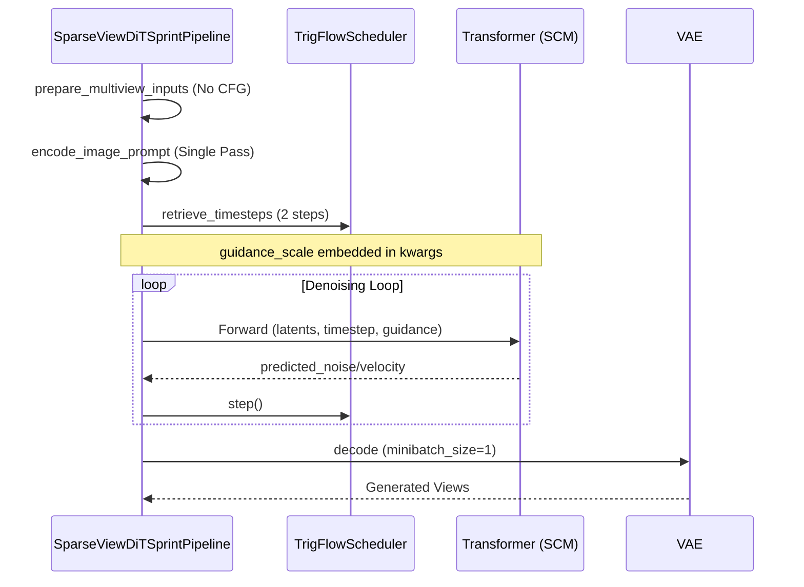

<!-- source: DeepWiki mcp.deepwiki.com · repo NVIDIA/asset-harvester · page 3.2 SparseViewDiT Inference Pipelines · fetched 2026-10-26 -->

# SparseViewDiT Inference Pipelines

Relevant source files

The following files were used as context for generating this wiki page:

- [asset_harvester/multiview_diffusion/pipelines/__init__.py](asset_harvester/multiview_diffusion/pipelines/__init__.py)
- [asset_harvester/multiview_diffusion/pipelines/sparseviewdit_pipeline.py](asset_harvester/multiview_diffusion/pipelines/sparseviewdit_pipeline.py)
- [asset_harvester/multiview_diffusion/pipelines/sparseviewdit_sprint_pipeline.py](asset_harvester/multiview_diffusion/pipelines/sparseviewdit_sprint_pipeline.py)

The `multiview_diffusion` subsystem provides specialized Diffusers-compatible pipelines for generating 16 geometrically consistent views of an object from sparse conditioning inputs. These pipelines manage the transition from image space to latent space, coordinate the transformer denoising loop with camera and Plucker ray conditioning, and handle memory-efficient decoding.

## Pipeline Variants

The codebase implements two primary pipelines located in `asset_harvester/multiview_diffusion/pipelines/`:

| Pipeline Class | Description | Key Characteristics |
| :--- | :--- | :--- |
| `SparseViewDiTPipeline` | Standard diffusion pipeline for multiview generation. | Supports CFG, Flow-matching with shift, and 20-30 denoising steps. |
| `SparseViewDiTSprintPipeline` | Distilled "Sprint" pipeline for fast inference. | 2-step SCM denoising, no CFG (distilled), uses `TrigFlow` parameterization. |

Sources: `[asset_harvester/multiview_diffusion/pipelines/__init__.py:16-22]()`, `[asset_harvester/multiview_diffusion/pipelines/sparseviewdit_sprint_pipeline.py:16-26]()`

## SparseViewDiTPipeline Implementation

The `SparseViewDiTPipeline` is the core inference engine. It orchestrates the interaction between the `SparseViewDiTTransformer2DModelNative`, the VAE, and the C-RADIO image encoder.

### Data Flow and System Mapping

The following diagram maps the high-level generation logic to the specific code entities and data structures.

**Diagram: Natural Language to Code Entity Space (Standard Pipeline)**

Sources: `[asset_harvester/multiview_diffusion/pipelines/sparseviewdit_pipeline.py:70-128]()`, `[asset_harvester/multiview_diffusion/pipelines/sparseviewdit_pipeline.py:284-330]()`

### Key Functional Components

#### 1. C-RADIO Image Conditioning
The pipeline uses `encode_image_prompt` to transform conditioning images (usually 1-3 views) into a continuous embedding space using the C-RADIO model.
*   **Logic**: If no images are provided, it defaults to a grey placeholder `[asset_harvester/multiview_diffusion/pipelines/sparseviewdit_pipeline.py:169-171]()`.
*   **CFG Support**: It generates both conditional and unconditional (null) embeddings to support Classifier-Free Guidance `[asset_harvester/multiview_diffusion/pipelines/sparseviewdit_pipeline.py:182-200]()`.

#### 2. Conditioning Mask (`cond_mask`)
The `cond_mask` is a critical binary tensor that tells the transformer which views are "known" (conditioning) and which are "unknown" (to be generated). 
*   Views with `cond_mask == 1` are treated as source context.
*   Views with `cond_mask == 0` are target latents being denoised.
*   Implementation: Handled within `prepare_multiview_inputs` `[asset_harvester/multiview_diffusion/pipelines/sparseviewdit_pipeline.py:284-300]()`.

#### 3. Flow-Shift Scheduling
The pipeline utilizes flow-matching with a configurable `flow_shift` (default 1.0). This shift adjusts the noise schedule to account for the high resolution and structural complexity of multiview generation `[asset_harvester/multiview_diffusion/pipelines/sparseviewdit_pipeline.py:441-443]()`.

## SparseViewDiTSprintPipeline (Fast Inference)

The "Sprint" pipeline is designed for low-latency applications, reducing inference from ~20 steps to 2 steps using Shortcut Consistency Models (SCM).

### Sprint Denoising Logic
Unlike the standard pipeline, the Sprint version incorporates the guidance scale directly as a conditioning signal rather than performing dual passes for CFG.

**Diagram: Sprint Pipeline Execution Flow**

Sources: `[asset_harvester/multiview_diffusion/pipelines/sparseviewdit_sprint_pipeline.py:41-49]()`, `[asset_harvester/multiview_diffusion/pipelines/sparseviewdit_sprint_pipeline.py:101-135]()`

### Differences in Sprint Implementation
*   **No CFG**: `do_classifier_free_guidance` is forced to `False` `[asset_harvester/multiview_diffusion/pipelines/sparseviewdit_sprint_pipeline.py:105-130]()`.
*   **TrigFlow**: Uses `TrigFlowScheduler` with specific `max_timesteps` (typically $\pi/2$) and `intermediate_timesteps` `[asset_harvester/multiview_diffusion/pipelines/sparseviewdit_sprint_pipeline.py:76-77]()`.
*   **Guidance Embedding**: The `guidance_scale` is scaled by `transformer.config.guidance_embeds_scale` and passed as a tensor to the model `[asset_harvester/multiview_diffusion/pipelines/sparseviewdit_sprint_pipeline.py:163-166]()`.

## Memory Optimizations

To handle the high VRAM requirements of 16-view generation (especially with 32-channel VAEs), the pipelines implement several optimization strategies:

### VAE Minibatching
Instead of decoding all 16 views simultaneously, the pipeline decodes them in smaller batches to avoid Out-Of-Memory (OOM) errors.
*   Controlled by `vae_minibatch_size` (default 1) in the `__call__` method.
*   Implementation: `[asset_harvester/multiview_diffusion/pipelines/sparseviewdit_pipeline.py:535-550]()`.

### CPU Offloading Sequence
The pipeline defines a specific order for offloading components to CPU memory when using Diffusers' `enable_model_cpu_offload()`:
1.  `text_encoder` (or image encoder)
2.  `transformer`
3.  `vae`
This sequence ensures that only the currently active model resides in GPU memory.

Sources: `[asset_harvester/multiview_diffusion/pipelines/sparseviewdit_pipeline.py:88]()`, `[asset_harvester/multiview_diffusion/pipelines/sparseviewdit_pipeline.py:535-545]()`

## Summary of Key Arguments (`__call__`)

| Argument | Purpose |
| :--- | :--- |
| `data_dict` | The preprocessed `MVData` containing images, cameras, and Plucker rays. |
| `conditioning_images` | PIL images used for C-RADIO encoding. |
| `num_inference_steps` | Steps for the denoising loop (20-30 for standard, 2 for Sprint). |
| `guidance_scale` | CFG scale for standard, or conditioning signal for Sprint. |
| `flow_shift` | Adjusts the noise schedule (standard pipeline only). |

Sources: `[asset_harvester/multiview_diffusion/pipelines/sparseviewdit_pipeline.py:350-380]()`, `[asset_harvester/multiview_diffusion/pipelines/sparseviewdit_sprint_pipeline.py:68-83]()`

---

