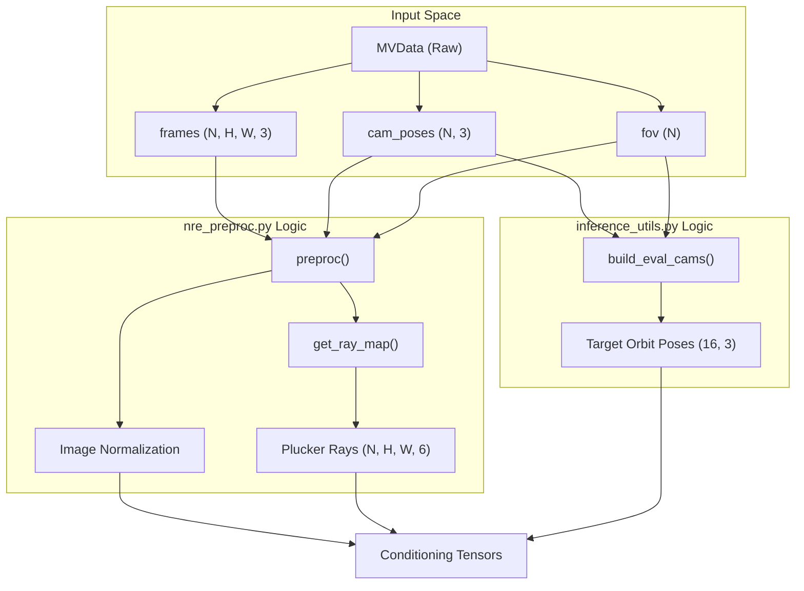
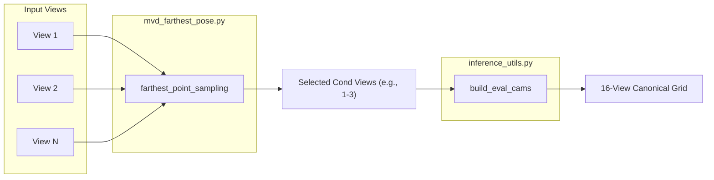

<!-- source: DeepWiki mcp.deepwiki.com · repo NVIDIA/asset-harvester · page 3.3 Multiview Diffusion Data and Preprocessing · fetched 2026-10-26 -->

# Multiview Diffusion Data and Preprocessing

Relevant source files

The following files were used as context for generating this wiki page:

- [asset_harvester/multiview_diffusion/data/__init__.py](asset_harvester/multiview_diffusion/data/__init__.py)
- [asset_harvester/multiview_diffusion/data/inference_utils.py](asset_harvester/multiview_diffusion/data/inference_utils.py)
- [asset_harvester/multiview_diffusion/data/nre_preproc.py](asset_harvester/multiview_diffusion/data/nre_preproc.py)

This page documents the data loading, preprocessing, and camera sampling utilities used by the multiview diffusion subsystem (SparseViewDiT). These utilities transform raw object-centric crops into the structured formats required for denoising, including Plucker coordinate generation, farthest-point view sampling, and canonical camera grid construction.

## Data Structures and Configuration

The primary data container for the multiview diffusion pipeline is the `MVData` class, which aggregates multi-view images with their corresponding geometric metadata.

### MVData Class
The `MVData` dataclass [asset_harvester/multiview_diffusion/data/nre_preproc.py:91-131]() stores both raw extracted data and post-processed properties. Key fields include:
*   `frames`: Image data (either `np.ndarray` or list of PIL Images).
*   `cam_poses`: Camera positions (N, 3).
*   `dists`: Camera distances from the object center.
*   `fov`: Field of view values.
*   `masks`: Foreground segmentation masks.
*   `ray_map`: Plucker coordinate maps generated during preprocessing.

### Inference Configuration
The `SanaInferenceConfig` [asset_harvester/multiview_diffusion/data/inference_utils.py:27-42]() defines the default parameters for the diffusion inference process, such as the number of output views (default 16), maximum input conditioning views (default 4), and the default prompt ("A vehicle in natural condition, white background").

Sources: [asset_harvester/multiview_diffusion/data/nre_preproc.py:91-131](), [asset_harvester/multiview_diffusion/data/inference_utils.py:27-42]()

---

## Preprocessing Pipeline

The `preproc` function is the central entry point for preparing data for the `SparseViewDiT` model. It handles image normalization, mask application, and the generation of auxiliary geometric embeddings.

### Implementation Flow: `preproc`
The function performs the following steps:
1.  **Image Preparation**: Converts PIL images to numpy arrays and normalizes them to a $[0, 1]$ or $[-1, 1]$ range depending on the pipeline requirements.
2.  **Masking**: If `mask_bg` is enabled, it applies the foreground masks to the images, typically setting the background to a neutral color (e.g., white or gray).
3.  **Ray Generation**: Calls `get_ray_map` to compute Plucker coordinates for every pixel in every view.
4.  **View Selection**: If the number of available views exceeds the model's capacity, it employs sampling strategies to select the most informative frames.

### Plucker Coordinate Generation
Plucker coordinates are used to represent the 3D rays associated with each pixel, providing the model with explicit geometric grounding.
*   **Function**: `get_ray_map` [asset_harvester/multiview_diffusion/data/nre_preproc.py:255-296]()
*   **Logic**: It calculates ray directions based on the camera FOV and image dimensions, then computes the moment (cross product of position and direction) to form the 6D Plucker representation $[d, m]$.

### Camera Sampling
When multiple input views are available, the system must select which views to use as "conditioning" for the diffusion model.
*   **Farthest Point Sampling (FPS)**: Used to select views that are maximally distant from each other in terms of camera rotation, ensuring diverse coverage of the object.
*   **Target View Construction**: The `build_eval_cams` function [asset_harvester/multiview_diffusion/data/inference_utils.py:44-64]() creates a canonical circular orbit of camera positions for the 16 output views. It uses the mean distance and FOV from the input images to ensure the generated views match the scale of the source data.

### Preprocessing Data Flow
The following diagram illustrates how raw input data is transformed into the conditioning tensors used by the diffusion model.

**Diagram: Preprocessing Data Flow**

Sources: [asset_harvester/multiview_diffusion/data/nre_preproc.py:255-296](), [asset_harvester/multiview_diffusion/data/inference_utils.py:44-64]()

---

## Conditioning Modes

The `SparseViewDiT` model supports different ways of incorporating input image information, defined by the `conditioning_mode` configuration.

| Mode | Description | Implementation Detail |
| :--- | :--- | :--- |
| `concat` | Input images are concatenated along the sequence dimension. | Handled in `SparseViewDiTPipeline` |
| `c-radio` | Uses the C-RADIO vision encoder to extract high-level features. | Invokes `encode_image_prompt` |
| `joint` | Combines image features and camera embeddings in a shared transformer space. | Used in `SparseViewDiTTransformer2DModelNative` |

### View Sampling Logic
The selection of views is often performed using `farthest_point_sampling` to maximize the baseline between conditioning views. This is particularly important for the `TokenGS` lifting stage, which requires wide-baseline multi-view consistency.

**Diagram: View Selection and Grid Construction**

Sources: [asset_harvester/multiview_diffusion/data/nre_preproc.py:112-132](), [asset_harvester/multiview_diffusion/data/inference_utils.py:44-64]()

---

