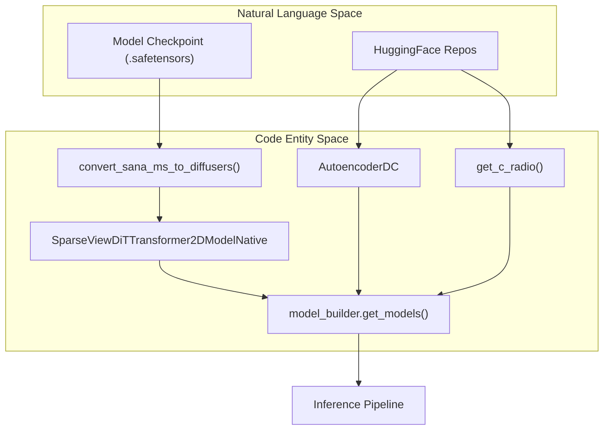
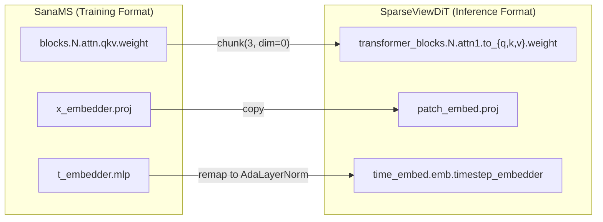

<!-- source: DeepWiki mcp.deepwiki.com · repo NVIDIA/asset-harvester · page 3.4 Multiview Diffusion Utilities and Model Builder · fetched 2026-10-26 -->

# Multiview Diffusion Utilities and Model Builder

Relevant source files

The following files were used as context for generating this wiki page:

- [asset_harvester/multiview_diffusion/utils/__init__.py](asset_harvester/multiview_diffusion/utils/__init__.py)
- [asset_harvester/multiview_diffusion/utils/config.py](asset_harvester/multiview_diffusion/utils/config.py)
- [asset_harvester/multiview_diffusion/utils/convert_checkpoint.py](asset_harvester/multiview_diffusion/utils/convert_checkpoint.py)
- [asset_harvester/multiview_diffusion/utils/gaussian_lifting.py](asset_harvester/multiview_diffusion/utils/gaussian_lifting.py)
- [asset_harvester/multiview_diffusion/utils/misc.py](asset_harvester/multiview_diffusion/utils/misc.py)
- [asset_harvester/multiview_diffusion/utils/model_builder.py](asset_harvester/multiview_diffusion/utils/model_builder.py)

This page documents the utility modules supporting the multiview diffusion stage of the Asset Harvester pipeline. These utilities manage model instantiation, configuration schemas, checkpoint format conversion, and geometric bridge functions for 3D Gaussian lifting.

## Model Builder and Factory Functions

The `model_builder.py` module serves as the primary factory for initializing the multiview diffusion stack. It handles the loading of the VAE, the C-RADIO image encoder, and the SparseViewDiT transformer model.

### Model Initialization
The `get_models` function orchestrates the loading process for inference [asset_harvester/multiview_diffusion/utils/model_builder.py:146-169]():
1.  **VAE**: Loads `AutoencoderDC` from the `mit-han-lab/dc-ae-f32c32-sana-1.0-diffusers` repository [asset_harvester/multiview_diffusion/utils/model_builder.py:150]().
2.  **C-RADIO**: Initializes the NVIDIA C-RADIO image encoder via `get_c_radio` [asset_harvester/multiview_diffusion/utils/model_builder.py:155]().
3.  **Transformer**: Instantiates `SparseViewDiTTransformer2DModelNative` using a predefined configuration and converts the training checkpoint to the Diffusers-compatible format [asset_harvester/multiview_diffusion/utils/model_builder.py:160-162]().

### VAE Operations
The module provides wrappers for VAE encoding and decoding, supporting multiple VAE architectures (SDXL, SD3, and DC-AE) [asset_harvester/multiview_diffusion/utils/model_builder.py:66-122](). 
*   **`vae_encode`**: Processes input images into latent space, applying the appropriate `scaling_factor` (default 0.41407 for DC-AE) [asset_harvester/multiview_diffusion/utils/model_builder.py:77-79]().
*   **`vae_decode`**: Reconstructs images from latents. For high-resolution latents that might cause VRAM issues, it includes a fallback to `enable_tiling` [asset_harvester/multiview_diffusion/utils/model_builder.py:116-119]().

### C-RADIO Integration
The `get_c_radio` function integrates with the `patches` subsystem to ensure compatibility with recent `transformers` versions [asset_harvester/multiview_diffusion/utils/model_builder.py:38-48](). It also provides `get_null_image_prompt` to generate a neutral grey embedding used for Classifier-Free Guidance (CFG) [asset_harvester/multiview_diffusion/utils/model_builder.py:52-63]().

**Sources:** [asset_harvester/multiview_diffusion/utils/model_builder.py:1-169]()

---

## Configuration Management

The `config.py` module defines the structured configuration schema for the diffusion pipeline using Python dataclasses.

| Config Class | Purpose | Key Parameters |
| :--- | :--- | :--- |
| `ModelConfig` | Transformer architecture | `model`, `in_channels`, `camera_emb_dim`, `cond_on_rays` |
| `AEConfig` | VAE settings | `vae_type`, `vae_pretrained`, `scale_factor` |
| `NREDataConfig` | Data preprocessing | `use_relative_coords`, `plucker_scene_scale` |
| `SchedulerConfig` | Flow-matching settings | `noise_schedule`, `flow_shift`, `weighting_scheme` |
| `SanaConfig` | Root configuration | Aggregates all sub-configs for the pipeline |

**Sources:** [asset_harvester/multiview_diffusion/utils/config.py:21-175]()

---

## Checkpoint Conversion

The `convert_checkpoint.py` utility provides a mapping between the internal training format (SanaMS) and the `SparseViewDiTTransformer2DModelNative` format used for inference.

### Weight Mapping Logic
The `convert_sana_ms_to_diffusers` function performs several critical transformations [asset_harvester/multiview_diffusion/utils/convert_checkpoint.py:54-167]():
*   **Fused QKV Splitting**: Original SanaMS self-attention weights are fused as `[3*D, D]`. The converter chunks these into separate `to_q`, `to_k`, and `to_v` weights [asset_harvester/multiview_diffusion/utils/convert_checkpoint.py:141-146]().
*   **Layer Renaming**: Maps original keys like `x_embedder` to `patch_embed` and `t_embedder` to `time_embed` to align with the Diffusers naming convention [asset_harvester/multiview_diffusion/utils/convert_checkpoint.py:77-89]().
*   **Embedder Preservation**: Custom camera, brightness, and skeletal embedders are preserved with minimal renaming [asset_harvester/multiview_diffusion/utils/convert_checkpoint.py:111-125]().

**Sources:** [asset_harvester/multiview_diffusion/utils/convert_checkpoint.py:19-167]()

---

## Gaussian Lifting Bridge Utilities

The `gaussian_lifting.py` module contains geometric utilities that bridge the gap between 2D generated views and 3D Gaussian reconstruction.

### Ray Generation
The module provides functions to compute camera rays, which are essential for Plucker coordinate generation and 3D lifting:
*   **`get_grid_uvs`**: Generates a grid of pixel coordinates (UVs) for a given image resolution, supporting view flipping [asset_harvester/multiview_diffusion/utils/gaussian_lifting.py:39-100]().
*   **`get_rays_from_uvs`**: Transforms UV coordinates into ray origins (`rays_o`) and directions (`rays_d`) using camera intrinsics `K` and extrinsics `c2w` [asset_harvester/multiview_diffusion/utils/gaussian_lifting.py:103-132]().

### View Selection
The `calculate_view_indices` function determines which subset of views should be used when the number of generated views exceeds the input requirements of the lifting model (e.g., selecting 16 views from a 32-view generation) [asset_harvester/multiview_diffusion/utils/gaussian_lifting.py:203-221]().

**Sources:** [asset_harvester/multiview_diffusion/utils/gaussian_lifting.py:39-221]()

---

## Infrastructure Diagrams

### Model Factory Data Flow
This diagram illustrates how `model_builder.py` assembles the inference stack.

Title: Model Builder Factory Flow

**Sources:** [asset_harvester/multiview_diffusion/utils/model_builder.py:146-169](), [asset_harvester/multiview_diffusion/utils/convert_checkpoint.py:54-67]()

### Checkpoint Transformation
This diagram shows the structural transformation of weights during the conversion process.

Title: SanaMS to Diffusers Mapping

**Sources:** [asset_harvester/multiview_diffusion/utils/convert_checkpoint.py:19-46](), [asset_harvester/multiview_diffusion/utils/convert_checkpoint.py:141-146]()

---

## Miscellaneous Utilities

The `misc.py` module provides `ADict_` (aliased as `AttrDict`), an attribute-accessible dictionary that supports dot-notation access to nested configuration keys. This is used throughout the multiview diffusion modules to handle `OmegaConf` or JSON-based configurations with Pythonic syntax [asset_harvester/multiview_diffusion/utils/misc.py:21-172]().

**Sources:** [asset_harvester/multiview_diffusion/utils/misc.py:16-172]()

---

