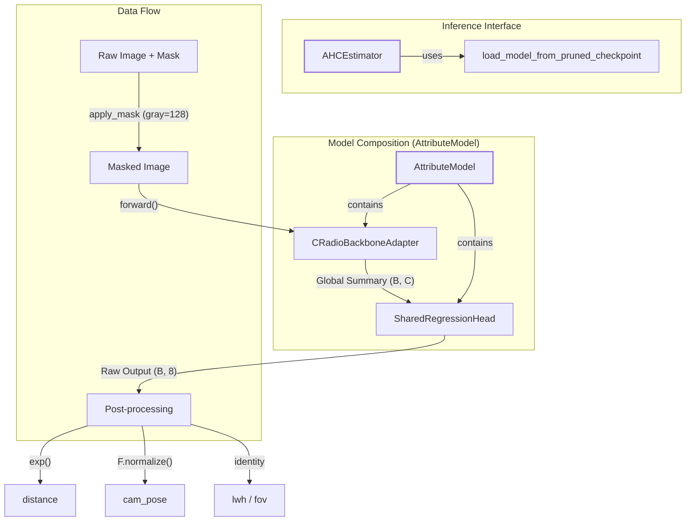
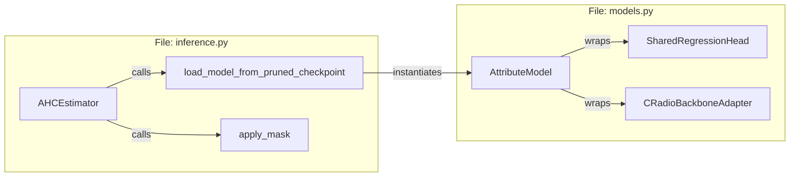

<!-- source: DeepWiki mcp.deepwiki.com · repo NVIDIA/asset-harvester · page 5 Camera Estimator (AHCEstimator) · fetched 2026-10-26 -->

# Camera Estimator (AHCEstimator)

Relevant source files

The following files were used as context for generating this wiki page:

- [asset_harvester/camera_estimator/__init__.py](asset_harvester/camera_estimator/__init__.py)
- [asset_harvester/camera_estimator/inference.py](asset_harvester/camera_estimator/inference.py)
- [asset_harvester/camera_estimator/models.py](asset_harvester/camera_estimator/models.py)

The `camera_estimator` subsystem is a critical component for processing "Out-of-Distribution" (OOD) images—standalone photos where camera intrinsics (FOV), extrinsics (distance, pose), and object dimensions (LWH) are unknown. It uses a pre-trained regression head on top of a shared vision backbone to estimate these parameters, enabling the rest of the pipeline to lift 2D images into 3D space.

### System Overview

The estimator is designed for VRAM efficiency by sharing its heavy vision backbone with the [SparseViewDiT: Multiview Diffusion](#3) pipeline. It utilizes the **C-RADIO** (Contrastive-Relative All-Distances Image Objects) model as a feature extractor.

#### Code Entity Mapping
The following diagram illustrates how the logical estimation process maps to specific classes and files within the `camera_estimator` subpackage.

**Camera Estimation Architecture**

**Sources:** [asset_harvester/camera_estimator/inference.py:154-189](), [asset_harvester/camera_estimator/models.py:105-150]()

---

### Key Components

#### 1. AHCEstimator (Inference Interface)
The `AHCEstimator` class serves as the primary entry point for users. It manages the lifecycle of the model, including loading pruned checkpoints and executing batched inference on directories of images and masks.

*   **Shared Backbone Injection**: To avoid loading the multi-GB C-RADIO model twice, the constructor allows injecting an existing `cradio_model` and `cradio_image_processor` [asset_harvester/camera_estimator/inference.py:170-188]().
*   **Preprocessing**: Images are masked using a neutral gray value (128) for the background before being passed to the model [asset_harvester/camera_estimator/inference.py:58-65]().
*   **Outputs**: It produces a structured dictionary containing averaged `lwh` across frames and per-frame `cam_poses`, `dists`, and `fov` [asset_harvester/camera_estimator/inference.py:36-37]().

For details, see [AHCEstimator Inference Interface](#5.1).

#### 2. AttributeModel and CRadio Backbone
The `AttributeModel` is the core `nn.Module` that combines the vision backbone with the regression head.

*   **CRadioBackboneAdapter**: A thin wrapper that converts input tensors back to PIL images for the HuggingFace processor, then extracts a global summary feature vector [asset_harvester/camera_estimator/models.py:64-103]().
*   **SharedRegressionHead**: A multi-layer MLP (typically 4 layers, 1024 hidden dim) that outputs an 8-dimensional vector [asset_harvester/camera_estimator/models.py:40-62]().
*   **Output Layout**: The 8 dimensions are partitioned into `distance(1)`, `lwh(3)`, `fov(1)`, and `cam_pose(3)` [asset_harvester/camera_estimator/models.py:35-37]().

For details, see [AttributeModel and CRadio Backbone](#5.2).

---

### Pruned Checkpoint Loading Pattern

The system uses a specific loading pattern to handle "pruned" checkpoints. Because the C-RADIO backbone is large and standard, it is often excluded from the AHC checkpoint to save space. The `load_model_from_pruned_checkpoint` function handles this by:
1.  Loading the C-RADIO backbone separately (or using a provided instance) [asset_harvester/camera_estimator/inference.py:123-128]().
2.  Extracting only the keys starting with `model.head` or `head.` from the checkpoint [asset_harvester/camera_estimator/inference.py:139-145]().
3.  Mapping these keys to the `SharedRegressionHead` inside the `AttributeModel` [asset_harvester/camera_estimator/inference.py:149-150]().

**Entity Association Diagram**

**Sources:** [asset_harvester/camera_estimator/inference.py:68-151](), [asset_harvester/camera_estimator/models.py:105-130]()

### Output Schema Reference

The estimator returns a dictionary with the following keys:

| Key | Dimensions | Activation / Post-processing | Description |
| :--- | :--- | :--- | :--- |
| `distance` | `(1,)` | `torch.exp()` | Distance from camera to object center. |
| `lwh` | `(3,)` | Linear | Length, Width, Height of the object. |
| `fov` | `(1,)` | Linear | Camera Field of View in degrees. |
| `cam_pose` | `(3,)` | `F.normalize()` | Normalized camera position vector. |

**Sources:** [asset_harvester/camera_estimator/models.py:35-37](), [asset_harvester/camera_estimator/models.py:140-150]()

---

