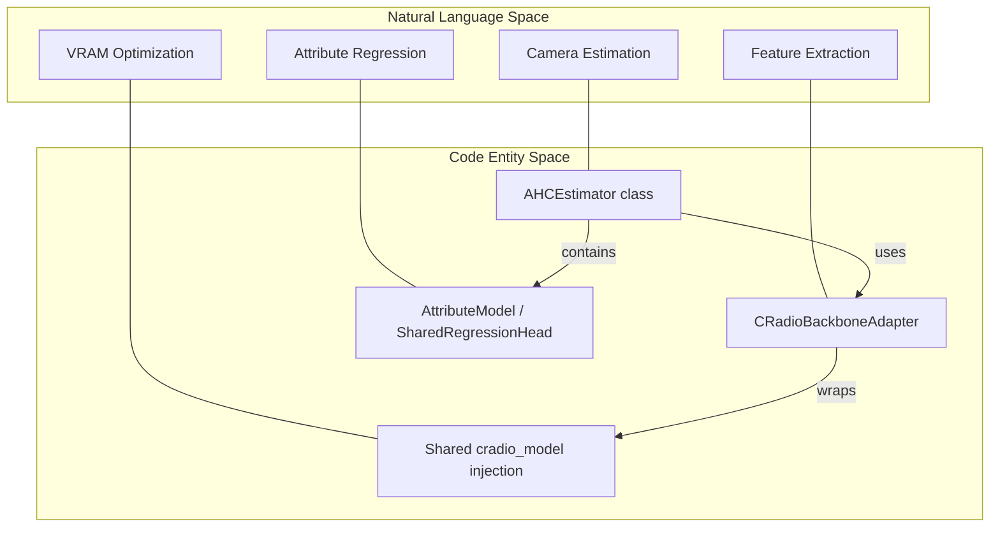
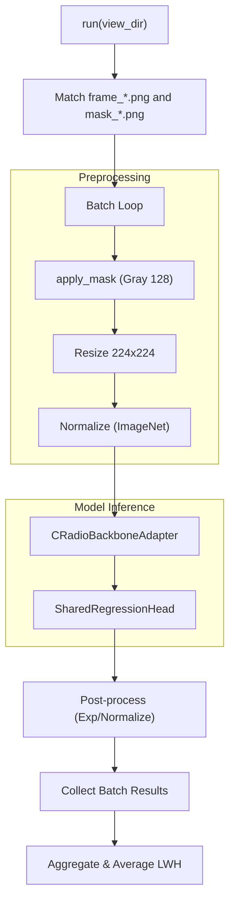

<!-- source: DeepWiki mcp.deepwiki.com · repo NVIDIA/asset-harvester · page 5.1 AHCEstimator Inference Interface · fetched 2026-10-26 -->

# AHCEstimator Inference Interface

Relevant source files

The following files were used as context for generating this wiki page:

- [asset_harvester/camera_estimator/inference.py](asset_harvester/camera_estimator/inference.py)

The `AHCEstimator` (Asset Harvester Camera Estimator) is a specialized inference wrapper designed to predict camera parameters and object dimensions from out-of-distribution (OOD) images. It addresses scenarios where camera intrinsics/extrinsics are unavailable by regressing these values directly from visual features.

### System Purpose and Architecture

The estimator utilizes a shared backbone architecture to minimize VRAM overhead. It leverages the **C-RADIO** vision transformer as a feature extractor, followed by a task-specific MLP head (`SharedRegressionHead`). This design allows the `AHCEstimator` to share the same backbone instance with the `SparseViewDiT` diffusion pipeline during the full asset harvesting process [asset_harvester/camera_estimator/inference.py:19-21]().

#### Data Flow and Entity Mapping

The following diagram illustrates the relationship between the natural language concepts of camera estimation and the specific code entities implementing them.

**Diagram: AHCEstimator Entity Mapping**

Sources: [asset_harvester/camera_estimator/inference.py:154-168](), [asset_harvester/camera_estimator/inference.py:51-51]()

---

### Constructor and Initialization

The `AHCEstimator` constructor handles the loading of the pruned MLP checkpoint and the optional injection of a pre-loaded backbone [asset_harvester/camera_estimator/inference.py:170-177]().

*   **Shared Backbone Injection**: To avoid loading two copies of the heavy C-RADIO model into VRAM, the constructor accepts `cradio_model` and `cradio_image_processor`. If these are provided, the estimator wraps them in a `CRadioBackboneAdapter`; otherwise, it fetches them via `get_c_radio()` [asset_harvester/camera_estimator/inference.py:123-128]().
*   **Pruned Checkpoints**: The estimator uses `load_model_from_pruned_checkpoint()`. This function loads a `.safetensors` or `.pt` file containing only the MLP head weights (`model.head.*`), significantly reducing the checkpoint size compared to full-model weights [asset_harvester/camera_estimator/inference.py:68-81]().

Sources: [asset_harvester/camera_estimator/inference.py:123-128](), [asset_harvester/camera_estimator/inference.py:183-188]()

---

### Inference Process: `run()` Method

The `run()` method processes a directory containing image/mask pairs to produce camera and object estimates [asset_harvester/camera_estimator/inference.py:204-204]().

#### Image Preprocessing
1.  **Loading**: The method identifies valid image/mask pairs using defined extensions (`.jpg`, `.png`, etc.) [asset_harvester/camera_estimator/inference.py:53-53]().
2.  **Gray Masking**: It applies a "gray mask" to the input images. Areas where the mask is 0 (background) are set to an RGB value of **128** [asset_harvester/camera_estimator/inference.py:54-54](). This ensures the model focuses on the object foreground [asset_harvester/camera_estimator/inference.py:58-65]().
3.  **Normalization**: Images are resized to 224x224 and normalized using standard ImageNet statistics (Mean: `[0.485, 0.456, 0.406]`, Std: `[0.229, 0.224, 0.225]`) [asset_harvester/camera_estimator/inference.py:190-198]().

#### Batched Execution
The estimator processes images in batches (default `batch_size=8`) to maximize throughput [asset_harvester/camera_estimator/inference.py:176-176](). It iterates through the input views, performs a forward pass through the `AttributeModel`, and collects the raw predictions [asset_harvester/camera_estimator/inference.py:237-245]().

**Diagram: Inference Logic Flow**

Sources: [asset_harvester/camera_estimator/inference.py:58-65](), [asset_harvester/camera_estimator/inference.py:190-198](), [asset_harvester/camera_estimator/inference.py:237-245]()

---

### Output Schema and Persistence

The estimator provides two primary ways to retrieve results: `run()` (returns a dictionary) and `run_and_save()` (writes to disk).

#### Data Schema
The output dictionary and the resulting `camera_data.json` follow a specific schema [asset_harvester/camera_estimator/inference.py:252-261]():

| Key | Description | Computation |
| :--- | :--- | :--- |
| `lwh` | Object Length, Width, Height | **Averaged** across all processed frames to ensure consistency. |
| `cam_poses` | Camera Position Vectors | Per-frame unit vectors (normalized). |
| `dists` | Camera Distances | Per-frame scalar distance from object center. |
| `fov` | Field of View | Per-frame predicted vertical FOV. |
| `frame_filenames` | Source Images | List of processed image paths. |

#### `run_and_save()`
This utility method executes the inference and serializes the result into a `camera_data.json` file within the input directory [asset_harvester/camera_estimator/inference.py:270-279](). This file is subsequently used by the `SparseViewDiT` pipeline to define the conditioning camera poses.

Sources: [asset_harvester/camera_estimator/inference.py:252-261](), [asset_harvester/camera_estimator/inference.py:284-288]()

---

