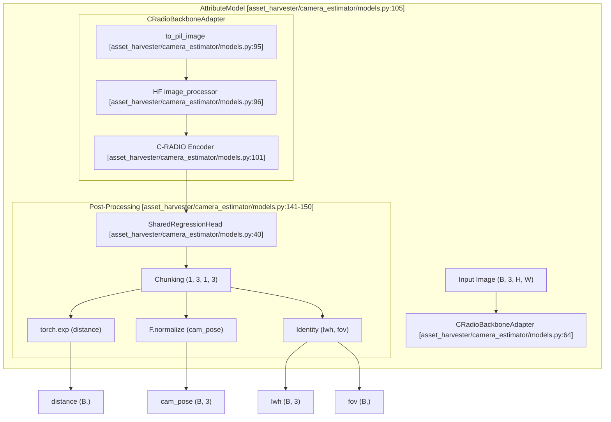
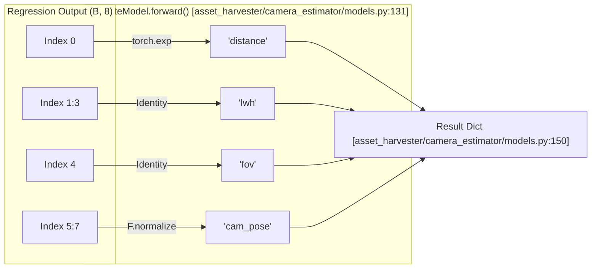

<!-- source: DeepWiki mcp.deepwiki.com · repo NVIDIA/asset-harvester · page 5.2 AttributeModel and CRadio Backbone · fetched 2026-10-26 -->

# AttributeModel and CRadio Backbone

Relevant source files

The following files were used as context for generating this wiki page:

- [asset_harvester/camera_estimator/__init__.py](asset_harvester/camera_estimator/__init__.py)
- [asset_harvester/camera_estimator/models.py](asset_harvester/camera_estimator/models.py)

The `AttributeModel` is the core neural network architecture within the `camera_estimator` subpackage. It is designed to predict camera extrinsics (distance, pose), camera intrinsics (field of view), and object geometry (length, width, height) from single masked images [asset_harvester/camera_estimator/__init__.py:17-19](). To optimize VRAM usage, the model utilizes a shared backbone strategy, allowing it to reuse the C-RADIO model instance employed by the diffusion pipeline [asset_harvester/camera_estimator/models.py:20-23]().

## AttributeModel Composition

The `AttributeModel` is a composite `nn.Module` consisting of two primary components: a backbone adapter and a regression head [asset_harvester/camera_estimator/models.py:105-120]().

### CRadioBackboneAdapter
The `CRadioBackboneAdapter` acts as a wrapper around the `nvidia/C-RADIO` model and its corresponding HuggingFace image processor [asset_harvester/camera_estimator/models.py:64-77]().

*   **Feature Discovery**: The adapter includes a `feat_dim` property that performs a one-time dummy forward pass with a $224 \times 224$ tensor to automatically discover the output dimension of the C-RADIO encoder [asset_harvester/camera_estimator/models.py:80-91]().
*   **Data Flow**: It accepts input tensors of shape $(B, 3, H, W)$ in the range $[0, 1]$. These are converted to PIL images via `to_pil_image` before being passed through the `image_processor` to generate the `pixel_values` required by the C-RADIO ViT [asset_harvester/camera_estimator/models.py:93-102]().
*   **Output**: The adapter returns the global summary feature vector $(B, C)$ [asset_harvester/camera_estimator/models.py:68-71]().

### SharedRegressionHead
The `SharedRegressionHead` is a multi-layer perceptron (MLP) that maps the backbone's feature vector to a concatenated 8-dimensional output vector [asset_harvester/camera_estimator/models.py:40-49]().

*   **Architecture**: It can be configured as a single linear layer (if `num_layers <= 1`) or a multi-layer MLP with ReLU activations [asset_harvester/camera_estimator/models.py:51-58]().
*   **Output Dimensionality**: The head outputs a total of 8 dimensions, representing four distinct attributes [asset_harvester/camera_estimator/models.py:35-37]().

### System Architecture and Data Flow
The following diagram illustrates the flow from an input image through the `AttributeModel` components to the final predicted attributes.

**AttributeModel Data Flow**

**Sources:** [asset_harvester/camera_estimator/models.py:35-151]()

## Output Layout and Post-Processing

The model predicts a concatenated vector that is sliced and transformed into specific physical quantities. The total output dimension is 8 [asset_harvester/camera_estimator/models.py:25-37]().

| Attribute | Dimensions | Layout Index | Post-Processing Activation |
| :--- | :--- | :--- | :--- |
| `distance` | 1 | 0 | `torch.exp()` |
| `lwh` | 3 | 1-3 | None (Linear) |
| `fov` | 1 | 4 | None (Linear) |
| `cam_pose` | 3 | 5-7 | `F.normalize()` |

### Activation Logic
The `forward` method of `AttributeModel` applies specific transformations to ensure the outputs reside in valid physical ranges:
*   **Distance**: The raw output is passed through `torch.exp` to ensure the predicted distance is always positive [asset_harvester/camera_estimator/models.py:144-145]().
*   **Camera Pose**: The 3D pose vector is processed via `F.normalize` to ensure it represents a valid unit vector on a sphere [asset_harvester/camera_estimator/models.py:146-147]().
*   **Squeezing**: Scalar outputs (`distance` and `fov`) are squeezed to remove the trailing dimension [asset_harvester/camera_estimator/models.py:148]().

**Attribute Layout Mapping**

**Sources:** [asset_harvester/camera_estimator/models.py:131-151]()

## Implementation Details

### Feature Dimension Discovery
The `feat_dim` is not hardcoded but determined dynamically. This allows the `AttributeModel` to be compatible with different versions or variants of the C-RADIO backbone without manual configuration [asset_harvester/camera_estimator/models.py:80-91]().

### PIL Conversion
The `CRadioBackboneAdapter` performs a conversion from Torch tensors to PIL images inside `_to_pixel_values` [asset_harvester/camera_estimator/models.py:93-97](). This is required because the underlying HuggingFace `image_processor` for C-RADIO expects PIL inputs to handle resizing and normalization according to the model's original training specification [asset_harvester/camera_estimator/models.py:96]().

### Shared Weights
By injecting the `backbone` into the `AttributeModel` constructor rather than instantiating it internally, the system avoids the multi-GB memory overhead of loading the C-RADIO ViT twice when both the camera estimator and the diffusion pipeline are active [asset_harvester/camera_estimator/models.py:20-23]().

**Sources:** [asset_harvester/camera_estimator/models.py:64-129]()

---

