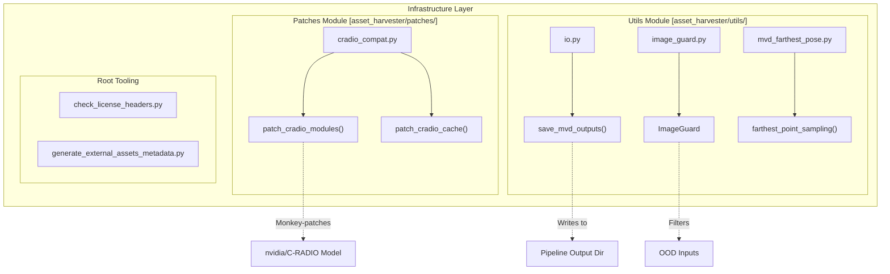

<!-- source: DeepWiki mcp.deepwiki.com · repo NVIDIA/asset-harvester · page 6 Shared Utilities and Infrastructure · fetched 2026-10-26 -->

# Shared Utilities and Infrastructure

Relevant source files

The following files were used as context for generating this wiki page:

- [asset_harvester/patches/__init__.py](asset_harvester/patches/__init__.py)
- [asset_harvester/utils/__init__.py](asset_harvester/utils/__init__.py)

The **Shared Utilities and Infrastructure** layer provides the cross-cutting support systems necessary for the Asset Harvester pipeline's stability, data integrity, and model compatibility. This subsystem manages the transition between pipeline stages, ensures that third-party model dependencies remain functional despite upstream breaking changes, and provides standardized tooling for developer workflows.

## Infrastructure Overview

The infrastructure is organized into three primary domains:
1.  **Compatibility Patches**: Mechanisms to maintain the `nvidia/C-RADIO` model's functionality across evolving library versions.
2.  **Shared I/O and Processing**: Standardized utilities for saving intermediate pipeline results and performing geometric or safety-based filtering on image data.
3.  **Developer Tooling**: Automation for license compliance, linting, and metadata generation for downstream simulation environments.

### System Architecture and Code Entities

The following diagram maps the high-level utility categories to their specific implementation modules and primary functional entities.

**Infrastructure Mapping: Utilities to Code Entities**

**Sources:** `asset_harvester/patches/__init__.py:1-15` (), `asset_harvester/utils/__init__.py:1-17` ()

---

## 6.1 C-RADIO Compatibility Patches

The `asset_harvester.patches` module is critical for maintaining the stability of the `nvidia/C-RADIO` vision-language model, which serves as the backbone for both the **Camera Estimator** and the **Multiview Diffusion** conditioning. 

Due to breaking changes in the `transformers` library (specifically versions >=4.48), the original model code requires both on-disk and in-memory modifications. This module implements `patch_cradio_cache()` to perform idempotent source patching of cached HuggingFace files and `patch_cradio_modules()` for monkey-patching specific layers like `ViTPatchGenerator` and `ViTPatchLinear`. It also handles weight interpolation for patch size mismatches.

For details, see [C-RADIO Compatibility Patches](#6.1).

---

## 6.2 Shared I/O and Image Utilities

Located in `asset_harvester/utils/`, these utilities provide the "glue" between the disparate stages of the harvester (Parser → Diffusion → Lifting).

*   **Standardized I/O**: `io.py` defines consistent directory structures and naming conventions for `save_input_views`, `save_mvd_outputs`, and `save_lifting_outputs`, ensuring that each stage can find the data produced by the previous one.
*   **Content Moderation**: The `ImageGuard` class in `image_guard.py` utilizes Llama Guard to filter out-of-distribution (OOD) inputs that may violate safety or content policies before they enter the generation pipeline.
*   **Geometric Sampling**: `mvd_farthest_pose.py` implements Farthest Point Sampling (FPS) to select the most diverse set of conditioning views from a sequence of driving frames, maximizing the geometric information provided to the diffusion model.

For details, see [Shared I/O and Image Utilities](#6.2).

---

## 6.3 Developer Tooling and CI

Asset Harvester maintains strict code quality and legal standards through automated tooling located in the repository root and configuration files.

*   **License Enforcement**: The `check_license_headers.py` script ensures all source files contain the Apache-2.0 SPDX header, supporting a `--fix` flag for automated compliance.
*   **Metadata Generation**: The `generate_external_assets_metadata.py` script bridges the gap between the Harvester and simulation environments (like NuRec), generating the necessary `metadata.yaml` manifests for exported assets.
*   **Quality Pipeline**: The project uses `pyproject.toml` to define build dependencies and `Ruff` for linting and formatting, enforcing the DCO (Developer Certificate of Origin) sign-off for all contributions.

For details, see [Developer Tooling and CI](#6.3).

**Sources:** `asset_harvester/patches/__init__.py:1-15` (), `asset_harvester/utils/__init__.py:16-17` ()

---

