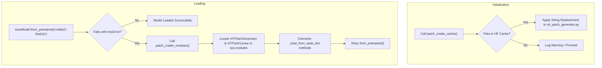
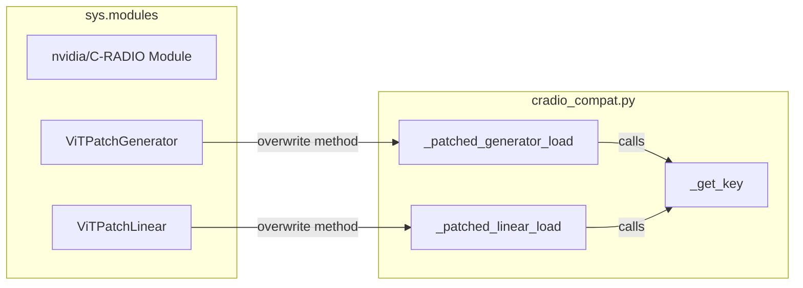

<!-- source: DeepWiki mcp.deepwiki.com · repo NVIDIA/asset-harvester · page 6.1 C-RADIO Compatibility Patches · fetched 2026-10-26 -->

# C-RADIO Compatibility Patches

Relevant source files

The following files were used as context for generating this wiki page:

- [asset_harvester/patches/__init__.py](asset_harvester/patches/__init__.py)
- [asset_harvester/patches/cradio_compat.py](asset_harvester/patches/cradio_compat.py)

The `nvidia/C-RADIO` model, used as a backbone for both the multiview diffusion and camera estimation subsystems, contains custom loading logic that is incompatible with `transformers >= 4.48`. In these newer versions, Hugging Face `transformers` changed its weight loading mechanism to load parameters individually with `assign=True`, passing single-key state dicts (e.g., `{"weight": tensor}`) to the `_load_from_state_dict` hook [asset_harvester/patches/cradio_compat.py:18-21](). 

The C-RADIO implementation expects the full prefixed key (e.g., `"embedder.weight"`), leading to `KeyError` exceptions during `from_pretrained`. The `asset_harvester.patches.cradio_compat` module provides two distinct strategies—on-disk source patching and in-memory monkey-patching—to ensure compatibility without requiring a fork of the remote model code [asset_harvester/patches/cradio_compat.py:23-27]().

### Patching Strategies and Data Flow

The module implements a tiered approach to patching. It first attempts to modify the cached source files on disk. If the cache is empty (i.e., first-time download), it catches the resulting `KeyError` and applies in-memory patches to the classes after they have been dynamically imported by the `transformers` library [asset_harvester/patches/cradio_compat.py:32-37]().

**Compatibility Logic Flow**

Sources: [asset_harvester/patches/cradio_compat.py:32-37](), [asset_harvester/patches/cradio_compat.py:140-151]()

### On-Disk Patching: patch_cradio_cache()

The `patch_cradio_cache()` function scans the Hugging Face modules cache directory (typically `~/.cache/huggingface/modules/transformers_modules/nvidia/`) for `vit_patch_generator.py` [asset_harvester/patches/cradio_compat.py:131-137](). 

It performs an idempotent string replacement on the source code to handle both prefixed and bare keys in the `state_dict`. To prevent redundant applications, it inserts a `_PATCH_SENTINEL` comment into the file [asset_harvester/patches/cradio_compat.py:47-47]().

| Target Class | Original Logic | Patched Logic |
| :--- | :--- | :--- |
| `ViTPatchGenerator` | Accesses `state_dict[f'{prefix}pos_embed']` [asset_harvester/patches/cradio_compat.py:53-53]() | Uses `state_dict.get('pos_embed')` if prefixed key is missing [asset_harvester/patches/cradio_compat.py:60-60]() |
| `ViTPatchLinear` | Accesses `state_dict[f'{prefix}weight']` [asset_harvester/patches/cradio_compat.py:69-69]() | Uses `state_dict['weight']` if prefixed key is missing [asset_harvester/patches/cradio_compat.py:79-79]() |

Sources: [asset_harvester/patches/cradio_compat.py:50-80](), [asset_harvester/patches/cradio_compat.py:140-180]()

### In-Memory Patching: patch_cradio_modules()

If the model is downloaded for the first time, `patch_cradio_cache()` will find no files. After `from_pretrained` fails, `patch_cradio_modules()` is called to modify the classes directly in `sys.modules`. It replaces the `_load_from_state_dict` method of `ViTPatchGenerator` and `ViTPatchLinear` with `_patched_generator_load` and `_patched_linear_load` respectively [asset_harvester/patches/cradio_compat.py:94-123]().

**Entity Mapping: Module Patching**

Sources: [asset_harvester/patches/cradio_compat.py:85-123]()

### Weight Interpolation for ViTPatchLinear

A critical feature of the `_patched_linear_load` function is its ability to handle mismatched patch sizes. If the `chk_weight` (the tensor from the `state_dict`) does not match the expected `self.weight.shape`, the patcher assumes a change in spatial resolution [asset_harvester/patches/cradio_compat.py:111-112]().

1.  **Shape Calculation**: It calculates the source patch size by taking the square root of the flattened dimension (divided by 3 for RGB channels) [asset_harvester/patches/cradio_compat.py:112-113]().
2.  **Reshaping**: It uses `einops.rearrange` to convert the flat weight into a spatial `(B, C, H, W)` tensor [asset_harvester/patches/cradio_compat.py:114-114]().
3.  **Interpolation**: It applies `torch.nn.functional.interpolate` with `mode="bicubic"` to resize the weights to the target `self.patch_size` [asset_harvester/patches/cradio_compat.py:115-121]().
4.  **Flattening**: The interpolated weights are rearranged back to the flattened format before being copied into the parameter data [asset_harvester/patches/cradio_compat.py:122-123]().

Sources: [asset_harvester/patches/cradio_compat.py:101-123]()

---

