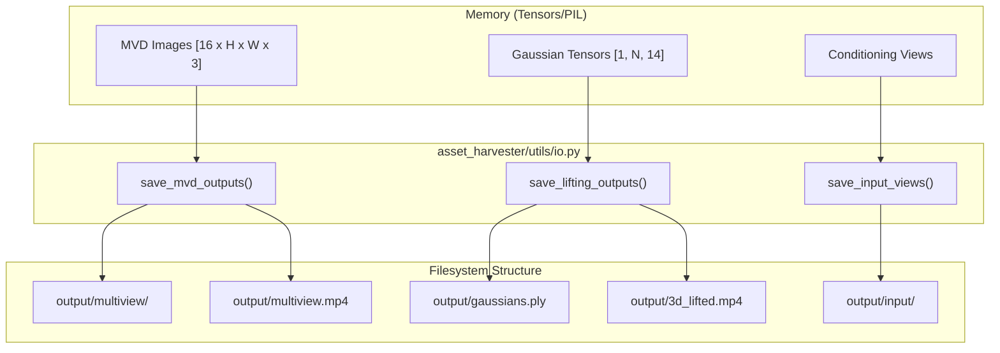
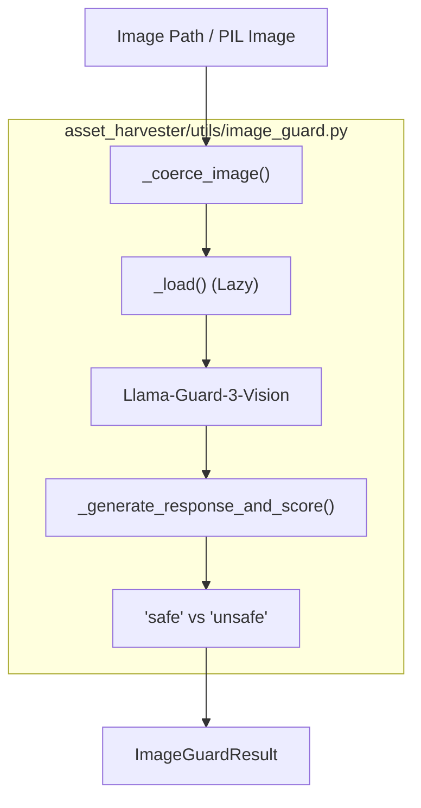
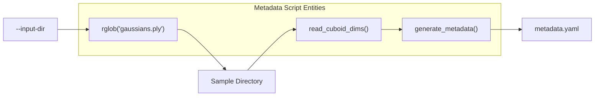

<!-- source: DeepWiki mcp.deepwiki.com · repo NVIDIA/asset-harvester · page 6.2 Shared I/O and Image Utilities · fetched 2026-10-26 -->

# Shared I/O and Image Utilities

Relevant source files

The following files were used as context for generating this wiki page:

- [asset_harvester/utils/generate_external_assets_metadata.py](asset_harvester/utils/generate_external_assets_metadata.py)
- [asset_harvester/utils/image_guard.py](asset_harvester/utils/image_guard.py)
- [asset_harvester/utils/io.py](asset_harvester/utils/io.py)
- [asset_harvester/utils/mvd_farthest_pose.py](asset_harvester/utils/mvd_farthest_pose.py)

The `asset_harvester/utils/` directory contains cross-cutting infrastructure for data persistence, safety moderation, view selection heuristics, and metadata generation for downstream simulation environments. These utilities ensure that the outputs of the Multiview Diffusion (MVD) and TokenGS Lifting stages are consistent, safe, and easily consumable by the NuRec ecosystem.

## Pipeline I/O Operations

The `io.py` module handles the structured persistence of intermediate and final assets. It organizes files into a standardized directory hierarchy that subsequent stages (and external tools) expect.

### Key Functions
*   **`save_input_views`**: Persists the conditioning RGB frames and their corresponding segmentation masks to an `input/` subdirectory [asset_harvester/utils/io.py:68-87]().
*   **`save_mvd_outputs`**: Saves the 16 generated views from the diffusion model as PNGs, compiles them into a `multiview.mp4` video for inspection, and writes camera metadata (`fov.txt`, `dist.txt`, `lwh.txt`) [asset_harvester/utils/io.py:27-65]().
*   **`save_lifting_outputs`**: Finalizes the asset by saving the 3D Gaussian Splatting `.ply` file and a `3d_lifted.mp4` orbit render [asset_harvester/utils/io.py:88-108]().

### Data Flow Diagram: I/O Orchestration
This diagram shows how the `io.py` functions map the internal memory state of the pipeline to the filesystem.

Sources: [asset_harvester/utils/io.py:16-108]()

---

## Image Moderation (ImageGuard)

For Out-of-Distribution (OOD) inputs where user-provided images are processed, the system utilizes `ImageGuard`. This class wraps **Llama Guard 3 Vision** to classify images as "safe" or "unsafe" before they enter the generation pipeline [asset_harvester/utils/image_guard.py:16-32]().

### Implementation Details
*   **Lazy Loading**: The model (`Llama-Guard-3-11B-Vision`) and its processor are only loaded into VRAM when `_load()` is triggered by a check [asset_harvester/utils/image_guard.py:99-114]().
*   **Binary Gating**: It uses a probability threshold (default 0.5) to determine safety [asset_harvester/utils/image_guard.py:34]().
*   **Batch Moderation**: `moderate_sample` processes a list of image pairs, filtering out unsafe frames and generating an `image_guard_report.json` for auditability [asset_harvester/utils/image_guard.py:143-201]().

### Moderation Logic Flow

Sources: [asset_harvester/utils/image_guard.py:127-141](), [asset_harvester/utils/image_guard.py:32-40]()

---

## Diverse View Selection (FPS)

The `mvd_farthest_pose.py` utility implements **Farthest Point Sampling (FPS)**. This is used to select the most diverse set of conditioning views from a long temporal sequence of a cuboid track.

### `farthest_point_sampling`
*   **Input**: An array of points (typically `MVData.cam_poses`) [asset_harvester/utils/mvd_farthest_pose.py:31]().
*   **Logic**: It greedily selects the next point that maximizes the minimum distance to the already sampled set [asset_harvester/utils/mvd_farthest_pose.py:50-53]().
*   **Termination**: Stops when `num_samples` is reached or the distance falls below `dist_threshold` [asset_harvester/utils/mvd_farthest_pose.py:54-55]().

Sources: [asset_harvester/utils/mvd_farthest_pose.py:24-59]()

---

## Metadata Generation for NuRec

The `generate_external_assets_metadata.py` script is a standalone utility that prepares the pipeline's output for use in simulation environments (like NuRec). It scans the output directory and generates a `metadata.yaml` file [asset_harvester/utils/generate_external_assets_metadata.py:16-25]().

### Metadata Schema
The script produces a mapping indexed by `track_id`, containing:
1.  `ply_file`: Relative path to the Gaussian asset [asset_harvester/utils/generate_external_assets_metadata.py:62]().
2.  `label_class`: The object category (e.g., car, pedestrian) [asset_harvester/utils/generate_external_assets_metadata.py:63]().
3.  `cuboids_dims`: The [Length, Width, Height] read from `multiview/lwh.txt` [asset_harvester/utils/generate_external_assets_metadata.py:64]().

### File Scanning Logic

Sources: [asset_harvester/utils/generate_external_assets_metadata.py:39-68]()

### Metadata Layout Table

| Field | Source File | Description |
| :--- | :--- | :--- |
| `track_id` | Directory Name | Unique identifier for the extracted object track. |
| `label_class` | Parent Dir Name | Semantic class used for simulation spawning. |
| `cuboids_dims` | `multiview/lwh.txt` | Physical dimensions for collision and scaling. |
| `ply_file` | `gaussians.ply` | Path to the 3D Gaussian Splatting model. |

Sources: [asset_harvester/utils/generate_external_assets_metadata.py:55-65]()

---

