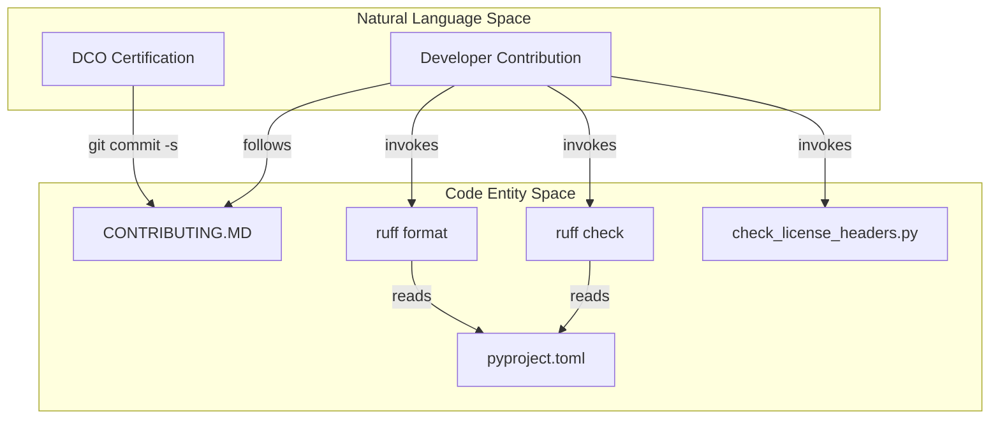
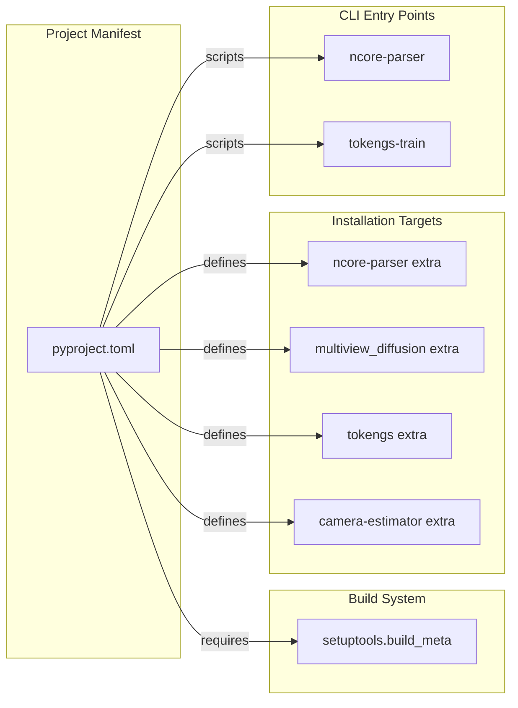

<!-- source: DeepWiki mcp.deepwiki.com · repo NVIDIA/asset-harvester · page 6.3 Developer Tooling and CI · fetched 2026-10-26 -->

# Developer Tooling and CI

<details>
<summary>Relevant source files</summary>

The following files were used as context for generating this wiki page:

- [CONTRIBUTING.MD](CONTRIBUTING.MD)
- [pyproject.toml](pyproject.toml)
- [scripts/check_license_headers.py](scripts/check_license_headers.py)

</details>


This section documents the infrastructure and guidelines that maintain code quality, licensing compliance, and build consistency across the Asset Harvester project. It covers the contribution workflow, automated linting/formatting with Ruff, license enforcement, and the `pyproject.toml` configuration.

## Contribution Guidelines and DCO

Contributors must adhere to specific coding conventions and legal requirements before submitting pull requests.

### DCO Sign-off
The project requires all contributors to "sign-off" on their commits, certifying the Developer Certificate of Origin (DCO) version 1.1 [CONTRIBUTING.MD:64-105](). This is enforced via git commit flags:
- **Usage**: `git commit -s -m "Commit message"` [CONTRIBUTING.MD:70-72]().
- **Effect**: Appends a `Signed-off-by: Name <email>` line to the commit message [CONTRIBUTING.MD:74-77]().

### Pre-submission Checklist
Before submitting a PR, developers must ensure the following checks pass [CONTRIBUTING.MD:51-58]():
1. `ruff check asset_harvester run_inference.py scripts`
2. `ruff format --check asset_harvester run_inference.py scripts docs`
3. `python scripts/check_license_headers.py`

**Sources:** [CONTRIBUTING.MD:1-106]()

## Linting and Formatting

Asset Harvester uses **Ruff** for both linting and code formatting, configured via `pyproject.toml` [CONTRIBUTING.MD:11-12]().

### Ruff Configuration
The tool is configured with a line length of 120 characters and targets Python 3.10 [pyproject.toml:90-92]().

| Category | Configuration | Code Reference |
| :--- | :--- | :--- |
| **Lint Rules** | `E` (Error), `F` (Pyflakes), `W` (Warning), `I` (Isort) | [pyproject.toml:103-104]() |
| **Exclusions** | `.git`, `__pycache__`, `build`, `dist`, `venv` | [pyproject.toml:93-101]() |
| **Format Style** | Double quotes, space indentation, formatted docstrings | [pyproject.toml:113-116]() |
| **Ignore** | `E501` (Line length), `E741` (Ambiguous variable name) | [pyproject.toml:105-108]() |

### Workflow Diagram: Code Quality Pipeline

This diagram illustrates how developer tools interact with the source code to ensure compliance.

"Code Quality Pipeline"

**Sources:** [CONTRIBUTING.MD:11-39](), [pyproject.toml:90-117]()

## License Header Enforcement

Every `.py` file in the repository must start with the Apache-2.0 SPDX license header [CONTRIBUTING.MD:41-43](). This is managed by the `scripts/check_license_headers.py` utility.

### Implementation Details
The script performs a recursive search for Python files, excluding build and environment directories like `.venv` and `dist` [scripts/check_license_headers.py:51-59]().

- **`EXPECTED_HEADER`**: A multi-line string containing the Apache-2.0 license text [scripts/check_license_headers.py:32-47]().
- **`check_header(path)`**: Reads the file and compares the first few lines (skipping shebangs) against `EXPECTED_HEADER` [scripts/check_license_headers.py:69-75]().
- **`fix_header(path)`**: Automatically prepends the header while preserving any existing `#!` shebang at the top of the file [scripts/check_license_headers.py:78-89]().

### Usage
```bash
python scripts/check_license_headers.py          # Audit only
python scripts/check_license_headers.py --fix     # Apply fixes
```
[scripts/check_license_headers.py:20-23]()

**Sources:** [scripts/check_license_headers.py:1-128](), [CONTRIBUTING.MD:41-49]()

## Build Configuration (pyproject.toml)

The `pyproject.toml` file serves as the central manifest for project metadata, dependencies, and entry points.

### Dependencies and Extras
The project uses `optional-dependencies` to manage the heavy requirements of different pipeline stages, allowing for modular installations [pyproject.toml:19-81]().

| Extra | Purpose | Key Dependencies |
| :--- | :--- | :--- |
| `ncore-parser` | Data ingestion | `nvidia-ncore`, `pydantic`, `transformers` |
| `multiview_diffusion` | SparseViewDiT | `diffusers`, `accelerate`, `xformers` |
| `tokengs` | 3D Reconstruction | `kiui`, `roma`, `lpips`, `tyro` |
| `camera-estimator` | OOD Image Processing | `transformers`, `safetensors` |

### Entry Points
The project defines two primary CLI entry points [pyproject.toml:83-86]():
1. `ncore-parser`: Points to `asset_harvester.ncore_parser.__main__:main`.
2. `tokengs-train`: Points to `asset_harvester.tokengs.main:main`.

### Build System Flow

This diagram maps the project configuration to the resulting environment and tools.

"Build System and Dependency Mapping"

**Sources:** [pyproject.toml:1-89]()

---

