# Page: Asset Harvester Overview

# Asset Harvester Overview

<details>
<summary>Relevant source files</summary>

The following files were used as context for generating this wiki page:

- [README.md](README.md)
- [asset_harvester/__init__.py](asset_harvester/__init__.py)
- [docs/assets/teaser.gif](docs/assets/teaser.gif)
- [docs/end_to_end_example.md](docs/end_to_end_example.md)

</details>


Asset Harvester is an end-to-end system designed to convert sparse, in-the-wild object observations from autonomous driving logs into complete, simulation-ready 3D assets [README.md:15-18](). It addresses the challenge of neural scene reconstruction by producing high-fidelity 3D Gaussian Splatting (GS) assets for agents (vehicles, pedestrians, riders) even under heavy occlusion or noisy calibration [README.md:25-26]().

The system integrates large-scale curation of object-centric training data, geometry-aware preprocessing, and a robust training recipe that couples sparse-view multiview generation with feed-forward 3D lifting [README.md:17-18]().

### High-Level System Pipeline

The pipeline transforms raw sensor data into structured 3D assets through four primary stages:

1.  **NCore Parsing**: Extracts multi-view object crops and masks from NCore V4 driving logs [docs/end_to_end_example.md:27-29]().
2.  **Camera Estimation**: (Optional) Estimates poses and intrinsics for out-of-distribution (OOD) images where sensor calibration is missing [README.md:149-150]().
3.  **Multiview Diffusion (SparseViewDiT)**: Generates 16 geometrically consistent views from 1–3 input images [README.md:25-26]().
4.  **Gaussian Lifting (TokenGS)**: Lifts the generated views into a 3D Gaussian Splatting asset in seconds [README.md:25-26]().

### System Architecture and Code Mapping

The following diagram bridges the conceptual pipeline stages to the specific code entities and scripts that implement them.

**Diagram: Pipeline Data Flow and Code Entities**
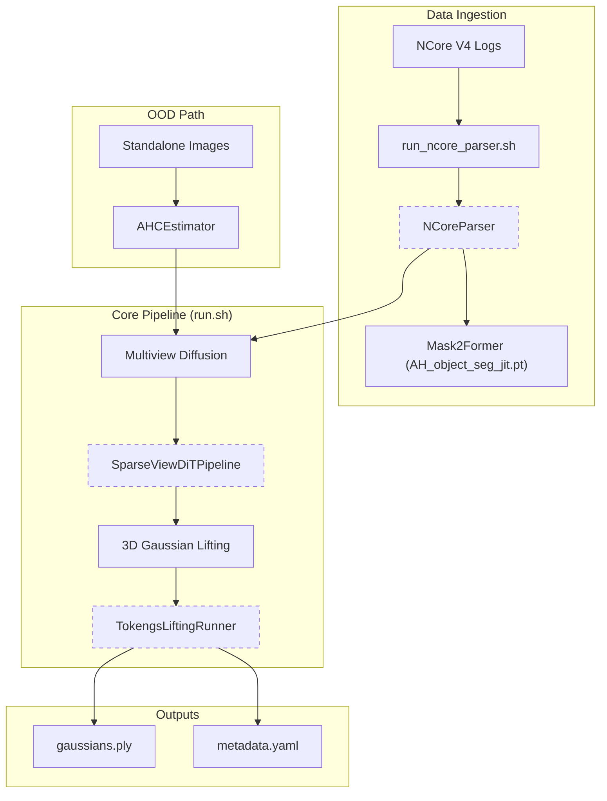
**Sources:** [README.md:27-30](), [docs/end_to_end_example.md:31-33](), [docs/end_to_end_example.md:54-56](), [docs/end_to_end_example.md:76-78]().

---

### Major Subsystems

#### 1. NCore Parser
The ingestion engine for the pipeline. It processes NCore V4 clips—which bundle multi-camera images, lidar, and 3D cuboid tracks—to produce object-centric datasets [docs/end_to_end_example.md:21-25](). It utilizes a JIT-compiled Mask2Former model (`AH_object_seg_jit.pt`) for precise instance segmentation [docs/end_to_end_example.md:46]().

*   **Key Scripts**: `scripts/run_ncore_parser.sh`
*   **Key Classes**: `NCoreParser`, `NCoreObjectParser`
*   **For details, see [NCore Parser: Data Ingestion](#2)**.

#### 2. Multiview Diffusion (SparseViewDiT)
SparseViewDiT is a diffusion transformer explicitly designed to handle limited-angle views and real-world AV data challenges [README.md:17-18](). It takes sparse input views and generates a consistent 16-view orbit around the object [README.md:25-26]().

*   **Key Model**: `SparseViewDiTTransformer2DModelNative`
*   **Key Pipeline**: `SparseViewDiTPipeline`
*   **For details, see [SparseViewDiT: Multiview Diffusion](#3)**.

#### 3. TokenGS: 3D Gaussian Lifting
A feed-forward reconstructor that "lifts" the 16 views generated by the diffusion model into a 3D Gaussian Splatting representation [README.md:25-26](). Unlike traditional optimization-based GS, TokenGS performs this reconstruction in a single forward pass [README.md:25-26]().

*   **Key Model**: `TokenGS` (Transformer-based encoder-decoder)
*   **Key Runner**: `TokengsLiftingRunner`
*   **For details, see [TokenGS: 3D Gaussian Lifting](#4)**.

#### 4. Camera Estimator (AHCEstimator)
Used when processing "Out-of-Distribution" (OOD) images where camera intrinsics and extrinsics are unknown [README.md:149-150](). It estimates distance, FOV, and relative poses to provide the necessary geometric context for the diffusion and lifting stages.

*   **Key Class**: `AHCEstimator`
*   **For details, see [Camera Estimator (AHCEstimator)](#5)**.

---

### Component Interaction Diagram

This diagram illustrates how the different checkpoints and model components interact during a standard `run.sh` execution.

**Diagram: Model Component Interactions**
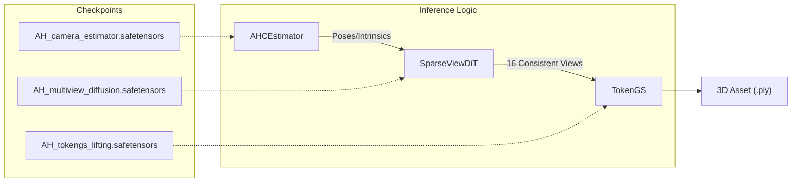
**Sources:** [README.md:96-101](), [README.md:116-121](), [README.md:152-160]().

---

### Child Pages

*   **[Getting Started: Installation and Setup](#1.1)**: Environment configuration, dependency management (PyTorch, gsplat), and checkpoint acquisition.
*   **[End-to-End Pipeline Walkthrough](#1.2)**: Step-by-step execution from raw NCore logs to simulation-ready assets, including `metadata.yaml` generation for NVIDIA Omniverse.
*   **[Data Samples Reference](#1.3)**: Overview of the bundled `data_samples/`, including rectified AV objects and OOD image formats.

**Sources:**
- Pipeline structure: [README.md:27-30](), [docs/end_to_end_example.md:1-4]()
- Checkpoint definitions: [README.md:96-101]()
- Script entry points: [docs/end_to_end_example.md:31-33](), [docs/end_to_end_example.md:54-56]()
- System purpose: [README.md:15-18]()

---

# Page: Getting Started: Installation and Setup

# Getting Started: Installation and Setup

<details>
<summary>Relevant source files</summary>

The following files were used as context for generating this wiki page:

- [CONTRIBUTING.MD](CONTRIBUTING.MD)
- [pyproject.toml](pyproject.toml)
- [setup.sh](setup.sh)

</details>


This page provides a technical guide for setting up the **Asset Harvester** environment. It covers hardware requirements, automated environment configuration via `setup.sh`, dependency management through `pyproject.toml` extras, and verification of the CUDA-accelerated components.

## System Requirements

The Asset Harvester pipeline requires specific hardware and software configurations to support high-fidelity 3D Gaussian Splatting and diffusion-based view generation.

*   **GPU:** NVIDIA GPU with at least **16 GB VRAM**. For lower VRAM configurations, CPU offloading can be enabled during inference [setup.sh:24-24]().
*   **Driver:** NVIDIA Driver version **>= 570** (required for CUDA 12.8 compatibility) [setup.sh:22-22]().
*   **Compiler:** GCC version **10–13** (tested with GCC 12.3) for building `gsplat` CUDA kernels [setup.sh:23-23]().
*   **Python:** Version **3.10** or higher [pyproject.toml:8-8]().

## Automated Installation

The project provides a `setup.sh` script that automates the creation of a Conda environment, installs the CUDA toolkit, builds the `gsplat` library from a pinned source commit, and installs the package in editable mode.

### Setup Execution Flow
The following diagram illustrates the sequence of operations performed by `setup.sh`.

**Figure 1: Environment Setup Sequence**
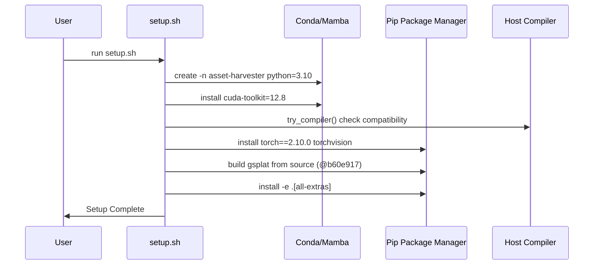
*Sources: [setup.sh:1-160]()*

### Usage
```bash
# Default installation (env name: asset-harvester, python: 3.10)
bash setup.sh

# Custom installation
bash setup.sh --env-name my-ah-env --python 3.11
```
*Sources: [setup.sh:28-45]()*

## Dependency Management

The project uses `pyproject.toml` to manage modular dependencies via optional extras. This allows users to install only the components necessary for their specific stage of the pipeline.

### Optional Extras
| Extra | Purpose | Key Dependencies |
| :--- | :--- | :--- |
| `ncore-parser` | Data ingestion from NCore V4 logs | `nvidia-ncore`, `pydantic`, `transformers` |
| `multiview_diffusion` | SparseViewDiT inference | `diffusers`, `accelerate`, `omegaconf` |
| `tokengs` | 3D Gaussian lifting and training | `gsplat`, `kiui`, `roma`, `lpips` |
| `camera-estimator` | Intrinsics/Extrinsics estimation for OOD images | `transformers`, `safetensors` |

*Sources: [pyproject.toml:19-81]()*

### Manual Installation of Extras
To install specific components manually:
```bash
pip install -e ".[ncore-parser,multiview_diffusion]"
```
*Sources: [pyproject.toml:83-86]()*

## Component Verification

### gsplat CUDA Backend
The `gsplat` library is a critical dependency for the `tokengs` module. It must be built from source to ensure compatibility with the local CUDA environment. The `setup.sh` script verifies the installation by attempting to load the C++ backend [setup.sh:142-142]().

### Code Quality Tools
The project uses `ruff` for linting and formatting [CONTRIBUTING.MD:11-11](). 
*   **Linting:** `ruff check asset_harvester` [CONTRIBUTING.MD:23-23]()
*   **Formatting:** `ruff format asset_harvester` [CONTRIBUTING.MD:38-38]()
*   **License Headers:** All source files must include the Apache-2.0 header, verified via `scripts/check_license_headers.py` [CONTRIBUTING.MD:43-49]().

## Data Flow: Setup to Runtime

The following diagram bridges the installation space to the code entities that manage the environment and execution.

**Figure 2: Setup Configuration Mapping**
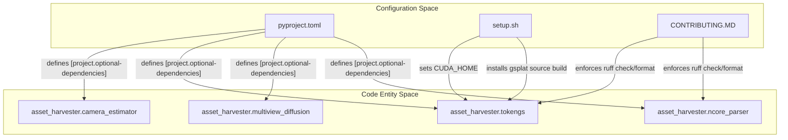
*Sources: [pyproject.toml:19-81](), [setup.sh:138-144](), [CONTRIBUTING.MD:53-58]()*

## Contribution Prerequisites

Before submitting code, contributors must:
1.  **Sign-off Commits:** Use `git commit -s` to adhere to the Developer Certificate of Origin (DCO) [CONTRIBUTING.MD:64-77]().
2.  **Verify Headers:** Run `python scripts/check_license_headers.py` [CONTRIBUTING.MD:57-57]().
3.  **Lint/Format:** Ensure `ruff check` and `ruff format --check` pass [CONTRIBUTING.MD:55-56]().

*Sources: [CONTRIBUTING.MD:1-105]()*

---

# Page: End-to-End Pipeline Walkthrough

# End-to-End Pipeline Walkthrough

<details>
<summary>Relevant source files</summary>

The following files were used as context for generating this wiki page:

- [docs/end_to_end_example.md](docs/end_to_end_example.md)
- [run.sh](run.sh)
- [run_inference.py](run_inference.py)
- [scripts/run_ncore_parser.sh](scripts/run_ncore_parser.sh)

</details>


This page provides a practical guide to the Asset Harvester pipeline, which transforms raw NCore V4 autonomous driving logs into simulation-ready 3D Gaussian Splatting (GS) assets. The pipeline consists of three primary stages: data ingestion and parsing, multiview diffusion generation, and feed-forward 3D lifting.

## Pipeline Overview

The pipeline follows a sequential flow from raw sensor data to a 3D asset. It is designed to be executed via a series of shell scripts that wrap the underlying Python logic.

### System Data Flow

The following diagram illustrates the flow of data from the NCore V4 source through the various code entities to the final PLY asset.

**Pipeline Entity Flow**
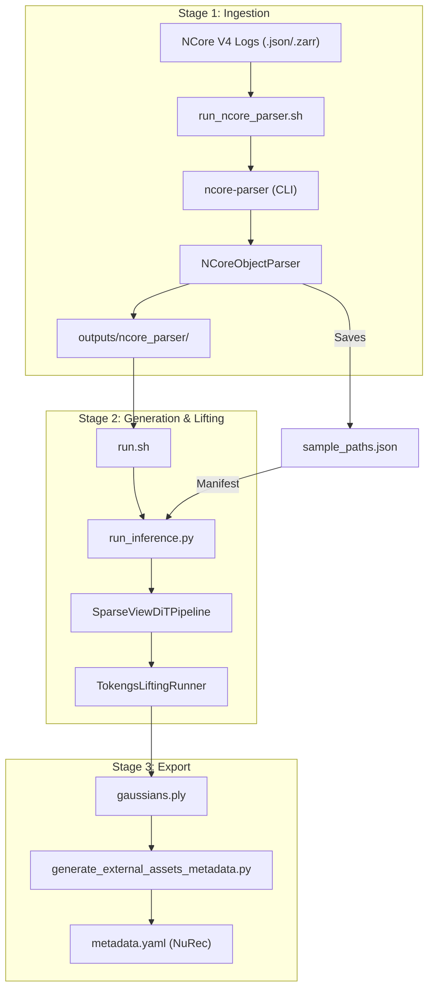
Sources: [docs/end_to_end_example.md:27-74](), [run_inference.py:30-48](), [scripts/run_ncore_parser.sh:98-104]()

---

## Step 1: NCore Parsing (Data Ingestion)

The first step uses `run_ncore_parser.sh` to extract object-centric crops from NCore V4 clips. This script invokes the `ncore-parser` entry point, which filters objects based on visibility and occlusion.

### Execution
```bash
bash scripts/run_ncore_parser.sh \
    --component-store "path/to/clip.json" \
    --output-path "outputs/ncore_parser/"
```
[scripts/run_ncore_parser.sh:31-34]()

### Key Arguments
| Argument | Default | Description |
|----------|---------|-------------|
| `--component-store` | *(required)* | Path to NCore V4 manifest or `.zarr.itar` globs. [scripts/run_ncore_parser.sh:30-31]() |
| `--output-path` | `outputs/ncore_parser/` | Target directory for parsed multi-view crops. [scripts/run_ncore_parser.sh:52]() |
| `--segmentation-ckpt` | `checkpoints/AH_object_seg_jit.pt` | JIT-compiled Mask2Former model for instance segmentation. [scripts/run_ncore_parser.sh:53]() |
| `--camera-ids` | 5 default cameras | Comma-separated list of NCore camera sensor IDs to process. [scripts/run_ncore_parser.sh:37-42]() |

### Output Structure
The parser generates a `sample_paths.json` manifest and subdirectories for each object:
```text
outputs/ncore_parser/
├── sample_paths.json           # Manifest for subsequent stages
└── <object_id>/
    └── input_views/
        ├── camera.json         # Poses, FOV, and LWH metadata
        ├── frame_000.png       # Rectified RGB crop
        └── mask_000.png        # Instance segmentation mask
```
Sources: [docs/end_to_end_example.md:42-49](), [run_inference.py:78-86](), [scripts/run_ncore_parser.sh:51-68]()

---

## Step 2: Diffusion and 3D Lifting

The `run.sh` script manages the core generative process. It first uses `SparseViewDiTPipeline` to generate 16 consistent views from 1-3 input images, then uses `TokengsLiftingRunner` to reconstruct the 3D Gaussian asset.

### Execution
```bash
bash run.sh --data-root ./outputs/ncore_parser --output-dir ./outputs/ncore_harvest
```
[run.sh:55-56]()

### Key Arguments
| Argument | Default | Description |
|----------|---------|-------------|
| `--data-root` | `outputs/ncore_parser/` | Input directory containing `sample_paths.json`. [run.sh:30-31]() |
| `--diffusion-ckpt` | `checkpoints/AH_multiview_diffusion.safetensors` | SparseViewDiT weights. [run.sh:33-34]() |
| `--lifting-ckpt` | `checkpoints/AH_tokengs_lifting.safetensors` | TokenGS weights. [run.sh:37-38]() |
| `--num-steps` | 30 | Diffusion denoising steps. [run.sh:40]() |
| `--skip-lifting` | `false` | If true, only generates 16-view images without 3D reconstruction. [run.sh:43]() |
| `--offload` | `false` | Offloads diffusion model to CPU during lifting to save VRAM. [run.sh:44]() |

### Implementation Details
`run.sh` internally calls `run_inference.py`, which performs the following:
1.  **Data Loading**: `load_sample_paths_from_json` reads the manifest [run_inference.py:51-76]().
2.  **View Selection**: If more than 3 views exist, `farthest_point_sampling` selects the most diverse views for conditioning [run_inference.py:37]().
3.  **Diffusion**: `SparseViewDiTPipeline` generates 16 images [run_inference.py:33]().
4.  **Lifting**: `TokengsLiftingRunner.run_lifting` takes the 16 views and outputs a `gaussians.ply` file [run_inference.py:40-46]().

**Inference Logic Diagram**
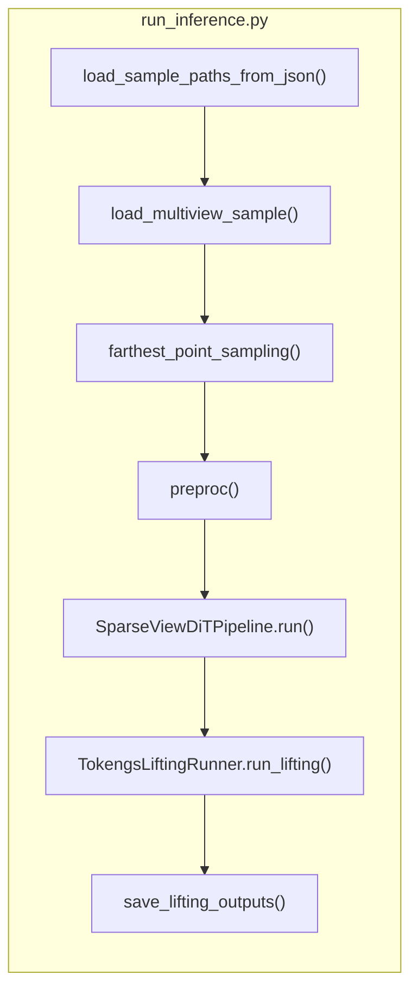
Sources: [run_inference.py:51-166](), [run.sh:179-189]()

---

## Step 3: Simulation Metadata Generation

For integration with NVIDIA Omniverse NuRec, a final metadata generation step is required. This converts the harvested assets into a format compatible with simulation workflows.

### Execution
```bash
python asset_harvester/utils/generate_external_assets_metadata.py --input-dir ./outputs/ncore_harvest
```
[docs/end_to_end_example.md:77]()

### Final Output Directory Structure
After the full pipeline, each object directory contains:
-   `multiview/`: The 16 images generated by SparseViewDiT.
-   `3d_lifted/`: Visualizations of the lifted Gaussian asset.
-   `gaussians.ply`: The final 3D Gaussian Splatting asset.
-   `multiview.mp4` & `3d_lifted.mp4`: Preview videos.
-   `metadata.yaml`: NuRec-compatible metadata (if Step 3 is run).

Sources: [docs/end_to_end_example.md:70-74](), [asset_harvester/utils/io.py:36]() (referenced in `run_inference.py`)

---

# Page: Data Samples Reference

# Data Samples Reference

<details>
<summary>Relevant source files</summary>

The following files were used as context for generating this wiki page:

- [README.md](README.md)
- [docs/end_to_end_example.md](docs/end_to_end_example.md)

</details>


The `data_samples/` directory contains curated examples used to demonstrate the Asset Harvester pipeline and verify installation. These samples represent two distinct data flows: rectified object-centric multi-view data (typically from the **NCore Parser**) and out-of-distribution (OOD) standalone images where camera parameters are unknown.

## Directory Structure and Data Types

The bundled data is organized into two primary subsets:

1.  **`rectified_AV_objects/`**: A subset of the [NuRec AV Object Benchmark](https://huggingface.co/datasets/nvidia/NuRec-AV-Object-Benchmark). This contains consumer vehicles and Vulnerable Road Users (VRU) such as pedestrians. These samples include precise camera intrinsics/extrinsics and object bounding box dimensions (LWH) [README.md:112-114]().
2.  **`OOD_images/`**: Standalone frame/mask pairs representing "in-the-wild" captures. These lack camera metadata, necessitating the use of the `AHCEstimator` (Camera Estimator) to predict distance, FOV, and poses before diffusion [README.md:152-156]().

### Data Flow for Samples

The following diagram illustrates how these data samples flow through the system components.

**Sample Processing Architecture**

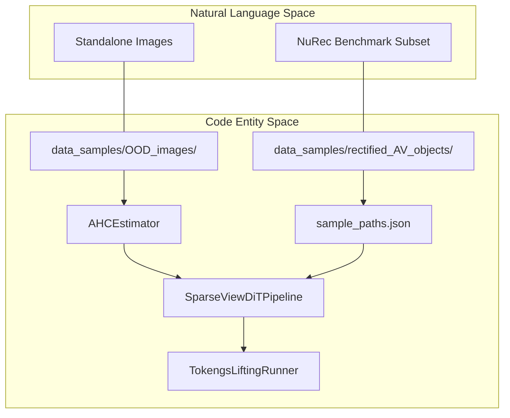
Sources: [README.md:112-156](), [docs/end_to_end_example.md:60-70]()

---

## Input Views and Manifest Format

The Asset Harvester pipeline relies on a standardized directory structure and metadata format to process objects.

### sample_paths.json
The root of a processed dataset (like `rectified_AV_objects/`) contains a `sample_paths.json` manifest. This file acts as a registry for all object instances found within the directory [docs/end_to_end_example.md:60]().

### input_views/ Directory
Each object sample contains an `input_views/` subdirectory. This folder holds the raw sensor data and the critical `camera.json` file.

| File | Description |
| :--- | :--- |
| `frame_XXXXX.jpeg` | The RGB image crop centered on the object. |
| `mask_XXXXX.png` | A binary or bit-packed instance mask for the target object. |
| `camera.json` | The unified metadata file containing poses, intrinsics, and object dimensions. |

### camera.json Format
The `camera.json` is the core schema used by the `NCore Parser` and consumed by the `Multiview Diffusion` stage. It includes:

*   **frame_filenames**: List of RGB image paths.
*   **mask_filenames**: List of corresponding mask paths.
*   **normalized_cam_positions**: Camera positions relative to the object center.
*   **cam_dists**: Radial distance from the camera to the object center.
*   **cam_fovs**: Field of view for each camera.
*   **object_lwh**: The Length, Width, and Height of the object's 3D bounding box.

**Data Mapping: Manifest to Code Entities**

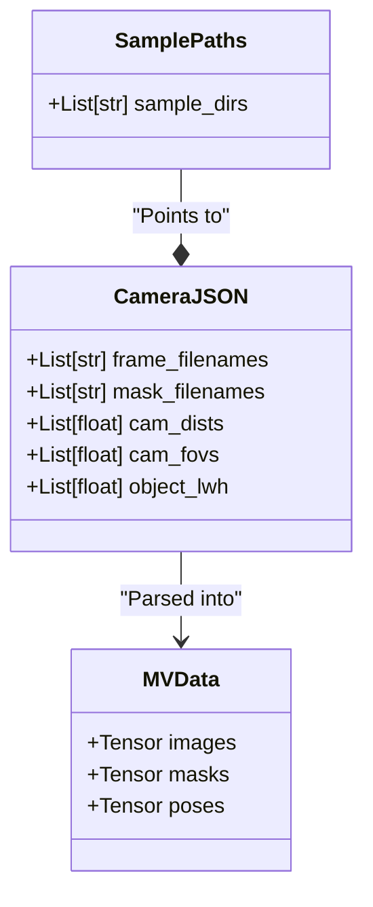
Sources: [docs/end_to_end_example.md:27-49](), [README.md:125-132]()

---

## OOD Image Requirements

For images in `data_samples/OOD_images/`, the system expects a specific flat structure if masks are already provided, or a structure compatible with the `image_segment` utility.

### Manual Preparation
If providing custom images, they must be resized to **512x512** and organized as follows [README.md:123-132]():
```text
YOUR_IMAGE_ROOT/
├─── SAMPLE_0
│    ├── frame.jpeg
│    └── mask.png
└─── SAMPLE_1
     ├── frame.jpeg
     └── mask.png
```

### Segmentation Utility
If masks are missing, the `asset_harvester.utils.image_segment` module (utilizing the `AH_object_seg_jit.pt` checkpoint) can be used to generate `mask.png` from `frame.jpeg` [README.md:138-145](). This utility implements a centering constraint to ensure the correct object is segmented in crowded driving scenes.

**OOD Processing Flow**
1.  **Segment**: `image_segment.py` generates masks [docs/end_to_end_example.md:80-90]().
2.  **Estimate**: `AHCEstimator` predicts the missing `camera.json` parameters (LWH, Distance, FOV) [README.md:149-156]().
3.  **Harvest**: `run_inference.py` executes the diffusion and lifting [README.md:116-121]().

Sources: [README.md:134-156](), [docs/end_to_end_example.md:80-95]()

---

# Page: NCore Parser: Data Ingestion

# NCore Parser: Data Ingestion

<details>
<summary>Relevant source files</summary>

The following files were used as context for generating this wiki page:

- [asset_harvester/ncore_parser/__init__.py](asset_harvester/ncore_parser/__init__.py)
- [asset_harvester/ncore_parser/__main__.py](asset_harvester/ncore_parser/__main__.py)
- [asset_harvester/ncore_parser/parser.py](asset_harvester/ncore_parser/parser.py)

</details>


The `ncore_parser` subsystem is the primary entry point for the Asset Harvester pipeline when working with autonomous driving datasets. It is designed to ingest raw NCore V4 driving logs, identify specific object tracks (e.g., vehicles, pedestrians), and extract multi-view image crops along with their associated camera parameters and segmentation masks.

### System Purpose and Scope
The parser automates the transition from massive, world-coordinate sensor streams to object-centric data packets ready for 3D reconstruction. It handles coordinate transformations, view selection based on visibility, and integrates deep-learning-based segmentation to ensure the extracted assets are clean and centered.

## High-Level Architecture

The `ncore_parser` is organized around a main controller class that orchestrates extraction, segmentation, and filtering.

### Data Ingestion Flow
The following diagram illustrates how the `NCoreParser` coordinates between raw data extraction and the refinement of those views.

**Diagram: NCore Parser Execution Flow**
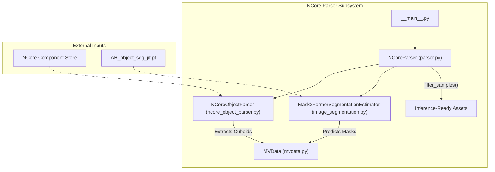
**Sources:** [asset_harvester/ncore_parser/parser.py:74-91](), [asset_harvester/ncore_parser/__main__.py:192-219]()

---

## Core Components

### NCoreParser (Controller)
The `NCoreParser` class [asset_harvester/ncore_parser/parser.py:74-75]() serves as the high-level API. It initializes the `NCoreObjectParser` for raw data handling and the `Mask2FormerSegmentationEstimator` for instance segmentation [asset_harvester/ncore_parser/parser.py:81-90](). Its `extract` method orchestrates the full pipeline from raw log paths to a dictionary of filtered `MVData` objects [asset_harvester/ncore_parser/parser.py:93-100]().

### NCoreObjectParser (Extractor)
This component handles the heavy lifting of reading NCore V4 component stores. It processes cuboid tracks, performs lidar-to-camera projections, and crops images to a target resolution [asset_harvester/ncore_parser/ncore_object_parser.py](). It is responsible for calculating initial occlusion rates and ensuring that the object is visible within the selected camera frames.
*   For details on extraction logic and track handling, see **[NCoreParser: Extraction and Filtering Logic](#2.1)**.

### Image Segmentation
The parser uses a JIT-compiled Mask2Former model to generate instance masks for every cropped view [asset_harvester/ncore_parser/parser.py:132-134](). These masks are critical for "best-fit" instance selection, where the system matches the predicted segmentation mask to the expected 3D cuboid projection [asset_harvester/ncore_parser/parser.py:34-41]().
*   For details on the segmentation model and bit-packed mask format, see **[Image Segmentation: Mask2Former Integration](#2.2)**.

---

## Data Filtering and Quality Control

The parser applies several heuristic filters to ensure that only high-quality, reconstructible views are passed to the SparseViewDiT model:
1.  **Occlusion Filtering:** Views with high occlusion rates (calculated via cuboid-to-lidar depth comparison) are discarded [asset_harvester/ncore_parser/parser.py:102-113]().
2.  **Centering Constraint:** The object must be relatively centered within the crop; views where the mask mean deviates significantly from the center are filtered out [asset_harvester/ncore_parser/parser.py:177-178]().
3.  **IoU Thresholding:** The system compares the segmentation mask with the target bounding box to ensure the correct object is being tracked [asset_harvester/ncore_parser/parser.py:63-71]().

**Diagram: View Filtering Logic**
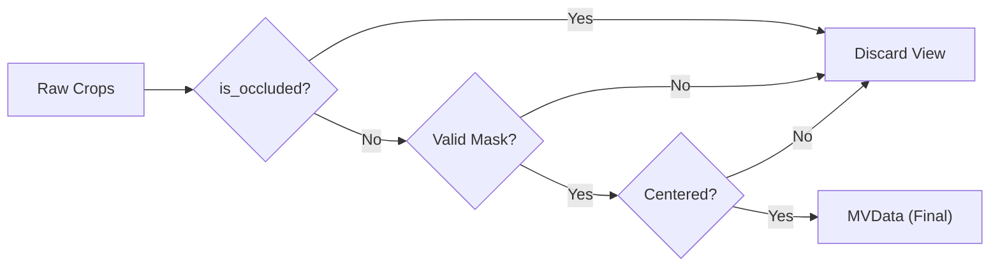
**Sources:** [asset_harvester/ncore_parser/parser.py:152-182]()

---

## Configuration and Output Format

The behavior of the parser is governed by the `NCoreParserConfig` Pydantic schema [asset_harvester/ncore_parser/schemas.py](). This includes parameters for resolution, occlusion thresholds, and camera selection.

The final output is structured to be compatible with the downstream inference pipeline, producing a `sample_paths.json` manifest and a standardized directory structure for each object:
*   `input_views/`: Contains `frame_XX.jpeg`, `mask_XX.png`, and `camera.json`.
*   `metadata.json`: Contains clip and object IDs.

For details on the specific schemas and the directory hierarchy, see **[NCore Parser Schemas and Output Format](#2.3)**.

**Sources:** [asset_harvester/ncore_parser/__main__.py:53-67](), [asset_harvester/ncore_parser/__main__.py:93-102]()

---

# Page: NCoreParser: Extraction and Filtering Logic

# NCoreParser: Extraction and Filtering Logic

<details>
<summary>Relevant source files</summary>

The following files were used as context for generating this wiki page:

- [asset_harvester/ncore_parser/mvdata.py](asset_harvester/ncore_parser/mvdata.py)
- [asset_harvester/ncore_parser/ncore_object_parser.py](asset_harvester/ncore_parser/ncore_object_parser.py)
- [asset_harvester/ncore_parser/parser.py](asset_harvester/ncore_parser/parser.py)
- [asset_harvester/ncore_parser/ray_aabb.py](asset_harvester/ncore_parser/ray_aabb.py)

</details>


The `NCoreParser` and `NCoreObjectParser` modules are responsible for the ingestion, extraction, and filtering of object-centric multi-view data from NCore V4 autonomous driving logs. This subsystem bridges raw sensor data and cuboid tracks into the `MVData` format required for downstream 3D asset generation.

## Overview and Data Flow

The extraction process transforms world-space cuboid tracks into normalized, cropped, and segmented image sequences. The logic is split between `NCoreObjectParser`, which handles the geometric extraction from NCore stores, and `NCoreParser`, which applies high-level segmentation-based filtering.

### System Data Flow

The following diagram illustrates the transformation of raw NCore V4 data into filtered `MVData` objects.

**Title: NCore Extraction Pipeline**
```mermaid
graph TD
    subgraph "NCore V4 Storage"
        [SequenceLoaderV4] --> [SequenceComponentGroupsReader]
        [SequenceComponentGroupsReader] --> [CuboidTrackObservation]
    end

    subgraph "NCoreObjectParser (Geometric Extraction)"
        [CuboidTrackObservation] --> |"build_tracks_from_observations"| [TrackData]
        [TrackData] --> |"extract"| [MVData_Raw]
        [MVData_Raw] --> |"compute_occlusion_rate"| [Occlusion_Metadata]
    end

    subgraph "NCoreParser (Filtering Logic)"
        [MVData_Raw] --> |"Mask2FormerSegmentationEstimator"| [Instance_Masks]
        [Instance_Masks] --> |"select_bestfit_instances"| [Filtered_Masks]
        [Filtered_Masks] --> |"_filter_samples"| [MVData_Final]
    end

    [MVData_Final] --> |"convert"| [Output_Dict]
```
Sources: [asset_harvester/ncore_parser/ncore_object_parser.py:29-42](), [asset_harvester/ncore_parser/parser.py:74-125](), [asset_harvester/ncore_parser/mvdata.py:40-101]()

---

## NCoreObjectParser: Geometric Extraction

The `NCoreObjectParser` [asset_harvester/ncore_parser/ncore_object_parser.py:197-200]() interfaces with the `ncore` library to retrieve sensor data and track information.

### Track Building and Interpolation
Raw observations are grouped by `track_id` and sorted by timestamp. If a track contains multiple observations, a `PoseInterpolator` is created to estimate the object's position at exact camera frame timestamps [asset_harvester/ncore_parser/ncore_object_parser.py:131-176]().

### Occlusion Rate Computation
The parser computes an occlusion rate to filter out views where the target object is hidden by LiDAR points (proxy for geometry).
1. It projects LiDAR points into the camera frame.
2. It uses `ray_aabb_intersect` [asset_harvester/ncore_parser/ray_aabb.py:50-111]() to determine if rays from the camera to the object's AABB (Axis-Aligned Bounding Box) are blocked by points closer to the camera than the object.
3. The `compute_occlusion_rate` function [asset_harvester/ncore_parser/ncore_object_parser.py:230-264]() returns a ratio of occluded vs. visible rays.

### View Normalization
For every extracted frame, the parser computes a canonical camera pose:
- **Look-at Vector**: The camera is oriented to look directly at the center of the object's 3D bounding box [asset_harvester/ncore_parser/ncore_object_parser.py:95-111]().
- **Up Vector**: Derived from the bounding box corners to ensure the "ground" is consistent across views [asset_harvester/ncore_parser/ncore_object_parser.py:113-118]().

Sources: [asset_harvester/ncore_parser/ncore_object_parser.py:131-176](), [asset_harvester/ncore_parser/ncore_object_parser.py:230-264](), [asset_harvester/ncore_parser/ray_aabb.py:50-111]()

---

## NCoreParser: Segmentation and Filtering

The `NCoreParser` [asset_harvester/ncore_parser/parser.py:74-76]() wraps the geometric extractor and adds semantic awareness using `Mask2Former`.

### Best-Fit Instance Selection
Because an image may contain multiple objects of the same class, the parser must identify which instance mask corresponds to the NCore track. The `select_bestfit_instances` function [asset_harvester/ncore_parser/parser.py:34-41]() performs this selection:
1. **Convex Hull**: It creates a target mask from the 2D projection of the 3D bounding box (`bbox_pix`) [asset_harvester/ncore_parser/parser.py:43-46]().
2. **IoU Thresholding**: It calculates the Intersection over Union (IoU) between the target mask and all instance masks produced by the segmentor [asset_harvester/ncore_parser/parser.py:63-67]().
3. **Exceed Constraint**: It rejects masks that extend significantly beyond the target bounding box (controlled by `mask_exceed_threshold`) [asset_harvester/ncore_parser/parser.py:60-61]().

### View Filtering Heuristics
The `_filter_samples` method [asset_harvester/ncore_parser/parser.py:152-154]() applies several constraints to ensure high-quality training data:
- **Occlusion**: Frames marked as occluded by the `NCoreObjectParser` are discarded [asset_harvester/ncore_parser/parser.py:167-168]().
- **Centering Constraint**: The object must be relatively centered in the crop. This is verified by checking if the mean of the mask coordinates $(y, x)$ is within a specific radius of the image center [asset_harvester/ncore_parser/parser.py:177-178]().
- **Minimum Pixels**: Masks with fewer than `min_instance_pixels` are rejected [asset_harvester/ncore_parser/parser.py:175-176]().

Sources: [asset_harvester/ncore_parser/parser.py:34-72](), [asset_harvester/ncore_parser/parser.py:152-185]()

---

## MVData Object

The `MVData` class [asset_harvester/ncore_parser/mvdata.py:40-62]() is the primary container for the extracted data. It stores:
- **Frames**: RGB crops of the object.
- **Cam Poses**: $4 \times 4$ matrices representing the camera-to-world transformation.
- **Dists**: The distance from the camera to the object center.
- **FOV**: The field of view used for the crop.
- **Masks**: Binary instance masks.

### Conversion for Storage
The `convert()` method [asset_harvester/ncore_parser/mvdata.py:102-144]() serializes these fields into a dictionary of byte buffers, suitable for writing to disk as `.jpeg` and `.npy` files.

**Title: MVData Entity Relationship**
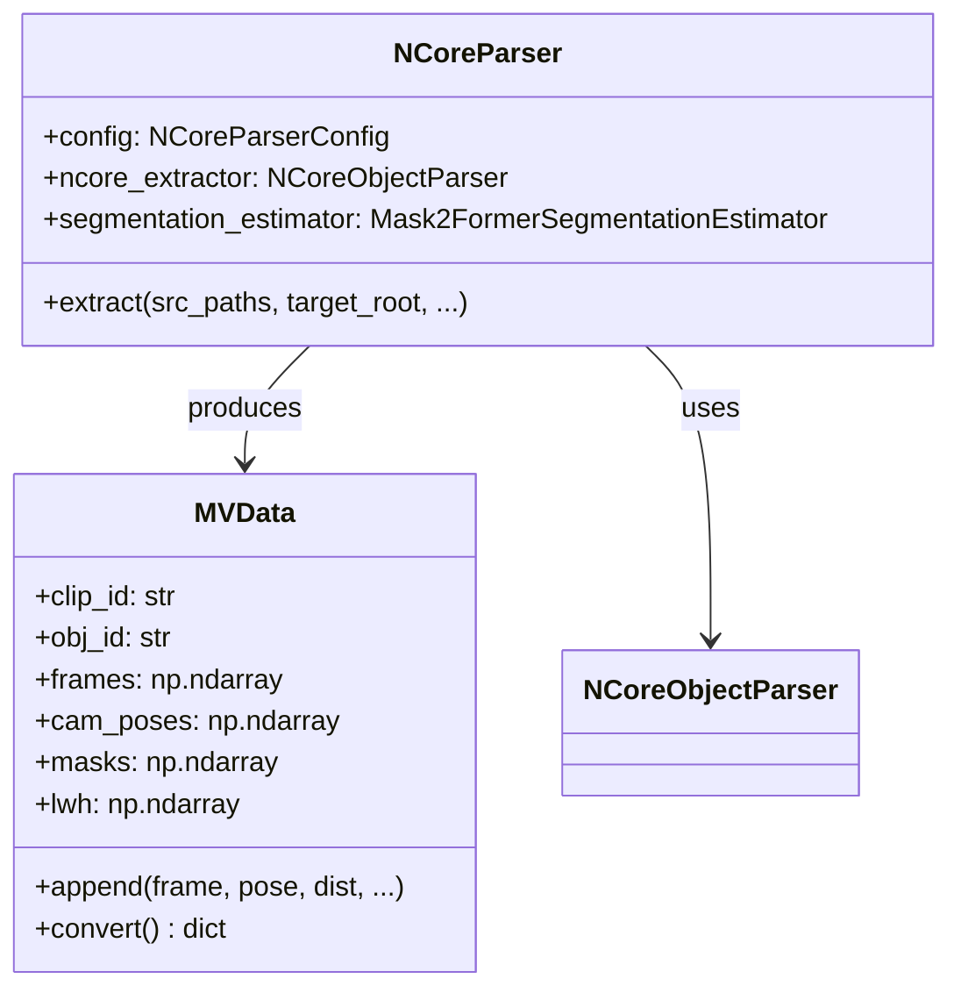
Sources: [asset_harvester/ncore_parser/mvdata.py:40-144](), [asset_harvester/ncore_parser/parser.py:74-125]()

---

# Page: Image Segmentation: Mask2Former Integration

# Image Segmentation: Mask2Former Integration

<details>
<summary>Relevant source files</summary>

The following files were used as context for generating this wiki page:

- [asset_harvester/ncore_parser/image_segmentation.py](asset_harvester/ncore_parser/image_segmentation.py)
- [asset_harvester/utils/image_segment.py](asset_harvester/utils/image_segment.py)

</details>


The Asset Harvester utilizes a specialized **Mask2Former** instance segmentation model to generate high-quality binary masks for object extraction. This subsystem is responsible for identifying foreground objects in multi-view images, which is critical for the `ncore_parser` to filter out background noise and for the subsequent 3D Gaussian lifting stage to focus on the asset of interest.

## Mask2Former JIT Integration

The segmentation engine is implemented as a TorchScript JIT (Just-In-Time) module, allowing for high-performance inference without a heavy dependency on the original training framework. The core logic resides in the `Mask2FormerSegmentationEstimator` class [asset_harvester/ncore_parser/image_segmentation.py:42-43]().

### Configuration and Optimization
The estimator requires a pre-compiled JIT checkpoint, typically `AH_object_seg_jit.pt`. To ensure compatibility across different GPU architectures and prevent runtime failures, the module explicitly disables certain JIT optimizations:
*   **NVFuser Disable**: The environment variable `PYTORCH_NVFUSER_DISABLE` is set to `"1"` [asset_harvester/ncore_parser/image_segmentation.py:24]().
*   **Bailout Depth**: `torch._C._jit_set_bailout_depth(0)` is called to prevent incompatible re-compilations between subsequent calls [asset_harvester/ncore_parser/image_segmentation.py:23]().

### Segmentation Data Flow
The following diagram illustrates the flow from a raw image to the bit-packed instance masks.

**Mask2Former Inference Pipeline**
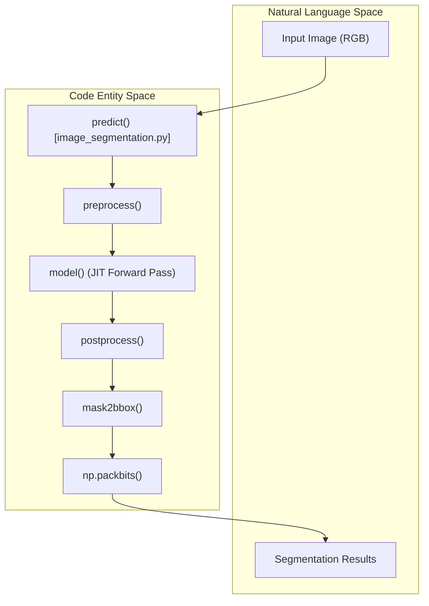
Sources: [asset_harvester/ncore_parser/image_segmentation.py:42-167]()

## Data Processing and Bit-Packing

To minimize memory footprint and disk I/O when handling large batches of multi-view images, the system uses a **bit-packed mask format**.

1.  **Preprocessing**: Images are converted to tensors, normalized, and resized to the model's expected `input_size` (typically 512x512) [asset_harvester/ncore_parser/image_segmentation.py:73-92]().
2.  **Inference**: The model returns a tuple containing panoptic segmentation, instance labels, masks, scores, and semantic segmentation [asset_harvester/ncore_parser/image_segmentation.py:96]().
3.  **Filtering**: Only instances with a score above `pred_score_thr` (default 0.3) are retained [asset_harvester/ncore_parser/image_segmentation.py:103]().
4.  **Bit-Packing**: Boolean instance masks are converted to `uint8` arrays using `np.packbits()`. This reduces the mask size by a factor of 8 [asset_harvester/ncore_parser/image_segmentation.py:108]().
5.  **Bounding Boxes**: Tight bounding boxes are computed from the masks using the `mask2bbox` helper function [asset_harvester/ncore_parser/image_segmentation.py:27-39]().

Sources: [asset_harvester/ncore_parser/image_segmentation.py:27-39](), [asset_harvester/ncore_parser/image_segmentation.py:94-112]()

## Standalone Utility: image_segment.py

For Out-of-Distribution (OOD) images or manual data correction, the `image_segment.py` utility provides a CLI to regenerate masks. This script is particularly useful when the `ncore_parser` has already extracted frames but masks need to be updated with different thresholds or a new model checkpoint.

### Object-Centric Selection Heuristic
When running in standalone mode, the utility assumes the image is centered on a single asset. It uses a **Largest-Area Heuristic** to select the target mask:
1.  Unpacks the bit-packed masks back to boolean arrays [asset_harvester/utils/image_segment.py:61]().
2.  Calculates the sum of pixels for every detected instance [asset_harvester/utils/image_segment.py:63]().
3.  Selects the instance with the maximum area (`np.argmax(areas)`) [asset_harvester/utils/image_segment.py:64]().
4.  Resizes this mask back to the original image dimensions using `Image.NEAREST` interpolation to preserve binary boundaries [asset_harvester/utils/image_segment.py:68]().

### CLI Usage
The utility recursively searches for images matching a specific filename (e.g., `frame.jpeg`) and saves the resulting mask in the same directory.

**CLI Component Interaction**
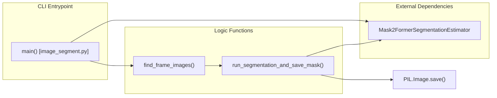
Sources: [asset_harvester/utils/image_segment.py:33-73](), [asset_harvester/utils/image_segment.py:76-159]()

## Key Functions and Classes

| Entity | Location | Role |
| :--- | :--- | :--- |
| `Mask2FormerSegmentationEstimator` | `image_segmentation.py` | Primary class for loading the JIT model and performing inference. |
| `mask2bbox` | `image_segmentation.py` | Utility to convert binary masks into `[x1, y1, x2, y2]` coordinates. |
| `predict_batch` | `image_segmentation.py` | Batched inference implementation for improved GPU throughput. |
| `run_segmentation_and_save_mask` | `image_segment.py` | Orchestrates image loading, prediction, area-based selection, and mask saving. |
| `np.packbits` / `np.unpackbits` | Internal (NumPy) | Used to compress/decompress masks for storage efficiency. |

Sources: [asset_harvester/ncore_parser/image_segmentation.py:42-167](), [asset_harvester/utils/image_segment.py:39-73]()

---

# Page: NCore Parser Schemas and Output Format

# NCore Parser Schemas and Output Format

<details>
<summary>Relevant source files</summary>

The following files were used as context for generating this wiki page:

- [asset_harvester/ncore_parser/__main__.py](asset_harvester/ncore_parser/__main__.py)
- [asset_harvester/ncore_parser/schemas.py](asset_harvester/ncore_parser/schemas.py)
- [scripts/run_ncore_parser.sh](scripts/run_ncore_parser.sh)

</details>


This page documents the data structures and output conventions used by the `ncore_parser` subsystem. The parser translates raw NCore V4 autonomous driving logs into a standardized, object-centric format compatible with the SparseViewDiT and TokenGS stages of the Asset Harvester pipeline.

## Pydantic Configuration Schemas

The `ncore_parser` utilizes Pydantic models to manage configuration and ensure data integrity during the extraction process. These schemas define the filtering logic, sensor selection, and metadata structure for harvested assets.

### NCoreParserConfig
The `NCoreParserConfig` class defines the operational parameters for the extraction pipeline, including thresholds for view filtering and sensor configuration [asset_harvester/ncore_parser/schemas.py:20-41]().

| Field | Type | Default | Description |
| :--- | :--- | :--- | :--- |
| `target_resolution` | `int` | `512` | Resolution for the exported image crops. |
| `num_lidar_ref_frames`| `int` | `10` | Max LiDAR frames sampled per track for geometry verification. |
| `cam_pose_flip` | `list[int]` | `[1, 1, -1]` | Factors to flip pose coordinates (x, y, z). |
| `occ_rate_threshold` | `float` | `0.5` | Max occlusion rate allowed before a view is discarded. |
| `crop_min_area_ratio` | `float` | `0.002` | Minimum bounding box area relative to image size. |
| `mask_overlap_threshold`| `float` | `0.3` | Threshold for instance segmentation overlap filtering. |
| `camera_ids` | `list[str]` | (Standard Surround) | List of NCore sensor IDs to process [asset_harvester/ncore_parser/schemas.py:32-41](). |
| `segmentation_ckpt` | `str` | N/A | Path to the Mask2Former JIT checkpoint. |

### Data Representation Schemas
The parser uses several auxiliary schemas to represent the state of an asset before it is written to disk:
*   **`MultiViewData`**: Holds the intrinsic and extrinsic camera data, distances, and object dimensions (LWH) for a set of frames [asset_harvester/ncore_parser/schemas.py:46-54]().
*   **`Asset`**: A container for a single track, including its `clip_id`, `track_id`, and associated `MultiViewData` [asset_harvester/ncore_parser/schemas.py:57-64]().
*   **`AssetHarvestingMetadata`**: The top-level schema representing a complete harvesting run, linking the configuration to the extracted assets [asset_harvester/ncore_parser/schemas.py:67-73]().

Sources: [asset_harvester/ncore_parser/schemas.py:20-73]()

## Output Directory Structure

The `write_inference_format` function in the CLI entry point dictates the directory structure of the output. This format is designed to be consumed directly by the inference scripts (`run.sh`) [asset_harvester/ncore_parser/__main__.py:53-67]().

### Directory Hierarchy
```text
output_dir/
├── sample_paths.json              # Global manifest of valid samples
└── <category>/                    # e.g., vehicle, pedestrian
    └── <track_id>/                # Unique object identifier
        ├── metadata.json          # Link back to source clip and ID
        └── input_views/           # Source data for diffusion
            ├── camera.json        # Unified camera/geometry data
            ├── frame_00.jpeg      # Object-centric crop
            ├── mask_00.png        # Instance segmentation mask
            └── ...
```

### Global Manifest: sample_paths.json
The `sample_paths.json` file contains a list of relative paths to every object directory successfully processed. This allows the subsequent pipeline stages to iterate over assets without traversing the entire filesystem [asset_harvester/ncore_parser/__main__.py:114-115]().

Sources: [asset_harvester/ncore_parser/__main__.py:53-115]()

## Camera and View Data Format

The core of the object representation is the `input_views/camera.json` file. This file provides the necessary geometric context for SparseViewDiT to perform consistent multi-view synthesis.

### camera.json Structure
The data is serialized from the `MultiViewData` object during the export phase [asset_harvester/ncore_parser/__main__.py:93-102]().

| Key | Description |
| :--- | :--- |
| `frame_filenames` | List of strings mapping to JPEG crops in the directory. |
| `mask_filenames` | List of strings mapping to PNG masks. |
| `normalized_cam_positions` | Camera positions in a coordinate system where the object is at the origin. |
| `cam_dists` | Scalar distance from the camera to the object center. |
| `cam_fovs` | Horizontal Field of View for each camera in degrees. |
| `object_lwh` | The Length, Width, and Height of the object bounding box. |

### View Filtering Logic
The parser does not export every frame. It applies the `occ_rate_threshold` and `crop_min_area_ratio` defined in `NCoreParserConfig` to ensure only high-quality, visible views are provided to the diffusion model [asset_harvester/ncore_parser/__main__.py:157-167]().

Sources: [asset_harvester/ncore_parser/__main__.py:93-102](), [asset_harvester/ncore_parser/schemas.py:20-41]()

## System Flow: Configuration to Output

The following diagram illustrates how the `NCoreParserConfig` drives the CLI and results in the standardized output format.

**Data Flow: NCore Parser Ingestion**
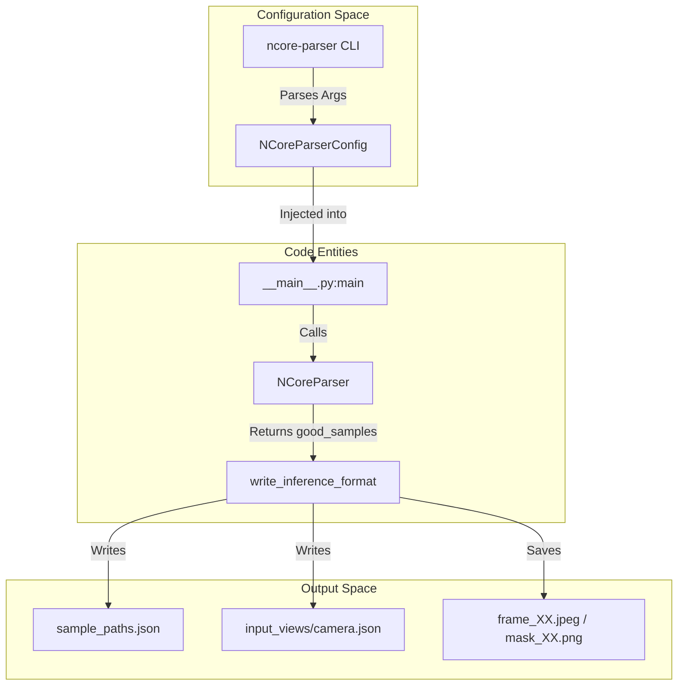
Sources: [asset_harvester/ncore_parser/__main__.py:192-219](), [asset_harvester/ncore_parser/__main__.py:53-115]()

## Code Entity Association

The following diagram maps the high-level concepts of the "Output Format" to the specific Pydantic classes and functions that generate them.

**Mapping: Logic to Code Entities**
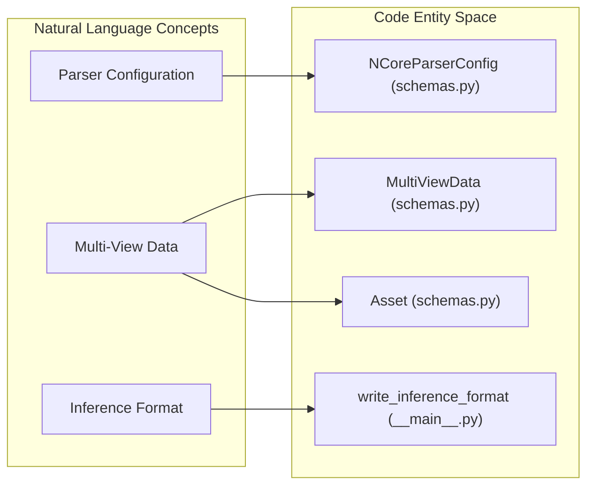
Sources: [asset_harvester/ncore_parser/schemas.py:20-64](), [asset_harvester/ncore_parser/__main__.py:53-54]()

---

# Page: SparseViewDiT: Multiview Diffusion

# SparseViewDiT: Multiview Diffusion

<details>
<summary>Relevant source files</summary>

The following files were used as context for generating this wiki page:

- [asset_harvester/multiview_diffusion/__init__.py](asset_harvester/multiview_diffusion/__init__.py)
- [asset_harvester/multiview_diffusion/models/__init__.py](asset_harvester/multiview_diffusion/models/__init__.py)

</details>


The `multiview_diffusion` subsystem, centered around the **SparseViewDiT** architecture, is responsible for generating a set of 16 geometrically consistent multi-view images from a sparse set of 1–3 input views. This stage bridges the gap between 2D object crops extracted by the [NCore Parser: Data Ingestion](#2) and the 3D reconstruction performed by [TokenGS: 3D Gaussian Lifting](#4). By synthesizing missing perspectives, it provides the dense multi-view supervision necessary for high-quality feed-forward 3D lifting.

### System Overview

SparseViewDiT leverages a Diffusion Transformer (DiT) backbone to perform conditional image generation. It takes as input latent representations of the source images, their corresponding camera parameters, and a target set of 16 camera poses. The system outputs 16 latent frames that are subsequently decoded into RGB images.

The subsystem is organized into several key components:
*   **Models**: Transformer-based architectures (`SparseViewDiTTransformer2DModelNative`) that handle the multi-view denoising process.
*   **Pipelines**: Inference orchestrators (`SparseViewDiTPipeline`) that manage the diffusion schedule, VAE encoding/decoding, and Classifier-Free Guidance (CFG).
*   **Data Utilities**: Preprocessing logic for Plucker ray generation and camera sampling.

### Architecture and Data Flow

The following diagram illustrates how the multiview diffusion components interact within the codebase to transform input images into a consistent 16-view set.

**SparseViewDiT Data Flow and Entity Mapping**
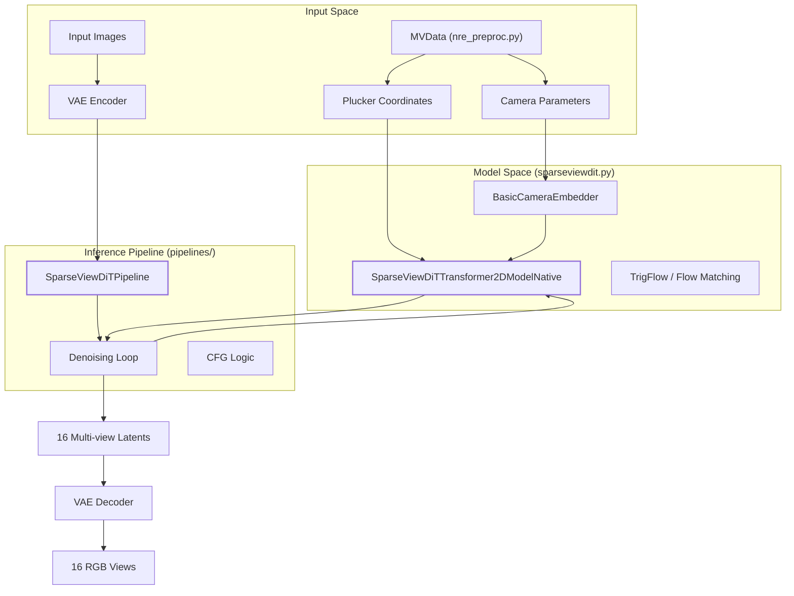
Sources: [asset_harvester/multiview_diffusion/__init__.py:21-34](), [asset_harvester/multiview_diffusion/models/__init__.py:16-21]()

### Subsystem Components

#### SparseViewDiT Model Architecture
The core of the system is a 2D Transformer model adapted for multi-view consistency. It utilizes a `BasicCameraEmbedder` to inject 17-dimensional camera embeddings (derived from camera-to-world matrices and Field of View) and incorporates Plucker ray embeddings to provide spatial grounding for the generated views.
*   For details on the transformer blocks and camera embedding logic, see [SparseViewDiT Model Architecture](#3.1).

#### Inference Pipelines
Inference is managed through specialized Diffusers-compatible pipelines. The `SparseViewDiTPipeline` handles the standard denoising process, while the `SparseViewDiTSprintPipeline` is optimized for speed. These pipelines manage the `cond_mask` (identifying which of the 16 slots are provided as input) and `c-radio` image conditioning.
*   For details on the denoising loop and memory optimizations, see [SparseViewDiT Inference Pipelines](#3.2).

#### Data and Preprocessing
Before entering the diffusion model, data must be prepared via `nre_preproc.py`. This includes generating Plucker coordinates and performing farthest-point sampling to select the most diverse input views if more than three are available.
*   For details on camera sampling and coordinate generation, see [Multiview Diffusion Data and Preprocessing](#3.3).

#### Utilities and Model Builder
The `model_builder.py` module provides factory functions for initializing the DiT models and the `c-radio` conditioning backbone. Configuration is managed via `OmegaConf` to ensure reproducibility across different hardware setups.
*   For details on model initialization and utility helpers, see [Multiview Diffusion Utilities and Model Builder](#3.4).

### Code Entity Mapping

| Code Entity | File Path | Role |
| :--- | :--- | :--- |
| `SparseViewDiTTransformer2DModelNative` | [asset_harvester/multiview_diffusion/models/sparseviewdit.py]() | Primary DiT architecture for multi-view generation. |
| `SparseViewDiTTrigFlow` | [asset_harvester/multiview_diffusion/models/sparseview_trigflow.py]() | Flow-matching variant of the DiT model. |
| `BasicCameraEmbedder` | [asset_harvester/multiview_diffusion/models/sparseviewdit_embedders.py]() | Projects 6DoF poses and FOV into embedding space. |
| `SparseViewDiTPipeline` | [asset_harvester/multiview_diffusion/pipelines/pipeline_sparseviewdit.py]() | Standard inference pipeline for 16-view synthesis. |
| `get_models` | [asset_harvester/multiview_diffusion/utils/model_builder.py]() | Factory function to load and configure models from checkpoints. |

Sources: [asset_harvester/multiview_diffusion/__init__.py:21-35](), [asset_harvester/multiview_diffusion/models/__init__.py:16-22]()

---

# Page: SparseViewDiT Model Architecture

# SparseViewDiT Model Architecture

<details>
<summary>Relevant source files</summary>

The following files were used as context for generating this wiki page:

- [asset_harvester/multiview_diffusion/models/sparseview_trigflow.py](asset_harvester/multiview_diffusion/models/sparseview_trigflow.py)
- [asset_harvester/multiview_diffusion/models/sparseviewdit.py](asset_harvester/multiview_diffusion/models/sparseviewdit.py)
- [asset_harvester/multiview_diffusion/models/sparseviewdit_embedders.py](asset_harvester/multiview_diffusion/models/sparseviewdit_embedders.py)
- [asset_harvester/multiview_diffusion/schedulers/__init__.py](asset_harvester/multiview_diffusion/schedulers/__init__.py)
- [asset_harvester/multiview_diffusion/schedulers/trigflow_scheduler.py](asset_harvester/multiview_diffusion/schedulers/trigflow_scheduler.py)

</details>


The SparseViewDiT (Sparse View Diffusion Transformer) architecture is the generative core of the Asset Harvester pipeline. It is responsible for generating 16 geometrically consistent views of an object from 1–3 input images. The model is built on the `SanaTransformer2DModel` [asset_harvester/multiview_diffusion/models/sparseviewdit.py:47-47]() and extended to support multiview-specific conditioning, including camera extrinsics, field-of-view (FOV), and Plucker ray embeddings.

## SparseViewDiTTransformer2DModelNative

The `SparseViewDiTTransformer2DModelNative` class is a native Diffusers implementation that integrates multiview conditioning directly into the transformer blocks. It maps original training components to standard Diffusers building blocks to ensure compatibility with features like LoRA and gradient checkpointing [asset_harvester/multiview_diffusion/models/sparseviewdit.py:25-36]().

### Data Flow and Conditioning
The model processes latents of shape `(BV, C, H, W)`, where `BV` represents the total number of views across the batch. Key conditioning inputs include:
*   **Camera Embeddings**: Injected via `BasicCameraEmbedder` [asset_harvester/multiview_diffusion/models/sparseviewdit_embedders.py:24-24]().
*   **Plucker Rays**: High-dimensional geometric embeddings added to the patch embeddings.
*   **Conditioning Mask (`cond_mask`)**: Identifies which views are provided as input (ground truth) versus those to be generated.
*   **Sequence Length (`x_seq_len`)**: A list of integers defining how many views belong to each batch item, used for linear attention packing [asset_harvester/multiview_diffusion/models/sparseviewdit.py:124-131]().

### Linear Attention Processing
To maintain efficiency across many views, the model utilizes `LiteLinearAttnProcessor`. This processor handles variable-length multiview sequences by padding them into a fixed-size batch during the attention mechanism [asset_harvester/multiview_diffusion/models/sparseviewdit.py:119-132]().

| Function | Role |
| :--- | :--- |
| `_unaggregate` | Pads `(BV, N, C)` packed tokens into `(B, max_views*N, C)` padded batch [asset_harvester/multiview_diffusion/models/sparseviewdit.py:56-65](). |
| `_aggregate` | Re-packs the padded batch back to the original `(BV, N, C)` format after attention [asset_harvester/multiview_diffusion/models/sparseviewdit.py:92-101](). |

**Sources:** [asset_harvester/multiview_diffusion/models/sparseviewdit.py:16-132](), [asset_harvester/multiview_diffusion/models/sparseviewdit_embedders.py:24-35]()

## TrigFlow Variant

The `SparseViewDiTTrigFlow` class is a specialized wrapper that implements **TrigFlow**, a flow-matching variant designed for improved distillation and sampling [asset_harvester/multiview_diffusion/models/sparseview_trigflow.py:21-21]().

### Flow Transformation Logic
The model converts standard timesteps into trigonometric flow timesteps before passing them to the transformer backbone.

1.  **TrigFlow to Flow**: The input `timestep` is transformed using sine and cosine functions:
    `flow_timestep = sin(t) / (cos(t) + sin(t))` [asset_harvester/multiview_diffusion/models/sparseview_trigflow.py:44-44]().
2.  **Latent Scaling**: Latents are scaled by the magnitude of the flow vector:
    `latent_model_input = latents * sqrt(flow_t^2 + (1 - flow_t)^2)` [asset_harvester/multiview_diffusion/models/sparseview_trigflow.py:47-47]().
3.  **Inverse Transformation**: After the forward pass, the model output is converted back from Flow space to TrigFlow space to provide the final prediction [asset_harvester/multiview_diffusion/models/sparseview_trigflow.py:71-74]().

**Sources:** [asset_harvester/multiview_diffusion/models/sparseview_trigflow.py:21-93](), [asset_harvester/multiview_diffusion/schedulers/trigflow_scheduler.py:49-120]()

## Camera and Ray Embeddings

### BasicCameraEmbedder
The `BasicCameraEmbedder` processes a 17-dimensional vector per view. This vector consists of:
*   **Camera-to-World (c2w)**: 16 values from the flattened 4x4 matrix.
*   **FOV**: 1 value representing the field of view.

The embedder uses a 2-layer MLP with SiLU activation to project these into the transformer's `hidden_size` [asset_harvester/multiview_diffusion/models/sparseviewdit_embedders.py:35-42]().

### Plucker Ray Embeddings
Plucker coordinates provide a view-independent representation of rays. In `SparseViewDiT`, these are computed during preprocessing and added to the visual features to provide the transformer with explicit geometric cues about the spatial location of each pixel/patch.

**Sources:** [asset_harvester/multiview_diffusion/models/sparseviewdit_embedders.py:24-53](), [asset_harvester/multiview_diffusion/models/sparseviewdit.py:32-35]()

## Architecture Overview Diagrams

### System Entity Mapping: Transformer Backbone
This diagram maps the high-level transformer components to their specific implementation classes in the codebase.

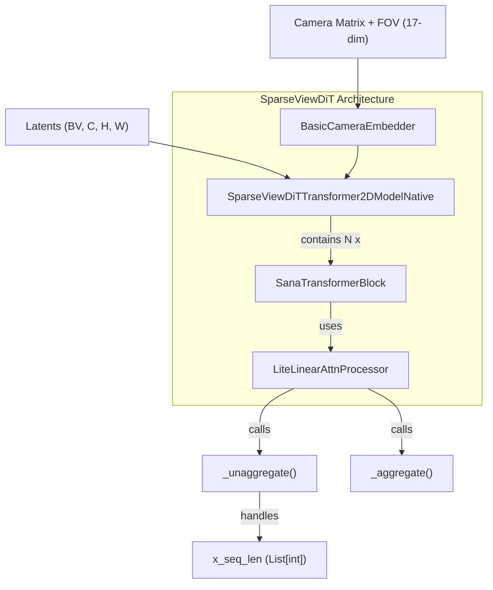
**Sources:** [asset_harvester/multiview_diffusion/models/sparseviewdit.py:47-132](), [asset_harvester/multiview_diffusion/models/sparseviewdit_embedders.py:24-42]()

### TrigFlow Data Flow
This diagram illustrates the mathematical transformation cycle within the `SparseViewDiTTrigFlow` wrapper.

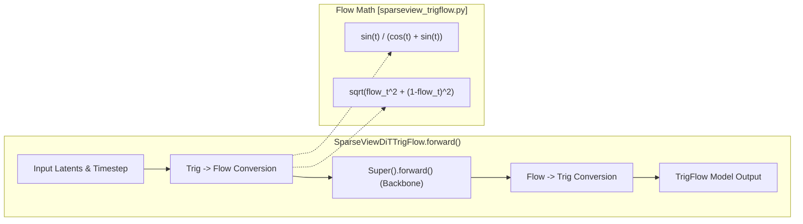
**Sources:** [asset_harvester/multiview_diffusion/models/sparseview_trigflow.py:37-93]()

## Scheduler Integration

The `TrigFlowScheduler` manages the noise schedule specifically for the TrigFlow variant. It inherits from `SchedulerMixin` and `ConfigMixin` [asset_harvester/multiview_diffusion/schedulers/trigflow_scheduler.py:49-49]().

*   **Timestep Spacing**: Defaults to "leading" for inference [asset_harvester/multiview_diffusion/schedulers/trigflow_scheduler.py:118-118]().
*   **Prediction Type**: Set to `trigflow` [asset_harvester/multiview_diffusion/schedulers/trigflow_scheduler.py:113-113]().
*   **Output**: Returns a `TrigFlowSchedulerOutput` containing the `prev_sample` and the predicted `denoised` latent [asset_harvester/multiview_diffusion/schedulers/trigflow_scheduler.py:33-47]().

**Sources:** [asset_harvester/multiview_diffusion/schedulers/trigflow_scheduler.py:1-127]()

---

# Page: SparseViewDiT Inference Pipelines

# SparseViewDiT Inference Pipelines

<details>
<summary>Relevant source files</summary>

The following files were used as context for generating this wiki page:

- [asset_harvester/multiview_diffusion/pipelines/__init__.py](asset_harvester/multiview_diffusion/pipelines/__init__.py)
- [asset_harvester/multiview_diffusion/pipelines/sparseviewdit_pipeline.py](asset_harvester/multiview_diffusion/pipelines/sparseviewdit_pipeline.py)
- [asset_harvester/multiview_diffusion/pipelines/sparseviewdit_sprint_pipeline.py](asset_harvester/multiview_diffusion/pipelines/sparseviewdit_sprint_pipeline.py)

</details>


The `multiview_diffusion` subsystem provides specialized Diffusers-compatible pipelines for generating 16 geometrically consistent views of an object from sparse conditioning inputs. These pipelines manage the transition from image space to latent space, coordinate the transformer denoising loop with camera and Plucker ray conditioning, and handle memory-efficient decoding.

## Pipeline Variants

The codebase implements two primary pipelines located in `asset_harvester/multiview_diffusion/pipelines/`:

| Pipeline Class | Description | Key Characteristics |
| :--- | :--- | :--- |
| `SparseViewDiTPipeline` | Standard diffusion pipeline for multiview generation. | Supports CFG, Flow-matching with shift, and 20-30 denoising steps. |
| `SparseViewDiTSprintPipeline` | Distilled "Sprint" pipeline for fast inference. | 2-step SCM denoising, no CFG (distilled), uses `TrigFlow` parameterization. |

Sources: `[asset_harvester/multiview_diffusion/pipelines/__init__.py:16-22]()`, `[asset_harvester/multiview_diffusion/pipelines/sparseviewdit_sprint_pipeline.py:16-26]()`

## SparseViewDiTPipeline Implementation

The `SparseViewDiTPipeline` is the core inference engine. It orchestrates the interaction between the `SparseViewDiTTransformer2DModelNative`, the VAE, and the C-RADIO image encoder.

### Data Flow and System Mapping

The following diagram maps the high-level generation logic to the specific code entities and data structures.

**Diagram: Natural Language to Code Entity Space (Standard Pipeline)**
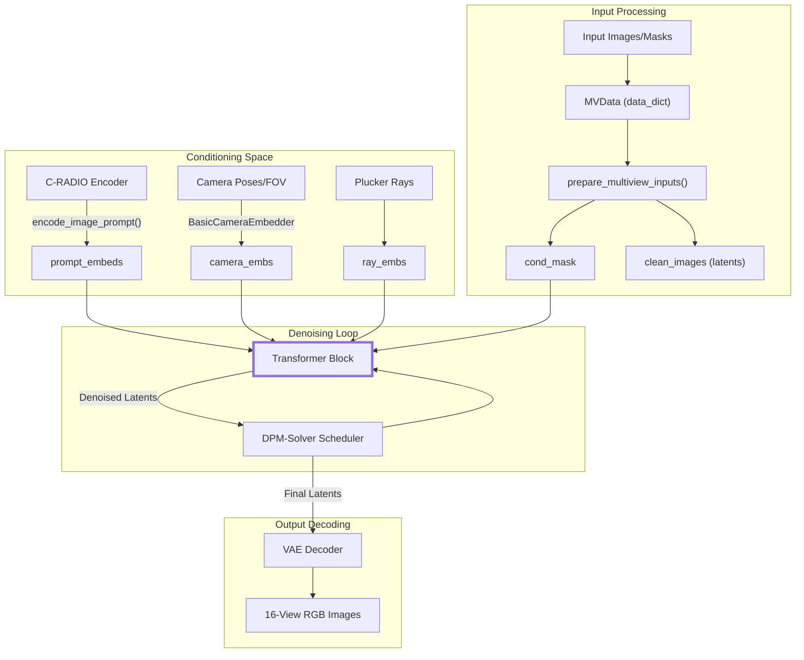
Sources: `[asset_harvester/multiview_diffusion/pipelines/sparseviewdit_pipeline.py:70-128]()`, `[asset_harvester/multiview_diffusion/pipelines/sparseviewdit_pipeline.py:284-330]()`

### Key Functional Components

#### 1. C-RADIO Image Conditioning
The pipeline uses `encode_image_prompt` to transform conditioning images (usually 1-3 views) into a continuous embedding space using the C-RADIO model.
*   **Logic**: If no images are provided, it defaults to a grey placeholder `[asset_harvester/multiview_diffusion/pipelines/sparseviewdit_pipeline.py:169-171]()`.
*   **CFG Support**: It generates both conditional and unconditional (null) embeddings to support Classifier-Free Guidance `[asset_harvester/multiview_diffusion/pipelines/sparseviewdit_pipeline.py:182-200]()`.

#### 2. Conditioning Mask (`cond_mask`)
The `cond_mask` is a critical binary tensor that tells the transformer which views are "known" (conditioning) and which are "unknown" (to be generated). 
*   Views with `cond_mask == 1` are treated as source context.
*   Views with `cond_mask == 0` are target latents being denoised.
*   Implementation: Handled within `prepare_multiview_inputs` `[asset_harvester/multiview_diffusion/pipelines/sparseviewdit_pipeline.py:284-300]()`.

#### 3. Flow-Shift Scheduling
The pipeline utilizes flow-matching with a configurable `flow_shift` (default 1.0). This shift adjusts the noise schedule to account for the high resolution and structural complexity of multiview generation `[asset_harvester/multiview_diffusion/pipelines/sparseviewdit_pipeline.py:441-443]()`.

## SparseViewDiTSprintPipeline (Fast Inference)

The "Sprint" pipeline is designed for low-latency applications, reducing inference from ~20 steps to 2 steps using Shortcut Consistency Models (SCM).

### Sprint Denoising Logic
Unlike the standard pipeline, the Sprint version incorporates the guidance scale directly as a conditioning signal rather than performing dual passes for CFG.

**Diagram: Sprint Pipeline Execution Flow**
```mermaid
sequenceDiagram
    participant P as SparseViewDiTSprintPipeline
    participant S as TrigFlowScheduler
    participant T as Transformer (SCM)
    participant V as VAE

    P->>P: prepare_multiview_inputs (No CFG)
    P->>P: encode_image_prompt (Single Pass)
    P->>S: retrieve_timesteps (2 steps)
    Note over P,T: guidance_scale embedded in kwargs
    loop Denoising Loop
        P->>T: Forward (latents, timestep, guidance)
        T-->>P: predicted_noise/velocity
        P->>S: step()
    end
    P->>V: decode (minibatch_size=1)
    V-->>P: Generated Views
```
Sources: `[asset_harvester/multiview_diffusion/pipelines/sparseviewdit_sprint_pipeline.py:41-49]()`, `[asset_harvester/multiview_diffusion/pipelines/sparseviewdit_sprint_pipeline.py:101-135]()`

### Differences in Sprint Implementation
*   **No CFG**: `do_classifier_free_guidance` is forced to `False` `[asset_harvester/multiview_diffusion/pipelines/sparseviewdit_sprint_pipeline.py:105-130]()`.
*   **TrigFlow**: Uses `TrigFlowScheduler` with specific `max_timesteps` (typically $\pi/2$) and `intermediate_timesteps` `[asset_harvester/multiview_diffusion/pipelines/sparseviewdit_sprint_pipeline.py:76-77]()`.
*   **Guidance Embedding**: The `guidance_scale` is scaled by `transformer.config.guidance_embeds_scale` and passed as a tensor to the model `[asset_harvester/multiview_diffusion/pipelines/sparseviewdit_sprint_pipeline.py:163-166]()`.

## Memory Optimizations

To handle the high VRAM requirements of 16-view generation (especially with 32-channel VAEs), the pipelines implement several optimization strategies:

### VAE Minibatching
Instead of decoding all 16 views simultaneously, the pipeline decodes them in smaller batches to avoid Out-Of-Memory (OOM) errors.
*   Controlled by `vae_minibatch_size` (default 1) in the `__call__` method.
*   Implementation: `[asset_harvester/multiview_diffusion/pipelines/sparseviewdit_pipeline.py:535-550]()`.

### CPU Offloading Sequence
The pipeline defines a specific order for offloading components to CPU memory when using Diffusers' `enable_model_cpu_offload()`:
1.  `text_encoder` (or image encoder)
2.  `transformer`
3.  `vae`
This sequence ensures that only the currently active model resides in GPU memory.

Sources: `[asset_harvester/multiview_diffusion/pipelines/sparseviewdit_pipeline.py:88]()`, `[asset_harvester/multiview_diffusion/pipelines/sparseviewdit_pipeline.py:535-545]()`

## Summary of Key Arguments (`__call__`)

| Argument | Purpose |
| :--- | :--- |
| `data_dict` | The preprocessed `MVData` containing images, cameras, and Plucker rays. |
| `conditioning_images` | PIL images used for C-RADIO encoding. |
| `num_inference_steps` | Steps for the denoising loop (20-30 for standard, 2 for Sprint). |
| `guidance_scale` | CFG scale for standard, or conditioning signal for Sprint. |
| `flow_shift` | Adjusts the noise schedule (standard pipeline only). |

Sources: `[asset_harvester/multiview_diffusion/pipelines/sparseviewdit_pipeline.py:350-380]()`, `[asset_harvester/multiview_diffusion/pipelines/sparseviewdit_sprint_pipeline.py:68-83]()`

---

# Page: Multiview Diffusion Data and Preprocessing

# Multiview Diffusion Data and Preprocessing

<details>
<summary>Relevant source files</summary>

The following files were used as context for generating this wiki page:

- [asset_harvester/multiview_diffusion/data/__init__.py](asset_harvester/multiview_diffusion/data/__init__.py)
- [asset_harvester/multiview_diffusion/data/inference_utils.py](asset_harvester/multiview_diffusion/data/inference_utils.py)
- [asset_harvester/multiview_diffusion/data/nre_preproc.py](asset_harvester/multiview_diffusion/data/nre_preproc.py)

</details>


This page documents the data loading, preprocessing, and camera sampling utilities used by the multiview diffusion subsystem (SparseViewDiT). These utilities transform raw object-centric crops into the structured formats required for denoising, including Plucker coordinate generation, farthest-point view sampling, and canonical camera grid construction.

## Data Structures and Configuration

The primary data container for the multiview diffusion pipeline is the `MVData` class, which aggregates multi-view images with their corresponding geometric metadata.

### MVData Class
The `MVData` dataclass [asset_harvester/multiview_diffusion/data/nre_preproc.py:91-131]() stores both raw extracted data and post-processed properties. Key fields include:
*   `frames`: Image data (either `np.ndarray` or list of PIL Images).
*   `cam_poses`: Camera positions (N, 3).
*   `dists`: Camera distances from the object center.
*   `fov`: Field of view values.
*   `masks`: Foreground segmentation masks.
*   `ray_map`: Plucker coordinate maps generated during preprocessing.

### Inference Configuration
The `SanaInferenceConfig` [asset_harvester/multiview_diffusion/data/inference_utils.py:27-42]() defines the default parameters for the diffusion inference process, such as the number of output views (default 16), maximum input conditioning views (default 4), and the default prompt ("A vehicle in natural condition, white background").

Sources: [asset_harvester/multiview_diffusion/data/nre_preproc.py:91-131](), [asset_harvester/multiview_diffusion/data/inference_utils.py:27-42]()

---

## Preprocessing Pipeline

The `preproc` function is the central entry point for preparing data for the `SparseViewDiT` model. It handles image normalization, mask application, and the generation of auxiliary geometric embeddings.

### Implementation Flow: `preproc`
The function performs the following steps:
1.  **Image Preparation**: Converts PIL images to numpy arrays and normalizes them to a $[0, 1]$ or $[-1, 1]$ range depending on the pipeline requirements.
2.  **Masking**: If `mask_bg` is enabled, it applies the foreground masks to the images, typically setting the background to a neutral color (e.g., white or gray).
3.  **Ray Generation**: Calls `get_ray_map` to compute Plucker coordinates for every pixel in every view.
4.  **View Selection**: If the number of available views exceeds the model's capacity, it employs sampling strategies to select the most informative frames.

### Plucker Coordinate Generation
Plucker coordinates are used to represent the 3D rays associated with each pixel, providing the model with explicit geometric grounding.
*   **Function**: `get_ray_map` [asset_harvester/multiview_diffusion/data/nre_preproc.py:255-296]()
*   **Logic**: It calculates ray directions based on the camera FOV and image dimensions, then computes the moment (cross product of position and direction) to form the 6D Plucker representation $[d, m]$.

### Camera Sampling
When multiple input views are available, the system must select which views to use as "conditioning" for the diffusion model.
*   **Farthest Point Sampling (FPS)**: Used to select views that are maximally distant from each other in terms of camera rotation, ensuring diverse coverage of the object.
*   **Target View Construction**: The `build_eval_cams` function [asset_harvester/multiview_diffusion/data/inference_utils.py:44-64]() creates a canonical circular orbit of camera positions for the 16 output views. It uses the mean distance and FOV from the input images to ensure the generated views match the scale of the source data.

### Preprocessing Data Flow
The following diagram illustrates how raw input data is transformed into the conditioning tensors used by the diffusion model.

**Diagram: Preprocessing Data Flow**
```mermaid
graph TD
    subgraph "Input Space"
        A["MVData (Raw)"] --> B["frames (N, H, W, 3)"]
        A --> C["cam_poses (N, 3)"]
        A --> D["fov (N)"]
    end

    subgraph "nre_preproc.py Logic"
        B --> E["preproc()"]
        C --> E
        D --> E
        E --> F["get_ray_map()"]
        F --> G["Plucker Rays (N, H, W, 6)"]
        E --> H["Image Normalization"]
    end

    subgraph "inference_utils.py Logic"
        C --> I["build_eval_cams()"]
        D --> I
        I --> J["Target Orbit Poses (16, 3)"]
    end

    H --> K["Conditioning Tensors"]
    G --> K
    J --> K
```
Sources: [asset_harvester/multiview_diffusion/data/nre_preproc.py:255-296](), [asset_harvester/multiview_diffusion/data/inference_utils.py:44-64]()

---

## Conditioning Modes

The `SparseViewDiT` model supports different ways of incorporating input image information, defined by the `conditioning_mode` configuration.

| Mode | Description | Implementation Detail |
| :--- | :--- | :--- |
| `concat` | Input images are concatenated along the sequence dimension. | Handled in `SparseViewDiTPipeline` |
| `c-radio` | Uses the C-RADIO vision encoder to extract high-level features. | Invokes `encode_image_prompt` |
| `joint` | Combines image features and camera embeddings in a shared transformer space. | Used in `SparseViewDiTTransformer2DModelNative` |

### View Sampling Logic
The selection of views is often performed using `farthest_point_sampling` to maximize the baseline between conditioning views. This is particularly important for the `TokenGS` lifting stage, which requires wide-baseline multi-view consistency.

**Diagram: View Selection and Grid Construction**
```mermaid
graph LR
    subgraph "Input Views"
        V1["View 1"]
        V2["View 2"]
        VN["View N"]
    end

    subgraph "mvd_farthest_pose.py"
        FPS["farthest_point_sampling"]
    end

    V1 & V2 & VN --> FPS
    FPS --> SEL["Selected Cond Views (e.g., 1-3)"]

    subgraph "inference_utils.py"
        BEC["build_eval_cams"]
    end

    SEL --> BEC
    BEC --> GRID["16-View Canonical Grid"]
```

Sources: [asset_harvester/multiview_diffusion/data/nre_preproc.py:112-132](), [asset_harvester/multiview_diffusion/data/inference_utils.py:44-64]()

---

# Page: Multiview Diffusion Utilities and Model Builder

# Multiview Diffusion Utilities and Model Builder

<details>
<summary>Relevant source files</summary>

The following files were used as context for generating this wiki page:

- [asset_harvester/multiview_diffusion/utils/__init__.py](asset_harvester/multiview_diffusion/utils/__init__.py)
- [asset_harvester/multiview_diffusion/utils/config.py](asset_harvester/multiview_diffusion/utils/config.py)
- [asset_harvester/multiview_diffusion/utils/convert_checkpoint.py](asset_harvester/multiview_diffusion/utils/convert_checkpoint.py)
- [asset_harvester/multiview_diffusion/utils/gaussian_lifting.py](asset_harvester/multiview_diffusion/utils/gaussian_lifting.py)
- [asset_harvester/multiview_diffusion/utils/misc.py](asset_harvester/multiview_diffusion/utils/misc.py)
- [asset_harvester/multiview_diffusion/utils/model_builder.py](asset_harvester/multiview_diffusion/utils/model_builder.py)

</details>


This page documents the utility modules supporting the multiview diffusion stage of the Asset Harvester pipeline. These utilities manage model instantiation, configuration schemas, checkpoint format conversion, and geometric bridge functions for 3D Gaussian lifting.

## Model Builder and Factory Functions

The `model_builder.py` module serves as the primary factory for initializing the multiview diffusion stack. It handles the loading of the VAE, the C-RADIO image encoder, and the SparseViewDiT transformer model.

### Model Initialization
The `get_models` function orchestrates the loading process for inference [asset_harvester/multiview_diffusion/utils/model_builder.py:146-169]():
1.  **VAE**: Loads `AutoencoderDC` from the `mit-han-lab/dc-ae-f32c32-sana-1.0-diffusers` repository [asset_harvester/multiview_diffusion/utils/model_builder.py:150]().
2.  **C-RADIO**: Initializes the NVIDIA C-RADIO image encoder via `get_c_radio` [asset_harvester/multiview_diffusion/utils/model_builder.py:155]().
3.  **Transformer**: Instantiates `SparseViewDiTTransformer2DModelNative` using a predefined configuration and converts the training checkpoint to the Diffusers-compatible format [asset_harvester/multiview_diffusion/utils/model_builder.py:160-162]().

### VAE Operations
The module provides wrappers for VAE encoding and decoding, supporting multiple VAE architectures (SDXL, SD3, and DC-AE) [asset_harvester/multiview_diffusion/utils/model_builder.py:66-122](). 
*   **`vae_encode`**: Processes input images into latent space, applying the appropriate `scaling_factor` (default 0.41407 for DC-AE) [asset_harvester/multiview_diffusion/utils/model_builder.py:77-79]().
*   **`vae_decode`**: Reconstructs images from latents. For high-resolution latents that might cause VRAM issues, it includes a fallback to `enable_tiling` [asset_harvester/multiview_diffusion/utils/model_builder.py:116-119]().

### C-RADIO Integration
The `get_c_radio` function integrates with the `patches` subsystem to ensure compatibility with recent `transformers` versions [asset_harvester/multiview_diffusion/utils/model_builder.py:38-48](). It also provides `get_null_image_prompt` to generate a neutral grey embedding used for Classifier-Free Guidance (CFG) [asset_harvester/multiview_diffusion/utils/model_builder.py:52-63]().

**Sources:** [asset_harvester/multiview_diffusion/utils/model_builder.py:1-169]()

---

## Configuration Management

The `config.py` module defines the structured configuration schema for the diffusion pipeline using Python dataclasses.

| Config Class | Purpose | Key Parameters |
| :--- | :--- | :--- |
| `ModelConfig` | Transformer architecture | `model`, `in_channels`, `camera_emb_dim`, `cond_on_rays` |
| `AEConfig` | VAE settings | `vae_type`, `vae_pretrained`, `scale_factor` |
| `NREDataConfig` | Data preprocessing | `use_relative_coords`, `plucker_scene_scale` |
| `SchedulerConfig` | Flow-matching settings | `noise_schedule`, `flow_shift`, `weighting_scheme` |
| `SanaConfig` | Root configuration | Aggregates all sub-configs for the pipeline |

**Sources:** [asset_harvester/multiview_diffusion/utils/config.py:21-175]()

---

## Checkpoint Conversion

The `convert_checkpoint.py` utility provides a mapping between the internal training format (SanaMS) and the `SparseViewDiTTransformer2DModelNative` format used for inference.

### Weight Mapping Logic
The `convert_sana_ms_to_diffusers` function performs several critical transformations [asset_harvester/multiview_diffusion/utils/convert_checkpoint.py:54-167]():
*   **Fused QKV Splitting**: Original SanaMS self-attention weights are fused as `[3*D, D]`. The converter chunks these into separate `to_q`, `to_k`, and `to_v` weights [asset_harvester/multiview_diffusion/utils/convert_checkpoint.py:141-146]().
*   **Layer Renaming**: Maps original keys like `x_embedder` to `patch_embed` and `t_embedder` to `time_embed` to align with the Diffusers naming convention [asset_harvester/multiview_diffusion/utils/convert_checkpoint.py:77-89]().
*   **Embedder Preservation**: Custom camera, brightness, and skeletal embedders are preserved with minimal renaming [asset_harvester/multiview_diffusion/utils/convert_checkpoint.py:111-125]().

**Sources:** [asset_harvester/multiview_diffusion/utils/convert_checkpoint.py:19-167]()

---

## Gaussian Lifting Bridge Utilities

The `gaussian_lifting.py` module contains geometric utilities that bridge the gap between 2D generated views and 3D Gaussian reconstruction.

### Ray Generation
The module provides functions to compute camera rays, which are essential for Plucker coordinate generation and 3D lifting:
*   **`get_grid_uvs`**: Generates a grid of pixel coordinates (UVs) for a given image resolution, supporting view flipping [asset_harvester/multiview_diffusion/utils/gaussian_lifting.py:39-100]().
*   **`get_rays_from_uvs`**: Transforms UV coordinates into ray origins (`rays_o`) and directions (`rays_d`) using camera intrinsics `K` and extrinsics `c2w` [asset_harvester/multiview_diffusion/utils/gaussian_lifting.py:103-132]().

### View Selection
The `calculate_view_indices` function determines which subset of views should be used when the number of generated views exceeds the input requirements of the lifting model (e.g., selecting 16 views from a 32-view generation) [asset_harvester/multiview_diffusion/utils/gaussian_lifting.py:203-221]().

**Sources:** [asset_harvester/multiview_diffusion/utils/gaussian_lifting.py:39-221]()

---

## Infrastructure Diagrams

### Model Factory Data Flow
This diagram illustrates how `model_builder.py` assembles the inference stack.

Title: Model Builder Factory Flow
```mermaid
graph TD
    subgraph "Natural Language Space"
        A["Model Checkpoint (.safetensors)"]
        B["HuggingFace Repos"]
    end

    subgraph "Code Entity Space"
        C["model_builder.get_models()"]
        D["convert_sana_ms_to_diffusers()"]
        E["AutoencoderDC"]
        F["SparseViewDiTTransformer2DModelNative"]
        G["get_c_radio()"]
    end

    A --> D
    D --> F
    B --> E
    B --> G
    E --> C
    F --> C
    G --> C
    C --> H["Inference Pipeline"]
```
**Sources:** [asset_harvester/multiview_diffusion/utils/model_builder.py:146-169](), [asset_harvester/multiview_diffusion/utils/convert_checkpoint.py:54-67]()

### Checkpoint Transformation
This diagram shows the structural transformation of weights during the conversion process.

Title: SanaMS to Diffusers Mapping
```mermaid
graph LR
    subgraph "SanaMS (Training Format)"
        S1["blocks.N.attn.qkv.weight"]
        S2["x_embedder.proj"]
        S3["t_embedder.mlp"]
    end

    subgraph "SparseViewDiT (Inference Format)"
        D1["transformer_blocks.N.attn1.to_{q,k,v}.weight"]
        D2["patch_embed.proj"]
        D3["time_embed.emb.timestep_embedder"]
    end

    S1 -- "chunk(3, dim=0)" --> D1
    S2 -- "copy" --> D2
    S3 -- "remap to AdaLayerNorm" --> D3
```
**Sources:** [asset_harvester/multiview_diffusion/utils/convert_checkpoint.py:19-46](), [asset_harvester/multiview_diffusion/utils/convert_checkpoint.py:141-146]()

---

## Miscellaneous Utilities

The `misc.py` module provides `ADict_` (aliased as `AttrDict`), an attribute-accessible dictionary that supports dot-notation access to nested configuration keys. This is used throughout the multiview diffusion modules to handle `OmegaConf` or JSON-based configurations with Pythonic syntax [asset_harvester/multiview_diffusion/utils/misc.py:21-172]().

**Sources:** [asset_harvester/multiview_diffusion/utils/misc.py:16-172]()

---

# Page: TokenGS: 3D Gaussian Lifting

# TokenGS: 3D Gaussian Lifting

<details>
<summary>Relevant source files</summary>

The following files were used as context for generating this wiki page:

- [asset_harvester/tokengs/__init__.py](asset_harvester/tokengs/__init__.py)
- [asset_harvester/tokengs/main.py](asset_harvester/tokengs/main.py)
- [docs/tokengs.md](docs/tokengs.md)

</details>


The **TokenGS** subsystem is a feed-forward reconstructor designed to lift 16 multi-view images (typically generated by [SparseViewDiT: Multiview Diffusion](#3)) into a 3D Gaussian Splatting (GS) asset. Unlike traditional optimization-based reconstruction methods that take minutes or hours, TokenGS performs this "lifting" in seconds using an encoder-decoder transformer architecture.

The core innovation of TokenGS is the use of **learnable GS tokens**, which unbinds the number of predicted primitives from the input image resolution. It directly regresses 3D mean coordinates, rotations, scales, opacities, and colors using a self-supervised rendering loss [docs/tokengs.md:1-4]().

### High-Level Workflow

The TokenGS pipeline transforms 2D observations into a 3D representation through the following stages:

1.  **Input Encoding**: 16 views (RGB + Masks) and their corresponding Plucker ray embeddings are processed by a ViT-based encoder.
2.  **Token Decoding**: Learnable "Gaussian Tokens" query the encoded image features via cross-attention.
3.  **Parameter Regression**: Activation heads convert decoded tokens into the physical parameters of 3D Gaussians (XYZ, Rotation, Scale, Opacity, SH Color).
4.  **Differentiable Rendering**: The `GaussianRenderer` uses `gsplat` to project the Gaussians back to 2D for loss calculation during training or visualization during inference.

### System Architecture: Code to Concept Map

The following diagram maps the logical components of the lifting process to their corresponding implementations in the `asset_harvester.tokengs` module.

**TokenGS Component Mapping**
```mermaid
graph TD
    subgraph "Input Space"
        Views["16 RGB Views + Masks"]
        Cams["Camera Intrinsics/Extrinsics"]
    end

    subgraph "TokenGS Model (models/tokengs.py)"
        Backbone["EncDecBackbone"]
        Tokens["Learnable GS Tokens"]
        Dec["Cross-Attention Decoder"]
        Heads["ActivationHead (models/activations.py)"]
    end

    subgraph "3D Asset Space"
        GS["3D Gaussian Parameters"]
        PLY["PLY Export (utils/ply_io.py)"]
    end

    Views --> Backbone
    Cams --> Backbone
    Backbone --> Dec
    Tokens --> Dec
    Dec --> Heads
    Heads --> GS
    GS --> PLY
```
Sources: [docs/tokengs.md:1-4](), [asset_harvester/tokengs/main.py:16-19]()

### Sub-Topic Overview

TokenGS is divided into four specialized areas, detailed in the child pages:

#### [TokenGS Model Architecture](#4.1)
This section covers the internal mechanics of the `TokenGS` `nn.Module`. It details the `EncDecBackbone` transformer, the `PatchEmbed` layers for RGB and Plucker inputs, and how static/dynamic tokens interact with the cross-attention decoder. It also explains the `ActivationHead` variants (Clip vs. Objaverse) that map latent vectors to physical Gaussian properties.
*   **Key Files**: `models/tokengs.py`, `models/activations.py`

#### [TokenGS Lifting Inference and PLY Export](#4.2)
Focuses on the `TokengsLiftingRunner`, which orchestrates the inference process. It covers LWH (Length-Width-Height) normalization, Test-Time Training (TTT) modes for refining assets, and the conversion from the model's internal coordinate system to standard GS PLY files.
*   **Key Files**: `runner.py`, `utils/ply_io.py`

#### [TokenGS Training Pipeline](#4.3)
Describes the training infrastructure accessed via the `tokengs-train` CLI. This includes the multi-component loss function (combining MSE, SSIM, LPIPS, and visibility masks) and the `tyro`-based configuration system used to manage complex training hyperparameters.
*   **Key Files**: `train.py`, `main.py`, `options.py`

#### [TokenGS Data Pipeline](#4.4)
Details the data loading and preprocessing subsystem. It explains how the `DataProvider` and `DataSampler` handle the `AssetHarvest` dataset, including camera math, image augmentation, and the integration of COLMAP-style data for training supervision.
*   **Key Files**: `data/provider.py`, `data/static/assetharvest.py`, `utils/camera_utils.py`

### Interaction Logic: From Pixels to Primitives

The interaction between the backbone and the tokens is the critical path for the lifting operation.

**Lifting Execution Flow**
```mermaid
sequenceDiagram
    participant R as TokengsLiftingRunner
    participant M as TokenGS Model
    participant B as EncDecBackbone
    participant D as Token Decoder
    participant H as ActivationHead

    R->>M: forward(images, cameras)
    M->>B: extract_features(images, plucker_rays)
    B-->>M: visual_context_embeddings
    M->>D: cross_attend(gs_tokens, visual_context)
    D-->>M: refined_gs_latents
    M->>H: project_to_params(refined_gs_latents)
    H-->>R: (xyz, rot, scale, opacity, color)
```
Sources: [docs/tokengs.md:1-4](), [asset_harvester/tokengs/main.py:16-19]()

### Installation and Entry Point

TokenGS requires specific dependencies, including a pinned version of `gsplat` and the `[tokengs]` extra package [docs/tokengs.md:9-16](). Once installed, the primary training entry point is the `tokengs-train` command, which invokes the main training loop [docs/tokengs.md:18-19]().

```bash
# Training entry point
tokengs-train --config path/to/config.yaml
```
Sources: [docs/tokengs.md:9-19](), [asset_harvester/tokengs/main.py:16-19]()

---

# Page: TokenGS Model Architecture

# TokenGS Model Architecture

<details>
<summary>Relevant source files</summary>

The following files were used as context for generating this wiki page:

- [asset_harvester/tokengs/attention.py](asset_harvester/tokengs/attention.py)
- [asset_harvester/tokengs/gs.py](asset_harvester/tokengs/gs.py)
- [asset_harvester/tokengs/models/__init__.py](asset_harvester/tokengs/models/__init__.py)
- [asset_harvester/tokengs/models/activations.py](asset_harvester/tokengs/models/activations.py)
- [asset_harvester/tokengs/models/tokengs.py](asset_harvester/tokengs/models/tokengs.py)

</details>


The TokenGS model is a feed-forward transformer-based reconstructor designed to lift 2D multi-view images into a 3D Gaussian Splatting (GS) representation. It utilizes an encoder-decoder architecture where sparse input views are encoded into a latent space, and a set of learnable tokens is decoded into 3D Gaussian parameters. This process enables high-fidelity 3D reconstruction in a single forward pass, significantly faster than traditional optimization-based methods.

## System Overview and Data Flow

The architecture follows a "lifting" paradigm. Input views (typically 16 views generated by SparseViewDiT) are processed by a Vision Transformer (ViT) encoder. A decoder then performs cross-attention between learnable GS tokens and the encoder's features to predict the geometric and appearance properties of the scene.

### High-Level Data Flow
1.  **Input Processing**: RGB images and Plucker ray coordinates are embedded into patches.
2.  **Encoding**: The `EncDecBackbone` processes these patches to create a rich multi-view latent representation.
3.  **Decoding**: Learnable `gs_tokens` (static and dynamic) query the latent representation via cross-attention.
4.  **Activation**: The `ActivationHead` transforms decoded tokens into physical 3D Gaussian parameters (XYZ, Opacity, Scale, Rotation, RGB).
5.  **Rendering**: The `GaussianRenderer` uses `gsplat` to project these Gaussians into target views for supervision or visualization.

Sources: `[asset_harvester/tokengs/models/tokengs.py:16-35]()`, `[asset_harvester/tokengs/models/activations.py:28-69]()`

## Core Model Components

### TokenGS Class
The `TokenGS` class is the central `nn.Module` managing the reconstruction pipeline. It initializes the backbone, learnable tokens, and the renderer.

| Component | Description | Code Entity |
| :--- | :--- | :--- |
| **Backbone** | Transformer for encoding views and decoding tokens. | `EncDecBackbone` |
| **Embeddings** | Patch embedding for RGB and Plucker inputs. | `PatchEmbed` |
| **Tokens** | Learnable parameters representing the 3D scene. | `gs_tokens` |
| **Head** | Converts latent tokens to GS parameters. | `BaseActivationHead` |
| **Renderer** | Differentiable GS rasterizer. | `GaussianRenderer` |

Sources: `[asset_harvester/tokengs/models/tokengs.py:465-510]()`, `[asset_harvester/tokengs/attention.py:228-260]()`

### Model Architecture Diagram
The following diagram illustrates the relationship between the transformer backbone and the Gaussian parameter generation.

```mermaid
graph TD
    subgraph "Encoder Space"
        InputRGB["images_rgb [B, V, 3, H, W]"] --> RGBEmbed["PatchEmbed (RGB)"]
        InputPlucker["plucker [B, V, 6, H, W]"] --> PluckerEmbed["PatchEmbed (Plucker)"]
        RGBEmbed & PluckerEmbed --> Encoder["EncDecBackbone (Encoder Blocks)"]
    end

    subgraph "Decoder Space"
        GSTokens["gs_tokens (Learnable)"] --> Decoder["EncDecBackbone (Decoder Blocks)"]
        Encoder -- "Cross-Attention" --> Decoder
        Decoder --> ActHead["ClipActivationHead / ObjaverseActivationHead"]
    end

    subgraph "3D Gaussian Output"
        ActHead --> GSParams["Gaussian Parameters (14-dim)"]
        GSParams --> Renderer["GaussianRenderer (gsplat)"]
    end

    style Encoder stroke-width:2px
    style Decoder stroke-width:2px
```
Sources: `[asset_harvester/tokengs/models/tokengs.py:650-750]()`, `[asset_harvester/tokengs/attention.py:315-380]()`

## Input Embedding and Backbone

### PatchEmbed
The model uses `PatchEmbed` to convert multi-view image data into a sequence of tokens. It supports both standard RGB inputs and Plucker coordinates, which provide the geometric context for each pixel's ray.
*   **RGB Embedding**: Projects 3-channel image patches to `enc_embed_dim`.
*   **Plucker Embedding**: Projects 6-channel ray coordinates (direction and moment) to the same latent dimension.

Sources: `[asset_harvester/tokengs/attention.py:228-260]()`, `[asset_harvester/tokengs/models/tokengs.py:480-495]()`

### EncDecBackbone
The backbone is a flexible transformer supporting various attention mechanisms. It manages:
1.  **Encoder Blocks**: Self-attention across all patches from all input views.
2.  **Decoder Blocks**: Cross-attention where GS tokens query the encoder latent space.
3.  **Flex Attention**: Optional use of `flex_attention` for optimized memory and compute.

Sources: `[asset_harvester/tokengs/attention.py:315-380]()`, `[asset_harvester/tokengs/attention.py:60-123]()`

## Learnable GS Tokens

The model represents the 3D scene using a fixed number of latent tokens (`gs_tokens`). These are learnable parameters initialized during model construction.
*   **Static Tokens**: Global scene representation.
*   **Dynamic Tokens**: Optionally conditioned on target view timestamps or other metadata.
*   **Patch-based Expansion**: Each token is expanded into a patch of Gaussians (e.g., 4x4 or 8x8) by the activation head to increase spatial resolution.

Sources: `[asset_harvester/tokengs/models/tokengs.py:500-515]()`, `[asset_harvester/tokengs/models/activations.py:40-41]()`

## Activation Heads

The `ActivationHead` defines how latent tokens are mapped to physical 3D Gaussian parameters. The codebase provides two primary variants:

### ClipActivationHead
Uses exponential activations and hard clipping to ensure parameters stay within valid physical ranges.
*   **XYZ**: Predicted via `pos_act` using an inverse log transform.
*   **Opacity**: Sigmoid activation with a shift to favor transparency initially.
*   **Scale**: Exponential activation with a configurable `scale_cap`.
*   **Rotation**: Normalized 4D unit quaternions.
*   **RGB**: Tanh activation mapped to [0, 1].

Sources: `[asset_harvester/tokengs/models/activations.py:70-137]()`

### ObjaverseActivationHead
A variant optimized for the Objaverse dataset, featuring different initialization and scaling logic for the `deconv` layer that expands tokens into Gaussians.

Sources: `[asset_harvester/tokengs/models/activations.py:245-280]()`

### Gaussian Parameter Layout
The output of the activation head is a tensor of shape `[B, N, 14]`, where 14 is the dimension of a single Gaussian:

| Index | Parameter | Dimension | Activation |
| :--- | :--- | :--- | :--- |
| 0-2 | Position (XYZ) | 3 | `pos_act` |
| 3 | Opacity | 1 | `opacity_act` (Sigmoid) |
| 4-6 | Scale | 3 | `scale_act` (Exp) |
| 7-10 | Rotation (Quat) | 4 | `rot_act` (L2 Norm) |
| 11-13 | Color (RGB) | 3 | `rgb_act` (Tanh) |

Sources: `[asset_harvester/tokengs/models/activations.py:169-177]()`, `[asset_harvester/tokengs/gs.py:138-143]()`

## Rendering and Supervision

### GaussianRenderer
The `GaussianRenderer` wraps the `gsplat` library to perform differentiable rasterization. It handles:
*   **Coordinate Transformation**: Converting world-space Gaussians to camera-space using `viewmats`.
*   **Deferred Backpropagation**: Implements `DeferredBP` (a `torch.autograd.Function`) to manage memory during large-scale rendering by recalculating values during the backward pass.

Sources: `[asset_harvester/tokengs/gs.py:132-175]()`, `[asset_harvester/tokengs/gs.py:21-83]()`

### Natural Language to Code Entity Mapping
This diagram maps high-level reconstruction concepts to specific implementation classes and functions.

```mermaid
graph LR
    subgraph "Reconstruction Concept"
        SceneRep["Scene Representation"]
        FeatureExt["Feature Extraction"]
        ParamMap["Parameter Mapping"]
        DiffRender["Differentiable Rendering"]
    end

    subgraph "Code Entity Space"
        SceneRep --- TokenGS["TokenGS (models/tokengs.py)"]
        TokenGS --- gs_tokens["gs_tokens (nn.Parameter)"]
        
        FeatureExt --- EncDecBackbone["EncDecBackbone (attention.py)"]
        EncDecBackbone --- PatchEmbed["PatchEmbed (attention.py)"]
        
        ParamMap --- ActivationHead["ClipActivationHead (activations.py)"]
        ActivationHead --- deconv["deconv (nn.Linear)"]
        
        DiffRender --- GaussianRenderer["GaussianRenderer (gs.py)"]
        GaussianRenderer --- rasterization["gsplat.rendering.rasterization"]
    end
```
Sources: `[asset_harvester/tokengs/models/tokengs.py:16-35]()`, `[asset_harvester/tokengs/gs.py:132-135]()`, `[asset_harvester/tokengs/models/activations.py:70-89]()`

---

# Page: TokenGS Lifting Inference and PLY Export

# TokenGS Lifting Inference and PLY Export

<details>
<summary>Relevant source files</summary>

The following files were used as context for generating this wiki page:

- [asset_harvester/tokengs/lifting_inference.py](asset_harvester/tokengs/lifting_inference.py)
- [asset_harvester/tokengs/options.py](asset_harvester/tokengs/options.py)
- [asset_harvester/tokengs/ply_io.py](asset_harvester/tokengs/ply_io.py)

</details>


The TokenGS lifting stage transforms 16 geometrically consistent multiview images into a 3D Gaussian Splatting (GS) asset. This process is managed by the `TokengsLiftingRunner` class, which handles data normalization, model execution, Test-Time Training (TTT) optimization, and final export to the PLY format for simulation use.

## TokengsLiftingRunner Implementation

The `TokengsLiftingRunner` [asset_harvester/tokengs/lifting_inference.py:284-286]() serves as the central orchestrator for the reconstruction pipeline. It encapsulates the `TokenGS` model and provides high-level methods for inference and visualization.

### Coordinate System Transformations
The pipeline operates across multiple coordinate systems. Input camera poses from `camera.json` are often in an OpenGL-style convention. The runner performs transformations to align these with the expectations of the Gaussian Splatting renderer:
*   **OpenGL to GS Renderer**: The runner flips the Y and Z axes of the camera-to-world (c2w) matrices by multiplying index `1:3` of the rotation component by `-1` [asset_harvester/tokengs/lifting_inference.py:72-72]().
*   **LWH Normalization**: Objects are reconstructed within a normalized unit bounding box. The distance of cameras is scaled by the maximum dimension of the object's Length-Width-Height (LWH) and a configurable `bbox_size` [asset_harvester/tokengs/lifting_inference.py:169-169]().

### Lifting Data Flow
The following diagram illustrates how raw image data and camera metadata are processed into a 3D asset.

**Diagram: Lifting Inference Data Flow**
```mermaid
graph TD
    subgraph "Input Space"
        A["16 Generated Views"]
        B["camera.json (LWH, FOV, Poses)"]
    end

    subgraph "TokengsLiftingRunner"
        C["load_cond_views_from_input_views"]
        D["build_ttt_data_dict"]
        E["run_lifting"]
        F["Test-Time Training (TTT)"]
    end

    subgraph "Output Space"
        G["Rendered Orbit Views (80 frames)"]
        H["3D Gaussian PLY File"]
    end

    A --> C
    B --> C
    C --> D
    D --> E
    E --> F
    F --> G
    F --> H
```
**Sources:** [asset_harvester/tokengs/lifting_inference.py:99-184](), [asset_harvester/tokengs/lifting_inference.py:201-204](), [asset_harvester/tokengs/lifting_inference.py:356-356]().

## Core Inference Functions

### run_lifting
The `run_lifting` method [asset_harvester/tokengs/lifting_inference.py:356-435]() is the primary entry point for reconstruction. It accepts 16 views and an optional `data_dict` containing conditioning information.
1.  **Normalization**: It applies ImageNet mean and standard deviation to the input tensors [asset_harvester/tokengs/lifting_inference.py:392-392]().
2.  **Forward Pass**: The `TokenGS` model processes the views to predict Gaussian parameters (XYZ, rotation, scale, opacity, and SH coefficients).
3.  **Optimization**: If enabled, it triggers Test-Time Training (TTT) to refine the reconstruction based on input view consistency.

### Test-Time Training (TTT) Modes
TTT allows for per-asset refinement of the feed-forward prediction. The behavior is controlled by several configuration flags in `Options` [asset_harvester/tokengs/options.py:181-185]():
*   **ttt_method**: 
    *   `"tokens"`: Optimizes the latent GS tokens before they are decoded into Gaussians.
    *   `"gaussians"`: Directly optimizes the resulting Gaussian parameters.
*   **ttt_supervision_mode**:
    *   `"input_only"`: Refines based on the 16 generated views.
    *   `"cond_only"`: Refines based on the original conditioning views from the parser.
    *   `"both"`: Uses both sets of views for supervision.

### render_orbit_views
To visualize the quality of the reconstruction, `render_orbit_views` [asset_harvester/tokengs/lifting_inference.py:437-474]() generates an 80-view 360-degree orbit video. It creates a sequence of camera matrices and renders the splatting model from each perspective, saving the result as a video or image grid.

**Sources:** [asset_harvester/tokengs/lifting_inference.py:356-474](), [asset_harvester/tokengs/options.py:181-185]().

## PLY Export and ply_io.py

The final stage of the pipeline is exporting the Gaussian parameters to a PLY file compatible with standard GS renderers.

### Inverse Bbox Scaling
During export, the runner applies an inverse scaling transformation. Since the model operates in a normalized space, the Gaussian positions (`x, y, z`) and scales must be multiplied back by the original object dimensions (derived from `object_lwh` in `camera.json`) to restore the asset to its real-world size [asset_harvester/tokengs/lifting_inference.py:503-512]().

### ply_io.py Implementation
The `ply_io.py` module provides a lightweight, dependency-free utility for reading and writing binary little-endian PLY files.

| Function | Purpose | Key Logic |
| :--- | :--- | :--- |
| `read_ply` | Reads Gaussian assets | Parses header to identify `vertex` elements and maps properties to numpy arrays [asset_harvester/tokengs/ply_io.py:46-108](). |
| `write_ply` | Saves reconstructed assets | Writes binary vertex data including `x, y, z`, `nx, ny, nz` (normals), `f_dc`, `opacity`, `scale`, and `rot` [asset_harvester/tokengs/ply_io.py:111-139](). |

**Diagram: PLY Export Mapping**
```mermaid
classDiagram
    class TokengsLiftingRunner {
        +save_ply(path, lwh)
    }
    class ply_io {
        +write_ply(path, count, map_to_tensors)
    }
    class GaussianParameters {
        +means: xyz
        +scales: s0, s1, s2
        +rotations: q0, q1, q2, q3
        +opacities: alpha
        +sh_coeffs: f_dc, f_rest
    }

    TokengsLiftingRunner ..> GaussianParameters : Extracts
    TokengsLiftingRunner --> ply_io : Calls write_ply
    GaussianParameters --|> ply_io : Data Payload
```
**Sources:** [asset_harvester/tokengs/lifting_inference.py:476-538](), [asset_harvester/tokengs/ply_io.py:16-139]().

## Configuration Defaults
The lifting process relies on defaults defined in the `Options` class:
*   **gaussian_scale_cap**: Maximum allowed value for predicted scales (default: 0.3) [asset_harvester/tokengs/options.py:46-46]().
*   **bg_color**: Background color for rendering (default: "grey") [asset_harvester/tokengs/options.py:48-48]().
*   **ttt_lr**: Learning rate for Test-Time Training (default: 1e-5) [asset_harvester/tokengs/options.py:183-183]().

**Sources:** [asset_harvester/tokengs/options.py:46-185]().

---

# Page: TokenGS Training Pipeline

# TokenGS Training Pipeline

<details>
<summary>Relevant source files</summary>

The following files were used as context for generating this wiki page:

- [asset_harvester/tokengs/fused_ssim.py](asset_harvester/tokengs/fused_ssim.py)
- [asset_harvester/tokengs/main.py](asset_harvester/tokengs/main.py)
- [asset_harvester/tokengs/options.py](asset_harvester/tokengs/options.py)
- [asset_harvester/tokengs/train.py](asset_harvester/tokengs/train.py)

</details>


The TokenGS training pipeline is responsible for optimizing the feed-forward reconstructor that lifts multi-view images into 3D Gaussian Splatting (GS) assets. The pipeline leverages a transformer-based encoder-decoder architecture to predict Gaussian parameters from a set of input views, supervised by a multi-component loss function including photometric, geometric, and perceptual terms.

## Training Entrypoint and CLI

The primary entrypoint for training is `asset_harvester.tokengs.main.py`, which invokes the core training logic in `train.py` [asset_harvester/tokengs/main.py:16-19](). The training system is built on top of the Hugging Face `accelerate` library to support distributed training and mixed precision (e.g., `bf16`) [asset_harvester/tokengs/train.py:30-30](), [asset_harvester/tokengs/options.py:104-104]().

### Configuration via Tyro
Training hyperparameters and model configurations are managed via `tyro` in `options.py`. This allows for a hierarchical and type-safe command-line interface [asset_harvester/tokengs/options.py:20-24]().

Key configuration categories include:
*   **Optimization**: Learning rate (`lr`), weight decay, and gradient clipping [asset_harvester/tokengs/options.py:101-116]().
*   **Loss Weights**: Coefficients for MSE, SSIM, LPIPS, Mask, and Visibility losses [asset_harvester/tokengs/options.py:89-96]().
*   **Architecture**: Encoder/decoder depth, embedding dimensions, and patch sizes [asset_harvester/tokengs/options.py:51-55]().
*   **Data**: Number of input views (typically 4 for training) and total views (8-16) [asset_harvester/tokengs/options.py:63-66]().

Sources: [asset_harvester/tokengs/main.py:16-19](), [asset_harvester/tokengs/options.py:24-210](), [asset_harvester/tokengs/train.py:30-30]()

## Training Data Flow

The training process involves a standard loop: data loading, forward pass through the `TokenGS` model, rendering target views, and backpropagating the loss.

### Code Entity Space: Training Loop
The following diagram illustrates how high-level training concepts map to specific functions and classes within `train.py`.

Title: TokenGS Training Execution Flow
```mermaid
graph TD
    subgraph "Data Preparation"
        A["get_multi_dataloader()"] --> B["DataLoader"]
    end

    subgraph "Training Iteration (train.py)"
        B --> C["model.forward()"]
        C --> D["Gaussians.render()"]
        D --> E["Loss Calculation"]
        E --> F["accelerator.backward(loss)"]
        F --> G["check_gradients_and_clip()"]
        G --> H["optimizer.step()"]
    end

    subgraph "Model Components"
        C -.-> I["EncDecBackbone"]
        I -.-> J["ActivationHead"]
    end

    Sources["Sources: asset_harvester/tokengs/train.py:33-36, 161-171, 33-34"]
```

### Safety and Gradient Management
The function `check_gradients_and_clip` implements several safety mechanisms to ensure training stability:
1.  **NaN/Inf Checks**: Scans `loss_per_scene` and other components for non-finite values [asset_harvester/tokengs/train.py:100-126]().
2.  **Loss Spike Detection**: Skips batches if the loss exceeds `safe_mode_loss_threshold` [asset_harvester/tokengs/train.py:128-142]().
3.  **Gradient Clipping**: Uses `accelerator.clip_grad_norm_` to prevent exploding gradients [asset_harvester/tokengs/train.py:162-162]().
4.  **Norm Capping**: Discards updates if the total gradient norm exceeds `grad_norm_cap` [asset_harvester/tokengs/train.py:165-171]().

Sources: [asset_harvester/tokengs/train.py:52-171](), [asset_harvester/tokengs/options.py:36-38]()

## Multi-Component Loss Function

The pipeline optimizes the model using a weighted sum of several loss functions to ensure high-fidelity reconstruction and geometric consistency.

| Loss Component | Implementation / Source | Description |
| :--- | :--- | :--- |
| **MSE** | `torch.nn.functional.mse_loss` | Pixel-wise L2 distance between rendered and ground truth images. |
| **SSIM** | `fused_ssim.py` | Structural Similarity Index Measure, implemented via a custom CUDA/MPS/XPU kernel for performance [asset_harvester/tokengs/fused_ssim.py:33-72](). |
| **LPIPS** | Perceptual Loss | Deep feature-based similarity to capture high-frequency details. |
| **Mask** | Binary Cross Entropy | Supervises the alpha channel (opacity) of the rendered Gaussians against object masks. |
| **Visibility** | Geometric Constraint | Penalizes Gaussians that are predicted in occluded regions or outside the frustum [asset_harvester/tokengs/options.py:95-100](). |

### Fused SSIM Implementation
The `FusedSSIMMap` class wraps CUDA operations to support `vmap`, allowing for efficient batch processing of SSIM during training [asset_harvester/tokengs/fused_ssim.py:33-36](). It handles padding ("same" vs "valid") and provides a custom autograd `backward` pass [asset_harvester/tokengs/fused_ssim.py:58-72]().

Sources: [asset_harvester/tokengs/fused_ssim.py:33-155](), [asset_harvester/tokengs/options.py:89-100](), [asset_harvester/tokengs/train.py:101-106]()

## Data Pipeline

The training data pipeline is orchestrated by `get_multi_dataloader`, which aggregates various datasets (e.g., RE10K, Objaverse, AssetHarvest) defined in the `data_mode` configuration [asset_harvester/tokengs/train.py:33-33](), [asset_harvester/tokengs/options.py:58-58]().

### Normalization and Augmentation
The pipeline performs several critical preprocessing steps:
*   **Camera Normalization**: Poses are normalized using methods like `first_cam` (making the first view the origin) or `mean_cam` [asset_harvester/tokengs/options.py:67-67]().
*   **Scale Normalization**: Objects are scaled based on `constant`, `distance`, or `bound` methods [asset_harvester/tokengs/options.py:68-68]().
*   **Augmentations**: The pipeline supports grid distortion, camera jitter, and random reflection/scaling to improve model robustness [asset_harvester/tokengs/options.py:189-209]().

### Data Flow Mapping
Title: TokenGS Data Pipeline to Code Mapping
```mermaid
graph LR
    subgraph "Input Space"
        Views["Multi-view Images/Masks"]
        Cams["Camera Intrinsics/Extrinsics"]
    end

    subgraph "Code Entities (Data Pipeline)"
        DP["DataProvider"]
        DS["DataSampler"]
        DR["DataRegistry"]
        DF["DataField"]
    end

    subgraph "Processing"
        Norm["Camera Normalization (options.py)"]
        Aug["Augmentation (options.py)"]
    end

    Views --> DP
    Cams --> DP
    DP --> DR
    DR --> DS
    DS --> DF
    DF --> Norm
    Norm --> Aug
    Aug --> TrainLoop["train.py Iteration"]

    Sources["Sources: asset_harvester/tokengs/options.py:67-68, 189-209, asset_harvester/tokengs/train.py:33-33"]
```

Sources: [asset_harvester/tokengs/options.py:58-75, 189-209](), [asset_harvester/tokengs/train.py:33-33]()

---

# Page: TokenGS Data Pipeline

# TokenGS Data Pipeline

<details>
<summary>Relevant source files</summary>

The following files were used as context for generating this wiki page:

- [asset_harvester/tokengs/data/__init__.py](asset_harvester/tokengs/data/__init__.py)
- [asset_harvester/tokengs/data/datafield.py](asset_harvester/tokengs/data/datafield.py)
- [asset_harvester/tokengs/data/provider.py](asset_harvester/tokengs/data/provider.py)
- [asset_harvester/tokengs/data/registry.py](asset_harvester/tokengs/data/registry.py)
- [asset_harvester/tokengs/data/sampler.py](asset_harvester/tokengs/data/sampler.py)
- [asset_harvester/tokengs/data/static/assetharvest.py](asset_harvester/tokengs/data/static/assetharvest.py)
- [asset_harvester/tokengs/utils/__init__.py](asset_harvester/tokengs/utils/__init__.py)
- [asset_harvester/tokengs/utils/augmentation.py](asset_harvester/tokengs/utils/augmentation.py)
- [asset_harvester/tokengs/utils/camera.py](asset_harvester/tokengs/utils/camera.py)
- [asset_harvester/tokengs/utils/colmap.py](asset_harvester/tokengs/utils/colmap.py)
- [asset_harvester/tokengs/utils/data.py](asset_harvester/tokengs/utils/data.py)
- [asset_harvester/tokengs/utils/gaussians.py](asset_harvester/tokengs/utils/gaussians.py)
- [asset_harvester/tokengs/utils/images.py](asset_harvester/tokengs/utils/images.py)
- [asset_harvester/tokengs/utils/metrics.py](asset_harvester/tokengs/utils/metrics.py)
- [asset_harvester/tokengs/utils/model.py](asset_harvester/tokengs/utils/model.py)

</details>


The TokenGS data pipeline is a multi-layered subsystem responsible for ingesting multi-view image data, managing camera transformations, and preparing batches for the TokenGS feed-forward reconstructor. It bridges the gap between raw object-centric crops (from the NCore Parser) or generated views (from SparseViewDiT) and the transformer-based lifting architecture.

## System Architecture

The pipeline is organized into three primary layers: the **Dataset Layer** (raw data access), the **Provider Layer** (normalization and augmentation), and the **Loader Layer** (batching and multi-dataset concatenation).

### Data Flow Diagram

The following diagram illustrates the flow from disk to the TokenGS model, highlighting key classes and data fields.

"TokenGS Data Flow: Disk to Model"
```mermaid
graph TD
    subgraph "Dataset Layer"
        AH["AssetHarvest (assetharvest.py)"]
        DR["DataRegistry (registry.py)"]
    end

    subgraph "Provider Layer"
        P["Provider (provider.py)"]
        IT["ImageTransform (utils/data.py)"]
        AUG["Augmentation (utils/augmentation.py)"]
    end

    subgraph "Loader Layer"
        RNG["RNGConcatDataset (__init__.py)"]
        DL["DataLoader"]
        FS["FixedRandomSampler (sampler.py)"]
    end

    AH -- "Raw RGB/K/c2w" --> P
    DR -- "Configures" --> AH
    P -- "preprocess_images()" --> IT
    P -- "augment_camera_uniform()" --> AUG
    P -- "DataField Dict" --> RNG
    RNG -- "Sample Indices" --> FS
    DL -- "Batched Tensors" --> TG["TokenGS Model"]

    Sources["Sources: [asset_harvester/tokengs/data/__init__.py:31-55](), [asset_harvester/tokengs/data/provider.py:44-147](), [asset_harvester/tokengs/data/registry.py:18-30]()"]
```

## Data Representation (DataField)

The pipeline uses a standardized set of keys, defined in `datafield.py`, to pass tensors between the data loading logic and the model.

| Constant | Description | Tensor Shape |
| :--- | :--- | :--- |
| `DF_IMAGE_RGB` | RGB image data | `[B, V, 3, H, W]` |
| `DF_CAMERA_C2W_TRANSFORM` | Camera-to-World transformation matrix | `[B, V, 4, 4]` |
| `DF_CAMERA_INTRINSICS` | Pinhole intrinsics `[fx, fy, cx, cy]` | `[B, V, 4]` |
| `DF_FOREGROUND_MASK` | Foreground segmentation mask | `[B, V, 1, H, W]` |
| `DF_DEPTH` | Depth map (optional) | `[B, V, 1, H, W]` |

Sources: `[asset_harvester/tokengs/data/datafield.py:16-24]()`

## Core Components

### 1. Data Provider (`provider.py`)
The `Provider` class is the central orchestrator for data preparation. It wraps specific dataset implementations (like `AssetHarvest`) and performs several critical transformations:

*   **Camera Normalization**: Implements multiple methods to stabilize poses. `_normalize_camera_mean_cam` computes a mean camera position and orientation using a Gram-Schmidt process to define a canonical frame `[asset_harvester/tokengs/data/provider.py:113-128]()`.
*   **Image Preprocessing**: Uses `ImageTransform` to handle center cropping, resizing to `opt.img_size`, and scaling intrinsics accordingly `[asset_harvester/tokengs/data/provider.py:148-161]()`.
*   **Augmentation**: Applies random reflections and uniform camera noise (rotation and translation) to improve model robustness during training `[asset_harvester/tokengs/data/provider.py:176-184]()`.

### 2. AssetHarvest Dataset (`assetharvest.py`)
This is the primary static dataset implementation used for training and Test-Time Training (TTT). It expects a directory structure containing `recon_input` (the 16 views generated by SparseViewDiT) and optionally `cond_views` (the original reference images).

*   **Coordinate Conversion**: Converts OpenGL-style camera matrices to the COLMAP convention required by the Gaussian renderer by inverting the Up and Forward directions `[asset_harvester/tokengs/data/static/assetharvest.py:171-173]()`.
*   **Dynamic Scaling**: Scales the camera distance by the object's `lwh` (Length, Width, Height) and a `bbox_size` factor to ensure the object remains within the unit volume for the TokenGS transformer `[asset_harvester/tokengs/data/static/assetharvest.py:105-106]()`.

### 3. Data Sampler and Registry
*   **`FixedRandomSampler`**: Ensures deterministic evaluation by producing a fixed pseudo-random permutation of the dataset based on a seed `[asset_harvester/tokengs/data/sampler.py:22-40]()`.
*   **`DataRegistry`**: A mapping system that allows the `Provider` to instantiate datasets by string name (e.g., "assetharvest") with pre-defined keyword arguments like `bbox_size` and `scene_scale` `[asset_harvester/tokengs/data/registry.py:18-30]()`.

## Technical Utilities

### Camera Math and Plucker Rays
The pipeline relies on `utils/data.py` for geometric operations:
*   **`ray_condition`**: Computes Plucker coordinates (ray direction and the cross product of origin and direction) for every pixel. This 6-channel representation is concatenated with RGB input in the TokenGS encoder `[asset_harvester/tokengs/utils/data.py:174-184]()`.
*   **`orbit_camera`**: Generates `c2w` matrices for orbiting a target at specific elevation and azimuth angles, used to synthesize the 16-view input ring `[asset_harvester/tokengs/utils/camera.py:22-90]()`.

### Gaussian Parameter Management
The `Gaussians` dataclass in `utils/gaussians.py` provides a structured interface for the 14-channel raw output of the TokenGS model:
*   **Channels**: XYZ (3), Opacity (1), Scaling (3), Rotation (4), and RGB (3) `[asset_harvester/tokengs/utils/gaussians.py:25-45]()`.
*   **Grouping**: The `grouped()` method rearranges flat Gaussian tensors into tokens (groups of 64) for compatibility with the transformer decoder's output patches `[asset_harvester/tokengs/utils/gaussians.py:47-51]()`.

### Code Entity Mapping

"Code Entity Mapping: Data Pipeline"
```mermaid
graph LR
    subgraph "Logic Entities"
        Transform["Image Transformation"]
        Pose["Camera Pose Math"]
        Metric["Evaluation Metrics"]
    end

    subgraph "Code Entities"
        IT["ImageTransform (utils/data.py)"]
        OC["orbit_camera (utils/camera.py)"]
        MC["MetricsCalculator (utils/metrics.py)"]
        RA["augment_camera_uniform (utils/augmentation.py)"]
    end

    Transform --> IT
    Pose --> OC
    Pose --> RA
    Metric --> MC

    Sources["Sources: [asset_harvester/tokengs/utils/data.py:25-32](), [asset_harvester/tokengs/utils/camera.py:22-29](), [asset_harvester/tokengs/utils/metrics.py:19-26](), [asset_harvester/tokengs/utils/augmentation.py:42-49]()"]
```

## Data Loading Entrypoint
The function `get_multi_dataloader` in `data/__init__.py` serves as the final constructor. It uses `RNGConcatDataset` to wrap multiple providers, allowing the model to train on mixed datasets while maintaining synchronized random number generation (RNG) across distributed processes via `set_rng_epoch` `[asset_harvester/tokengs/data/__init__.py:24-55]()`.

Sources:
* `asset_harvester/tokengs/data/__init__.py`
* `asset_harvester/tokengs/data/datafield.py`
* `asset_harvester/tokengs/data/provider.py`
* `asset_harvester/tokengs/data/registry.py`
* `asset_harvester/tokengs/data/sampler.py`
* `asset_harvester/tokengs/data/static/assetharvest.py`
* `asset_harvester/tokengs/utils/augmentation.py`
* `asset_harvester/tokengs/utils/camera.py`
* `asset_harvester/tokengs/utils/data.py`
* `asset_harvester/tokengs/utils/gaussians.py`
* `asset_harvester/tokengs/utils/metrics.py`

---

# Page: Camera Estimator (AHCEstimator)

# Camera Estimator (AHCEstimator)

<details>
<summary>Relevant source files</summary>

The following files were used as context for generating this wiki page:

- [asset_harvester/camera_estimator/__init__.py](asset_harvester/camera_estimator/__init__.py)
- [asset_harvester/camera_estimator/inference.py](asset_harvester/camera_estimator/inference.py)
- [asset_harvester/camera_estimator/models.py](asset_harvester/camera_estimator/models.py)

</details>


The `camera_estimator` subsystem is a critical component for processing "Out-of-Distribution" (OOD) images—standalone photos where camera intrinsics (FOV), extrinsics (distance, pose), and object dimensions (LWH) are unknown. It uses a pre-trained regression head on top of a shared vision backbone to estimate these parameters, enabling the rest of the pipeline to lift 2D images into 3D space.

### System Overview

The estimator is designed for VRAM efficiency by sharing its heavy vision backbone with the [SparseViewDiT: Multiview Diffusion](#3) pipeline. It utilizes the **C-RADIO** (Contrastive-Relative All-Distances Image Objects) model as a feature extractor.

#### Code Entity Mapping
The following diagram illustrates how the logical estimation process maps to specific classes and files within the `camera_estimator` subpackage.

**Camera Estimation Architecture**
```mermaid
graph TD
    subgraph "Inference Interface"
        A["AHCEstimator"] -- "uses" --> B["load_model_from_pruned_checkpoint"]
    end

    subgraph "Model Composition (AttributeModel)"
        C["AttributeModel"] -- "contains" --> D["CRadioBackboneAdapter"]
        C -- "contains" --> E["SharedRegressionHead"]
    end

    subgraph "Data Flow"
        F["Raw Image + Mask"] -- "apply_mask (gray=128)" --> G["Masked Image"]
        G -- "forward()" --> D
        D -- "Global Summary (B, C)" --> E
        E -- "Raw Output (B, 8)" --> H["Post-processing"]
    end

    H -- "exp()" --> I["distance"]
    H -- "F.normalize()" --> J["cam_pose"]
    H -- "identity" --> K["lwh / fov"]

    style A stroke-width:2px
    style C stroke-width:2px
```
**Sources:** [asset_harvester/camera_estimator/inference.py:154-189](), [asset_harvester/camera_estimator/models.py:105-150]()

---

### Key Components

#### 1. AHCEstimator (Inference Interface)
The `AHCEstimator` class serves as the primary entry point for users. It manages the lifecycle of the model, including loading pruned checkpoints and executing batched inference on directories of images and masks.

*   **Shared Backbone Injection**: To avoid loading the multi-GB C-RADIO model twice, the constructor allows injecting an existing `cradio_model` and `cradio_image_processor` [asset_harvester/camera_estimator/inference.py:170-188]().
*   **Preprocessing**: Images are masked using a neutral gray value (128) for the background before being passed to the model [asset_harvester/camera_estimator/inference.py:58-65]().
*   **Outputs**: It produces a structured dictionary containing averaged `lwh` across frames and per-frame `cam_poses`, `dists`, and `fov` [asset_harvester/camera_estimator/inference.py:36-37]().

For details, see [AHCEstimator Inference Interface](#5.1).

#### 2. AttributeModel and CRadio Backbone
The `AttributeModel` is the core `nn.Module` that combines the vision backbone with the regression head.

*   **CRadioBackboneAdapter**: A thin wrapper that converts input tensors back to PIL images for the HuggingFace processor, then extracts a global summary feature vector [asset_harvester/camera_estimator/models.py:64-103]().
*   **SharedRegressionHead**: A multi-layer MLP (typically 4 layers, 1024 hidden dim) that outputs an 8-dimensional vector [asset_harvester/camera_estimator/models.py:40-62]().
*   **Output Layout**: The 8 dimensions are partitioned into `distance(1)`, `lwh(3)`, `fov(1)`, and `cam_pose(3)` [asset_harvester/camera_estimator/models.py:35-37]().

For details, see [AttributeModel and CRadio Backbone](#5.2).

---

### Pruned Checkpoint Loading Pattern

The system uses a specific loading pattern to handle "pruned" checkpoints. Because the C-RADIO backbone is large and standard, it is often excluded from the AHC checkpoint to save space. The `load_model_from_pruned_checkpoint` function handles this by:
1.  Loading the C-RADIO backbone separately (or using a provided instance) [asset_harvester/camera_estimator/inference.py:123-128]().
2.  Extracting only the keys starting with `model.head` or `head.` from the checkpoint [asset_harvester/camera_estimator/inference.py:139-145]().
3.  Mapping these keys to the `SharedRegressionHead` inside the `AttributeModel` [asset_harvester/camera_estimator/inference.py:149-150]().

**Entity Association Diagram**
```mermaid
graph LR
    subgraph "File: models.py"
        M1["AttributeModel"]
        M2["SharedRegressionHead"]
        M3["CRadioBackboneAdapter"]
    end

    subgraph "File: inference.py"
        I1["AHCEstimator"]
        I2["load_model_from_pruned_checkpoint"]
        I3["apply_mask"]
    end

    I1 -- "calls" --> I2
    I2 -- "instantiates" --> M1
    M1 -- "wraps" --> M3
    M1 -- "wraps" --> M2
    I1 -- "calls" --> I3
```
**Sources:** [asset_harvester/camera_estimator/inference.py:68-151](), [asset_harvester/camera_estimator/models.py:105-130]()

### Output Schema Reference

The estimator returns a dictionary with the following keys:

| Key | Dimensions | Activation / Post-processing | Description |
| :--- | :--- | :--- | :--- |
| `distance` | `(1,)` | `torch.exp()` | Distance from camera to object center. |
| `lwh` | `(3,)` | Linear | Length, Width, Height of the object. |
| `fov` | `(1,)` | Linear | Camera Field of View in degrees. |
| `cam_pose` | `(3,)` | `F.normalize()` | Normalized camera position vector. |

**Sources:** [asset_harvester/camera_estimator/models.py:35-37](), [asset_harvester/camera_estimator/models.py:140-150]()

---

# Page: AHCEstimator Inference Interface

# AHCEstimator Inference Interface

<details>
<summary>Relevant source files</summary>

The following files were used as context for generating this wiki page:

- [asset_harvester/camera_estimator/inference.py](asset_harvester/camera_estimator/inference.py)

</details>


The `AHCEstimator` (Asset Harvester Camera Estimator) is a specialized inference wrapper designed to predict camera parameters and object dimensions from out-of-distribution (OOD) images. It addresses scenarios where camera intrinsics/extrinsics are unavailable by regressing these values directly from visual features.

### System Purpose and Architecture

The estimator utilizes a shared backbone architecture to minimize VRAM overhead. It leverages the **C-RADIO** vision transformer as a feature extractor, followed by a task-specific MLP head (`SharedRegressionHead`). This design allows the `AHCEstimator` to share the same backbone instance with the `SparseViewDiT` diffusion pipeline during the full asset harvesting process [asset_harvester/camera_estimator/inference.py:19-21]().

#### Data Flow and Entity Mapping

The following diagram illustrates the relationship between the natural language concepts of camera estimation and the specific code entities implementing them.

**Diagram: AHCEstimator Entity Mapping**
```mermaid
graph TD
    subgraph "Natural Language Space"
        A["Camera Estimation"]
        B["Feature Extraction"]
        C["Attribute Regression"]
        D["VRAM Optimization"]
    end

    subgraph "Code Entity Space"
        A1["AHCEstimator class"]
        B1["CRadioBackboneAdapter"]
        C1["AttributeModel / SharedRegressionHead"]
        D1["Shared cradio_model injection"]
    end

    A --- A1
    B --- B1
    C --- C1
    D --- D1

    A1 -->|uses| B1
    A1 -->|contains| C1
    B1 -->|wraps| D1
```
Sources: [asset_harvester/camera_estimator/inference.py:154-168](), [asset_harvester/camera_estimator/inference.py:51-51]()

---

### Constructor and Initialization

The `AHCEstimator` constructor handles the loading of the pruned MLP checkpoint and the optional injection of a pre-loaded backbone [asset_harvester/camera_estimator/inference.py:170-177]().

*   **Shared Backbone Injection**: To avoid loading two copies of the heavy C-RADIO model into VRAM, the constructor accepts `cradio_model` and `cradio_image_processor`. If these are provided, the estimator wraps them in a `CRadioBackboneAdapter`; otherwise, it fetches them via `get_c_radio()` [asset_harvester/camera_estimator/inference.py:123-128]().
*   **Pruned Checkpoints**: The estimator uses `load_model_from_pruned_checkpoint()`. This function loads a `.safetensors` or `.pt` file containing only the MLP head weights (`model.head.*`), significantly reducing the checkpoint size compared to full-model weights [asset_harvester/camera_estimator/inference.py:68-81]().

Sources: [asset_harvester/camera_estimator/inference.py:123-128](), [asset_harvester/camera_estimator/inference.py:183-188]()

---

### Inference Process: `run()` Method

The `run()` method processes a directory containing image/mask pairs to produce camera and object estimates [asset_harvester/camera_estimator/inference.py:204-204]().

#### Image Preprocessing
1.  **Loading**: The method identifies valid image/mask pairs using defined extensions (`.jpg`, `.png`, etc.) [asset_harvester/camera_estimator/inference.py:53-53]().
2.  **Gray Masking**: It applies a "gray mask" to the input images. Areas where the mask is 0 (background) are set to an RGB value of **128** [asset_harvester/camera_estimator/inference.py:54-54](). This ensures the model focuses on the object foreground [asset_harvester/camera_estimator/inference.py:58-65]().
3.  **Normalization**: Images are resized to 224x224 and normalized using standard ImageNet statistics (Mean: `[0.485, 0.456, 0.406]`, Std: `[0.229, 0.224, 0.225]`) [asset_harvester/camera_estimator/inference.py:190-198]().

#### Batched Execution
The estimator processes images in batches (default `batch_size=8`) to maximize throughput [asset_harvester/camera_estimator/inference.py:176-176](). It iterates through the input views, performs a forward pass through the `AttributeModel`, and collects the raw predictions [asset_harvester/camera_estimator/inference.py:237-245]().

**Diagram: Inference Logic Flow**
```mermaid
flowchart TD
    Start["run(view_dir)"] --> FindPairs["Match frame_*.png and mask_*.png"]
    FindPairs --> Loop["Batch Loop"]
    subgraph "Preprocessing"
        Loop --> Mask["apply_mask (Gray 128)"]
        Mask --> Resize["Resize 224x224"]
        Resize --> Norm["Normalize (ImageNet)"]
    end
    subgraph "Model Inference"
        Norm --> Backbone["CRadioBackboneAdapter"]
        Backbone --> Head["SharedRegressionHead"]
    end
    Head --> Post["Post-process (Exp/Normalize)"]
    Post --> Collect["Collect Batch Results"]
    Collect --> End["Aggregate & Average LWH"]
```
Sources: [asset_harvester/camera_estimator/inference.py:58-65](), [asset_harvester/camera_estimator/inference.py:190-198](), [asset_harvester/camera_estimator/inference.py:237-245]()

---

### Output Schema and Persistence

The estimator provides two primary ways to retrieve results: `run()` (returns a dictionary) and `run_and_save()` (writes to disk).

#### Data Schema
The output dictionary and the resulting `camera_data.json` follow a specific schema [asset_harvester/camera_estimator/inference.py:252-261]():

| Key | Description | Computation |
| :--- | :--- | :--- |
| `lwh` | Object Length, Width, Height | **Averaged** across all processed frames to ensure consistency. |
| `cam_poses` | Camera Position Vectors | Per-frame unit vectors (normalized). |
| `dists` | Camera Distances | Per-frame scalar distance from object center. |
| `fov` | Field of View | Per-frame predicted vertical FOV. |
| `frame_filenames` | Source Images | List of processed image paths. |

#### `run_and_save()`
This utility method executes the inference and serializes the result into a `camera_data.json` file within the input directory [asset_harvester/camera_estimator/inference.py:270-279](). This file is subsequently used by the `SparseViewDiT` pipeline to define the conditioning camera poses.

Sources: [asset_harvester/camera_estimator/inference.py:252-261](), [asset_harvester/camera_estimator/inference.py:284-288]()

---

# Page: AttributeModel and CRadio Backbone

# AttributeModel and CRadio Backbone

<details>
<summary>Relevant source files</summary>

The following files were used as context for generating this wiki page:

- [asset_harvester/camera_estimator/__init__.py](asset_harvester/camera_estimator/__init__.py)
- [asset_harvester/camera_estimator/models.py](asset_harvester/camera_estimator/models.py)

</details>


The `AttributeModel` is the core neural network architecture within the `camera_estimator` subpackage. It is designed to predict camera extrinsics (distance, pose), camera intrinsics (field of view), and object geometry (length, width, height) from single masked images [asset_harvester/camera_estimator/__init__.py:17-19](). To optimize VRAM usage, the model utilizes a shared backbone strategy, allowing it to reuse the C-RADIO model instance employed by the diffusion pipeline [asset_harvester/camera_estimator/models.py:20-23]().

## AttributeModel Composition

The `AttributeModel` is a composite `nn.Module` consisting of two primary components: a backbone adapter and a regression head [asset_harvester/camera_estimator/models.py:105-120]().

### CRadioBackboneAdapter
The `CRadioBackboneAdapter` acts as a wrapper around the `nvidia/C-RADIO` model and its corresponding HuggingFace image processor [asset_harvester/camera_estimator/models.py:64-77]().

*   **Feature Discovery**: The adapter includes a `feat_dim` property that performs a one-time dummy forward pass with a $224 \times 224$ tensor to automatically discover the output dimension of the C-RADIO encoder [asset_harvester/camera_estimator/models.py:80-91]().
*   **Data Flow**: It accepts input tensors of shape $(B, 3, H, W)$ in the range $[0, 1]$. These are converted to PIL images via `to_pil_image` before being passed through the `image_processor` to generate the `pixel_values` required by the C-RADIO ViT [asset_harvester/camera_estimator/models.py:93-102]().
*   **Output**: The adapter returns the global summary feature vector $(B, C)$ [asset_harvester/camera_estimator/models.py:68-71]().

### SharedRegressionHead
The `SharedRegressionHead` is a multi-layer perceptron (MLP) that maps the backbone's feature vector to a concatenated 8-dimensional output vector [asset_harvester/camera_estimator/models.py:40-49]().

*   **Architecture**: It can be configured as a single linear layer (if `num_layers <= 1`) or a multi-layer MLP with ReLU activations [asset_harvester/camera_estimator/models.py:51-58]().
*   **Output Dimensionality**: The head outputs a total of 8 dimensions, representing four distinct attributes [asset_harvester/camera_estimator/models.py:35-37]().

### System Architecture and Data Flow
The following diagram illustrates the flow from an input image through the `AttributeModel` components to the final predicted attributes.

**AttributeModel Data Flow**
```mermaid
graph TD
    subgraph "AttributeModel [asset_harvester/camera_estimator/models.py:105]"
        INPUT["Input Image (B, 3, H, W)"] --> ADAPTER["CRadioBackboneAdapter [asset_harvester/camera_estimator/models.py:64]"]
        
        subgraph "CRadioBackboneAdapter"
            PIL["to_pil_image [asset_harvester/camera_estimator/models.py:95]"] --> PROC["HF image_processor [asset_harvester/camera_estimator/models.py:96]"]
            PROC --> ENCODER["C-RADIO Encoder [asset_harvester/camera_estimator/models.py:101]"]
        end
        
        ENCODER --> HEAD["SharedRegressionHead [asset_harvester/camera_estimator/models.py:40]"]
        
        subgraph "Post-Processing [asset_harvester/camera_estimator/models.py:141-150]"
            HEAD --> CHUNK["Chunking (1, 3, 1, 3)"]
            CHUNK --> EXP["torch.exp (distance)"]
            CHUNK --> NORM["F.normalize (cam_pose)"]
            CHUNK --> RAW["Identity (lwh, fov)"]
        end
    end
    
    EXP --> DIST["distance (B,)"]
    NORM --> POSE["cam_pose (B, 3)"]
    RAW --> LWH["lwh (B, 3)"]
    RAW --> FOV["fov (B,)"]
```
**Sources:** [asset_harvester/camera_estimator/models.py:35-151]()

## Output Layout and Post-Processing

The model predicts a concatenated vector that is sliced and transformed into specific physical quantities. The total output dimension is 8 [asset_harvester/camera_estimator/models.py:25-37]().

| Attribute | Dimensions | Layout Index | Post-Processing Activation |
| :--- | :--- | :--- | :--- |
| `distance` | 1 | 0 | `torch.exp()` |
| `lwh` | 3 | 1-3 | None (Linear) |
| `fov` | 1 | 4 | None (Linear) |
| `cam_pose` | 3 | 5-7 | `F.normalize()` |

### Activation Logic
The `forward` method of `AttributeModel` applies specific transformations to ensure the outputs reside in valid physical ranges:
*   **Distance**: The raw output is passed through `torch.exp` to ensure the predicted distance is always positive [asset_harvester/camera_estimator/models.py:144-145]().
*   **Camera Pose**: The 3D pose vector is processed via `F.normalize` to ensure it represents a valid unit vector on a sphere [asset_harvester/camera_estimator/models.py:146-147]().
*   **Squeezing**: Scalar outputs (`distance` and `fov`) are squeezed to remove the trailing dimension [asset_harvester/camera_estimator/models.py:148]().

**Attribute Layout Mapping**
```mermaid
graph LR
    subgraph "Regression Output (B, 8)"
        R0["Index 0"]
        R13["Index 1:3"]
        R4["Index 4"]
        R57["Index 5:7"]
    end

    subgraph "AttributeModel.forward() [asset_harvester/camera_estimator/models.py:131]"
        R0 -->|torch.exp| DIST["'distance'"]
        R13 -->|Identity| LWH["'lwh'"]
        R4 -->|Identity| FOV["'fov'"]
        R57 -->|F.normalize| POSE["'cam_pose'"]
    end

    DIST --> RESULT["Result Dict [asset_harvester/camera_estimator/models.py:150]"]
    LWH --> RESULT
    FOV --> RESULT
    POSE --> RESULT
```
**Sources:** [asset_harvester/camera_estimator/models.py:131-151]()

## Implementation Details

### Feature Dimension Discovery
The `feat_dim` is not hardcoded but determined dynamically. This allows the `AttributeModel` to be compatible with different versions or variants of the C-RADIO backbone without manual configuration [asset_harvester/camera_estimator/models.py:80-91]().

### PIL Conversion
The `CRadioBackboneAdapter` performs a conversion from Torch tensors to PIL images inside `_to_pixel_values` [asset_harvester/camera_estimator/models.py:93-97](). This is required because the underlying HuggingFace `image_processor` for C-RADIO expects PIL inputs to handle resizing and normalization according to the model's original training specification [asset_harvester/camera_estimator/models.py:96]().

### Shared Weights
By injecting the `backbone` into the `AttributeModel` constructor rather than instantiating it internally, the system avoids the multi-GB memory overhead of loading the C-RADIO ViT twice when both the camera estimator and the diffusion pipeline are active [asset_harvester/camera_estimator/models.py:20-23]().

**Sources:** [asset_harvester/camera_estimator/models.py:64-129]()

---

# Page: Shared Utilities and Infrastructure

# Shared Utilities and Infrastructure

<details>
<summary>Relevant source files</summary>

The following files were used as context for generating this wiki page:

- [asset_harvester/patches/__init__.py](asset_harvester/patches/__init__.py)
- [asset_harvester/utils/__init__.py](asset_harvester/utils/__init__.py)

</details>


The **Shared Utilities and Infrastructure** layer provides the cross-cutting support systems necessary for the Asset Harvester pipeline's stability, data integrity, and model compatibility. This subsystem manages the transition between pipeline stages, ensures that third-party model dependencies remain functional despite upstream breaking changes, and provides standardized tooling for developer workflows.

## Infrastructure Overview

The infrastructure is organized into three primary domains:
1.  **Compatibility Patches**: Mechanisms to maintain the `nvidia/C-RADIO` model's functionality across evolving library versions.
2.  **Shared I/O and Processing**: Standardized utilities for saving intermediate pipeline results and performing geometric or safety-based filtering on image data.
3.  **Developer Tooling**: Automation for license compliance, linting, and metadata generation for downstream simulation environments.

### System Architecture and Code Entities

The following diagram maps the high-level utility categories to their specific implementation modules and primary functional entities.

**Infrastructure Mapping: Utilities to Code Entities**
```mermaid
graph TD
    subgraph "Infrastructure Layer"
        subgraph "Patches Module [asset_harvester/patches/]"
            CR_COMPAT["cradio_compat.py"]
            PATCH_M["patch_cradio_modules()"]
            PATCH_C["patch_cradio_cache()"]
            CR_COMPAT --> PATCH_M
            CR_COMPAT --> PATCH_C
        end

        subgraph "Utils Module [asset_harvester/utils/]"
            IO_UTIL["io.py"]
            GUARD["image_guard.py"]
            FPS["mvd_farthest_pose.py"]
            
            IO_UTIL --> SAVE_MV["save_mvd_outputs()"]
            GUARD --> IG_CLASS["ImageGuard"]
            FPS --> FPS_FUNC["farthest_point_sampling()"]
        end

        subgraph "Root Tooling"
            LIC["check_license_headers.py"]
            META["generate_external_assets_metadata.py"]
        end
    end

    %% Relationships
    PATCH_M -.-> |"Monkey-patches"| CRADIO["nvidia/C-RADIO Model"]
    SAVE_MV -.-> |"Writes to"| DISK["Pipeline Output Dir"]
    IG_CLASS -.-> |"Filters"| OOD["OOD Inputs"]
```
**Sources:** `asset_harvester/patches/__init__.py:1-15` (), `asset_harvester/utils/__init__.py:1-17` ()

---

## 6.1 C-RADIO Compatibility Patches

The `asset_harvester.patches` module is critical for maintaining the stability of the `nvidia/C-RADIO` vision-language model, which serves as the backbone for both the **Camera Estimator** and the **Multiview Diffusion** conditioning. 

Due to breaking changes in the `transformers` library (specifically versions >=4.48), the original model code requires both on-disk and in-memory modifications. This module implements `patch_cradio_cache()` to perform idempotent source patching of cached HuggingFace files and `patch_cradio_modules()` for monkey-patching specific layers like `ViTPatchGenerator` and `ViTPatchLinear`. It also handles weight interpolation for patch size mismatches.

For details, see [C-RADIO Compatibility Patches](#6.1).

---

## 6.2 Shared I/O and Image Utilities

Located in `asset_harvester/utils/`, these utilities provide the "glue" between the disparate stages of the harvester (Parser → Diffusion → Lifting).

*   **Standardized I/O**: `io.py` defines consistent directory structures and naming conventions for `save_input_views`, `save_mvd_outputs`, and `save_lifting_outputs`, ensuring that each stage can find the data produced by the previous one.
*   **Content Moderation**: The `ImageGuard` class in `image_guard.py` utilizes Llama Guard to filter out-of-distribution (OOD) inputs that may violate safety or content policies before they enter the generation pipeline.
*   **Geometric Sampling**: `mvd_farthest_pose.py` implements Farthest Point Sampling (FPS) to select the most diverse set of conditioning views from a sequence of driving frames, maximizing the geometric information provided to the diffusion model.

For details, see [Shared I/O and Image Utilities](#6.2).

---

## 6.3 Developer Tooling and CI

Asset Harvester maintains strict code quality and legal standards through automated tooling located in the repository root and configuration files.

*   **License Enforcement**: The `check_license_headers.py` script ensures all source files contain the Apache-2.0 SPDX header, supporting a `--fix` flag for automated compliance.
*   **Metadata Generation**: The `generate_external_assets_metadata.py` script bridges the gap between the Harvester and simulation environments (like NuRec), generating the necessary `metadata.yaml` manifests for exported assets.
*   **Quality Pipeline**: The project uses `pyproject.toml` to define build dependencies and `Ruff` for linting and formatting, enforcing the DCO (Developer Certificate of Origin) sign-off for all contributions.

For details, see [Developer Tooling and CI](#6.3).

**Sources:** `asset_harvester/patches/__init__.py:1-15` (), `asset_harvester/utils/__init__.py:16-17` ()

---

# Page: C-RADIO Compatibility Patches

# C-RADIO Compatibility Patches

<details>
<summary>Relevant source files</summary>

The following files were used as context for generating this wiki page:

- [asset_harvester/patches/__init__.py](asset_harvester/patches/__init__.py)
- [asset_harvester/patches/cradio_compat.py](asset_harvester/patches/cradio_compat.py)

</details>


The `nvidia/C-RADIO` model, used as a backbone for both the multiview diffusion and camera estimation subsystems, contains custom loading logic that is incompatible with `transformers >= 4.48`. In these newer versions, Hugging Face `transformers` changed its weight loading mechanism to load parameters individually with `assign=True`, passing single-key state dicts (e.g., `{"weight": tensor}`) to the `_load_from_state_dict` hook [asset_harvester/patches/cradio_compat.py:18-21](). 

The C-RADIO implementation expects the full prefixed key (e.g., `"embedder.weight"`), leading to `KeyError` exceptions during `from_pretrained`. The `asset_harvester.patches.cradio_compat` module provides two distinct strategies—on-disk source patching and in-memory monkey-patching—to ensure compatibility without requiring a fork of the remote model code [asset_harvester/patches/cradio_compat.py:23-27]().

### Patching Strategies and Data Flow

The module implements a tiered approach to patching. It first attempts to modify the cached source files on disk. If the cache is empty (i.e., first-time download), it catches the resulting `KeyError` and applies in-memory patches to the classes after they have been dynamically imported by the `transformers` library [asset_harvester/patches/cradio_compat.py:32-37]().

**Compatibility Logic Flow**

```mermaid
graph TD
    subgraph "Initialization"
        A["Call patch_cradio_cache()"] --> B{"Files in HF Cache?"}
        B -- "Yes" --> C["Apply String Replacement to vit_patch_generator.py"]
        B -- "No" --> D["Log Warning / Proceed"]
    end

    subgraph "Loading"
        E["AutoModel.from_pretrained('nvidia/C-RADIO')"] --> F{"Fails with KeyError?"}
        F -- "No" --> G["Model Loaded Successfully"]
        F -- "Yes" --> H["Call patch_cradio_modules()"]
        H --> I["Locate ViTPatchGenerator & ViTPatchLinear in sys.modules"]
        I --> J["Overwrite _load_from_state_dict methods"]
        J --> K["Retry from_pretrained()"]
    end
```
Sources: [asset_harvester/patches/cradio_compat.py:32-37](), [asset_harvester/patches/cradio_compat.py:140-151]()

### On-Disk Patching: patch_cradio_cache()

The `patch_cradio_cache()` function scans the Hugging Face modules cache directory (typically `~/.cache/huggingface/modules/transformers_modules/nvidia/`) for `vit_patch_generator.py` [asset_harvester/patches/cradio_compat.py:131-137](). 

It performs an idempotent string replacement on the source code to handle both prefixed and bare keys in the `state_dict`. To prevent redundant applications, it inserts a `_PATCH_SENTINEL` comment into the file [asset_harvester/patches/cradio_compat.py:47-47]().

| Target Class | Original Logic | Patched Logic |
| :--- | :--- | :--- |
| `ViTPatchGenerator` | Accesses `state_dict[f'{prefix}pos_embed']` [asset_harvester/patches/cradio_compat.py:53-53]() | Uses `state_dict.get('pos_embed')` if prefixed key is missing [asset_harvester/patches/cradio_compat.py:60-60]() |
| `ViTPatchLinear` | Accesses `state_dict[f'{prefix}weight']` [asset_harvester/patches/cradio_compat.py:69-69]() | Uses `state_dict['weight']` if prefixed key is missing [asset_harvester/patches/cradio_compat.py:79-79]() |

Sources: [asset_harvester/patches/cradio_compat.py:50-80](), [asset_harvester/patches/cradio_compat.py:140-180]()

### In-Memory Patching: patch_cradio_modules()

If the model is downloaded for the first time, `patch_cradio_cache()` will find no files. After `from_pretrained` fails, `patch_cradio_modules()` is called to modify the classes directly in `sys.modules`. It replaces the `_load_from_state_dict` method of `ViTPatchGenerator` and `ViTPatchLinear` with `_patched_generator_load` and `_patched_linear_load` respectively [asset_harvester/patches/cradio_compat.py:94-123]().

**Entity Mapping: Module Patching**

```mermaid
graph LR
    subgraph "sys.modules"
        M["nvidia/C-RADIO Module"]
        GEN["ViTPatchGenerator"]
        LIN["ViTPatchLinear"]
    end

    subgraph "cradio_compat.py"
        PGEN["_patched_generator_load"]
        PLIN["_patched_linear_load"]
        GK["_get_key"]
    end

    GEN -- "overwrite method" --> PGEN
    LIN -- "overwrite method" --> PLIN
    PGEN -- "calls" --> GK
    PLIN -- "calls" --> GK
```
Sources: [asset_harvester/patches/cradio_compat.py:85-123]()

### Weight Interpolation for ViTPatchLinear

A critical feature of the `_patched_linear_load` function is its ability to handle mismatched patch sizes. If the `chk_weight` (the tensor from the `state_dict`) does not match the expected `self.weight.shape`, the patcher assumes a change in spatial resolution [asset_harvester/patches/cradio_compat.py:111-112]().

1.  **Shape Calculation**: It calculates the source patch size by taking the square root of the flattened dimension (divided by 3 for RGB channels) [asset_harvester/patches/cradio_compat.py:112-113]().
2.  **Reshaping**: It uses `einops.rearrange` to convert the flat weight into a spatial `(B, C, H, W)` tensor [asset_harvester/patches/cradio_compat.py:114-114]().
3.  **Interpolation**: It applies `torch.nn.functional.interpolate` with `mode="bicubic"` to resize the weights to the target `self.patch_size` [asset_harvester/patches/cradio_compat.py:115-121]().
4.  **Flattening**: The interpolated weights are rearranged back to the flattened format before being copied into the parameter data [asset_harvester/patches/cradio_compat.py:122-123]().

Sources: [asset_harvester/patches/cradio_compat.py:101-123]()

---

# Page: Shared I/O and Image Utilities

# Shared I/O and Image Utilities

<details>
<summary>Relevant source files</summary>

The following files were used as context for generating this wiki page:

- [asset_harvester/utils/generate_external_assets_metadata.py](asset_harvester/utils/generate_external_assets_metadata.py)
- [asset_harvester/utils/image_guard.py](asset_harvester/utils/image_guard.py)
- [asset_harvester/utils/io.py](asset_harvester/utils/io.py)
- [asset_harvester/utils/mvd_farthest_pose.py](asset_harvester/utils/mvd_farthest_pose.py)

</details>


The `asset_harvester/utils/` directory contains cross-cutting infrastructure for data persistence, safety moderation, view selection heuristics, and metadata generation for downstream simulation environments. These utilities ensure that the outputs of the Multiview Diffusion (MVD) and TokenGS Lifting stages are consistent, safe, and easily consumable by the NuRec ecosystem.

## Pipeline I/O Operations

The `io.py` module handles the structured persistence of intermediate and final assets. It organizes files into a standardized directory hierarchy that subsequent stages (and external tools) expect.

### Key Functions
*   **`save_input_views`**: Persists the conditioning RGB frames and their corresponding segmentation masks to an `input/` subdirectory [asset_harvester/utils/io.py:68-87]().
*   **`save_mvd_outputs`**: Saves the 16 generated views from the diffusion model as PNGs, compiles them into a `multiview.mp4` video for inspection, and writes camera metadata (`fov.txt`, `dist.txt`, `lwh.txt`) [asset_harvester/utils/io.py:27-65]().
*   **`save_lifting_outputs`**: Finalizes the asset by saving the 3D Gaussian Splatting `.ply` file and a `3d_lifted.mp4` orbit render [asset_harvester/utils/io.py:88-108]().

### Data Flow Diagram: I/O Orchestration
This diagram shows how the `io.py` functions map the internal memory state of the pipeline to the filesystem.

```mermaid
graph TD
    subgraph "Memory (Tensors/PIL)"
        MVD_IMG["MVD Images [16 x H x W x 3]"]
        LIFT_GS["Gaussian Tensors [1, N, 14]"]
        COND_IMG["Conditioning Views"]
    end

    subgraph "asset_harvester/utils/io.py"
        SIV["save_input_views()"]
        SMO["save_mvd_outputs()"]
        SLO["save_lifting_outputs()"]
    end

    subgraph "Filesystem Structure"
        IN_DIR["output/input/"]
        MV_DIR["output/multiview/"]
        PLY_FILE["output/gaussians.ply"]
        VID_MVD["output/multiview.mp4"]
        VID_LIFT["output/3d_lifted.mp4"]
    end

    COND_IMG --> SIV
    SIV --> IN_DIR

    MVD_IMG --> SMO
    SMO --> MV_DIR
    SMO --> VID_MVD

    LIFT_GS --> SLO
    SLO --> PLY_FILE
    SLO --> VID_LIFT
```
Sources: [asset_harvester/utils/io.py:16-108]()

---

## Image Moderation (ImageGuard)

For Out-of-Distribution (OOD) inputs where user-provided images are processed, the system utilizes `ImageGuard`. This class wraps **Llama Guard 3 Vision** to classify images as "safe" or "unsafe" before they enter the generation pipeline [asset_harvester/utils/image_guard.py:16-32]().

### Implementation Details
*   **Lazy Loading**: The model (`Llama-Guard-3-11B-Vision`) and its processor are only loaded into VRAM when `_load()` is triggered by a check [asset_harvester/utils/image_guard.py:99-114]().
*   **Binary Gating**: It uses a probability threshold (default 0.5) to determine safety [asset_harvester/utils/image_guard.py:34]().
*   **Batch Moderation**: `moderate_sample` processes a list of image pairs, filtering out unsafe frames and generating an `image_guard_report.json` for auditability [asset_harvester/utils/image_guard.py:143-201]().

### Moderation Logic Flow
```mermaid
graph TD
    INPUT["Image Path / PIL Image"] --> COERCE["_coerce_image()"]
    COERCE --> LOAD["_load() (Lazy)"]
    LOAD --> MODEL["Llama-Guard-3-Vision"]
    MODEL --> PROB["_generate_response_and_score()"]
    PROB --> CLASS["'safe' vs 'unsafe'"]
    CLASS --> RESULT["ImageGuardResult"]
    
    subgraph "asset_harvester/utils/image_guard.py"
        COERCE
        LOAD
        MODEL
        PROB
        CLASS
    end
```
Sources: [asset_harvester/utils/image_guard.py:127-141](), [asset_harvester/utils/image_guard.py:32-40]()

---

## Diverse View Selection (FPS)

The `mvd_farthest_pose.py` utility implements **Farthest Point Sampling (FPS)**. This is used to select the most diverse set of conditioning views from a long temporal sequence of a cuboid track.

### `farthest_point_sampling`
*   **Input**: An array of points (typically `MVData.cam_poses`) [asset_harvester/utils/mvd_farthest_pose.py:31]().
*   **Logic**: It greedily selects the next point that maximizes the minimum distance to the already sampled set [asset_harvester/utils/mvd_farthest_pose.py:50-53]().
*   **Termination**: Stops when `num_samples` is reached or the distance falls below `dist_threshold` [asset_harvester/utils/mvd_farthest_pose.py:54-55]().

Sources: [asset_harvester/utils/mvd_farthest_pose.py:24-59]()

---

## Metadata Generation for NuRec

The `generate_external_assets_metadata.py` script is a standalone utility that prepares the pipeline's output for use in simulation environments (like NuRec). It scans the output directory and generates a `metadata.yaml` file [asset_harvester/utils/generate_external_assets_metadata.py:16-25]().

### Metadata Schema
The script produces a mapping indexed by `track_id`, containing:
1.  `ply_file`: Relative path to the Gaussian asset [asset_harvester/utils/generate_external_assets_metadata.py:62]().
2.  `label_class`: The object category (e.g., car, pedestrian) [asset_harvester/utils/generate_external_assets_metadata.py:63]().
3.  `cuboids_dims`: The [Length, Width, Height] read from `multiview/lwh.txt` [asset_harvester/utils/generate_external_assets_metadata.py:64]().

### File Scanning Logic
```mermaid
graph LR
    ROOT["--input-dir"] --> SCAN["rglob('gaussians.ply')"]
    SCAN --> SDIR["Sample Directory"]
    SDIR --> READ_LWH["read_cuboid_dims()"]
    READ_LWH --> BUILD["generate_metadata()"]
    BUILD --> YAML["metadata.yaml"]

    subgraph "Metadata Script Entities"
        SCAN
        READ_LWH
        BUILD
    end
```
Sources: [asset_harvester/utils/generate_external_assets_metadata.py:39-68]()

### Metadata Layout Table

| Field | Source File | Description |
| :--- | :--- | :--- |
| `track_id` | Directory Name | Unique identifier for the extracted object track. |
| `label_class` | Parent Dir Name | Semantic class used for simulation spawning. |
| `cuboids_dims` | `multiview/lwh.txt` | Physical dimensions for collision and scaling. |
| `ply_file` | `gaussians.ply` | Path to the 3D Gaussian Splatting model. |

Sources: [asset_harvester/utils/generate_external_assets_metadata.py:55-65]()

---

# Page: Developer Tooling and CI

# Developer Tooling and CI

<details>
<summary>Relevant source files</summary>

The following files were used as context for generating this wiki page:

- [CONTRIBUTING.MD](CONTRIBUTING.MD)
- [pyproject.toml](pyproject.toml)
- [scripts/check_license_headers.py](scripts/check_license_headers.py)

</details>


This section documents the infrastructure and guidelines that maintain code quality, licensing compliance, and build consistency across the Asset Harvester project. It covers the contribution workflow, automated linting/formatting with Ruff, license enforcement, and the `pyproject.toml` configuration.

## Contribution Guidelines and DCO

Contributors must adhere to specific coding conventions and legal requirements before submitting pull requests.

### DCO Sign-off
The project requires all contributors to "sign-off" on their commits, certifying the Developer Certificate of Origin (DCO) version 1.1 [CONTRIBUTING.MD:64-105](). This is enforced via git commit flags:
- **Usage**: `git commit -s -m "Commit message"` [CONTRIBUTING.MD:70-72]().
- **Effect**: Appends a `Signed-off-by: Name <email>` line to the commit message [CONTRIBUTING.MD:74-77]().

### Pre-submission Checklist
Before submitting a PR, developers must ensure the following checks pass [CONTRIBUTING.MD:51-58]():
1. `ruff check asset_harvester run_inference.py scripts`
2. `ruff format --check asset_harvester run_inference.py scripts docs`
3. `python scripts/check_license_headers.py`

**Sources:** [CONTRIBUTING.MD:1-106]()

## Linting and Formatting

Asset Harvester uses **Ruff** for both linting and code formatting, configured via `pyproject.toml` [CONTRIBUTING.MD:11-12]().

### Ruff Configuration
The tool is configured with a line length of 120 characters and targets Python 3.10 [pyproject.toml:90-92]().

| Category | Configuration | Code Reference |
| :--- | :--- | :--- |
| **Lint Rules** | `E` (Error), `F` (Pyflakes), `W` (Warning), `I` (Isort) | [pyproject.toml:103-104]() |
| **Exclusions** | `.git`, `__pycache__`, `build`, `dist`, `venv` | [pyproject.toml:93-101]() |
| **Format Style** | Double quotes, space indentation, formatted docstrings | [pyproject.toml:113-116]() |
| **Ignore** | `E501` (Line length), `E741` (Ambiguous variable name) | [pyproject.toml:105-108]() |

### Workflow Diagram: Code Quality Pipeline

This diagram illustrates how developer tools interact with the source code to ensure compliance.

"Code Quality Pipeline"
```mermaid
graph TD
    subgraph "Natural Language Space"
        A["Developer Contribution"]
        B["DCO Certification"]
    end

    subgraph "Code Entity Space"
        C["CONTRIBUTING.MD"]
        D["pyproject.toml"]
        E["ruff check"]
        F["ruff format"]
        G["check_license_headers.py"]
    end

    A -->|"follows"| C
    A -->|"invokes"| E
    A -->|"invokes"| F
    A -->|"invokes"| G
    B -->|"git commit -s"| C
    E -->|"reads"| D
    F -->|"reads"| D
```
**Sources:** [CONTRIBUTING.MD:11-39](), [pyproject.toml:90-117]()

## License Header Enforcement

Every `.py` file in the repository must start with the Apache-2.0 SPDX license header [CONTRIBUTING.MD:41-43](). This is managed by the `scripts/check_license_headers.py` utility.

### Implementation Details
The script performs a recursive search for Python files, excluding build and environment directories like `.venv` and `dist` [scripts/check_license_headers.py:51-59]().

- **`EXPECTED_HEADER`**: A multi-line string containing the Apache-2.0 license text [scripts/check_license_headers.py:32-47]().
- **`check_header(path)`**: Reads the file and compares the first few lines (skipping shebangs) against `EXPECTED_HEADER` [scripts/check_license_headers.py:69-75]().
- **`fix_header(path)`**: Automatically prepends the header while preserving any existing `#!` shebang at the top of the file [scripts/check_license_headers.py:78-89]().

### Usage
```bash
python scripts/check_license_headers.py          # Audit only
python scripts/check_license_headers.py --fix     # Apply fixes
```
[scripts/check_license_headers.py:20-23]()

**Sources:** [scripts/check_license_headers.py:1-128](), [CONTRIBUTING.MD:41-49]()

## Build Configuration (pyproject.toml)

The `pyproject.toml` file serves as the central manifest for project metadata, dependencies, and entry points.

### Dependencies and Extras
The project uses `optional-dependencies` to manage the heavy requirements of different pipeline stages, allowing for modular installations [pyproject.toml:19-81]().

| Extra | Purpose | Key Dependencies |
| :--- | :--- | :--- |
| `ncore-parser` | Data ingestion | `nvidia-ncore`, `pydantic`, `transformers` |
| `multiview_diffusion` | SparseViewDiT | `diffusers`, `accelerate`, `xformers` |
| `tokengs` | 3D Reconstruction | `kiui`, `roma`, `lpips`, `tyro` |
| `camera-estimator` | OOD Image Processing | `transformers`, `safetensors` |

### Entry Points
The project defines two primary CLI entry points [pyproject.toml:83-86]():
1. `ncore-parser`: Points to `asset_harvester.ncore_parser.__main__:main`.
2. `tokengs-train`: Points to `asset_harvester.tokengs.main:main`.

### Build System Flow

This diagram maps the project configuration to the resulting environment and tools.

"Build System and Dependency Mapping"
```mermaid
graph LR
    subgraph "Project Manifest"
        P["pyproject.toml"]
    end

    subgraph "Build System"
        S["setuptools.build_meta"]
    end

    subgraph "Installation Targets"
        NP["ncore-parser extra"]
        MD["multiview_diffusion extra"]
        TGS["tokengs extra"]
        CE["camera-estimator extra"]
    end

    subgraph "CLI Entry Points"
        NP_CLI["ncore-parser"]
        TGS_CLI["tokengs-train"]
    end

    P -->|"requires"| S
    P -->|"defines"| NP
    P -->|"defines"| MD
    P -->|"defines"| TGS
    P -->|"defines"| CE
    P -->|"scripts"| NP_CLI
    P -->|"scripts"| TGS_CLI
```
**Sources:** [pyproject.toml:1-89]()

---

# Page: Glossary

# Glossary

<details>
<summary>Relevant source files</summary>

The following files were used as context for generating this wiki page:

- [README.md](README.md)
- [asset_harvester/camera_estimator/models.py](asset_harvester/camera_estimator/models.py)
- [asset_harvester/multiview_diffusion/pipelines/sparseviewdit_pipeline.py](asset_harvester/multiview_diffusion/pipelines/sparseviewdit_pipeline.py)
- [asset_harvester/ncore_parser/parser.py](asset_harvester/ncore_parser/parser.py)
- [asset_harvester/patches/cradio_compat.py](asset_harvester/patches/cradio_compat.py)
- [asset_harvester/tokengs/lifting_inference.py](asset_harvester/tokengs/lifting_inference.py)
- [asset_harvester/tokengs/models/tokengs.py](asset_harvester/tokengs/models/tokengs.py)

</details>


This page provides definitions for codebase-specific terminology, abbreviations, and architectural components within the Asset Harvester system. It serves as a technical reference for onboarding engineers to map domain concepts to specific implementation details in the code.

## Core System Terms

| Term | Definition | Key Code Pointers |
| :--- | :--- | :--- |
| **NCore V4** | The input data format representing autonomous driving logs, containing multi-sensor data and ground-truth cuboids. | [asset_harvester/ncore_parser/parser.py:74-77]() |
| **MVData** | A data container used by the parser to store multi-view images, masks, camera poses, and bounding box information for a specific object track. | [asset_harvester/ncore_parser/mvdata.py:1-30]() |
| **SparseViewDiT** | The multiview diffusion model based on a Transformer (DiT) architecture that generates 16 consistent views from 1-3 input images. | [asset_harvester/multiview_diffusion/models/sparseviewdit.py:1-50]() |
| **TokenGS** | The feed-forward 3D Gaussian reconstructor that "lifts" generated 2D views into a 3D Gaussian Splatting asset. | [asset_harvester/tokengs/models/tokengs.py:161-200]() |
| **AHCEstimator** | Asset Harvester Camera Estimator; used to predict camera intrinsics and extrinsics for "In-the-Wild" (OOD) images. | [asset_harvester/camera_estimator/models.py:105-118]() |
| **C-RADIO** | A vision-language foundation model used as the feature backbone for both the diffusion conditioning and camera estimation. | [asset_harvester/patches/cradio_compat.py:16-38]() |

Sources: [asset_harvester/ncore_parser/parser.py:74-77](), [asset_harvester/camera_estimator/models.py:105-118](), [asset_harvester/patches/cradio_compat.py:16-38]()

## Pipeline Concepts and Data Flow

### Natural Language to Code Entity Mapping: Data Ingestion
The following diagram illustrates how raw driving data is transformed into structured `MVData` objects via the `NCoreParser`.

**NCore Ingestion Flow**
```mermaid
graph TD
    subgraph "Natural Language Space"
        A["Driving Log (NCore V4)"]
        B["Object Track"]
        C["Multi-view Crops"]
    end

    subgraph "Code Entity Space (asset_harvester/ncore_parser/)"
        D["NCoreObjectParser"]
        E["NCoreParser.extract()"]
        F["MVData Class"]
        G["Mask2FormerSegmentationEstimator"]
    end

    A --> D
    D --> E
    E --> G
    G -- "Instance Masks" --> F
    B --> F
    C --> F
```
Sources: [asset_harvester/ncore_parser/parser.py:74-125](), [asset_harvester/ncore_parser/ncore_object_parser.py:1-50]()

### Natural Language to Code Entity Mapping: 3D Reconstruction
This diagram maps the conceptual "Lifting" process to the internal `TokenGS` architecture.

**3D Lifting Flow**
```mermaid
graph LR
    subgraph "Natural Language Space"
        V["16 Generated Views"]
        T["3D Gaussian Tokens"]
        S["3D Splat Asset"]
    end

    subgraph "Code Entity Space (asset_harvester/tokengs/)"
        M["ModelInputEncoder"]
        H["EncDecBackbone"]
        G["GaussianRenderer"]
        P["TokengsLiftingRunner.run_lifting()"]
    end

    V --> M
    M --> H
    H -- "Latents" --> P
    P -- "Parameters" --> G
    G --> S
    T -- "Learnable" --> H
```
Sources: [asset_harvester/tokengs/models/tokengs.py:63-150](), [asset_harvester/tokengs/lifting_inference.py:1-40]()

## Technical Abbreviations & Definitions

### 1. Camera & Geometry
*   **c2w (Camera-to-World):** A 4x4 transformation matrix mapping coordinates from the camera coordinate system to the world coordinate system. In TokenGS, these are often converted between OpenGL and COLMAP conventions.
    *   *Implementation:* [asset_harvester/tokengs/lifting_inference.py:63-87]()
*   **Plucker Coordinates:** A 6-dimensional representation of rays (direction and moment) used to provide geometric conditioning to the Transformer models.
    *   *Implementation:* [asset_harvester/tokengs/models/tokengs.py:68-68]()
*   **LWH (Length, Width, Height):** The dimensions of an object's bounding box. Used for normalization and scaling during the lifting process.
    *   *Implementation:* [asset_harvester/camera_estimator/models.py:25-25]()

### 2. Model Components
*   **TTT (Test-Time Training):** An optimization step where the model's parameters or the predicted Gaussian parameters are refined on a specific sample to improve reconstruction fidelity.
    *   *Implementation:* `TokengsLiftingRunner.run_lifting` with `ttt_supervision_mode`.
*   **CFG (Classifier-Free Guidance):** A technique used in the `SparseViewDiTPipeline` to balance sample quality and conditioning adherence by interpolating between conditional and unconditional model outputs.
    *   *Implementation:* [asset_harvester/multiview_diffusion/pipelines/sparseviewdit_pipeline.py:129-147]()
*   **Activation Head:** The final layer of the TokenGS decoder that maps transformer features to physical Gaussian parameters (opacity, scale, rotation, color).
    *   *Implementation:* [asset_harvester/tokengs/models/activations.py:1-50]()

### 3. Infrastructure & Utilities
*   **C-RADIO Patching:** A set of compatibility fixes required to run the `nvidia/C-RADIO` model with `transformers >= 4.48`. It involves on-disk and in-memory monkey-patching of the `ViTPatchGenerator`.
    *   *Implementation:* [asset_harvester/patches/cradio_compat.py:46-80]()
*   **Image Guard:** A safety moderation layer using Llama Guard to filter out-of-distribution (OOD) inputs that may contain inappropriate content.
    *   *Reference:* `asset_harvester/utils/image_guard.py`.

Sources: [asset_harvester/tokengs/lifting_inference.py:63-87](), [asset_harvester/camera_estimator/models.py:25-25](), [asset_harvester/multiview_diffusion/pipelines/sparseviewdit_pipeline.py:129-147](), [asset_harvester/patches/cradio_compat.py:46-80]()