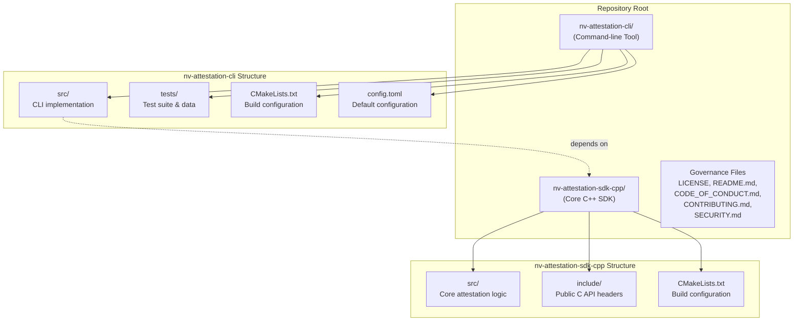
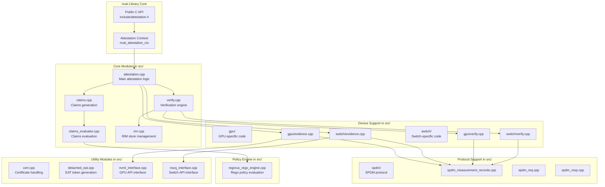
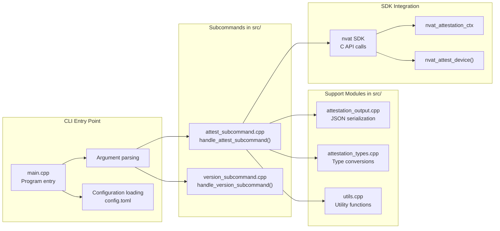
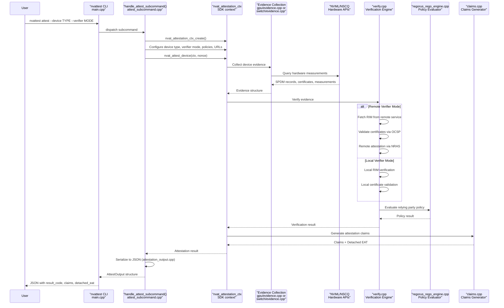

<!-- source: DeepWiki mcp.deepwiki.com · repo NVIDIA/attestation-sdk · page 1 Overview · fetched 2026-10-26 -->

# Overview

Relevant source files

The following files were used as context for generating this wiki page:

- [.gitignore](.gitignore)
- [LICENSE](LICENSE)
- [README.md](README.md)

This document provides an introduction to the NVIDIA Attestation SDK repository, explaining its purpose in trusted computing and confidential computing contexts, and describing the high-level structure of the codebase. For detailed installation instructions, see [Installation Guide](#2.1). For architectural details of specific components, see [Architecture](#3).

## Purpose and Scope

The NVIDIA Attestation SDK (NVAT) is an open-source C++ software development kit that provides resources for implementing and validating Trusted Computing Solutions on NVIDIA hardware. The SDK focuses on attestation, a critical security mechanism for ensuring the integrity and authenticity of hardware and software in confidential computing environments.

The repository contains two primary deliverables:
- **nv-attestation-sdk-cpp**: A C++ core library (`nvat`) with a C API for integration into applications
- **nv-attestation-cli**: A command-line tool (`nvattest`) that wraps the SDK for standalone attestation operations

This project is the successor to the guest tools in the [nvTrust](https://github.com/NVIDIA/nvtrust) repository, rewritten in C++ to support broader deployment scenarios and use cases.

**Sources**: [README.md:1-31]()

## What is Attestation?

Attestation is a process by which a device (attester) presents cryptographic evidence of its hardware and software state to a verifying party (verifier). The verifier validates this evidence against known reference measurements to determine whether the device is in a trusted state. In confidential computing environments, attestation ensures that:

- Hardware components are genuine NVIDIA products
- Firmware and software have not been tampered with
- The system configuration matches expected security policies
- Sensitive workloads are running in a secure, isolated environment

The NVIDIA Attestation SDK implements the attestation workflow for NVIDIA GPUs and NVSwitch devices, collecting hardware evidence, verifying it against reference integrity measurements (RIMs), and generating attestation claims that applications can use to make trust decisions.

**Sources**: [README.md:9-11](), [README.md:90-105]()

## Repository Structure

The repository is organized into two main directories with supporting infrastructure:

**Directory Structure**:

| Directory | Purpose |
|-----------|---------|
| `nv-attestation-sdk-cpp/` | Core C++ SDK library with attestation implementation |
| `nv-attestation-sdk-cpp/include/` | Public C API headers (`attestation.h`, `types.h`, etc.) |
| `nv-attestation-sdk-cpp/src/` | Core implementation (attestation, verification, device support) |
| `nv-attestation-cli/` | Command-line tool implementation |
| `nv-attestation-cli/src/` | CLI entry point, subcommand handlers, configuration |
| `nv-attestation-cli/tests/` | Test suite with unit and integration tests |
| `nv-attestation-cli/tests/data/` | Test evidence files and Rego policies |

**Sources**: [README.md:1-13](), Diagram 1 from system architecture

## Core SDK Architecture

The `nv-attestation-sdk-cpp` library is built around modular components that handle different aspects of the attestation workflow:

The SDK exposes a C API through header files in `nv-attestation-sdk-cpp/include/`. The main entry point is `nvat_attestation_ctx`, which encapsulates the attestation configuration and state. Core modules handle attestation orchestration, verification against reference measurements, and claims generation. Device-specific modules (`gpu/` and `switch/`) implement evidence collection and verification logic for different hardware types.

**Sources**: [nv-attestation-sdk-cpp/include/](), Diagram 2 from system architecture

## CLI Tool Architecture

The `nvattest` command-line tool is implemented in `nv-attestation-cli/src/` and provides a user-friendly interface to the SDK:

The CLI entry point in `main.cpp` parses command-line arguments and dispatches to subcommand handlers. The `handle_attest_subcommand()` function in `attest_subcommand.cpp` configures the SDK context based on user parameters and invokes `nvat_attest_device()`. Results are serialized to JSON format by `attestation_output.cpp` for consumption by other tools or scripts.

**Sources**: [nv-attestation-cli/src/](), Diagram 3 from system architecture

## Attestation Workflow

The end-to-end attestation workflow involves evidence collection, verification, policy evaluation, and claims generation:

The workflow begins with CLI argument parsing and SDK context creation. Evidence collection queries hardware via NVML (for GPUs) or NSCQ (for switches), obtaining SPDM measurement records and certificate chains. The verification engine validates this evidence against reference measurements, either locally or by communicating with remote NVIDIA services. The Rego policy engine evaluates user-defined policies to determine if the device meets security requirements. Finally, the claims generator produces structured claims and a detached EAT (Entity Attestation Token) that applications can consume.

**Sources**: Diagram 3 and Diagram 4 from system architecture

## Supported Devices

The SDK supports attestation for two device types, each with dedicated code modules:

```mermaid
graph TB
    subgraph "Device Type: GPU"
        GPU_FLAG["--device gpu"]
        GPU_EV_SRC["Evidence Source"]
        GPU_FILE["--gpu-evidence FILE<br/>(Test/offline mode)"]
        GPU_LIVE["NVML API<br/>(Live hardware)"]
        GPU_CODE["gpu/evidence.cpp<br/>gpu/verify.cpp"]
        GPU_POL["relying_party_policy.rego<br/>device-type == 'gpu'"]
    end
    
    subgraph "Device Type: NVSwitch"
        SW_FLAG["--device nvswitch"]
        SW_EV_SRC["Evidence Source"]
        SW_FILE["--switch-evidence FILE<br/>(Test/offline mode)"]
        SW_LIVE["NSCQ API<br/>(Live hardware)"]
        SW_CODE["switch/evidence.cpp<br/>switch/verify.cpp"]
        SW_POL["switch_relying_party_policy.rego<br/>device-type == 'nvswitch'"]
    end
    
    GPU_FLAG --> GPU_EV_SRC
    GPU_EV_SRC --> GPU_FILE
    GPU_EV_SRC --> GPU_LIVE
    GPU_FILE --> GPU_CODE
    GPU_LIVE --> GPU_CODE
    GPU_CODE --> GPU_POL
    
    SW_FLAG --> SW_EV_SRC
    SW_EV_SRC --> SW_FILE
    SW_EV_SRC --> SW_LIVE
    SW_FILE --> SW_CODE
    SW_LIVE --> SW_CODE
    SW_CODE --> SW_POL
```

**GPU Attestation**:
- Implementation: `nv-attestation-sdk-cpp/src/gpu/evidence.cpp` and `nv-attestation-sdk-cpp/src/gpu/verify.cpp`
- Hardware Interface: NVIDIA Management Library (NVML) via `nvml_interface.cpp`
- Command-line flag: `--device gpu`
- Test data: `nv-attestation-cli/tests/data/hopper_evidence.json`
- Default policy: `nv-attestation-cli/tests/data/relying_party_policy.rego`

**NVSwitch Attestation**:
- Implementation: `nv-attestation-sdk-cpp/src/switch/evidence.cpp` and `nv-attestation-sdk-cpp/src/switch/verify.cpp`
- Hardware Interface: NVIDIA Switch Configuration and Query (NSCQ) library via `nscq_interface.cpp`
- Command-line flag: `--device nvswitch`
- Test data: `nv-attestation-cli/tests/data/switch_evidence_ls10.json`
- Default policy: `nv-attestation-cli/tests/data/switch_relying_party_policy.rego`

Both device types share common SPDM protocol handling implemented in `nv-attestation-sdk-cpp/src/spdm/`. Evidence can be collected from live hardware or loaded from pre-collected evidence files for testing and offline scenarios.

**Sources**: Diagram 6 from system architecture, [README.md:40-41]()

## Verification Modes

The SDK supports two verification modes, configurable via the `--verifier` flag:

**Local Verification** (`--verifier local`):
- Performs all verification operations on the local system
- Requires pre-configured RIM (Reference Integrity Measurement) data
- Certificate validation performed locally
- Suitable for environments without network access or when using custom RIM sources
- Implementation: Logic in `verify.cpp` with local RIM store from `rim.cpp`

**Remote Verification** (`--verifier remote`):
- Communicates with NVIDIA remote attestation services
- Fetches RIM data from remote RIM service
- Validates certificates via OCSP (Online Certificate Status Protocol)
- Optionally communicates with NRAS (NVIDIA Remote Attestation Service)
- Requires network access to NVIDIA services
- Implementation: Same `verify.cpp` logic with network calls via CURL

Service URLs for remote verification can be configured via command-line flags:
- `--rim-service-url`: RIM service endpoint
- `--ocsp-url`: OCSP responder endpoint  
- `--nras-url`: NRAS service endpoint

For details on verification implementation, see [Verification Modes](#5.4).

**Sources**: Diagram 4 from system architecture, [README.md:72-77]()

## Confidential Computing Context

The NVIDIA Attestation SDK is designed for confidential computing environments where data and code must be protected from unauthorized access and modification during processing. Key use cases include:

**AI/ML Workload Protection**:
- Protecting training data containing personally identifiable information (PII)
- Securing AI models as valuable intellectual property
- Ensuring inference workloads run on trusted hardware

**GPU-Accelerated Confidential VMs**:
- Intel TDX (Trust Domain Extensions) environments with NVIDIA GPUs
- AMD SEV-SNP (Secure Encrypted Virtualization) environments with NVIDIA GPUs
- Attestation of GPU hardware and firmware within the trusted execution environment

**Multi-Tenant Cloud Environments**:
- Verifying hardware integrity before processing sensitive workloads
- Providing cryptographic proof of security posture to data owners
- Enabling secure collaboration on shared infrastructure

The SDK integrates with CPU-based confidential computing technologies (TDX, SEV-SNP) to provide end-to-end attestation of the entire confidential computing stack, from CPU to GPU. For deployment guides and detailed confidential computing documentation, see the [NVIDIA Confidential Computing documentation](https://docs.nvidia.com/confidential-computing/index.html).

**Sources**: [README.md:90-105]()

## Project Status

The NVIDIA Attestation SDK is currently in **Alpha** status. Key implications:

- **API Stability**: The C API and CLI interface may change before stabilization. Breaking changes will be minimized but may still occur.
- **ABI Compatibility**: Binary compatibility is not guaranteed between alpha releases.
- **Installation**: Currently requires building from source. No pre-built packages are available.
- **Production Use**: Not recommended for production deployments until the project reaches stable status.
- **Migration Path**: This project replaces the Python-based guest tools in [nvTrust](https://github.com/NVIDIA/nvtrust). Users of nvTrust should plan to migrate to this SDK as it stabilizes.

The project aims to support a broader range of environments and use cases compared to nvTrust, with improved performance and reduced dependencies through the C++ implementation.

**Sources**: [README.md:22-31]()

## License and Support

The repository is licensed under the Apache License 2.0. See [LICENSE]() for full terms. The project downloads and installs third-party open source dependencies during build. Review the license terms of these dependencies before use.

**Getting Help**:
- Report issues: [GitHub Issues](https://github.com/NVIDIA/attestation-sdk/issues)
- Email support: attestation-support@nvidia.com
- Documentation: 
  - [CLI Documentation](https://docs.nvidia.com/attestation/nv-attestation-cli/latest/introduction.html)
  - [SDK Documentation](https://docs.nvidia.com/attestation/nv-attestation-sdk-c/latest/introduction.html)
  - [Attestation Suite Overview](https://docs.nvidia.com/attestation/overview-attestation-suite/latest/introduction.html)

**Sources**: [README.md:107-118](), [LICENSE:1-202]()

## Next Steps

To get started with the NVIDIA Attestation SDK:

1. **Installation**: Follow the [Installation Guide](#2.1) to build the SDK and CLI from source
2. **Quick Start**: Try the [Quick Start Tutorial](#2.2) to perform your first attestation
3. **CLI Usage**: Explore the [CLI Command Structure](#4.1) and [Attest Command Reference](#4.2)
4. **Understanding Attestation**: Read about [Device Attestation Flow](#5.1) and [Evidence Format](#5.2)
5. **Development**: Review the [Development Guide](#6) if you plan to contribute or extend the SDK

For comprehensive architectural details, see [Architecture](#3). For information on testing the SDK, see [Testing Infrastructure](#6.3).

**Sources**: [README.md:33-88]()

---

