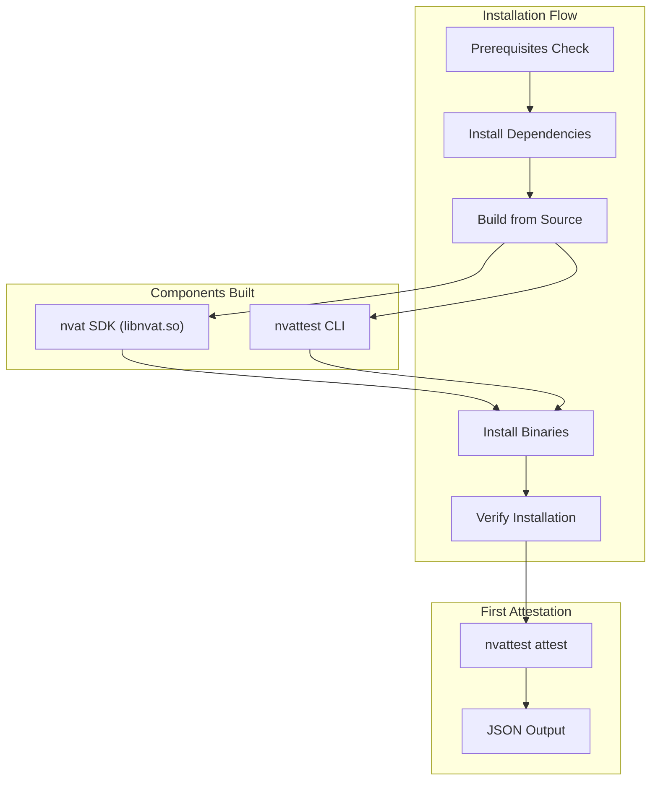
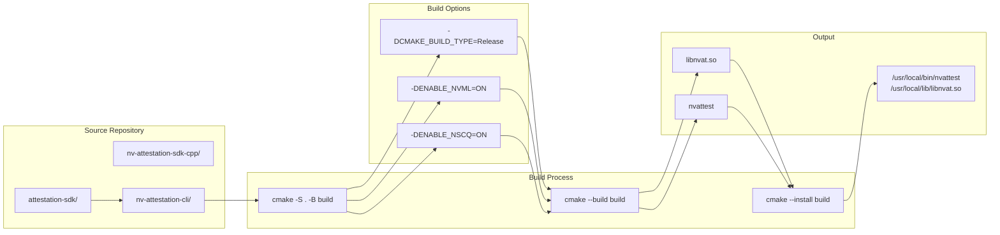
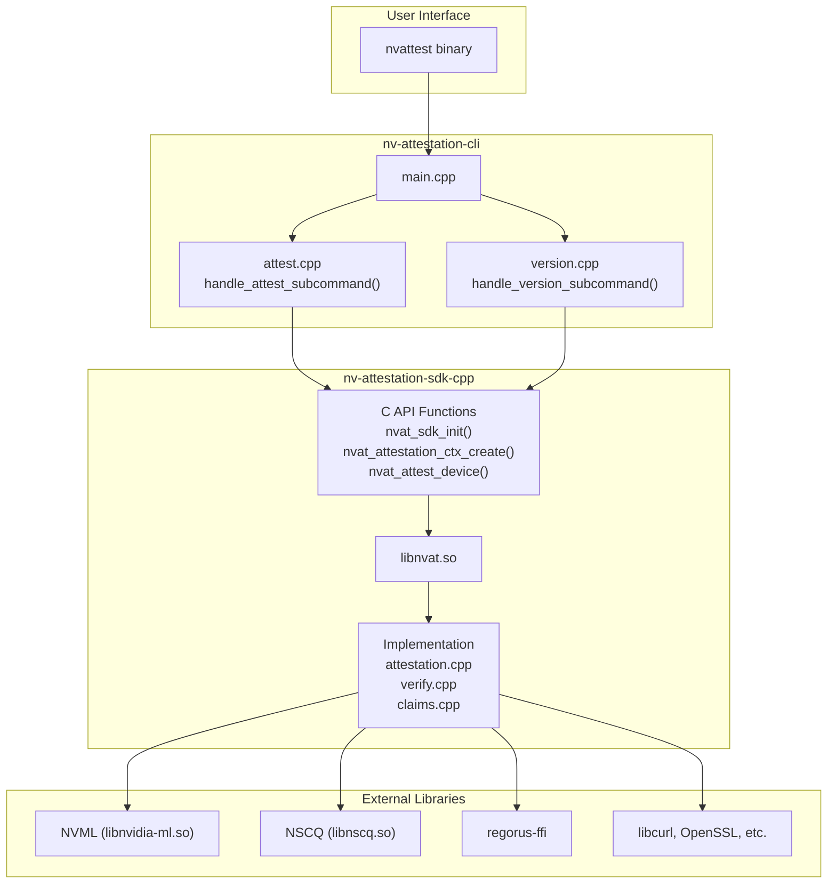

<!-- source: DeepWiki mcp.deepwiki.com · repo NVIDIA/attestation-sdk · page 2 Getting Started · fetched 2026-10-26 -->

# Getting Started

<details>
<summary>Relevant source files</summary>

The following files were used as context for generating this wiki page:

- [README.md](README.md)
- [nv-attestation-cli/CMakeLists.txt](nv-attestation-cli/CMakeLists.txt)

</details>


This document provides an overview of how to set up and use the NVIDIA Attestation SDK for the first time. It covers prerequisites, a high-level installation overview, and basic usage of the `nvattest` CLI tool. For detailed installation instructions, see [Installation Guide](#2.1). For a step-by-step tutorial with examples, see [Quick Start Tutorial](#2.2). For complete CLI command reference, see [Using the CLI](#4).

## Overview

The NVIDIA Attestation SDK consists of two main components:

1. **nvat SDK** - The core C++ library (`libnvat.so`) that provides attestation functionality
2. **nvattest CLI** - A command-line tool that wraps the SDK for easy device attestation

The typical getting started flow involves installing dependencies, building both components from source, and running your first attestation.



**Diagram: Getting Started Workflow**

Sources: [README.md:33-88]()

## Prerequisites

### Hardware Requirements

- **NVIDIA GPU** - A supported NVIDIA GPU connected to a confidential virtual machine (CVM)
- **CVM Platform** - Intel TDX or AMD SNP confidential computing environment

The attestation SDK is designed for confidential computing environments where GPU attestation is required. For deployment guides on setting up CVMs with NVIDIA GPUs, refer to the NVIDIA Trusted Computing Solutions documentation.

### Software Requirements

| Component | Requirement | Purpose |
|-----------|-------------|---------|
| **Operating System** | Ubuntu 22.04 or 24.04 | Primary supported platform |
| **NVML** | NVIDIA Management Library | GPU evidence collection (for GPU attestation) |
| **Rust Compiler** | Latest stable via rustup | Required for building regorus-ffi dependency |
| **CMake** | Version 3.11+ | Build system |
| **C++ Compiler** | clang or gcc | Compiling C++ source |
| **System Libraries** | libcurl, libssl, libxml2, libxmlsec1, libspdlog | Core dependencies |

Sources: [README.md:39-59]()

## Installation Overview

The installation process builds the SDK and CLI from source. The build system uses CMake and supports optional features through build flags.



**Diagram: Build and Installation Process**

The build process is controlled by [nv-attestation-cli/CMakeLists.txt:1-70](), which configures the CLI and includes the SDK as a subdirectory at [nv-attestation-cli/CMakeLists.txt:44-47](). The SDK CMakeLists.txt handles the core library build with optional device support.

### Key Build Options

| CMake Option | Default | Description |
|--------------|---------|-------------|
| `ENABLE_NVML` | OFF | Enable GPU attestation support via NVML |
| `ENABLE_NSCQ` | OFF | Enable NVSwitch attestation support via NSCQ |
| `CMAKE_BUILD_TYPE` | Debug | Build configuration (Release/Debug) |
| `BUILD_TESTING` | OFF | Build test suite |

For GPU attestation, you must specify `-DENABLE_NVML=ON` during the CMake configuration step.

Sources: [nv-attestation-cli/CMakeLists.txt:1-70](), [README.md:61-69]()

## Basic Installation Steps

The minimal installation for GPU attestation involves these steps:

```bash
# 1. Install NVML (from NVIDIA Driver)
# See NVIDIA Driver Installation Guide

# 2. Install Rust
curl --proto '=https' --tlsv1.2 -sSf https://sh.rustup.rs | sh

# 3. Install build dependencies
apt update && apt install cmake git pkg-config clang \
    libcurl4-openssl-dev libssl-dev libxml2-dev \
    libxmlsec1-dev libxmlsec1-openssl libspdlog-dev

# 4. Build and install
git clone https://github.com/NVIDIA/attestation-sdk.git
cd attestation-sdk/nv-attestation-cli
cmake -S . -B build -DCMAKE_BUILD_TYPE=Release -DENABLE_NVML=ON
cmake --build build
cmake --install build
sudo ldconfig
```

The `ldconfig` command updates the dynamic linker cache so the installed `libnvat.so` can be found by the `nvattest` binary.

For complete installation instructions including troubleshooting, see [Installation Guide](#2.1).

Sources: [README.md:46-69]()

## First Attestation

Once installed, verify the installation by running a basic attestation:

```bash
nvattest attest --device gpu --verifier local
```

This command:
- Targets GPU devices (`--device gpu`)
- Performs local verification (`--verifier local`)
- Returns JSON output with attestation results

```mermaid
sequenceDiagram
    participant User
    participant nvattest["nvattest CLI<br/>(main.cpp)"]
    participant handle_attest["handle_attest_subcommand<br/>(attest.cpp)"]
    participant nvat_sdk["nvat SDK<br/>(libnvat.so)"]
    participant NVML["NVML<br/>(GPU Driver)"]
    
    User->>nvattest: "nvattest attest --device gpu --verifier local"
    nvattest->>handle_attest: "Parse arguments"
    handle_attest->>nvat_sdk: "nvat_sdk_init()"
    handle_attest->>nvat_sdk: "nvat_attestation_ctx_create()"
    handle_attest->>nvat_sdk: "nvat_set_device(ctx, NVAT_DEVICE_GPU)"
    handle_attest->>nvat_sdk: "nvat_set_verifier(ctx, NVAT_VERIFIER_LOCAL)"
    handle_attest->>nvat_sdk: "nvat_attest_device(ctx, nonce)"
    nvat_sdk->>NVML: "Collect GPU evidence"
    NVML-->>nvat_sdk: "Evidence data"
    nvat_sdk->>nvat_sdk: "Local verification"
    nvat_sdk->>nvat_sdk: "Generate claims"
    nvat_sdk-->>handle_attest: "Claims + Detached EAT"
    handle_attest->>handle_attest: "Serialize to JSON"
    handle_attest-->>User: "JSON output with result_code"
```

**Diagram: Basic Attestation Command Flow**

The CLI entry point is [nv-attestation-cli/src/main.cpp](), which dispatches to `handle_attest_subcommand()` in [nv-attestation-cli/src/attest.cpp](). This function initializes the SDK, configures the attestation context, and calls `nvat_attest_device()` from the SDK's C API.

Sources: [README.md:72-83](), [nv-attestation-cli/src/main.cpp](), [nv-attestation-cli/src/attest.cpp]()

### Output Structure

The attestation output is JSON with this structure:

```json
{
  "result_code": "NVAT_RC_OK",
  "result_message": "Attestation successful",
  "claims": { /* ... */ },
  "detached_eat": "base64-encoded-token"
}
```

The `result_code` field indicates success (`NVAT_RC_OK`) or failure. For complete output format documentation, see [Output Format](#4.4).

### Common Options

The `attest` subcommand supports many options. View all options with:

```bash
nvattest attest --help
```

Common options include:

| Option | Description | Example |
|--------|-------------|---------|
| `--device` | Device type (gpu, nvswitch) | `--device gpu` |
| `--verifier` | Verification mode (local, remote) | `--verifier local` |
| `--gpu-evidence` | Use evidence from file (testing) | `--gpu-evidence file.json` |
| `--policy` | Custom Rego policy file | `--policy policy.rego` |
| `--nonce` | Attestation nonce | `--nonce abc123` |

For complete command reference, see [Attest Command Reference](#4.2).

Sources: [README.md:79-83]()

## Configuration Files

The CLI supports configuration via TOML files. A default configuration file is provided at [nv-attestation-cli/config.toml](). Command-line arguments override configuration file settings.

Example configuration:

```toml
device = "gpu"
verifier = "local"
```

For complete configuration documentation, see [Configuration Files](#4.3).

Sources: [nv-attestation-cli/CMakeLists.txt:35-37]()

## Component Relationship

Understanding how the components relate helps in troubleshooting and advanced usage:



**Diagram: Component Dependencies**

The `nvattest` binary links against `libnvat.so` as configured in [nv-attestation-cli/CMakeLists.txt:52-57](). The SDK library depends on optional device libraries (NVML for GPU, NSCQ for Switch) based on build configuration.

Sources: [nv-attestation-cli/CMakeLists.txt:27-57]()

## Verification

After installation, verify that both components are properly installed:

```bash
# Check nvattest is in PATH
which nvattest
# Output: /usr/local/bin/nvattest

# Check libnvat.so is found
ldd $(which nvattest) | grep nvat
# Output: libnvat.so => /usr/local/lib/libnvat.so

# Check version
nvattest version
# Output: version information JSON
```

The `version` subcommand verifies that the CLI can load the SDK library and reports version information as defined in [nv-attestation-cli/src/version_config.h.in]().

Sources: [nv-attestation-cli/src/version.cpp]()

## Next Steps

After completing the basic setup:

1. **Run a complete tutorial** - See [Quick Start Tutorial](#2.2) for a step-by-step walkthrough with detailed explanations
2. **Explore CLI options** - See [Using the CLI](#4) for complete command documentation
3. **Understand attestation concepts** - See [Attestation Concepts](#5) to learn about evidence, claims, and policies
4. **Learn verification modes** - See [Verification Modes](#5.4) to understand local vs. remote attestation
5. **Review device support** - See [Device Support](#5.5) for GPU and Switch attestation details
6. **Build from source** - See [Building from Source](#6.1) for advanced build options and customization

## Troubleshooting

Common issues during setup:

| Issue | Solution |
|-------|----------|
| `NVML library not found` | Ensure NVIDIA driver is installed and NVML is available. Check `/usr/lib/x86_64-linux-gnu/libnvidia-ml.so` exists |
| `Rust not found during build` | Install Rust via rustup: `curl --proto '=https' --tlsv1.2 -sSf https://sh.rustup.rs \| sh` |
| `nvattest: command not found` | Run `sudo ldconfig` and ensure `/usr/local/bin` is in PATH |
| `libnvat.so not found` | Run `sudo ldconfig` to update library cache |
| Build fails with CMake errors | Ensure all dependencies are installed: `apt install cmake git pkg-config clang libcurl4-openssl-dev libssl-dev libxml2-dev libxmlsec1-dev libxmlsec1-openssl libspdlog-dev` |

For detailed troubleshooting and advanced build options, see [Installation Guide](#2.1).

Sources: [README.md:46-69]()

---

