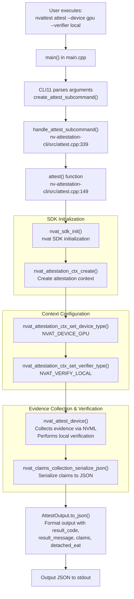
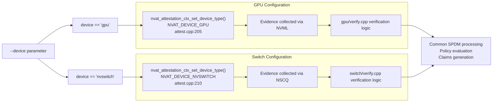
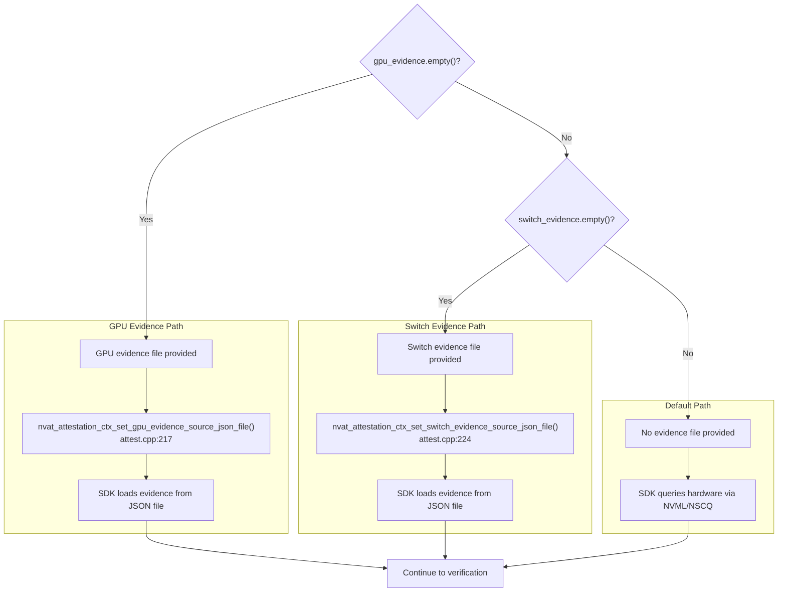
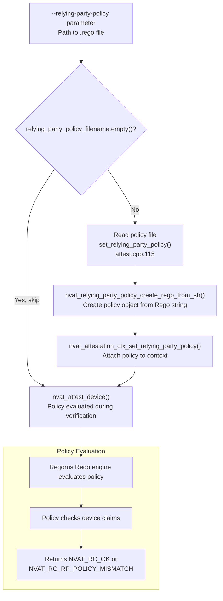

<!-- source: DeepWiki mcp.deepwiki.com · repo NVIDIA/attestation-sdk · page 2.2 Quick Start Tutorial · fetched 2026-10-26 -->

# Quick Start Tutorial

<details>
<summary>Relevant source files</summary>

The following files were used as context for generating this wiki page:

- [README.md](README.md)
- [nv-attestation-cli/config.toml](nv-attestation-cli/config.toml)
- [nv-attestation-cli/src/attest.cpp](nv-attestation-cli/src/attest.cpp)

</details>


This tutorial provides hands-on examples for using the `nvattest` CLI tool to perform attestation on NVIDIA GPUs and NVSwitch devices. It demonstrates basic attestation workflows, output interpretation, and common configuration options.

For installation instructions, see [Installation Guide](#2.1). For detailed command reference, see [Attest Command Reference](#4.2). For comprehensive attestation concepts, see [Attestation Concepts](#5).

---

## Prerequisites

Before beginning this tutorial, ensure you have:

1. Installed the `nvattest` CLI tool and `nvat` shared library (see [Installation Guide](#2.1))
2. Access to an NVIDIA GPU in a confidential virtual machine (CVM) OR NVML/NSCQ libraries installed for testing
3. Alternatively, test evidence files for offline testing without hardware

**Hardware Requirements:**
- For GPU attestation: NVIDIA GPU with confidential computing support (e.g., H100, H200 Hopper GPUs)
- For Switch attestation: NVIDIA NVSwitch with SPDM support
- Ubuntu 22.04 or 24.04 operating system

Sources: [README.md:39-47]()

---

## Basic GPU Attestation

The simplest attestation command uses local verification with a connected GPU:

```bash
nvattest attest --device gpu --verifier local
```

This command performs the following operations:

1. Initializes the SDK via `nvat_sdk_init()`
2. Creates an attestation context via `nvat_attestation_ctx_create()`
3. Configures device type to `NVAT_DEVICE_GPU`
4. Configures verifier type to `NVAT_VERIFY_LOCAL`
5. Calls `nvat_attest_device()` to collect evidence from the GPU using NVML
6. Verifies the evidence locally against reference measurements
7. Generates claims and a detached Entity Attestation Token (EAT)
8. Outputs results as JSON

### Command Execution Flow



Sources: [nv-attestation-cli/src/attest.cpp:149-336](), [nv-attestation-cli/src/attest.cpp:339-358](), [README.md:72-77]()

### Example Output Structure

The command outputs JSON with the following structure:

```json
{
  "result_code": 0,
  "result_message": "NVAT_RC_OK",
  "claims": {
    "devices": [...],
    "overall_result": true
  },
  "detached_eat": {
    "protected": "...",
    "payload": "...",
    "signature": "..."
  }
}
```

| Field | Description |
|-------|-------------|
| `result_code` | Integer result code (0 = success, see [Error Codes and Handling](#8.2)) |
| `result_message` | Human-readable result string via `nvat_rc_to_string()` |
| `claims` | JSON object containing attestation claims from `nvat_claims_collection_serialize_json()` |
| `detached_eat` | JSON object containing the Entity Attestation Token |

The `result_code` maps to SDK return codes:
- `NVAT_RC_OK` (0): Attestation succeeded
- `NVAT_RC_RP_POLICY_MISMATCH`: Policy evaluation failed
- `NVAT_RC_OVERALL_RESULT_FALSE`: Verification failed

Sources: [nv-attestation-cli/src/attest.cpp:36-68](), [nv-attestation-cli/src/attest.cpp:311-334]()

---

## Basic Switch Attestation

To attest an NVIDIA NVSwitch device, change the `--device` parameter:

```bash
nvattest attest --device nvswitch --verifier local
```

This configures the attestation context with `NVAT_DEVICE_NVSWITCH` instead of `NVAT_DEVICE_GPU`. The SDK uses NSCQ (NVIDIA Switch Configuration and Query) library instead of NVML to collect evidence.

### Device Type Configuration



Sources: [nv-attestation-cli/src/attest.cpp:204-214](), [nv-attestation-cli/src/attest.cpp:86-88]()

---

## Using Test Evidence Files

For testing without hardware or in environments without NVML/NSCQ libraries, use pre-serialized evidence files:

### GPU Evidence File Example

```bash
nvattest attest --device gpu --verifier local \
  --gpu-evidence tests/data/hopper_evidence.json
```

This calls `nvat_attestation_ctx_set_gpu_evidence_source_json_file()` with the provided file path instead of querying live hardware.

### Switch Evidence File Example

```bash
nvattest attest --device nvswitch --verifier local \
  --switch-evidence tests/data/switch_evidence_ls10.json
```

This calls `nvat_attestation_ctx_set_switch_evidence_source_json_file()` with the provided file path.

### Evidence Source Configuration Flow



Sources: [nv-attestation-cli/src/attest.cpp:216-228](), [nv-attestation-cli/src/attest.cpp:95-96]()

**Available Test Evidence Files:**
- `tests/data/hopper_evidence.json` - H100 GPU evidence
- `tests/data/switch_evidence_ls10.json` - LS10 NVSwitch evidence

These files are used by the test infrastructure and provide valid evidence samples for offline testing.

Sources: [README.md:95-96]()

---

## Remote Verification

To use NVIDIA's remote attestation services instead of local verification:

```bash
nvattest attest --device gpu --verifier remote
```

This configures `NVAT_VERIFY_REMOTE` and communicates with external services:

| Service | Default URL | Purpose | Configuration |
|---------|-------------|---------|---------------|
| RIM Service | `https://rim.attestation.nvidia.com` | Reference Integrity Measurements | `--rim-url` |
| OCSP Responder | `https://ocsp.ndis.nvidia.com` | Certificate status validation | `--ocsp-url` |
| NRAS | `https://nras.attestation.nvidia.com` | Remote attestation service | `--nras-url` |

### Custom Service URLs

```bash
nvattest attest --device gpu --verifier remote \
  --rim-url https://custom-rim.example.com \
  --ocsp-url https://custom-ocsp.example.com \
  --nras-url https://custom-nras.example.com
```

### Service Configuration Implementation

The CLI configures these services through SDK calls:

1. **RIM Store**: Creates `nvat_rim_store_t` via `nvat_rim_store_create_remote()` and sets it with `nvat_attestation_ctx_set_default_rim_store()`
2. **OCSP Client**: Creates `nvat_ocsp_client_t` via `nvat_ocsp_client_create_default()` and sets it with `nvat_attestation_ctx_set_default_ocsp_client()`
3. **NRAS**: Sets `NVAT_NRAS_BASE_URL` environment variable

Sources: [nv-attestation-cli/src/attest.cpp:230-265](), [nv-attestation-cli/src/attest.cpp:99-101]()

---

## Custom Relying Party Policies

To enforce custom verification policies using Rego:

```bash
nvattest attest --device gpu --verifier local \
  --relying-party-policy tests/data/relying_party_policy.rego
```

### Policy Application Process



Sources: [nv-attestation-cli/src/attest.cpp:115-146](), [nv-attestation-cli/src/attest.cpp:267-270](), [nv-attestation-cli/src/attest.cpp:97]()

**Available Test Policies:**
- `tests/data/relying_party_policy.rego` - GPU verification policy
- `tests/data/switch_relying_party_policy.rego` - Switch verification policy

For detailed policy structure and writing custom policies, see [Relying Party Policies](#5.3).

Sources: [README.md:97]()

---

## Using Custom Nonces

To provide a specific nonce for attestation freshness:

```bash
nvattest attest --device gpu --verifier local \
  --nonce 0123456789abcdef0123456789abcdef
```

The nonce must be provided in hexadecimal format. If not provided, the SDK generates one automatically.

Implementation details:
- The CLI converts the hex string to `nvat_nonce_t` via `nvat_nonce_from_hex()`
- The nonce is passed to `nvat_attest_device()` as the second parameter
- The nonce is included in the evidence to ensure freshness

Sources: [nv-attestation-cli/src/attest.cpp:84-85](), [nv-attestation-cli/src/attest.cpp:290-295]()

---

## Configuration File Usage

Instead of passing command-line arguments, use a configuration file:

**config.toml:**
```toml
[attest]
device = "gpu"
verifier = "local"
gpu-evidence = ""
switch-evidence = ""
relying-party-policy = ""
```

Run with the configuration file:

```bash
nvattest --config-file config.toml attest
```

Command-line arguments override configuration file settings. For details, see [Configuration Files](#4.3).

Sources: [nv-attestation-cli/config.toml:1-13]()

---

## Logging and Debugging

Enable detailed logging to troubleshoot issues:

```bash
nvattest attest --device gpu --verifier local --log-level debug
```

Available log levels: `trace`, `debug`, `info`, `warn`, `error`, `off`

The CLI creates an `nvat_logger_t` via `nvat_logger_spdlog_create()` with the specified level and passes it to the SDK through `nvat_sdk_opts_set_logger()`.

Sources: [nv-attestation-cli/src/attest.cpp:102-104](), [nv-attestation-cli/src/attest.cpp:172-189]()

---

## Common Usage Patterns

### Pattern 1: Development Testing with Evidence Files

```bash
# Test GPU attestation without hardware
nvattest attest --device gpu --verifier local \
  --gpu-evidence tests/data/hopper_evidence.json \
  --log-level info
```

### Pattern 2: Production GPU Attestation

```bash
# Live GPU attestation with remote verification
nvattest attest --device gpu --verifier remote \
  --nonce $(openssl rand -hex 16)
```

### Pattern 3: Policy-Enforced Attestation

```bash
# Attest with custom policy requirements
nvattest attest --device gpu --verifier local \
  --relying-party-policy custom_policy.rego \
  --log-level warn
```

### Pattern 4: Switch Infrastructure Validation

```bash
# Attest NVSwitch with remote verification
nvattest attest --device nvswitch --verifier remote \
  --rim-url https://rim.attestation.nvidia.com \
  --ocsp-url https://ocsp.ndis.nvidia.com
```

---

## Interpreting Results

### Success Case

```json
{
  "result_code": 0,
  "result_message": "NVAT_RC_OK",
  "claims": {
    "devices": [...],
    "overall_result": true
  },
  "detached_eat": {...}
}
```

The attestation succeeded. All claims can be trusted.

### Policy Mismatch Case

```json
{
  "result_code": -4,
  "result_message": "NVAT_RC_RP_POLICY_MISMATCH",
  "claims": {...},
  "detached_eat": {...}
}
```

The verification succeeded but the relying party policy requirements were not met. Review the claims to identify which policy checks failed.

### Verification Failure Case

```json
{
  "result_code": -11,
  "result_message": "NVAT_RC_OVERALL_RESULT_FALSE",
  "claims": {...},
  "detached_eat": {...}
}
```

The attestation evidence failed verification. The device state does not match reference measurements.

The CLI returns the `result_code` as its exit code, allowing shell scripts to check attestation status with `$?`.

Sources: [nv-attestation-cli/src/attest.cpp:296-299](), [nv-attestation-cli/src/attest.cpp:351-356]()

---

## Next Steps

After completing this tutorial:

- Explore all available CLI options: `nvattest attest --help`
- Learn about evidence structure in [Evidence Format and Structure](#5.2)
- Understand verification modes in [Verification Modes](#5.4)
- Review the C API for programmatic usage at [SDK introduction](https://docs.nvidia.com/attestation/nv-attestation-sdk-c/latest/introduction.html)
- Study claim interpretation in [Output Format](#4.4)
- Write custom policies using [Relying Party Policies](#5.3)

Sources: [README.md:79-88]()

---

