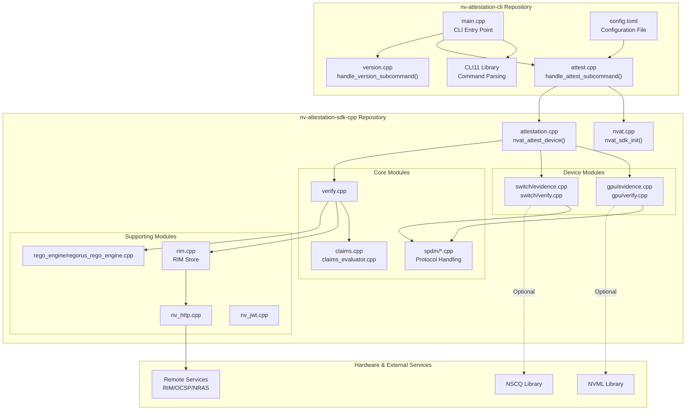
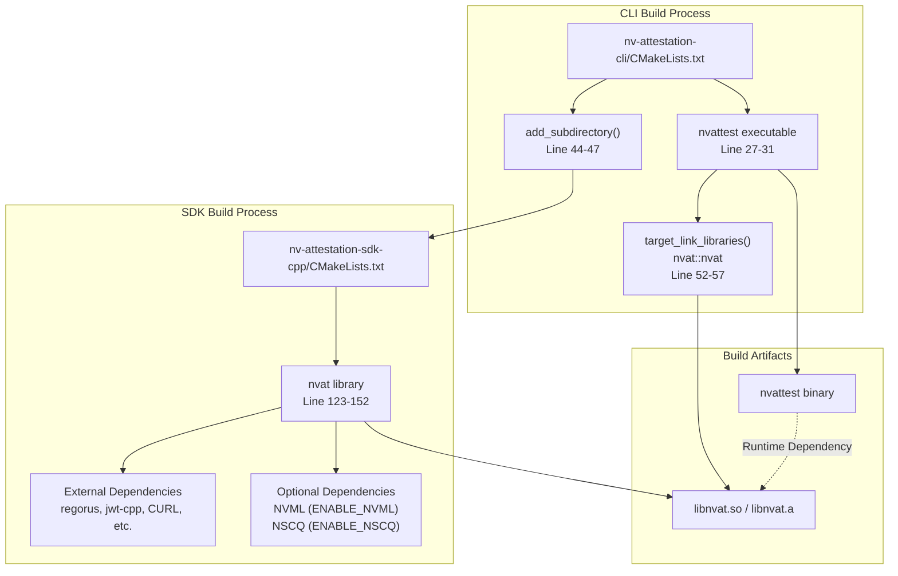
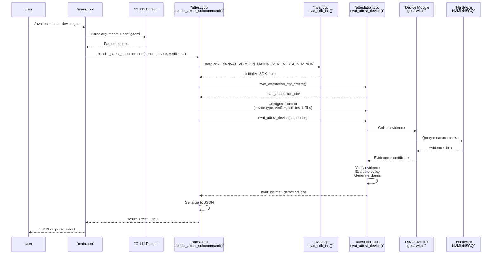
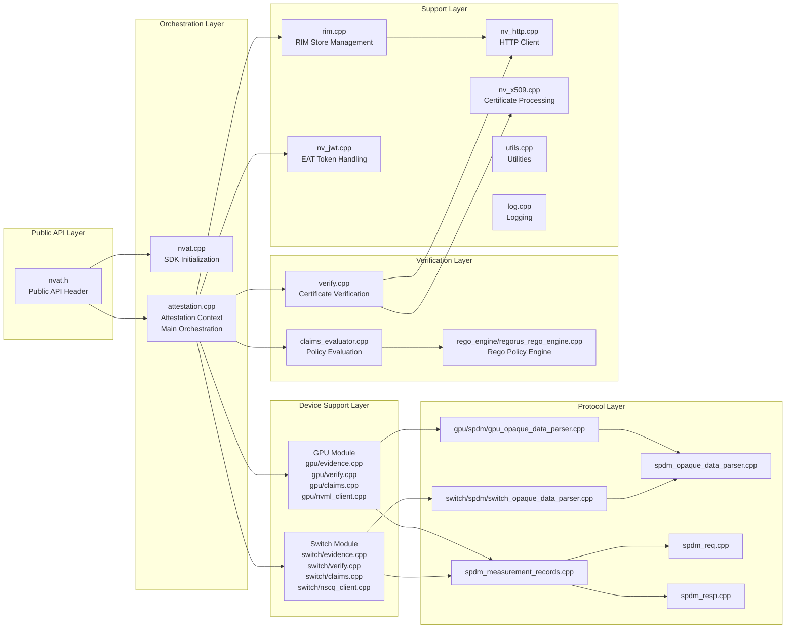

<!-- source: DeepWiki mcp.deepwiki.com · repo NVIDIA/attestation-sdk · page 3.1 System Overview · fetched 2026-10-26 -->

# System Overview

<details>
<summary>Relevant source files</summary>

The following files were used as context for generating this wiki page:

- [nv-attestation-cli/CMakeLists.txt](nv-attestation-cli/CMakeLists.txt)
- [nv-attestation-cli/src/main.cpp](nv-attestation-cli/src/main.cpp)
- [nv-attestation-sdk-cpp/CMakeLists.txt](nv-attestation-sdk-cpp/CMakeLists.txt)

</details>


## Purpose and Scope

This document provides a high-level architectural overview of the NVIDIA Attestation SDK repository, focusing on the relationship between the two primary components: the `nvat` C++ SDK library (`nv-attestation-sdk-cpp`) and the `nvattest` command-line tool (`nv-attestation-cli`). It describes the structural organization, build system integration, and runtime interaction patterns between these components.

For detailed information about specific components:
- For in-depth SDK architecture and internal modules, see [Core SDK (nv-attestation-sdk-cpp)](#3.2)
- For CLI tool implementation details, see [CLI Tool (nv-attestation-cli)](#3.3)
- For external library dependencies, see [External Dependencies](#3.4)

---

## Repository Structure

The repository contains two primary directories that form the core of the attestation system:

| Directory | Component | Build Artifact | Purpose |
|-----------|-----------|----------------|---------|
| `nv-attestation-sdk-cpp/` | Core SDK Library | `libnvat.so` (or `.a`) | C++ library providing attestation functionality for GPU and Switch devices |
| `nv-attestation-cli/` | CLI Tool | `nvattest` executable | Command-line interface wrapping the SDK for end-user interaction |

**Sources:** [nv-attestation-sdk-cpp/CMakeLists.txt:1-273](), [nv-attestation-cli/CMakeLists.txt:1-70]()

---

## Component Architecture

The system follows a layered architecture where the CLI acts as a thin wrapper around the SDK library:



**Key Architectural Principles:**

1. **Separation of Concerns**: The CLI handles user interaction and argument parsing, while the SDK implements all attestation logic
2. **Modular Design**: Device-specific code (GPU/Switch) is isolated in separate modules
3. **Optional Dependencies**: Hardware libraries (NVML, NSCQ) are conditionally compiled based on build flags
4. **Protocol Abstraction**: SPDM protocol handling is shared between device types

**Sources:** [nv-attestation-cli/src/main.cpp:1-58](), [nv-attestation-sdk-cpp/CMakeLists.txt:123-152]()

---

## Build System Integration

The CLI and SDK are tightly integrated through the CMake build system:



**Build Configuration:**

The CLI's CMakeLists.txt directly includes the SDK as a subdirectory:

```cmake
add_subdirectory(
    "${CMAKE_CURRENT_SOURCE_DIR}/../nv-attestation-sdk-cpp"  # Source directory
    "${CMAKE_CURRENT_BINARY_DIR}/nv-attestation-sdk-build"   # Binary directory
)
```

This creates a **monolithic build** where:
- The SDK is built first as a dependency
- An alias `nvat::nvat` is created for the SDK target [nv-attestation-cli/CMakeLists.txt:50]()
- The CLI links against this alias [nv-attestation-cli/CMakeLists.txt:52-57]()

**Build Options:**

| Option | Component | Purpose | Default |
|--------|-----------|---------|---------|
| `ENABLE_NVML` | SDK | Enable GPU attestation via NVML | OFF |
| `ENABLE_NSCQ` | SDK | Enable Switch attestation via NSCQ | OFF |
| `BUILD_SHARED_LIBS` | SDK | Build shared library instead of static | ON |
| `BUILD_TESTING` | Both | Enable test suite compilation | OFF |
| `SANITIZER` | SDK | Enable sanitizer (address/thread/undefined) | OFF |

**Sources:** [nv-attestation-cli/CMakeLists.txt:44-57](), [nv-attestation-sdk-cpp/CMakeLists.txt:12-17]()

---

## Runtime Interaction Model

The following diagram illustrates the runtime flow from CLI invocation to SDK execution:



**Key Function Entry Points:**

| Function | File | Responsibility |
|----------|------|----------------|
| `main()` | [nv-attestation-cli/src/main.cpp:29]() | CLI entry point, sets up subcommands |
| `handle_attest_subcommand()` | [nv-attestation-cli/src/attest.cpp]() | Processes attest command, calls SDK |
| `nvat_sdk_init()` | [nv-attestation-sdk-cpp/src/nvat.cpp]() | Initializes SDK global state |
| `nvat_attestation_ctx_create()` | [nv-attestation-sdk-cpp/src/attestation.cpp]() | Creates attestation context |
| `nvat_attest_device()` | [nv-attestation-sdk-cpp/src/attestation.cpp]() | Main attestation orchestration |

**Sources:** [nv-attestation-cli/src/main.cpp:29-58](), [nv-attestation-cli/CMakeLists.txt:27-31]()

---

## Core SDK Module Organization

The SDK is organized into functional modules, each with specific responsibilities:



**Module Responsibilities:**

| Layer | Modules | Purpose |
|-------|---------|---------|
| **Public API** | `nvat.h` | Defines public C interface for SDK consumers |
| **Orchestration** | `nvat.cpp`, `attestation.cpp` | SDK initialization, attestation workflow coordination |
| **Device Support** | `gpu/`, `switch/` | Device-specific evidence collection and verification |
| **Protocol** | `spdm/` | SPDM protocol parsing and measurement record handling |
| **Verification** | `verify.cpp`, `claims_evaluator.cpp`, `rego_engine/` | Certificate validation, policy evaluation |
| **Support** | `rim.cpp`, `nv_http.cpp`, `nv_jwt.cpp`, `nv_x509.cpp` | Utility functionality for HTTP, JWT, X.509, RIM operations |

**Sources:** [nv-attestation-sdk-cpp/CMakeLists.txt:123-152]()

---

## Key Code Entry Points and Mappings

The following table maps high-level concepts to specific code entities:

| Concept | Code Entity | File Location |
|---------|-------------|---------------|
| CLI executable | `nvattest` | Built from [nv-attestation-cli/CMakeLists.txt:27]() |
| SDK library | `nvat` | Built from [nv-attestation-sdk-cpp/CMakeLists.txt:123]() |
| CLI entry point | `main()` | [nv-attestation-cli/src/main.cpp:29]() |
| Attest command handler | `handle_attest_subcommand()` | [nv-attestation-cli/src/attest.cpp]() |
| SDK initialization | `nvat_sdk_init()` | [nv-attestation-sdk-cpp/src/nvat.cpp]() |
| Context creation | `nvat_attestation_ctx_create()` | [nv-attestation-sdk-cpp/src/attestation.cpp]() |
| Main attestation flow | `nvat_attest_device()` | [nv-attestation-sdk-cpp/src/attestation.cpp]() |
| GPU evidence collection | `nvat_gpu_evidence_collect()` | [nv-attestation-sdk-cpp/src/gpu/evidence.cpp]() |
| Switch evidence collection | `nvat_switch_evidence_collect()` | [nv-attestation-sdk-cpp/src/switch/evidence.cpp]() |
| SPDM measurement parsing | `parse_spdm_measurement_block()` | [nv-attestation-sdk-cpp/src/spdm/spdm_measurement_records.cpp]() |
| Certificate verification | `verify_certificate_chain()` | [nv-attestation-sdk-cpp/src/verify.cpp]() |
| Policy evaluation | `evaluate_claims()` | [nv-attestation-sdk-cpp/src/claims_evaluator.cpp]() |
| Rego engine integration | `RegorusRegoEngine` class | [nv-attestation-sdk-cpp/src/rego_engine/regorus_rego_engine.cpp]() |

**Sources:** [nv-attestation-cli/CMakeLists.txt:1-70](), [nv-attestation-sdk-cpp/CMakeLists.txt:1-273]()

---

## Summary

The NVIDIA Attestation SDK follows a clean separation between user interface (CLI) and core functionality (SDK library). The CLI is a lightweight wrapper that parses user input and delegates all attestation operations to the SDK. The SDK itself is modular, with clear separation between device-specific code, protocol handling, and verification logic. This architecture enables:

1. **Reusability**: The SDK can be used directly by other applications without the CLI
2. **Maintainability**: Device support can be added/modified without affecting core logic
3. **Testability**: Components can be tested independently
4. **Flexibility**: Build-time options control which hardware interfaces are included

For implementation details of individual components, refer to [Core SDK (nv-attestation-sdk-cpp)](#3.2) and [CLI Tool (nv-attestation-cli)](#3.3).

---

