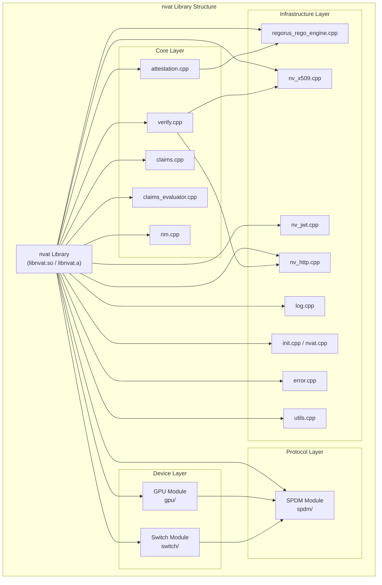
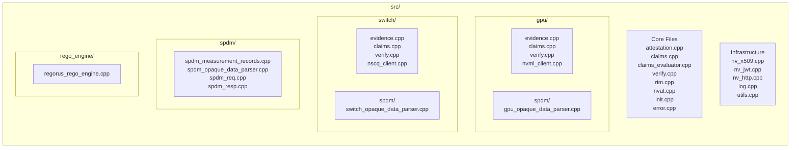
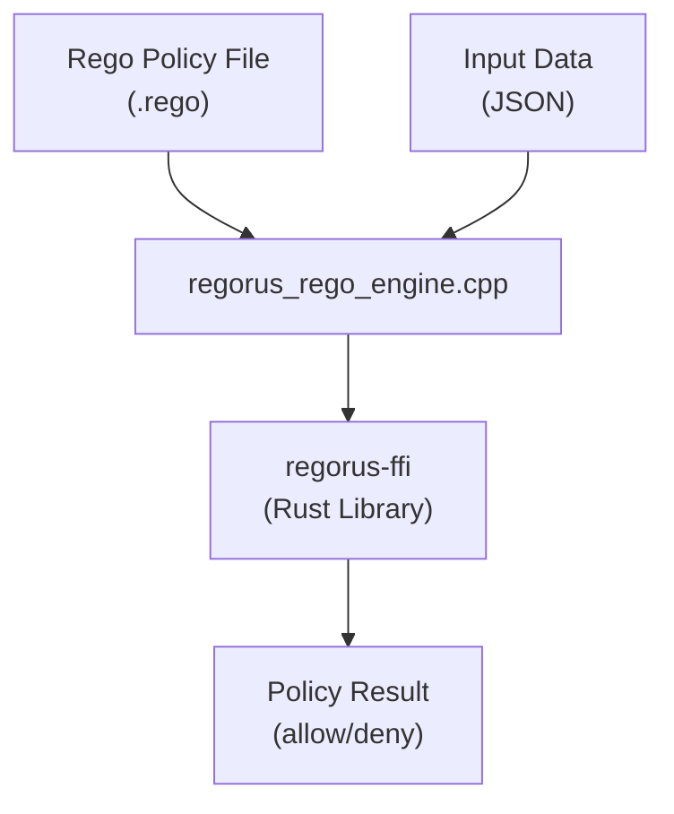
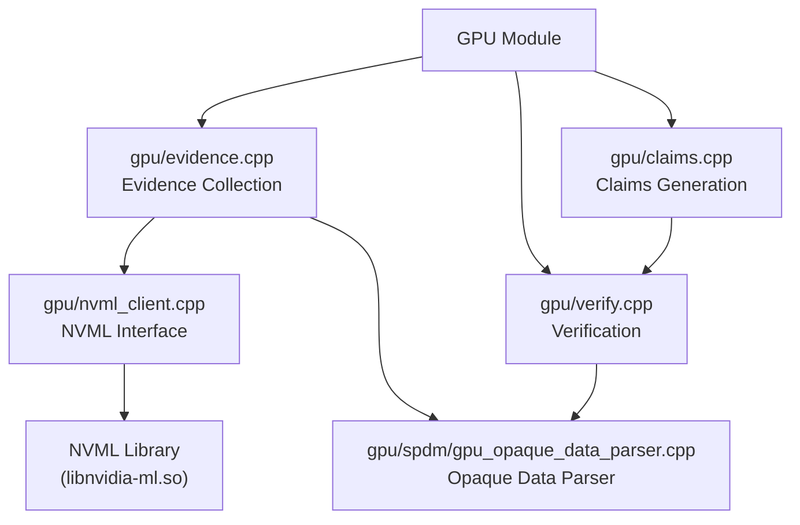
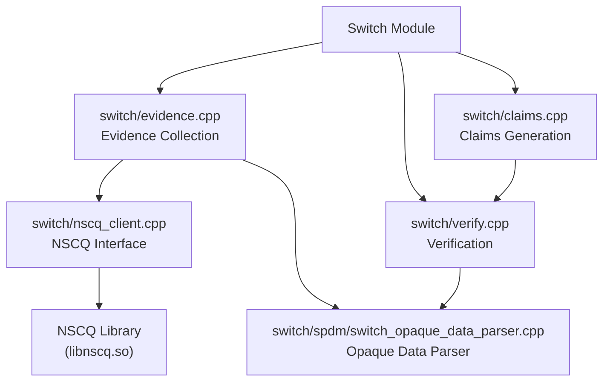
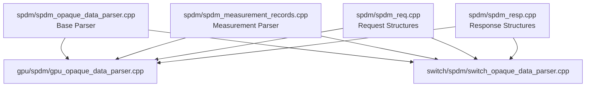
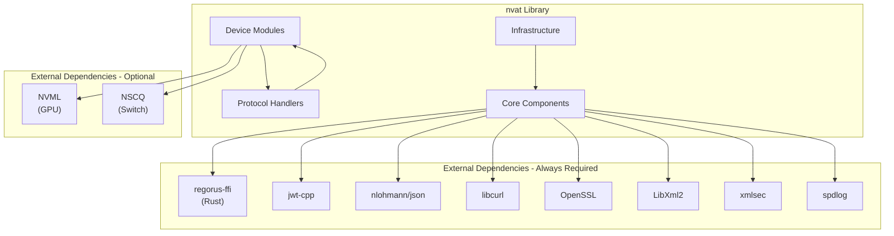

<!-- source: DeepWiki mcp.deepwiki.com · repo NVIDIA/attestation-sdk · page 3.2 Core SDK (nv-attestation-sdk-cpp) · fetched 2026-10-26 -->

# Core SDK (nv-attestation-sdk-cpp)

<details>
<summary>Relevant source files</summary>

The following files were used as context for generating this wiki page:

- [nv-attestation-sdk-cpp/.clang-tidy](nv-attestation-sdk-cpp/.clang-tidy)
- [nv-attestation-sdk-cpp/CMakeLists.txt](nv-attestation-sdk-cpp/CMakeLists.txt)
- [nv-attestation-sdk-cpp/cmake/Config.cmake.in](nv-attestation-sdk-cpp/cmake/Config.cmake.in)

</details>


## Purpose and Scope

The Core SDK (`nv-attestation-sdk-cpp`) is the foundational C++ library that provides attestation functionality for NVIDIA hardware. This page documents the internal structure, components, and architecture of the `nvat` library, which implements evidence collection, verification, claims processing, and policy evaluation for GPU and Switch devices.

For information about using the library through the command-line interface, see [CLI Tool](#3.3). For external dependencies, see [External Dependencies](#3.4). For attestation concepts and workflows, see [Attestation Concepts](#5).

---

## Library Overview

The SDK is built as a shared or static library named `nvat` with SOVERSION 0. The library implements a modular architecture where core attestation functionality is separated from device-specific implementations, protocol handlers, and infrastructure services.



**Sources:** [nv-attestation-sdk-cpp/CMakeLists.txt:123-152]()

### Build Configuration

The library supports several build-time configuration options controlled through CMake:

| Option | Default | Description |
|--------|---------|-------------|
| `BUILD_SHARED_LIBS` | ON | Build as shared library instead of static |
| `ENABLE_NVML` | OFF | Enable NVML support for GPU attestation |
| `ENABLE_NSCQ` | OFF | Enable NSCQ support for Switch attestation |
| `BUILD_EXAMPLES` | OFF | Build example executables |
| `BUILD_TESTING` | OFF | Build unit and integration tests |
| `SANITIZER` | OFF | Enable sanitizer (thread, address, undefined, leak) |
| `CMAKE_COMPILE_WARNING_AS_ERROR` | ON | Treat warnings as errors |
| `CMAKE_CXX_STANDARD` | 14 | C++ standard version |

**Sources:** [nv-attestation-sdk-cpp/CMakeLists.txt:5-17]()

---

## Module Organization

The SDK source files are organized hierarchically by functional responsibility:



**Sources:** [nv-attestation-sdk-cpp/CMakeLists.txt:123-152]()

---

## Core Components

### Attestation Engine

The attestation engine coordinates the overall attestation workflow, from evidence collection through verification to claims generation.

**Key Files:**
- `attestation.cpp` - Main attestation orchestration
- `verify.cpp` - Verification logic and external service integration

The attestation engine interacts with device modules to collect evidence, communicates with external services (RIM, OCSP, NRAS) for verification in remote mode, and coordinates policy evaluation.

```mermaid
sequenceDiagram
    participant Client
    participant attestation.cpp
    participant Device["Device Module<br/>(gpu/switch)"]
    participant verify.cpp
    participant HTTP["nv_http.cpp"]
    participant Policy["regorus_rego_engine.cpp"]
    participant claims.cpp
    
    Client->>attestation.cpp: nvat_attest_device()
    attestation.cpp->>Device: Collect evidence
    Device-->>attestation.cpp: Evidence data
    attestation.cpp->>verify.cpp: Verify evidence
    
    alt Remote Verification
        verify.cpp->>HTTP: Fetch RIM data
        HTTP-->>verify.cpp: Reference measurements
        verify.cpp->>HTTP: Verify certificates (OCSP)
        HTTP-->>verify.cpp: Certificate status
    else Local Verification
        verify.cpp->>verify.cpp: Local validation
    end
    
    verify.cpp->>Policy: Evaluate relying party policy
    Policy-->>verify.cpp: Policy result
    verify.cpp-->>attestation.cpp: Verification result
    attestation.cpp->>claims.cpp: Generate claims
    claims.cpp-->>attestation.cpp: Claims + EAT
    attestation.cpp-->>Client: Attestation result
```

**Sources:** [nv-attestation-sdk-cpp/CMakeLists.txt:125-126](), [nv-attestation-sdk-cpp/CMakeLists.txt:147]()

---

### Claims Processing

The claims subsystem generates structured attestation claims and Entity Attestation Tokens (EAT).

**Key Files:**
- `claims.cpp` - Claims data structures and serialization
- `claims_evaluator.cpp` - Claims evaluation logic

Claims are generated from verified evidence and include:
- Device identity information
- Measurement values and their verification status
- Policy evaluation results
- Timestamps and nonces

**Sources:** [nv-attestation-sdk-cpp/CMakeLists.txt:126-127]()

---

### RIM Store

The RIM (Reference Integrity Measurements) store manages golden measurements used for verification.

**Key File:** `rim.cpp`

The RIM store:
- Fetches reference measurements from NVIDIA RIM services
- Caches RIM data for offline verification
- Provides measurement comparison functionality
- Handles RIM versioning and device-specific measurements

**Sources:** [nv-attestation-sdk-cpp/CMakeLists.txt:142]()

---

### Policy Engine

The policy engine evaluates Rego policies to enforce relying party requirements.

**Key File:** `rego_engine/regorus_rego_engine.cpp`

The policy engine wraps the `regorus-ffi` library and provides:
- Policy loading and compilation
- Input data marshaling
- Policy evaluation execution
- Result extraction and error handling



**Sources:** [nv-attestation-sdk-cpp/CMakeLists.txt:141](), [nv-attestation-sdk-cpp/CMakeLists.txt:25-54]()

---

## Device Support Modules

### GPU Support

The GPU module implements attestation for NVIDIA GPUs using the NVML (NVIDIA Management Library) API.

**Module Structure:**

| File | Purpose |
|------|---------|
| `gpu/evidence.cpp` | Evidence collection and serialization |
| `gpu/claims.cpp` | GPU-specific claims generation |
| `gpu/verify.cpp` | GPU evidence verification logic |
| `gpu/nvml_client.cpp` | NVML API wrapper and interface |
| `gpu/spdm/gpu_opaque_data_parser.cpp` | GPU-specific SPDM opaque data parsing |



The GPU module is conditionally compiled when `ENABLE_NVML` is set. It collects:
- GPU device information and identifiers
- SPDM measurement records
- Certificate chains
- GPU-specific opaque data (e.g., VBIOS measurements)

**Sources:** [nv-attestation-sdk-cpp/CMakeLists.txt:129-132](), [nv-attestation-sdk-cpp/CMakeLists.txt:135](), [nv-attestation-sdk-cpp/CMakeLists.txt:91-95]()

---

### Switch Support

The Switch module implements attestation for NVIDIA switches using the NSCQ (NVIDIA Switch Configuration and Query) library.

**Module Structure:**

| File | Purpose |
|------|---------|
| `switch/evidence.cpp` | Switch evidence collection |
| `switch/claims.cpp` | Switch-specific claims generation |
| `switch/verify.cpp` | Switch evidence verification |
| `switch/nscq_client.cpp` | NSCQ API wrapper |
| `switch/spdm/switch_opaque_data_parser.cpp` | Switch-specific SPDM opaque data parsing |



The Switch module is conditionally compiled when `ENABLE_NSCQ` is set. It handles switch-specific attestation requirements and opaque data formats.

**Sources:** [nv-attestation-sdk-cpp/CMakeLists.txt:143-146](), [nv-attestation-sdk-cpp/CMakeLists.txt:148](), [nv-attestation-sdk-cpp/CMakeLists.txt:97-101]()

---

## Protocol Support

### SPDM Protocol

The SPDM (Security Protocol and Data Model) module implements protocol-level operations common to both GPU and Switch attestation.

**Module Structure:**

| File | Purpose |
|------|---------|
| `spdm/spdm_measurement_records.cpp` | Parse SPDM measurement records |
| `spdm/spdm_opaque_data_parser.cpp` | Base opaque data parsing |
| `spdm/spdm_req.cpp` | SPDM request structures |
| `spdm/spdm_resp.cpp` | SPDM response structures |



The SPDM module provides:
- Binary protocol parsing for SPDM data structures
- Measurement record extraction and validation
- Opaque data field interpretation
- Device-agnostic protocol handling that can be specialized per device type

**Sources:** [nv-attestation-sdk-cpp/CMakeLists.txt:133-137](), [nv-attestation-sdk-cpp/CMakeLists.txt:135](), [nv-attestation-sdk-cpp/CMakeLists.txt:148]()

---

## Infrastructure Components

### X.509 Certificate Handling

**Key File:** `nv_x509.cpp`

Provides X.509 certificate operations including:
- Certificate parsing and validation
- Certificate chain verification
- OCSP (Online Certificate Status Protocol) support for revocation checking
- X.509 extension extraction
- Integration with OpenSSL and xmlsec libraries

**Sources:** [nv-attestation-sdk-cpp/CMakeLists.txt:140]()

---

### JWT Token Processing

**Key File:** `nv_jwt.cpp`

Implements JWT (JSON Web Token) operations for Entity Attestation Tokens:
- JWT token generation and signing
- Token verification and validation
- Claims encoding and decoding
- Integration with `jwt-cpp` library

**Sources:** [nv-attestation-sdk-cpp/CMakeLists.txt:150]()

---

### HTTP Client

**Key File:** `nv_http.cpp`

Provides HTTP/HTTPS client functionality for external service communication:
- RESTful API calls to RIM services
- OCSP responder communication
- NRAS (NVIDIA Remote Attestation Service) integration
- TLS/SSL certificate verification
- Error handling and retry logic
- Built on libcurl

**Sources:** [nv-attestation-sdk-cpp/CMakeLists.txt:149]()

---

### Logging Infrastructure

**Key File:** `log.cpp`

Implements structured logging using spdlog:
- Configurable log levels
- Formatted log output
- File path truncation for cleaner logs
- Thread-safe logging operations

The build system configures `__FILE__` macro to be relative to the source directory for cleaner log messages.

**Sources:** [nv-attestation-sdk-cpp/CMakeLists.txt:139](), [nv-attestation-sdk-cpp/CMakeLists.txt:116-119]()

---

### Initialization and Lifecycle

**Key Files:**
- `init.cpp` - Library initialization and global state setup
- `nvat.cpp` - Main library entry points and context management

These files implement:
- Library initialization (`nvat_sdk_init()`)
- Context creation and destruction
- Resource allocation and cleanup
- Global state management

**Sources:** [nv-attestation-sdk-cpp/CMakeLists.txt:124](), [nv-attestation-sdk-cpp/CMakeLists.txt:138]()

---

### Error Handling

**Key File:** `error.cpp`

Defines error codes and error handling mechanisms:
- Result codes enumeration (e.g., `NVAT_RC_OK`, `NVAT_RC_RP_POLICY_MISMATCH`)
- Error message formatting
- Error context propagation
- Mapping internal errors to public API error codes

For a complete list of error codes, see [Error Codes and Handling](#8.2).

**Sources:** [nv-attestation-sdk-cpp/CMakeLists.txt:128]()

---

### Utilities

**Key File:** `utils.cpp`

Common utility functions including:
- String manipulation
- Data encoding/decoding (Base64, hex)
- File I/O helpers
- JSON manipulation utilities
- Time and date formatting

**Sources:** [nv-attestation-sdk-cpp/CMakeLists.txt:151]()

---

## Dependency Architecture

The library has a layered dependency structure:



### Required Dependencies

All dependencies are linked as follows:

| Dependency | Link Type | Usage |
|------------|-----------|-------|
| `regorus-ffi` | PRIVATE | Policy evaluation engine |
| `jwt-cpp` | PRIVATE | JWT token operations |
| `nlohmann/json` | PRIVATE | JSON parsing and generation |
| `CURL::libcurl` | PUBLIC | HTTP client |
| `OpenSSL::SSL` | PUBLIC | TLS/SSL operations |
| `OpenSSL::Crypto` | PUBLIC | Cryptographic operations |
| `LibXml2::LibXml2` | PUBLIC | XML parsing |
| `xmlsec::xmlsec` | PUBLIC | XML security operations |
| `xmlsec::xmlsec-openssl` | PUBLIC | XML security with OpenSSL backend |
| `spdlog::spdlog` | PUBLIC | Logging framework |

**Sources:** [nv-attestation-sdk-cpp/CMakeLists.txt:198-213]()

### Optional Dependencies

| Dependency | CMake Option | Usage |
|------------|--------------|-------|
| NVML | `ENABLE_NVML` | GPU evidence collection via NVIDIA Management Library |
| NSCQ | `ENABLE_NSCQ` | Switch evidence collection via NVIDIA Switch Configuration and Query |

When enabled, these dependencies are linked as PUBLIC to allow client code to use the same headers.

**Sources:** [nv-attestation-sdk-cpp/CMakeLists.txt:91-101](), [nv-attestation-sdk-cpp/CMakeLists.txt:200-201]()

---

## Build System Details

### Compiler Flags

The library enforces strict compilation standards:

```cmake
# Warning flags (applied to all builds)
-Wall -Wextra -Wpedantic -pedantic
-Werror  # Warnings as errors

# Suppressed warnings (temporary during development)
-Wno-unused -Wno-unused-parameter
```

**Sources:** [nv-attestation-sdk-cpp/CMakeLists.txt:103-109]()

### Debug and Sanitizer Builds

When `CMAKE_BUILD_TYPE=Debug` or a sanitizer is enabled:

```cmake
-g3                    # Maximum debug information
-O0                    # No optimization
-fno-omit-frame-pointer # Preserve frame pointers for stack traces
-fsanitize=${SANITIZER}  # Enable sanitizer
-fno-sanitize-recover=all # Fail fast on sanitizer errors
```

**Sources:** [nv-attestation-sdk-cpp/CMakeLists.txt:112-114](), [nv-attestation-sdk-cpp/CMakeLists.txt:172-176]()

### Static Analysis

The library uses `clang-tidy` for static analysis with comprehensive checks enabled:

**Enabled Check Categories:**
- `clang-diagnostic-*` - All compiler diagnostics
- `clang-analyzer-*` - Static analyzer checks
- `bugprone-*` - Bug-prone code patterns
- `performance-*` - Performance issues
- `readability-*` - Code readability issues
- `cppcoreguidelines-init-variables` - Variable initialization
- `cppcoreguidelines-avoid-non-const-global-variables` - Global variable usage

All warnings from enabled checks are treated as errors.

**Sources:** [nv-attestation-sdk-cpp/.clang-tidy:1-6]()

### Installation

The library installs the following components:

| Component | Type | Install Path |
|-----------|------|--------------|
| `libnvat.so` / `libnvat.a` | Library | `${CMAKE_INSTALL_LIBDIR}` |
| `nvat.h` | Header | `${CMAKE_INSTALL_INCLUDEDIR}` |
| `nvatTargets.cmake` | CMake Config | `${CMAKE_INSTALL_DATADIR}/cmake/nvat` |
| Find modules | CMake Modules | `${CMAKE_INSTALL_DATADIR}/cmake/nvat/Modules` |
| `nvatConfig.cmake` | Package Config | `${CMAKE_INSTALL_DATADIR}/cmake/nvat` |

**Sources:** [nv-attestation-sdk-cpp/CMakeLists.txt:218-270]()

---

## Header File Generation

The main public header `nvat.h` is generated from a template at build time:

```cmake
configure_file("include/nvat.h.in" "include/nvat.h")
```

This allows version information and build-time configuration to be embedded in the header.

**Sources:** [nv-attestation-sdk-cpp/CMakeLists.txt:121]()

---

## CMake Package Configuration

The SDK provides a CMake package configuration that automatically finds all required dependencies:

```cmake
find_dependency(CURL REQUIRED)
find_dependency(LibXml2 REQUIRED)
find_dependency(OpenSSL REQUIRED)
find_dependency(spdlog REQUIRED)
find_dependency(xmlsec REQUIRED)

# Optional dependencies based on build configuration
if (@ENABLE_NVML@)
  find_dependency(Nvml)
endif()

if (@ENABLE_NSCQ@)
  find_dependency(Nscq)
endif()
```

This allows downstream projects to use the library with a simple `find_package(nvat)` call.

**Sources:** [nv-attestation-sdk-cpp/cmake/Config.cmake.in:1-22]()

---

