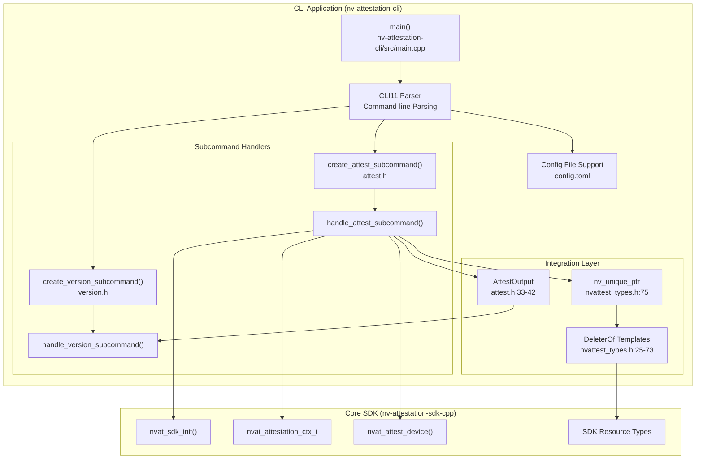
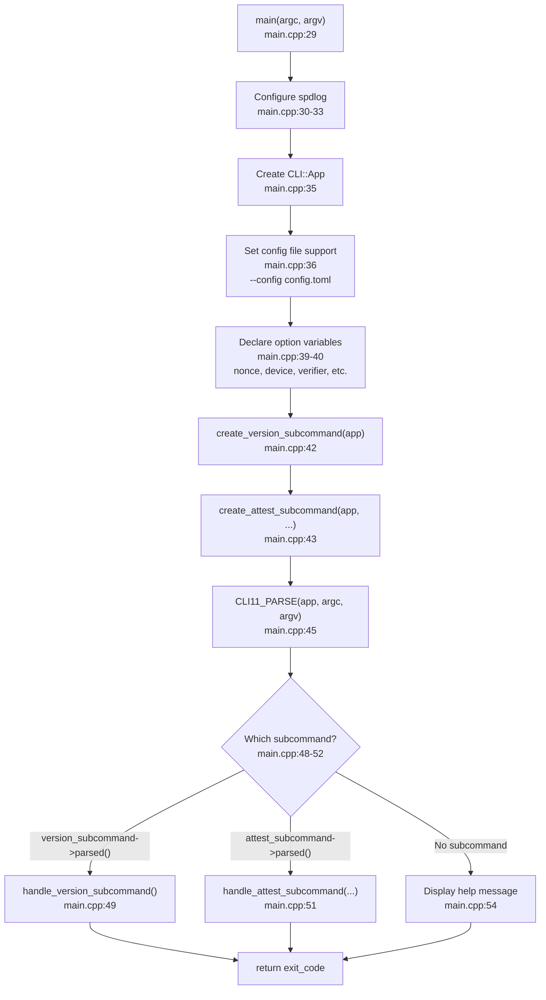
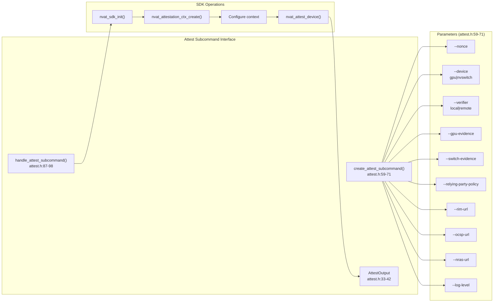
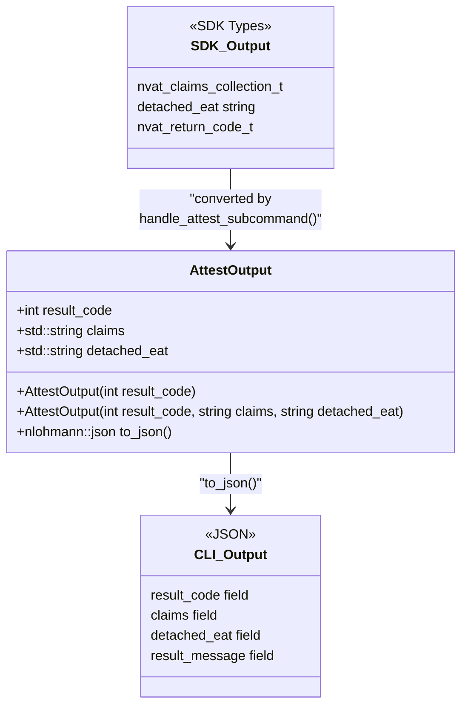
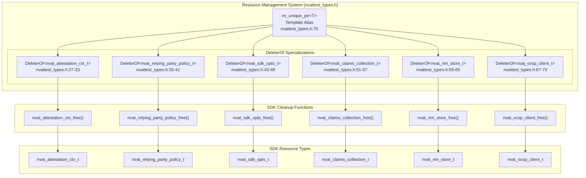

<!-- source: DeepWiki mcp.deepwiki.com · repo NVIDIA/attestation-sdk · page 3.3 CLI Tool (nv-attestation-cli) · fetched 2026-10-26 -->

# CLI Tool (nv-attestation-cli)

<details>
<summary>Relevant source files</summary>

The following files were used as context for generating this wiki page:

- [nv-attestation-cli/src/attest.h](nv-attestation-cli/src/attest.h)
- [nv-attestation-cli/src/main.cpp](nv-attestation-cli/src/main.cpp)
- [nv-attestation-cli/src/nvattest_types.h](nv-attestation-cli/src/nvattest_types.h)
- [nv-attestation-cli/src/version.h](nv-attestation-cli/src/version.h)

</details>


## Purpose and Scope

This document describes the architecture and implementation of the `nv-attestation-cli` tool, a command-line interface that provides user-facing access to the NVIDIA attestation capabilities. The CLI is a lightweight wrapper around the core SDK ([3.2](#3.2)) that handles command-line parsing, configuration management, and output formatting.

For information about using the CLI tool, see [Using the CLI](#4). For details about the underlying attestation functionality, see [Core SDK](#3.2). For information about building the CLI from source, see [Building from Source](#6.1).

---

## CLI Architecture Overview

The CLI tool is structured as a layered application with clear separation between command-line interface concerns and attestation logic.



**Sources:** [nv-attestation-cli/src/main.cpp:1-58](), [nv-attestation-cli/src/attest.h:1-101](), [nv-attestation-cli/src/version.h:1-40](), [nv-attestation-cli/src/nvattest_types.h:1-76]()

The CLI architecture consists of three distinct layers:

| Layer | Components | Purpose |
|-------|-----------|---------|
| **Command-Line Interface** | `main()`, CLI11 parser, config file support | Parse user input, load configuration, dispatch to subcommands |
| **Subcommand Handlers** | `create_*_subcommand()`, `handle_*_subcommand()` functions | Implement business logic for each command |
| **Integration Layer** | `AttestOutput`, `nv_unique_ptr`, `DeleterOf` templates | Bridge between CLI and SDK, manage resources |

---

## Entry Point and Command Dispatch

The CLI application entry point follows a straightforward dispatch pattern.



**Sources:** [nv-attestation-cli/src/main.cpp:29-58]()

The entry point implementation at [nv-attestation-cli/src/main.cpp:29-58]() follows these steps:

1. **Logger Configuration** ([main.cpp:30-33]()): Initializes spdlog with stdout output and simple formatting pattern
2. **CLI Application Setup** ([main.cpp:35]()): Creates the root `CLI::App` with descriptive help text
3. **Config File Support** ([main.cpp:36]()): Enables TOML configuration file parsing via `--config` option
4. **Option Variables** ([main.cpp:39-40]()): Declares string variables to receive parsed command-line arguments
5. **Subcommand Creation** ([main.cpp:42-43]()): Registers `version` and `attest` subcommands
6. **Parsing** ([main.cpp:45]()): Invokes CLI11 parser which populates option variables
7. **Dispatch** ([main.cpp:48-52]()): Checks which subcommand was parsed and invokes corresponding handler

---

## Subcommand System

### Attest Subcommand

The `attest` subcommand is the primary interface for device attestation operations.



**Sources:** [nv-attestation-cli/src/attest.h:28-98]()

The attest subcommand interface consists of two primary functions defined in [attest.h:59-98]():

**Function: `create_attest_subcommand()`** ([attest.h:59-71]())

Registers the `attest` subcommand with CLI11 and binds command-line parameters:

| Parameter | Type | Purpose |
|-----------|------|---------|
| `nonce` | `std::string&` | Cryptographic nonce for attestation freshness |
| `device` | `std::string&` | Device type selector ("gpu" or "nvswitch") |
| `verifier` | `std::string&` | Verification mode ("local" or "remote") |
| `gpu_evidence` | `std::string&` | Path to pre-collected GPU evidence file |
| `switch_evidence` | `std::string&` | Path to pre-collected switch evidence file |
| `relying_party_policy` | `std::string&` | Path to Rego policy file |
| `rim_url` | `std::string&` | RIM service URL for remote verification |
| `ocsp_url` | `std::string&` | OCSP service URL for certificate validation |
| `nras_url` | `std::string&` | NRAS service URL for remote attestation |
| `log_level` | `std::string&` | Logging verbosity control |

**Function: `handle_attest_subcommand()`** ([attest.h:87-98]())

Executes attestation workflow using the parsed parameters:
1. Initializes the SDK via `nvat_sdk_init()`
2. Creates attestation context with `nvat_attestation_ctx_create()`
3. Configures context with device type, verifier mode, and service URLs
4. Invokes `nvat_attest_device()` to perform attestation
5. Returns exit code (0 = success, 1 = failure, 2 = policy mismatch)

### Version Subcommand

The `version` subcommand provides version information about the CLI and SDK.

**Sources:** [nv-attestation-cli/src/version.h:23-38]()

The version subcommand interface at [version.h:23-38]() consists of:

- **`create_version_subcommand()`** ([version.h:30]()): Registers the subcommand with CLI11
- **`handle_version_subcommand()`** ([version.h:37]()): Outputs version information and returns exit code 0

For detailed information about version output format and versioning system, see [Version Information](#8.1).

---

## AttestOutput Class

The `AttestOutput` class encapsulates attestation results and provides JSON serialization.



**Sources:** [nv-attestation-cli/src/attest.h:28-42]()

The `AttestOutput` class defined at [attest.h:33-42]() serves as a bridge between SDK data structures and CLI output format:

**Member Variables:**
- `result_code` (int): Attestation result code from SDK (see [Error Codes](#8.2))
- `claims` (std::string): Serialized claims collection in JSON format
- `detached_eat` (std::string): Detached Entity Attestation Token

**Constructors:**
- Single-argument constructor ([attest.h:39]()): For error cases with only result code
- Three-argument constructor ([attest.h:40]()): For successful attestations with claims and token

**Method:**
- `to_json()` ([attest.h:41]()): Serializes to `nlohmann::json` object for output

The class provides a clean abstraction that allows the subcommand handler to work with strongly-typed C++ objects while ultimately producing JSON output for CLI users. For details about the output JSON structure, see [Output Format](#4.4).

---

## SDK Integration and Resource Management

The CLI implements RAII-based resource management to ensure proper cleanup of SDK resources.



**Sources:** [nv-attestation-cli/src/nvattest_types.h:1-76]()

The resource management system in [nvattest_types.h:1-76]() provides automatic cleanup of SDK resources through C++ RAII patterns:

### DeleterOf Template Pattern

The `DeleterOf` template ([nvattest_types.h:25]()) defines custom deleters for SDK types. Each specialization implements the function call operator that invokes the appropriate SDK cleanup function:

**Template Structure:**
```
DeleterOf<T>::operator()(T* ptr) {
    if (ptr) {
        // Call SDK-specific free function
    }
}
```

### nv_unique_ptr Alias

The `nv_unique_ptr<T>` template alias ([nvattest_types.h:75]()) combines `std::unique_ptr` with `DeleterOf<T>`:

```
template<class T> using nv_unique_ptr = std::unique_ptr<T, DeleterOf<T>>;
```

This allows CLI code to use SDK resources with automatic cleanup:

```cpp
nv_unique_ptr<nvat_attestation_ctx_t> ctx(nvat_attestation_ctx_create(...));
// Automatic cleanup via DeleterOf when ctx goes out of scope
```

### Supported SDK Resource Types

| SDK Type | Cleanup Function | DeleterOf Line Reference |
|----------|-----------------|-------------------------|
| `nvat_attestation_ctx_t` | `nvat_attestation_ctx_free()` | [nvattest_types.h:27-33]() |
| `nvat_relying_party_policy_t` | `nvat_relying_party_policy_free()` | [nvattest_types.h:35-41]() |
| `nvat_sdk_opts_t` | `nvat_sdk_opts_free()` | [nvattest_types.h:43-49]() |
| `nvat_claims_collection_t` | `nvat_claims_collection_free()` | [nvattest_types.h:51-57]() |
| `nvat_rim_store_t` | `nvat_rim_store_free()` | [nvattest_types.h:59-65]() |
| `nvat_ocsp_client_t` | `nvat_ocsp_client_free()` | [nvattest_types.h:67-73]() |

This pattern ensures that SDK resources are properly released even when exceptions are thrown or early returns occur in the CLI code. For more information about resource management patterns in the codebase, see [Resource Management Patterns](#6.5).

---

## Configuration File Support

The CLI supports loading options from a TOML configuration file, enabling users to avoid repeatedly specifying common parameters on the command line.

**Configuration File Setup:**

The configuration file support is enabled at [main.cpp:36]():
```cpp
app.set_config("--config", "config.toml", "Read options from a TOML configuration file");
```

This provides:
- `--config` command-line option to specify configuration file path
- Default filename of `config.toml` if no path specified
- CLI11 automatic parsing of TOML format

**Configuration Hierarchy:**

The CLI11 library processes configuration in this order:
1. Values from configuration file (if specified) are loaded first
2. Command-line arguments override configuration file values
3. Default values are used if neither config file nor CLI args provide a value

This allows users to maintain a base configuration file while selectively overriding specific options on the command line.

For detailed information about configuration file format and available options, see [Configuration Files](#4.3).

**Sources:** [nv-attestation-cli/src/main.cpp:36]()

---

## Code Organization

The CLI tool source code is organized into focused modules with clear responsibilities:

| File | Purpose | Key Components |
|------|---------|---------------|
| [main.cpp](nv-attestation-cli/src/main.cpp) | Application entry point | `main()`, logger setup, CLI11 application, subcommand dispatch |
| [attest.h](nv-attestation-cli/src/attest.h) | Attest subcommand interface | `create_attest_subcommand()`, `handle_attest_subcommand()`, `AttestOutput` class |
| [version.h](nv-attestation-cli/src/version.h) | Version subcommand interface | `create_version_subcommand()`, `handle_version_subcommand()` |
| [nvattest_types.h](nv-attestation-cli/src/nvattest_types.h) | SDK resource management | `nv_unique_ptr`, `DeleterOf` template specializations |

### Design Principles

The CLI implementation follows several design principles:

1. **Thin Wrapper**: The CLI contains minimal business logic; attestation logic resides in the SDK
2. **RAII Resource Management**: SDK resources are wrapped in `nv_unique_ptr` for automatic cleanup
3. **Separation of Concerns**: Command-line parsing (CLI11) is separate from attestation logic (SDK)
4. **Type Safety**: Strong typing via C++ classes (`AttestOutput`) rather than raw strings
5. **Testability**: Subcommand handlers are separate functions that can be unit tested independently of `main()`

For information about building the CLI from source and understanding the CMake configuration, see [Building from Source](#6.1).

**Sources:** [nv-attestation-cli/src/main.cpp:1-58](), [nv-attestation-cli/src/attest.h:1-101](), [nv-attestation-cli/src/version.h:1-40](), [nv-attestation-cli/src/nvattest_types.h:1-76]()

---

