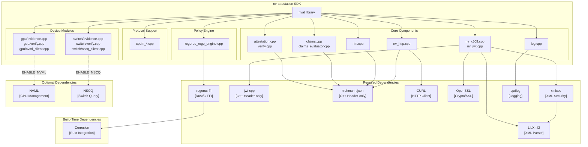
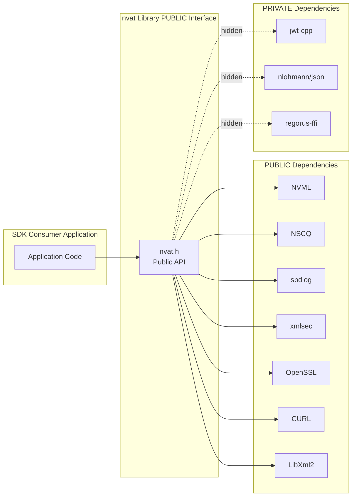

<!-- source: DeepWiki mcp.deepwiki.com · repo NVIDIA/attestation-sdk · page 3.4 External Dependencies · fetched 2026-10-26 -->

# External Dependencies

<details>
<summary>Relevant source files</summary>

The following files were used as context for generating this wiki page:

- [nv-attestation-sdk-cpp/CMakeLists.txt](nv-attestation-sdk-cpp/CMakeLists.txt)
- [nv-attestation-sdk-cpp/cmake/Config.cmake.in](nv-attestation-sdk-cpp/cmake/Config.cmake.in)

</details>


This page documents all external libraries and dependencies required by the NVIDIA Attestation SDK. It covers both required dependencies that must be present for the SDK to build and function, and optional dependencies that enable specific features. For information about building the SDK and configuring these dependencies, see [Building from Source](#6.1). For details on device-specific requirements, see [Device Support](#5.5).

## Overview

The attestation SDK relies on several categories of external dependencies:

- **Build System Dependencies**: Tools and libraries required to build the SDK
- **Required Runtime Dependencies**: Libraries that must be present for core SDK functionality
- **Optional Feature Dependencies**: Libraries that enable specific device support (GPU/Switch)

All dependencies are managed through CMake's dependency resolution system, either via `FetchContent` for source-level dependencies or `find_package()` for system-installed libraries.

## Dependency Architecture



**Sources:** [nv-attestation-sdk-cpp/CMakeLists.txt:1-273]()

## Required Dependencies

### Build System Dependencies

#### Corrosion

**Purpose:** Integrates Rust code compilation into CMake build system

**Version:** Specific commit `6be991bb34c348dfb8344be22f3606288ea5c7fd`

**Usage:** Enables building the `regorus-ffi` Rust crate as part of the C++ build process

**Configuration:**
```
FetchContent_Declare(
    Corrosion
    GIT_REPOSITORY https://github.com/corrosion-rs/corrosion.git
    GIT_TAG 6be991bb34c348dfb8344be22f3606288ea5c7fd
)
```

Corrosion is used exclusively to compile the Regorus policy engine from Rust source. The specific commit is chosen to include a fix for issue #590.

**Sources:** [nv-attestation-sdk-cpp/CMakeLists.txt:25-32]()

### Fetched Dependencies

These dependencies are automatically downloaded and built from source using CMake's `FetchContent` mechanism.

#### regorus-ffi

**Purpose:** Rego policy evaluation engine for attestation policy verification

**Type:** Rust library with C FFI bindings

**Version:** `regorus-v0.4.0`

**Repository:** https://github.com/microsoft/regorus

**Build Configuration:**
- Built in Release mode regardless of SDK build type
- Compiled as static library (`staticlib`)
- Enables `regorus/semver` feature
- Only the `regorus-ffi` crate is built from the workspace

**Usage in SDK:**
- Powers the policy evaluation engine in [nv-attestation-sdk-cpp/src/rego_engine/regorus_rego_engine.cpp]()
- Evaluates Rego policies to determine if device attestation meets relying party requirements
- Header files generated during build at `${regorus_SOURCE_DIR}/bindings/ffi`

**Link Relationship:** `PRIVATE` - linked only to `nvat` library, not exposed to consumers

**Sources:** [nv-attestation-sdk-cpp/CMakeLists.txt:34-54]()

#### jwt-cpp

**Purpose:** JWT (JSON Web Token) creation and parsing

**Type:** C++ header-only library

**Version:** v0.7.1

**Repository:** https://github.com/Thalhammer/jwt-cpp

**Build Configuration:**
- `JWT_DISABLE_PICOJSON=ON` - Disables picojson support (uses nlohmann/json instead)
- `JWT_BUILD_EXAMPLES=OFF` - Skips example programs
- Handled with custom `FetchContent_Populate()` to prevent header installation
- Wrapped in custom `own-jwt-cpp` interface target to control installation

**Special Handling:**
The SDK uses a custom wrapper to prevent jwt-cpp headers from being installed with the SDK:
```
FetchContent_Populate(jwt-cpp)
add_library(own-jwt-cpp INTERFACE)
target_include_directories(own-jwt-cpp
    INTERFACE ${jwt-cpp_SOURCE_DIR}/include)
target_compile_options(own-jwt-cpp INTERFACE -Wno-c++17-extensions)
```

**Usage in SDK:**
- Used in [nv-attestation-sdk-cpp/src/nv_jwt.cpp]() for JWT token handling
- Supports creating and parsing Entity Attestation Tokens (EAT)

**Link Relationship:** `PRIVATE` - linked only to `nvat` library

**Sources:** [nv-attestation-sdk-cpp/CMakeLists.txt:56-80]()

#### nlohmann/json

**Purpose:** JSON parsing and serialization

**Type:** C++ header-only library

**Version:** v3.12.0

**Distribution:** Pre-built header archive from GitHub releases

**Build Configuration:**
```
FetchContent_Declare(json 
    URL https://github.com/nlohmann/json/releases/download/v3.12.0/json.tar.xz 
    EXCLUDE_FROM_ALL)
```

**Usage in SDK:**
- Pervasive use throughout the codebase for JSON processing
- Used in attestation processing, claims generation, evidence parsing
- Primary source files: [nv-attestation-sdk-cpp/src/attestation.cpp](), [nv-attestation-sdk-cpp/src/claims.cpp](), [nv-attestation-sdk-cpp/src/rim.cpp](), [nv-attestation-sdk-cpp/src/nv_http.cpp]()

**Link Relationship:** `PRIVATE` - linked only to `nvat` library

**Sources:** [nv-attestation-sdk-cpp/CMakeLists.txt:81-82]()

### System Dependencies

These dependencies must be installed on the system before building the SDK. CMake locates them using `find_package()`.

#### CURL

**Purpose:** HTTP/HTTPS client for network operations

**Required:** Yes

**Usage in SDK:**
- Fetches Reference Integrity Manifests (RIMs) from remote services
- Communicates with OCSP responders for certificate validation
- Interacts with NVIDIA Remote Attestation Service (NRAS)
- Implementation in [nv-attestation-sdk-cpp/src/nv_http.cpp]()

**Link Relationship:** `PUBLIC` - exposed to SDK consumers via `CURL::libcurl` target

**Sources:** [nv-attestation-sdk-cpp/CMakeLists.txt:85](), [nv-attestation-sdk-cpp/CMakeLists.txt:207](), [nv-attestation-sdk-cpp/cmake/Config.cmake.in:7]()

#### OpenSSL

**Purpose:** Cryptographic operations and SSL/TLS support

**Required:** Yes

**Components Used:**
- `OpenSSL::SSL` - SSL/TLS protocol implementation
- `OpenSSL::Crypto` - Cryptographic primitives

**Usage in SDK:**
- X.509 certificate parsing and validation in [nv-attestation-sdk-cpp/src/nv_x509.cpp]()
- Certificate chain verification
- Cryptographic operations for attestation
- SSL/TLS for secure communications (via CURL)

**Link Relationship:** `PUBLIC` - both `OpenSSL::SSL` and `OpenSSL::Crypto` exposed to consumers

**Sources:** [nv-attestation-sdk-cpp/CMakeLists.txt:87](), [nv-attestation-sdk-cpp/CMakeLists.txt:205-206](), [nv-attestation-sdk-cpp/cmake/Config.cmake.in:9]()

#### LibXml2

**Purpose:** XML parsing

**Required:** Yes

**Usage in SDK:**
- Parses XML responses from OCSP services
- Required by xmlsec for XML signature verification
- Used in certificate validation workflows

**Link Relationship:** `PUBLIC` - exposed to SDK consumers via `LibXml2::LibXml2` target

**Sources:** [nv-attestation-sdk-cpp/CMakeLists.txt:86](), [nv-attestation-sdk-cpp/CMakeLists.txt:208](), [nv-attestation-sdk-cpp/cmake/Config.cmake.in:8]()

#### xmlsec

**Purpose:** XML security and digital signatures

**Required:** Yes

**Components Used:**
- `xmlsec::xmlsec` - Core XML security library
- `xmlsec::xmlsec-openssl` - OpenSSL crypto backend for xmlsec

**Usage in SDK:**
- Verifies XML digital signatures in attestation responses
- OCSP response validation
- Certificate-related XML processing in [nv-attestation-sdk-cpp/src/nv_x509.cpp]()

**Link Relationship:** `PUBLIC` - both components exposed to consumers

**Custom Find Module:** [nv-attestation-sdk-cpp/cmake/Findxmlsec.cmake]() provides the CMake integration

**Sources:** [nv-attestation-sdk-cpp/CMakeLists.txt:89](), [nv-attestation-sdk-cpp/CMakeLists.txt:203-204](), [nv-attestation-sdk-cpp/cmake/Config.cmake.in:11]()

#### spdlog

**Purpose:** Fast C++ logging library

**Required:** Yes

**Usage in SDK:**
- All logging throughout the SDK
- Primary logging interface in [nv-attestation-sdk-cpp/src/log.cpp]()
- Provides structured, leveled logging (trace, debug, info, warn, error)

**Link Relationship:** `PUBLIC` - exposed via `spdlog::spdlog` target

**Sources:** [nv-attestation-sdk-cpp/CMakeLists.txt:88](), [nv-attestation-sdk-cpp/CMakeLists.txt:202](), [nv-attestation-sdk-cpp/cmake/Config.cmake.in:10]()

## Optional Dependencies

Optional dependencies are enabled via CMake options and provide support for specific hardware types.

### Conditional Compilation Table

| Dependency | CMake Option | Define | Purpose |
|------------|-------------|--------|---------|
| NVML | `ENABLE_NVML=ON` | `ENABLE_NVML` | GPU device attestation |
| NSCQ | `ENABLE_NSCQ=ON` | `ENABLE_NSCQ` | Switch device attestation |

**Sources:** [nv-attestation-sdk-cpp/CMakeLists.txt:15-16](), [nv-attestation-sdk-cpp/CMakeLists.txt:91-101]()

### NVML (NVIDIA Management Library)

**Purpose:** Query and manage NVIDIA GPU devices

**Type:** Optional hardware-specific dependency

**Enabled By:** CMake option `ENABLE_NVML=ON`

**When Enabled:**
- Defines `ENABLE_NVML` preprocessor macro
- Adds NVML include directories and library to build
- Enables live GPU attestation (as opposed to file-based evidence)

**Usage in SDK:**
- [nv-attestation-sdk-cpp/src/gpu/nvml_client.cpp]() - NVML API wrapper
- [nv-attestation-sdk-cpp/src/gpu/evidence.cpp]() - GPU evidence collection using NVML

**Configuration:**
```cmake
if(ENABLE_NVML)
  message("-- Building with NVML support")
  find_package(Nvml REQUIRED)
  add_compile_definitions(ENABLE_NVML)
endif()
```

**Link Relationship:** `PUBLIC` - conditionally linked via `$<$<BOOL:${ENABLE_NVML}>:${Nvml_LIBRARY}>`

**Custom Find Module:** [nv-attestation-sdk-cpp/cmake/FindNvml.cmake]()

**Sources:** [nv-attestation-sdk-cpp/CMakeLists.txt:91-95](), [nv-attestation-sdk-cpp/CMakeLists.txt:162](), [nv-attestation-sdk-cpp/CMakeLists.txt:200](), [nv-attestation-sdk-cpp/cmake/Config.cmake.in:13-15]()

### NSCQ (NVIDIA Switch Configuration and Query)

**Purpose:** Query and manage NVIDIA NVSwitch devices

**Type:** Optional hardware-specific dependency

**Enabled By:** CMake option `ENABLE_NSCQ=ON`

**When Enabled:**
- Defines `ENABLE_NSCQ` preprocessor macro
- Adds NSCQ include directories and library to build
- Enables live switch attestation (as opposed to file-based evidence)

**Usage in SDK:**
- [nv-attestation-sdk-cpp/src/switch/nscq_client.cpp]() - NSCQ API wrapper
- [nv-attestation-sdk-cpp/src/switch/evidence.cpp]() - Switch evidence collection using NSCQ

**Configuration:**
```cmake
if(ENABLE_NSCQ)
  message("-- Building with NSCQ support")
  find_package(Nscq REQUIRED)
  add_compile_definitions(ENABLE_NSCQ)
endif()
```

**Link Relationship:** `PUBLIC` - conditionally linked via `$<$<BOOL:${ENABLE_NSCQ}>:${Nscq_LIBRARY}>`

**Custom Find Module:** [nv-attestation-sdk-cpp/cmake/FindNscq.cmake]() (not shown but referenced)

**Sources:** [nv-attestation-sdk-cpp/CMakeLists.txt:97-101](), [nv-attestation-sdk-cpp/CMakeLists.txt:163](), [nv-attestation-sdk-cpp/CMakeLists.txt:201](), [nv-attestation-sdk-cpp/cmake/Config.cmake.in:17-19]()

## Dependency Linkage Strategy

The SDK uses different linkage types for different dependencies based on API exposure requirements:



### PUBLIC Linkage

Dependencies linked as `PUBLIC` are exposed to consumers of the SDK:

| Dependency | Reason for PUBLIC Linkage |
|------------|--------------------------|
| NVML | Optional feature - consumers may need to link against it |
| NSCQ | Optional feature - consumers may need to link against it |
| spdlog | Logging interface used in public API |
| xmlsec (both components) | May be needed for certificate handling |
| OpenSSL (SSL & Crypto) | May be needed for SSL/crypto operations |
| CURL | May be needed for HTTP operations |
| LibXml2 | Dependency of xmlsec, transitive exposure |

**Configuration:** [nv-attestation-sdk-cpp/CMakeLists.txt:198-208](), [nv-attestation-sdk-cpp/cmake/Config.cmake.in:1-21]()

### PRIVATE Linkage

Dependencies linked as `PRIVATE` are implementation details hidden from consumers:

| Dependency | Reason for PRIVATE Linkage |
|------------|---------------------------|
| jwt-cpp | Internal JWT token handling, not exposed in public API |
| nlohmann/json | Internal JSON processing, not exposed in public API |
| regorus-ffi | Internal policy engine, not exposed in public API |

**Configuration:** [nv-attestation-sdk-cpp/CMakeLists.txt:209-213]()

**Sources:** [nv-attestation-sdk-cpp/CMakeLists.txt:198-213]()

## Dependency Version Requirements

### Build System Requirements

The SDK requires CMake 3.11 or later for `FetchContent` support:

```cmake
cmake_minimum_required(VERSION 3.11)
```

C++ standard is set to C++14:

```cmake
set(CMAKE_CXX_STANDARD 14 CACHE STRING 
  "The C++ standard whose features are requested to build this target.")
```

**Sources:** [nv-attestation-sdk-cpp/CMakeLists.txt:1-7]()

### Pinned Versions

| Dependency | Version/Tag | Pinning Strategy |
|------------|-------------|------------------|
| Corrosion | Commit `6be991bb` | Specific commit for bug fix |
| regorus | `regorus-v0.4.0` | Semantic version tag |
| jwt-cpp | `v0.7.1` | Semantic version tag |
| nlohmann/json | `v3.12.0` | Semantic version tag |

System dependencies (CURL, OpenSSL, LibXml2, spdlog, xmlsec, NVML, NSCQ) use whatever version is installed on the system, located via CMake's `find_package()`.

**Sources:** [nv-attestation-sdk-cpp/CMakeLists.txt:25-82]()

## Consumer Requirements

Applications that link against the SDK must ensure the same dependencies are available, as specified in the generated CMake config file:

```cmake
# From nvatConfig.cmake (generated at install time)
find_dependency(CURL REQUIRED)
find_dependency(LibXml2 REQUIRED)
find_dependency(OpenSSL REQUIRED)
find_dependency(spdlog REQUIRED)
find_dependency(xmlsec REQUIRED)

if (@ENABLE_NVML@)
  find_dependency(Nvml)
endif()

if (@ENABLE_NSCQ@)
  find_dependency(Nscq)
endif()
```

The config file automatically handles finding `PUBLIC` dependencies but not `PRIVATE` ones (jwt-cpp, nlohmann/json, regorus-ffi), as those are statically linked into the SDK library.

**Sources:** [nv-attestation-sdk-cpp/cmake/Config.cmake.in:1-21]()

## Build Dependency Installation

Custom CMake Find modules are installed with the SDK to help consumers locate dependencies:

- [nv-attestation-sdk-cpp/cmake/FindLibXml2.cmake]() - Locates LibXml2
- [nv-attestation-sdk-cpp/cmake/FindNvml.cmake]() - Locates NVML
- [nv-attestation-sdk-cpp/cmake/Findxmlsec.cmake]() - Locates xmlsec

These are installed to `${CMAKE_INSTALL_DATADIR}/cmake/nvat/Modules/` for use by downstream projects.

**Sources:** [nv-attestation-sdk-cpp/CMakeLists.txt:244-250]()

---

