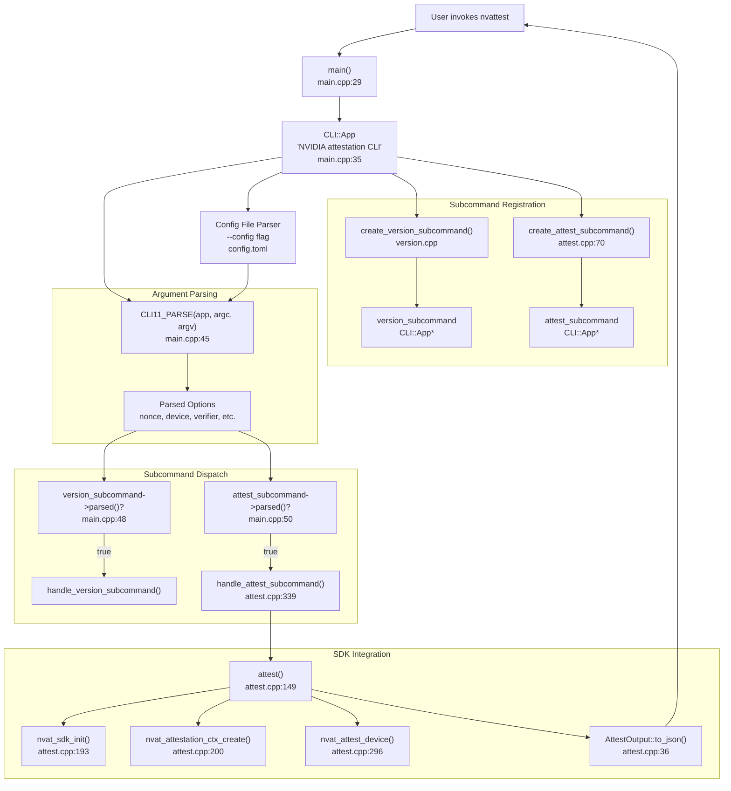
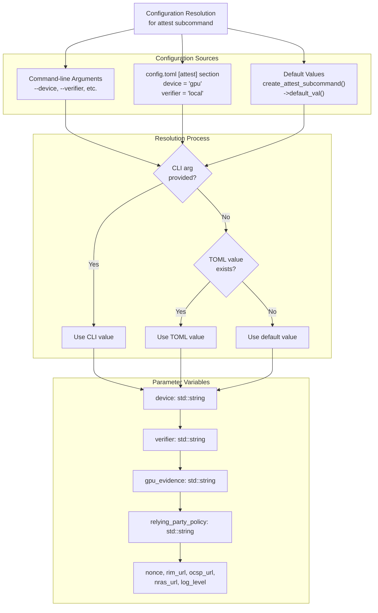
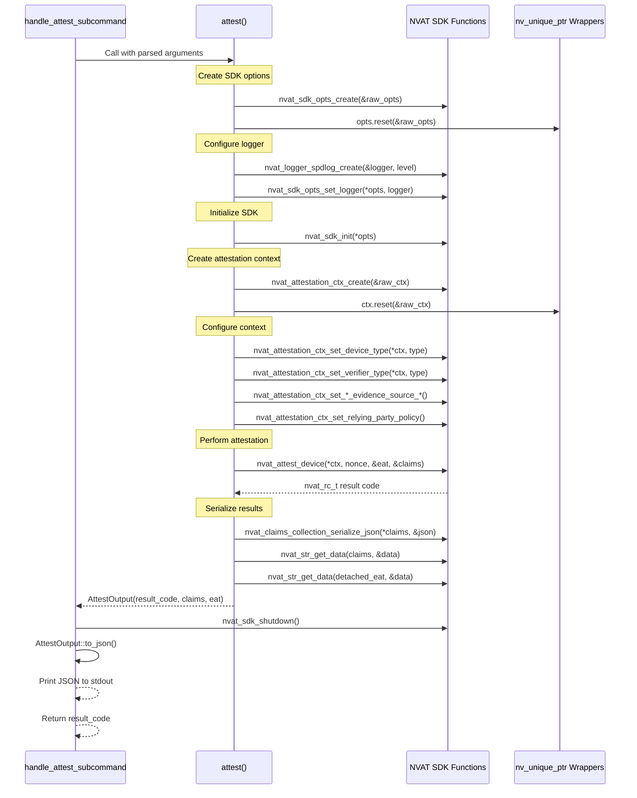

<!-- source: DeepWiki mcp.deepwiki.com · repo NVIDIA/attestation-sdk · page 4 Using the CLI · fetched 2026-10-26 -->

# Using the CLI

<details>
<summary>Relevant source files</summary>

The following files were used as context for generating this wiki page:

- [nv-attestation-cli/config.toml](nv-attestation-cli/config.toml)
- [nv-attestation-cli/src/attest.cpp](nv-attestation-cli/src/attest.cpp)
- [nv-attestation-cli/src/main.cpp](nv-attestation-cli/src/main.cpp)

</details>


## Purpose and Scope

This document provides a comprehensive guide to the `nvattest` command-line interface tool. The CLI wraps the NVIDIA Attestation SDK (nv-attestation-sdk-cpp) to provide device attestation functionality through a simple command-line interface. This page covers the overall CLI structure, invocation patterns, and configuration mechanisms.

For detailed information about specific topics, see:
- Command structure and available subcommands: [CLI Command Structure](#4.1)
- Complete attest subcommand documentation: [Attest Command Reference](#4.2)
- Configuration file format and options: [Configuration Files](#4.3)
- JSON output structure and result codes: [Output Format](#4.4)
- Core attestation concepts: [Attestation Concepts](#5)

## CLI Overview

The `nvattest` tool is a C++ application that provides a command-line interface for device attestation operations. It supports attestation of NVIDIA GPUs and switches through two primary subcommands:
- `attest` - Performs device attestation and returns structured results
- `version` - Displays version information

The CLI is built using the CLI11 library and integrates directly with the nvat SDK through C API bindings defined in `nvat.h`.

Sources: [nv-attestation-cli/src/main.cpp:29-58]()

## CLI Application Structure

The following diagram shows how the CLI application is structured and how command-line arguments flow through the system to SDK calls:



**CLI Application Flow from Entry Point to SDK**

The application initializes a `CLI::App` instance with configuration file support, registers subcommands through factory functions (`create_version_subcommand`, `create_attest_subcommand`), parses arguments using `CLI11_PARSE`, dispatches to the appropriate handler function, and returns JSON-formatted results.

Sources: [nv-attestation-cli/src/main.cpp:29-58](), [nv-attestation-cli/src/attest.cpp:70-106](), [nv-attestation-cli/src/attest.cpp:339-357]()

## Command Invocation

The basic invocation pattern for `nvattest` follows standard CLI conventions:

```
nvattest [global-options] <subcommand> [subcommand-options]
```

### Global Options

The CLI supports one global option that applies across all subcommands:

| Option | Description | Default |
|--------|-------------|---------|
| `--config <file>` | Path to TOML configuration file | `config.toml` |

Sources: [nv-attestation-cli/src/main.cpp:36]()

### Subcommands

| Subcommand | Purpose | Handler Function |
|------------|---------|------------------|
| `attest` | Run device attestation | `handle_attest_subcommand()` |
| `version` | Display version information | `handle_version_subcommand()` |

When invoked without a subcommand, the CLI displays help information.

Sources: [nv-attestation-cli/src/main.cpp:42-55]()

## Configuration Precedence

The CLI uses a layered configuration system where options can be specified in multiple locations. The precedence order (highest to lowest) is:

1. **Command-line arguments** - Explicitly provided via flags
2. **Configuration file** - Values from `config.toml` or custom config file
3. **Default values** - Built-in defaults from subcommand definitions

The following diagram illustrates how configuration values are resolved:



**Configuration Value Resolution Process**

The CLI11 library handles configuration precedence automatically. When `CLI11_PARSE` is invoked, it first reads the configuration file (if specified), then processes command-line arguments which override config file values.

Sources: [nv-attestation-cli/src/main.cpp:36-45](), [nv-attestation-cli/src/attest.cpp:70-106](), [nv-attestation-cli/config.toml:1-13]()

## Basic Usage Examples

### Attest a GPU (Local Verification)

```bash
nvattest attest --device gpu --verifier local
```

This invokes `handle_attest_subcommand()` which creates an attestation context, sets device type to `NVAT_DEVICE_GPU`, configures local verification, and calls `nvat_attest_device()`.

### Attest a GPU with Custom Policy

```bash
nvattest attest --device gpu --verifier local \
  --relying-party-policy /path/to/policy.rego
```

The policy file is loaded in `set_relying_party_policy()` at [attest.cpp:115-146]() and applied via `nvat_attestation_ctx_set_relying_party_policy()`.

### Attest Using Pre-Collected Evidence

```bash
nvattest attest --device gpu --verifier local \
  --gpu-evidence /path/to/evidence.json
```

This uses file-based evidence instead of querying hardware. The evidence source is configured via `nvat_attestation_ctx_set_gpu_evidence_source_json_file()` at [attest.cpp:217-221]().

### Remote Verification with Custom Endpoints

```bash
nvattest attest --device nvswitch --verifier remote \
  --rim-url https://custom-rim.example.com \
  --ocsp-url https://custom-ocsp.example.com \
  --nras-url https://custom-nras.example.com
```

Service URLs are configured through SDK functions `nvat_rim_store_create_remote()`, `nvat_ocsp_client_create_default()`, and environment variable `NVAT_NRAS_BASE_URL` at [attest.cpp:231-265]().

### Using Configuration File

```bash
nvattest --config /path/to/custom-config.toml attest
```

The configuration file follows TOML format with sections corresponding to subcommands. See [Configuration Files](#4.3) for format details.

Sources: [nv-attestation-cli/src/attest.cpp:149-357]()

## SDK Integration Pattern

The CLI's integration with the SDK follows a consistent pattern for all operations:



**SDK Function Call Pattern**

The `attest()` function demonstrates the standard pattern for SDK integration: create options, initialize SDK, create context, configure context parameters, execute operation, retrieve results, and shutdown. The `nv_unique_ptr` wrapper (defined in SDK headers) provides RAII-based resource management for SDK objects.

Sources: [nv-attestation-cli/src/attest.cpp:149-357]()

## Return Codes and Error Handling

The CLI returns exit codes that correspond to `nvat_rc_t` values from the SDK. The primary result codes are:

| Exit Code | Name | Meaning |
|-----------|------|---------|
| 0 | `NVAT_RC_OK` | Attestation succeeded |
| Non-zero | Various error codes | Attestation failed or error occurred |

When errors occur during attestation, the `attest()` function returns an `AttestOutput` object containing the error code. This is converted to JSON and printed to stdout before the application exits with the error code.

The function handles three special cases that still produce output:
- `NVAT_RC_OK` - Success
- `NVAT_RC_RP_POLICY_MISMATCH` - Policy evaluation failed
- `NVAT_RC_OVERALL_RESULT_FALSE` - Overall attestation result is false

These cases return claims and EAT data even though attestation did not fully succeed. All other error codes return immediately without claims or EAT data.

Sources: [nv-attestation-cli/src/attest.cpp:30-68](), [nv-attestation-cli/src/attest.cpp:296-334](), [nv-attestation-cli/src/attest.cpp:339-357]()

## Logging and Diagnostics

The CLI supports configurable logging through the `--log-level` option. Log levels map to `nvat_log_level_t` values:

| CLI Value | SDK Constant | Description |
|-----------|--------------|-------------|
| `trace` | `NVAT_LOG_LEVEL_TRACE` | Most verbose |
| `debug` | `NVAT_LOG_LEVEL_DEBUG` | Debug information |
| `info` | `NVAT_LOG_LEVEL_INFO` | Informational messages |
| `warn` | `NVAT_LOG_LEVEL_WARN` | Warnings (default) |
| `error` | `NVAT_LOG_LEVEL_ERROR` | Errors only |
| `off` | `NVAT_LOG_LEVEL_OFF` | No logging |

The logger is created via `nvat_logger_spdlog_create()` and attached to the SDK options before initialization. This enables diagnostic output from both CLI and SDK operations.

Sources: [nv-attestation-cli/src/attest.cpp:172-189](), [nv-attestation-cli/src/attest.cpp:102-104](), [nv-attestation-cli/src/main.cpp:30-33]()

## Configuration File Format

The CLI supports TOML configuration files for persistent option storage. The configuration file is organized into sections corresponding to subcommands:

```toml
# Global section for application-wide settings
[default]

# Version subcommand configuration
[version]

# Attest subcommand configuration  
[attest]
device = "gpu"
verifier = "local"
gpu-evidence = ""
switch-evidence = ""
relying-party-policy = ""
```

Each option in the `[attest]` section corresponds to a command-line flag. When both are present, command-line arguments take precedence.

Sources: [nv-attestation-cli/config.toml:1-13]()

## Next Steps

For more detailed information about using the CLI, see:
- [CLI Command Structure](#4.1) - Detailed command structure and argument parsing
- [Attest Command Reference](#4.2) - Complete reference for all attest options
- [Configuration Files](#4.3) - Full configuration file format specification
- [Output Format](#4.4) - Understanding JSON output structure and result codes

---

