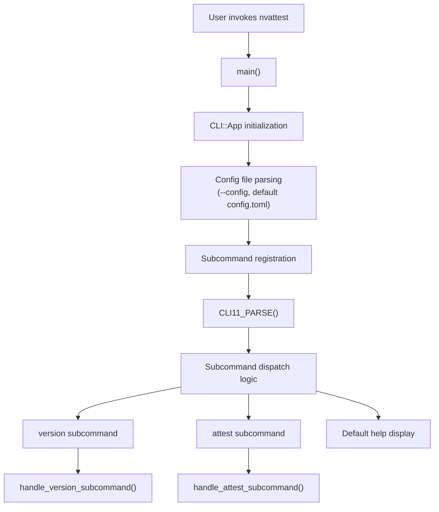
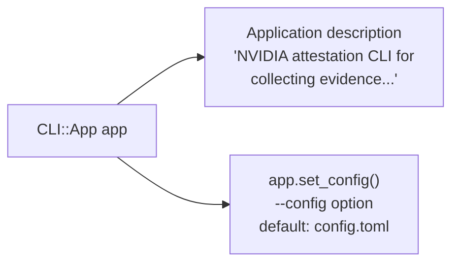
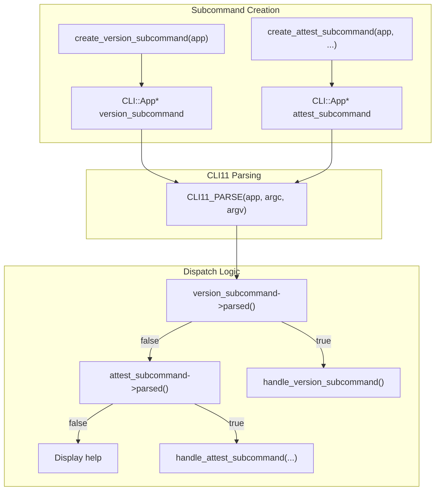
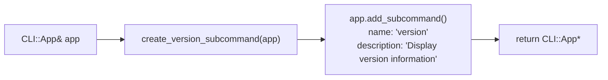
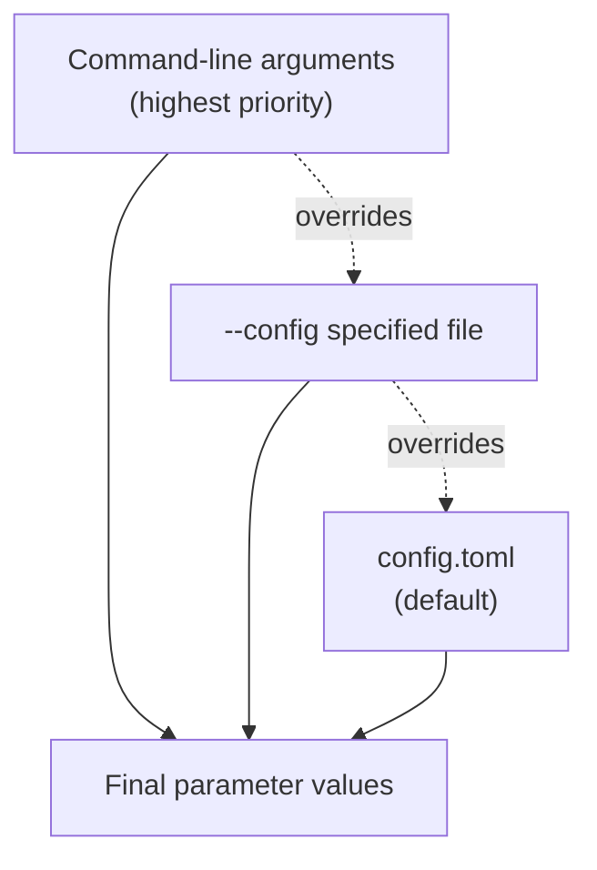
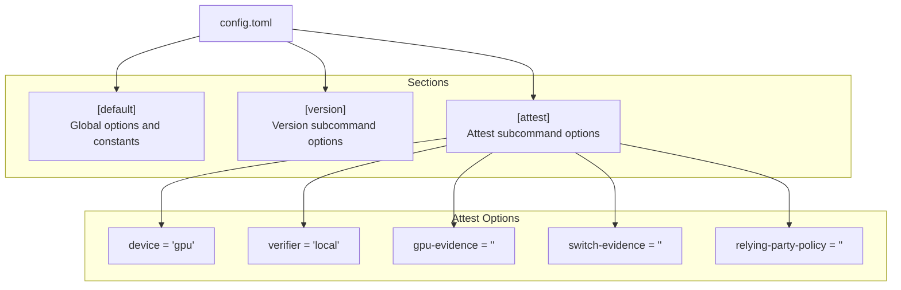
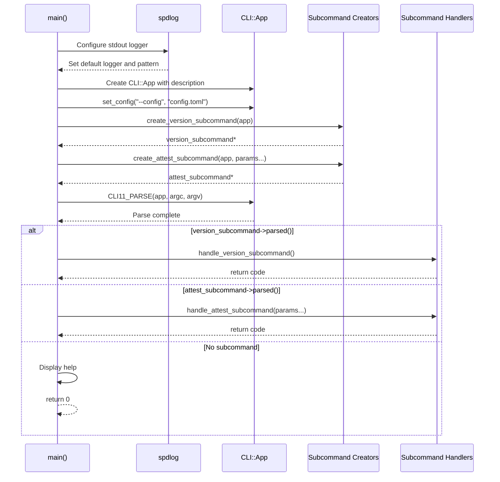

<!-- source: DeepWiki mcp.deepwiki.com · repo NVIDIA/attestation-sdk · page 4.1 CLI Command Structure · fetched 2026-10-26 -->

# CLI Command Structure

<details>
<summary>Relevant source files</summary>

The following files were used as context for generating this wiki page:

- [nv-attestation-cli/config.toml](nv-attestation-cli/config.toml)
- [nv-attestation-cli/src/main.cpp](nv-attestation-cli/src/main.cpp)
- [nv-attestation-cli/src/version.cpp](nv-attestation-cli/src/version.cpp)

</details>


## Purpose and Scope

This document describes the overall structure of the `nvattest` command-line interface, including its subcommand architecture, configuration file support, and program flow. For detailed documentation of the `attest` subcommand parameters, see [Attest Command Reference](#4.2). For configuration file format and options, see [Configuration Files](#4.3). For version information handling, see [Version Information](#8.1).

## Overview

The `nvattest` CLI is built on the CLI11 library and provides a subcommand-based interface for NVIDIA device attestation. The tool supports two modes of configuration: command-line arguments and TOML configuration files, with command-line arguments taking precedence over file-based configuration.



**Sources:** [nv-attestation-cli/src/main.cpp:29-58]()

## Command Line Structure

### Basic Invocation

The `nvattest` command follows this general structure:

```
nvattest [--config FILE] <subcommand> [subcommand-options]
```

Where:
- `--config FILE` is an optional global option to specify a configuration file (defaults to `config.toml`)
- `<subcommand>` is either `version` or `attest`
- `[subcommand-options]` are options specific to the chosen subcommand

### CLI11 Application Setup

The main entry point initializes a `CLI::App` object with a description and configuration file support:



**Sources:** [nv-attestation-cli/src/main.cpp:35-36]()

The application description clearly states its purpose: "NVIDIA attestation CLI for collecting evidence and verifying device integrity in confidential computing environments".

## Subcommand Architecture

### Subcommand Registration

The CLI implements two subcommands, each with its own creation function that registers the subcommand with the parent `CLI::App`:

| Subcommand | Creation Function | Handler Function | Purpose |
|------------|------------------|------------------|---------|
| `version` | `create_version_subcommand()` | `handle_version_subcommand()` | Display version information |
| `attest` | `create_attest_subcommand()` | `handle_attest_subcommand()` | Perform device attestation |



**Sources:** [nv-attestation-cli/src/main.cpp:42-55]()

### Version Subcommand

The `version` subcommand is the simplest, requiring no additional parameters:



**Sources:** [nv-attestation-cli/src/version.cpp:24-26]()

The handler simply outputs version information using the configured logger:

```cpp
handle_version_subcommand() -> SPDLOG_INFO("nvattest {version} ({system}/{processor})")
```

### Attest Subcommand

The `attest` subcommand is more complex, accepting multiple parameters that configure the attestation process. The creation function accepts string references that will be populated by CLI11 during parsing:

**Parameters passed to `create_attest_subcommand()`:**
- `nonce` - Cryptographic nonce for attestation freshness
- `device` - Device type (gpu/nvswitch)
- `verifier` - Verification mode (local/remote)
- `gpu_evidence` - Path to GPU evidence file
- `switch_evidence` - Path to switch evidence file
- `relying_party_policy` - Path to custom policy file
- `rim_url` - Reference Integrity Manifest service URL
- `ocsp_url` - OCSP service URL
- `nras_url` - NRAS service URL
- `log_level` - Logging verbosity

These parameters are then forwarded to the handler during dispatch.

**Sources:** [nv-attestation-cli/src/main.cpp:39-51]()

## Configuration File Support

### Configuration Priority

The CLI supports configuration through TOML files via CLI11's built-in configuration support. Configuration values can be specified in multiple ways, with the following priority (highest to lowest):

1. **Command-line arguments** - Direct flags override everything
2. **Specified configuration file** - `--config custom.toml`
3. **Default configuration file** - `config.toml` in the current directory



**Sources:** [nv-attestation-cli/src/main.cpp:36]()

### Configuration File Structure

The configuration file uses TOML format with sections corresponding to subcommands:



**Sources:** [nv-attestation-cli/config.toml:1-13]()

The default `config.toml` includes comments explaining the structure:
- The `[default]` section holds global options applicable to all subcommands
- Each subcommand has its own section (e.g., `[version]`, `[attest]`)
- Options in subcommand sections map directly to command-line flags

## Program Flow

### Main Function Execution

The `main()` function follows a structured initialization and dispatch pattern:



**Sources:** [nv-attestation-cli/src/main.cpp:29-58]()

### Logging Configuration

Before any CLI processing, the main function configures logging using spdlog:

1. Creates a stdout logger named "console"
2. Sets it as the default logger
3. Configures the pattern to `"%v"` (value only, no metadata)

This ensures that all output from the CLI uses consistent formatting.

**Sources:** [nv-attestation-cli/src/main.cpp:30-33]()

### Dispatch Mechanism

The dispatch logic uses CLI11's `parsed()` method to determine which subcommand was invoked:

```cpp
if (version_subcommand->parsed()) {
    return handle_version_subcommand();
} else if (attest_subcommand->parsed()) {
    return handle_attest_subcommand(nonce, device, verifier, ...);
} else {
    // Display help if no subcommand provided
    std::cout << app.help() << std::endl;
}
```

This pattern allows for:
- Clear separation between subcommand logic
- Easy addition of new subcommands
- Default help display when no subcommand is specified

**Sources:** [nv-attestation-cli/src/main.cpp:48-55]()

## Extension Points

The current architecture is designed for extensibility. To add a new subcommand:

1. Create a `create_<subcommand>_subcommand()` function that registers the subcommand with `CLI::App`
2. Implement a `handle_<subcommand>_subcommand()` function with the command logic
3. Add the creation call in `main()`
4. Add the dispatch check in the if-else chain
5. Add a corresponding section in `config.toml` for default values

**Sources:** [nv-attestation-cli/src/main.cpp:42-55](), [nv-attestation-cli/config.toml:1-13]()

---

