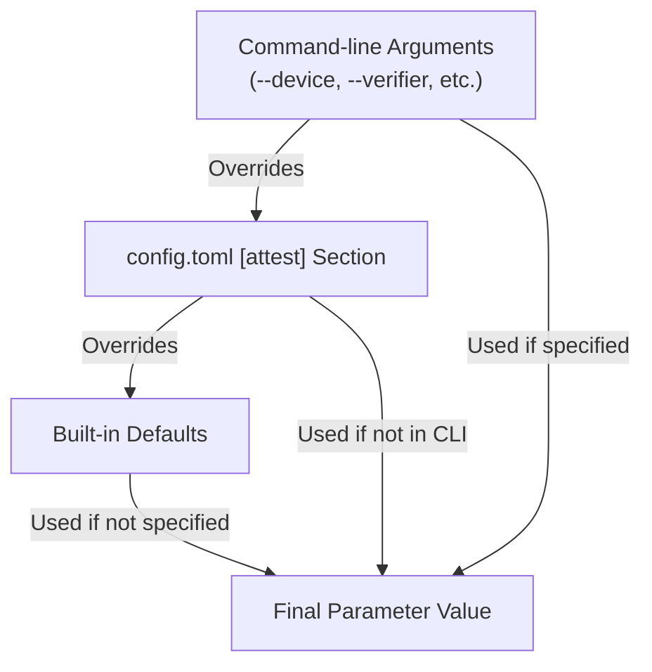
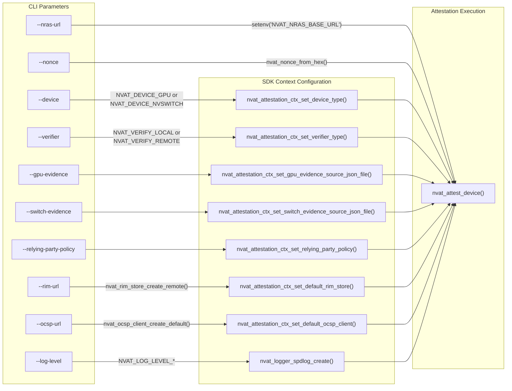
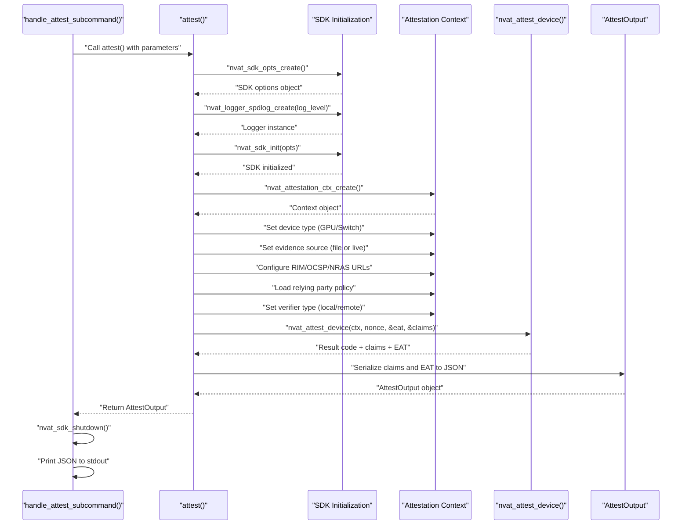
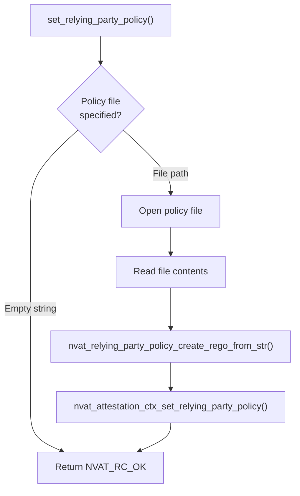
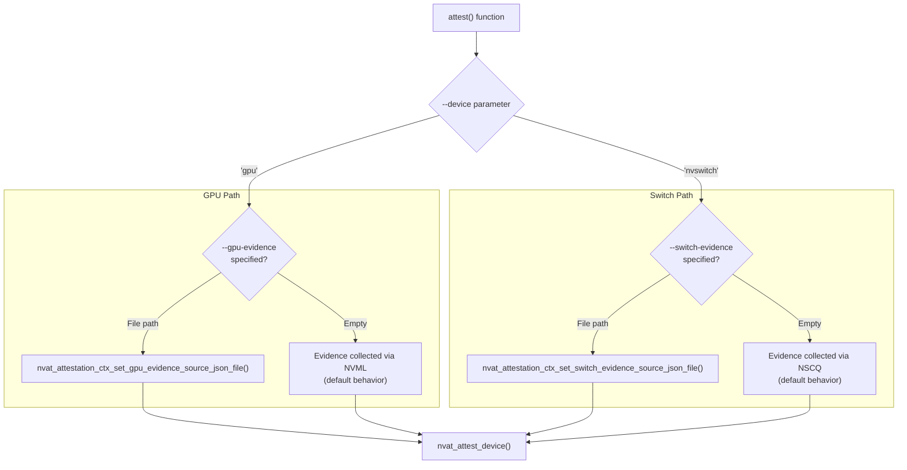
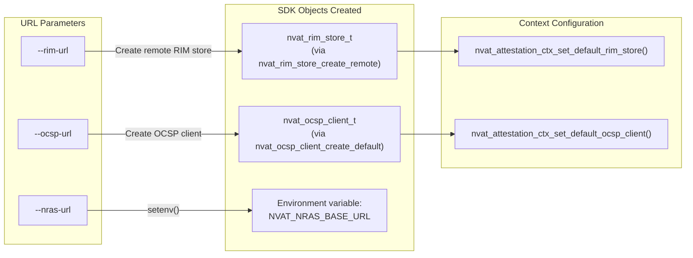
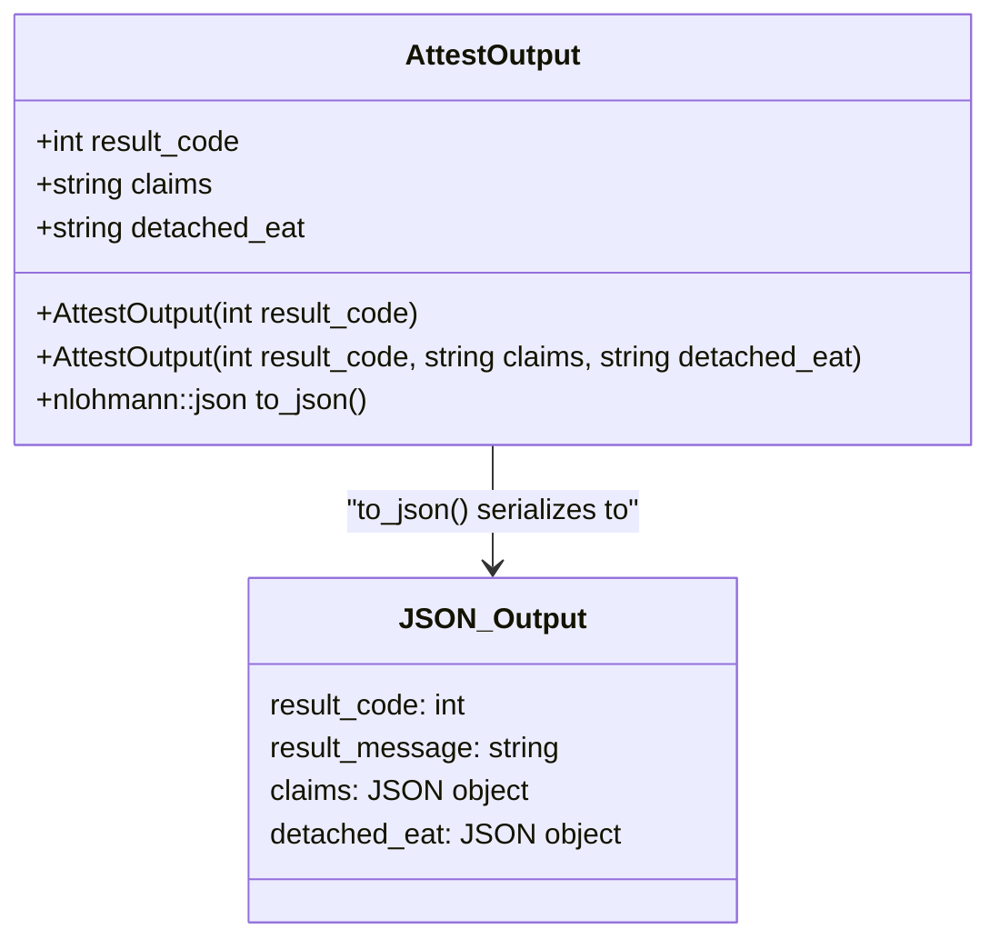

<!-- source: DeepWiki mcp.deepwiki.com · repo NVIDIA/attestation-sdk · page 4.2 Attest Command Reference · fetched 2026-10-26 -->

# Attest Command Reference

<details>
<summary>Relevant source files</summary>

The following files were used as context for generating this wiki page:

- [nv-attestation-cli/config.toml](nv-attestation-cli/config.toml)
- [nv-attestation-cli/src/attest.cpp](nv-attestation-cli/src/attest.cpp)
- [nv-attestation-cli/src/attest.h](nv-attestation-cli/src/attest.h)

</details>


## Purpose and Scope

This page provides comprehensive reference documentation for the `attest` subcommand of the `nvattest` CLI tool. The `attest` command performs device attestation by collecting hardware evidence, verifying it against reference measurements, and evaluating relying party policies to produce attestation claims.

For information about the overall CLI structure and global options, see [CLI Command Structure](#4.1). For details on how to configure the CLI using `config.toml`, see [Configuration Files](#4.3). For documentation of the JSON output format, see [Output Format](#4.4). To understand the underlying attestation workflow, see [Device Attestation Flow](#5.1).

**Sources:** [nv-attestation-cli/src/attest.h:44-71](), [nv-attestation-cli/src/attest.cpp:70-106]()

---

## Command Syntax

```bash
nvattest attest [OPTIONS]
```

The `attest` subcommand performs device attestation and outputs results as JSON to stdout. All parameters are optional and have default values that can be overridden via command-line arguments or the configuration file.

**Sources:** [nv-attestation-cli/src/attest.cpp:83]()

---

## Parameters Reference

The following table lists all parameters supported by the `attest` subcommand:

| Parameter | Type | Valid Values | Default | Description |
|-----------|------|--------------|---------|-------------|
| `--nonce` | String (hex) | Valid hex string | Auto-generated | Nonce for the attestation in hexadecimal format. If not provided, a nonce is generated automatically. |
| `--device` | String | `gpu`, `nvswitch` | `gpu` | Device type to attest. Controls which device-specific evidence collection and verification logic is used. |
| `--verifier` | String | `local`, `remote` | `local` | Verifier type. Local performs verification using the SDK's built-in verifier. Remote uses NVIDIA Remote Attestation Service (NRAS). |
| `--gpu-evidence` | File path | Valid file path | Empty | Path to a JSON file containing pre-collected GPU evidence. When specified, NVML is not called. Used primarily for testing. |
| `--switch-evidence` | File path | Valid file path | Empty | Path to a JSON file containing pre-collected Switch evidence. When specified, NSCQ is not called. Used primarily for testing. |
| `--relying-party-policy` | File path | Valid file path | Empty | Path to a Rego policy file that defines the relying party's requirements. If not specified, no custom policy is applied. |
| `--rim-url` | URL | Valid URL | `https://rim.attestation.nvidia.com` | Base URL for the NVIDIA Reference Integrity Manifest (RIM) service used to fetch reference measurements. |
| `--ocsp-url` | URL | Valid URL | `https://ocsp.ndis.nvidia.com` | Base URL for the OCSP (Online Certificate Status Protocol) responder used to verify certificate revocation status. |
| `--nras-url` | URL | Valid URL | `https://nras.attestation.nvidia.com` | Base URL for the NVIDIA Remote Attestation Service (NRAS) used when `--verifier remote` is specified. |
| `--log-level` | String | `trace`, `debug`, `info`, `warn`, `error`, `off` | `warn` | Logging verbosity level for diagnostic output. |

**Sources:** [nv-attestation-cli/src/attest.cpp:84-104](), [nv-attestation-cli/config.toml:8-13]()

---

## Configuration Precedence

Parameter values are resolved using the following precedence order (highest to lowest):



**Configuration Cascade Behavior:**

1. **Command-line arguments** take precedence over all other sources
2. **config.toml values** are used if the parameter is not specified on the command line
3. **Default values** are used if the parameter is not specified in either location

For example, if `config.toml` contains `verifier = "remote"` but the user runs `nvattest attest --verifier local`, the local verifier will be used.

**Sources:** [nv-attestation-cli/src/attest.cpp:70-106](), [nv-attestation-cli/config.toml:8-13]()

---

## Parameter to SDK Mapping

The following diagram shows how `attest` command parameters are mapped to SDK API calls:



**Sources:** [nv-attestation-cli/src/attest.cpp:149-336]()

---

## Execution Flow

The `handle_attest_subcommand()` function orchestrates the attestation process by configuring the SDK context and invoking the attestation API:



**Sources:** [nv-attestation-cli/src/attest.cpp:149-336](), [nv-attestation-cli/src/attest.cpp:339-358]()

---

## Implementation Details

### Core Functions

The attest subcommand implementation consists of three main functions:

1. **`create_attest_subcommand()`** [nv-attestation-cli/src/attest.cpp:70-106]()
   - Creates the CLI11 subcommand object
   - Defines all command-line options with validators and default values
   - Registers the subcommand with the main CLI application

2. **`attest()`** [nv-attestation-cli/src/attest.cpp:149-336]()
   - Core attestation logic that interfaces with the SDK
   - Creates and configures the attestation context
   - Invokes `nvat_attest_device()` and handles results
   - Returns an `AttestOutput` object containing the attestation results

3. **`handle_attest_subcommand()`** [nv-attestation-cli/src/attest.cpp:339-358]()
   - Entry point called when the attest subcommand is invoked
   - Calls `attest()` with parsed parameters
   - Shuts down the SDK
   - Serializes output to JSON and prints to stdout

### Relying Party Policy Loading

The `set_relying_party_policy()` helper function [nv-attestation-cli/src/attest.cpp:115-146]() handles loading custom policies:



**Sources:** [nv-attestation-cli/src/attest.cpp:115-146]()

---

## Usage Examples

### Basic GPU Attestation (Local Verification)

```bash
nvattest attest --device gpu --verifier local
```

This performs attestation on the local GPU using the built-in local verifier. Evidence is collected via NVML.

### Switch Attestation (Remote Verification)

```bash
nvattest attest --device nvswitch --verifier remote
```

This performs attestation on an NVSwitch device using NVIDIA's remote attestation service. Evidence is collected via NSCQ.

### Using Pre-Collected Evidence

```bash
nvattest attest --device gpu --gpu-evidence /path/to/hopper_evidence.json --verifier local
```

This attests using evidence from a JSON file instead of querying hardware. Useful for testing and offline scenarios.

### Custom Relying Party Policy

```bash
nvattest attest --device gpu --verifier local --relying-party-policy /path/to/policy.rego
```

This applies a custom Rego policy to the attestation claims. The policy defines acceptance criteria for the attestation.

### Custom Service URLs

```bash
nvattest attest \
  --device gpu \
  --verifier remote \
  --rim-url https://custom-rim.example.com \
  --ocsp-url https://custom-ocsp.example.com \
  --nras-url https://custom-nras.example.com
```

This overrides the default service URLs with custom endpoints. Useful for enterprise deployments or testing environments.

### With Custom Nonce

```bash
nvattest attest --nonce 0123456789abcdef --device gpu --verifier local
```

This provides a specific nonce (in hexadecimal format) instead of using an auto-generated one. The nonce is included in the attestation evidence.

### Debug Logging

```bash
nvattest attest --device gpu --verifier local --log-level debug
```

This enables detailed debug logging to help troubleshoot attestation issues.

**Sources:** [nv-attestation-cli/src/attest.cpp:70-106]()

---

## Device-Specific Evidence Sources

The following diagram illustrates how the `--device`, `--gpu-evidence`, and `--switch-evidence` parameters control evidence collection:



**Sources:** [nv-attestation-cli/src/attest.cpp:204-228]()

---

## Return Codes

The `attest` command returns an integer exit code indicating the attestation result:

| Return Code | Symbolic Name | Meaning |
|-------------|---------------|---------|
| 0 | `NVAT_RC_OK` | Attestation succeeded. Device is trusted and policy matched. |
| 2 | `NVAT_RC_RP_POLICY_MISMATCH` | Attestation completed but relying party policy did not match. Claims are still generated. |
| 3 | `NVAT_RC_OVERALL_RESULT_FALSE` | Attestation completed but verification failed. Claims indicate failure reason. |
| Other | Various error codes | An error occurred during attestation. See `result_message` in JSON output for details. |

The full list of error codes and their meanings is documented in [Error Codes and Handling](#8.2).

**Exit Behavior:**

The command always outputs a JSON structure to stdout (see [Output Format](#4.4)) and returns the result code as the process exit code. Even when attestation fails, the JSON structure is produced with `result_code` and `result_message` fields populated. When `result_code` is 0, 2, or 3, the `claims` and `detached_eat` fields contain the attestation data.

**Sources:** [nv-attestation-cli/src/attest.cpp:296-299](), [nv-attestation-cli/src/attest.cpp:36-68](), [nv-attestation-cli/src/attest.cpp:339-358]()

---

## Service URL Configuration

The RIM, OCSP, and NRAS service URLs can be configured to point to custom endpoints:



**Implementation Details:**

- **RIM URL** [nv-attestation-cli/src/attest.cpp:231-244](): Creates a remote RIM store using `nvat_rim_store_create_remote()` and configures it on the context.
- **OCSP URL** [nv-attestation-cli/src/attest.cpp:246-259](): Creates an OCSP client using `nvat_ocsp_client_create_default()` and configures it on the context.
- **NRAS URL** [nv-attestation-cli/src/attest.cpp:261-265](): Sets the `NVAT_NRAS_BASE_URL` environment variable which is used internally by remote verifiers.

**Sources:** [nv-attestation-cli/src/attest.cpp:231-265]()

---

## AttestOutput Structure

The `AttestOutput` class [nv-attestation-cli/src/attest.h:33-42]() encapsulates attestation results:



**Serialization Logic** [nv-attestation-cli/src/attest.cpp:36-68]():

1. Creates a base JSON object with `result_code` and `result_message`
2. If `result_code` is 0, 2, or 3, parses `claims` and `detached_eat` strings as JSON
3. On parse error, logs the error and uses empty JSON objects
4. Returns the complete JSON structure

**Sources:** [nv-attestation-cli/src/attest.h:33-42](), [nv-attestation-cli/src/attest.cpp:30-68]()

---

