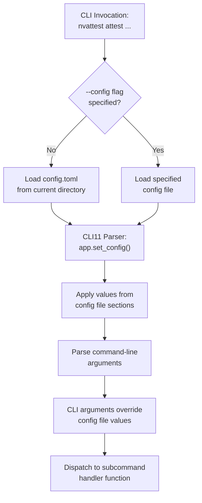
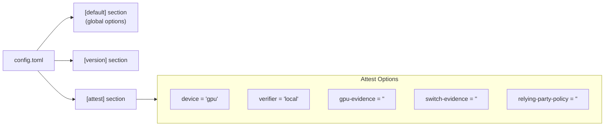
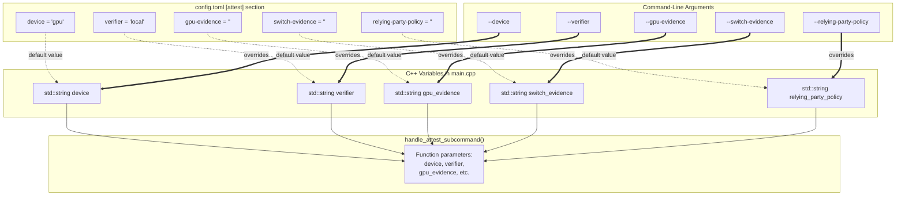

<!-- source: DeepWiki mcp.deepwiki.com · repo NVIDIA/attestation-sdk · page 4.3 Configuration Files · fetched 2026-10-26 -->

# Configuration Files

<details>
<summary>Relevant source files</summary>

The following files were used as context for generating this wiki page:

- [nv-attestation-cli/config.toml](nv-attestation-cli/config.toml)
- [nv-attestation-cli/src/main.cpp](nv-attestation-cli/src/main.cpp)

</details>


## Purpose and Scope

This document describes the `config.toml` configuration file format used by the `nvattest` CLI tool. Configuration files provide a convenient way to specify default values for command-line options without requiring them to be passed on every invocation.

For information about the command-line arguments themselves, see [Attest Command Reference](#4.2). For details about output interpretation, see [Output Format](#4.4).

## Configuration File Overview

The `nvattest` CLI tool supports TOML-formatted configuration files to specify default values for command-line options. When a configuration file is present, its values serve as defaults that can be overridden by explicit command-line arguments.

**Default Configuration File**: The CLI automatically looks for a file named `config.toml` in the current working directory. Users can specify an alternative configuration file using the `--config` flag.

**Sources**: [nv-attestation-cli/src/main.cpp:36](), [nv-attestation-cli/config.toml:1-13]()

## Configuration Loading Mechanism



**Diagram**: Configuration Loading Process

The configuration loading process follows these steps:

1. **Configuration File Discovery**: The CLI11 framework checks for a configuration file. If `--config` is not specified, it defaults to `config.toml` in the current directory.

2. **TOML Parsing**: The `CLI::App::set_config()` method registers the configuration file with the CLI11 parser [nv-attestation-cli/src/main.cpp:36]().

3. **Default Application**: Configuration values are applied as defaults for their corresponding command-line options.

4. **Argument Parsing**: Command-line arguments are parsed and override any values loaded from the configuration file.

5. **Subcommand Dispatch**: The final merged configuration is passed to the appropriate subcommand handler (e.g., `handle_attest_subcommand()`).

**Sources**: [nv-attestation-cli/src/main.cpp:29-58]()

## Configuration File Structure

The configuration file uses TOML syntax and is organized into sections that correspond to CLI subcommands. Each section contains key-value pairs for the options available to that subcommand.



**Diagram**: Configuration File Structure

### Section Mapping

| Configuration Section | CLI Subcommand | Purpose |
|----------------------|----------------|---------|
| `[default]` | All subcommands | Global options and application-wide constants |
| `[version]` | `nvattest version` | Options for version information display |
| `[attest]` | `nvattest attest` | Options for device attestation operations |

**Sources**: [nv-attestation-cli/config.toml:1-13]()

## Configuration Options Reference

### Default Section

The `[default]` section is intended for global options that apply across all subcommands. While the current implementation does not define specific options in this section, it serves as a placeholder for future application-wide configuration values.

```toml
[default]
# Global options and constants would be defined here
```

**Sources**: [nv-attestation-cli/config.toml:1-3]()

### Version Section

The `[version]` section corresponds to the `nvattest version` subcommand. Currently, this section has no configurable options, as the version subcommand accepts no parameters.

```toml
[version]
# No configurable options
```

**Sources**: [nv-attestation-cli/config.toml:5-6]()

### Attest Section

The `[attest]` section contains configuration options for the attestation subcommand. These options control device selection, verification mode, evidence sources, and policy enforcement.

```toml
[attest]
device = "gpu"
verifier = "local"
gpu-evidence = ""
switch-evidence = ""
relying-party-policy = ""
```

**Sources**: [nv-attestation-cli/config.toml:8-13]()

#### Attest Configuration Options

| Option | Type | Default Value | Description |
|--------|------|---------------|-------------|
| `device` | string | `"gpu"` | Device type to attest. Valid values: `"gpu"`, `"nvswitch"` |
| `verifier` | string | `"local"` | Verification mode. Valid values: `"local"`, `"remote"` |
| `gpu-evidence` | string | `""` (empty) | Path to a JSON file containing pre-collected GPU evidence. When empty, evidence is collected from live hardware using NVML |
| `switch-evidence` | string | `""` (empty) | Path to a JSON file containing pre-collected NVSwitch evidence. When empty, evidence is collected from live hardware using NSCQ |
| `relying-party-policy` | string | `""` (empty) | Path to a custom Rego policy file for attestation verification. When empty, a default policy is used |

Additional options that can be specified in the configuration file (though not present in the default `config.toml`):

| Option | Type | Default | Description |
|--------|------|---------|-------------|
| `nonce` | string | Auto-generated | Custom nonce value for attestation freshness |
| `rim-url` | string | NVIDIA default | URL for Reference Integrity Manifest service (remote verifier only) |
| `ocsp-url` | string | NVIDIA default | URL for OCSP certificate status service (remote verifier only) |
| `nras-url` | string | NVIDIA default | URL for NVIDIA Remote Attestation Service (remote verifier only) |
| `log-level` | string | `"info"` | Logging verbosity level |

**Sources**: [nv-attestation-cli/src/main.cpp:39-43](), [nv-attestation-cli/config.toml:8-13]()

## Configuration and CLI Argument Mapping



**Diagram**: Configuration Value Flow from Config File to Handler Function

The diagram illustrates the precedence mechanism:
- Dotted lines represent default values loaded from the configuration file
- Solid arrows represent command-line argument overrides
- Configuration file values are used only when corresponding CLI arguments are not provided

**Sources**: [nv-attestation-cli/src/main.cpp:39-51]()

## Precedence and Override Behavior

The CLI11 framework implements a clear precedence order for configuration values:

1. **Command-line arguments** (highest precedence): Values explicitly provided via command-line flags always take precedence.

2. **Configuration file values** (middle precedence): Values specified in the TOML configuration file are used when no command-line argument is provided.

3. **Built-in defaults** (lowest precedence): If neither command-line arguments nor configuration file values are provided, the built-in defaults are used.

### Practical Example

Given this configuration file:

```toml
[attest]
device = "nvswitch"
verifier = "remote"
```

Different invocations produce different effective configurations:

| Command | Effective `device` | Effective `verifier` |
|---------|-------------------|---------------------|
| `nvattest attest` | `"nvswitch"` (from config) | `"remote"` (from config) |
| `nvattest attest --device gpu` | `"gpu"` (CLI override) | `"remote"` (from config) |
| `nvattest attest --verifier local` | `"nvswitch"` (from config) | `"local"` (CLI override) |
| `nvattest attest --device gpu --verifier local` | `"gpu"` (CLI override) | `"local"` (CLI override) |

**Sources**: [nv-attestation-cli/src/main.cpp:36-51]()

## Configuration File Examples

### Example 1: Basic GPU Attestation with Local Verification

This configuration sets up default behavior for local GPU attestation:

```toml
[attest]
device = "gpu"
verifier = "local"
gpu-evidence = ""
relying-party-policy = ""
```

**Usage**: `nvattest attest` will use these defaults, collecting evidence from local GPU hardware and performing local verification.

### Example 2: NVSwitch with Pre-collected Evidence

This configuration is useful for testing or offline verification scenarios:

```toml
[attest]
device = "nvswitch"
verifier = "local"
switch-evidence = "/path/to/switch_evidence.json"
relying-party-policy = "/path/to/switch_policy.rego"
```

**Usage**: `nvattest attest` will load evidence from the specified file rather than querying hardware.

### Example 3: Remote Verification with Custom Services

This configuration specifies custom service endpoints for remote attestation:

```toml
[attest]
device = "gpu"
verifier = "remote"
rim-url = "https://custom-rim-service.example.com"
ocsp-url = "https://custom-ocsp-service.example.com"
nras-url = "https://custom-nras-service.example.com"
```

**Usage**: `nvattest attest` will use remote verification mode with the specified service URLs.

### Example 4: Development/Testing Configuration

This configuration is optimized for development and testing workflows:

```toml
[attest]
device = "gpu"
verifier = "local"
gpu-evidence = "tests/data/hopper_evidence.json"
relying-party-policy = "tests/data/relying_party_policy.rego"
log-level = "debug"
```

**Usage**: Enables quick testing without hardware access and provides verbose logging for debugging.

**Sources**: [nv-attestation-cli/config.toml:1-13]()

## Configuration File Location Strategies

### Default Location Strategy

The CLI automatically looks for `config.toml` in the current working directory when invoked. This approach works well for:

- Project-specific configurations
- Containerized environments where the working directory is controlled
- Development environments with consistent directory structures

### Explicit Configuration Path

Users can specify a configuration file at any location using the `--config` flag:

```bash
nvattest --config /etc/nvattest/config.toml attest
nvattest --config ~/.config/nvattest.toml attest
```

This approach is useful for:

- System-wide configurations in standard directories like `/etc/`
- User-specific configurations in home directories
- CI/CD pipelines with configuration files in known locations

**Sources**: [nv-attestation-cli/src/main.cpp:36]()

## Integration with CLI11 Framework

The configuration file support is implemented using the CLI11 library's built-in configuration file functionality. The key integration point is:

```cpp
app.set_config("--config", "config.toml", "Read options from a TOML configuration file");
```

This single method call:

1. Registers a `--config` command-line option
2. Sets `config.toml` as the default configuration file name
3. Configures CLI11 to parse TOML format
4. Establishes the precedence mechanism (CLI args override config file)

The CLI11 framework handles all parsing, validation, and merge logic automatically. The application code simply declares variables and binds them to command-line options; CLI11 populates these variables from either the configuration file or command-line arguments as appropriate.

**Sources**: [nv-attestation-cli/src/main.cpp:36]()

## Troubleshooting Configuration Issues

### Configuration File Not Found

If the default `config.toml` is not present in the current directory, the CLI proceeds with built-in defaults. This is not an error condition.

To verify which configuration file is being used:
- Use an explicit `--config` path
- Check the current working directory with `pwd`

### Invalid TOML Syntax

If the configuration file contains syntax errors, CLI11 will report a parsing error. Common issues:

- Missing quotes around string values
- Incorrect section headers (must be `[section_name]`)
- Invalid key names (must match CLI option names)

### Option Name Mismatches

Configuration file keys must exactly match the long-form command-line option names (without the `--` prefix). For example:

- Correct: `relying-party-policy = "policy.rego"`
- Incorrect: `relying_party_policy = "policy.rego"` (underscores instead of hyphens)

### Values Not Taking Effect

If configuration values appear to be ignored, verify:

1. The option is specified in the correct section (e.g., `[attest]` for attestation options)
2. Command-line arguments are not overriding the configuration values
3. The configuration file is being loaded (check with `--config` if using non-default location)

**Sources**: [nv-attestation-cli/src/main.cpp:36-51](), [nv-attestation-cli/config.toml:1-13]()

---

