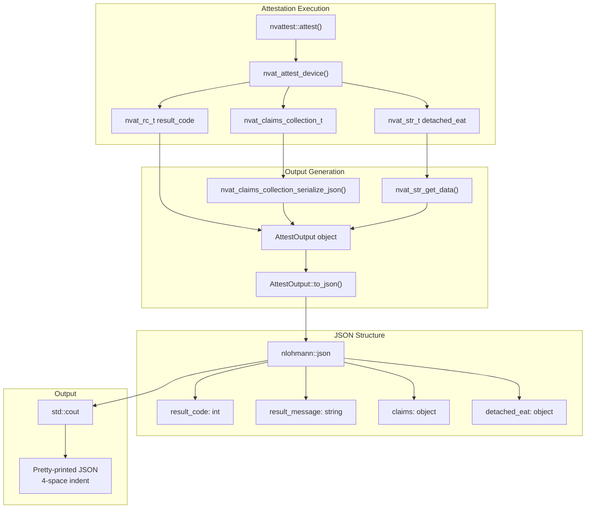
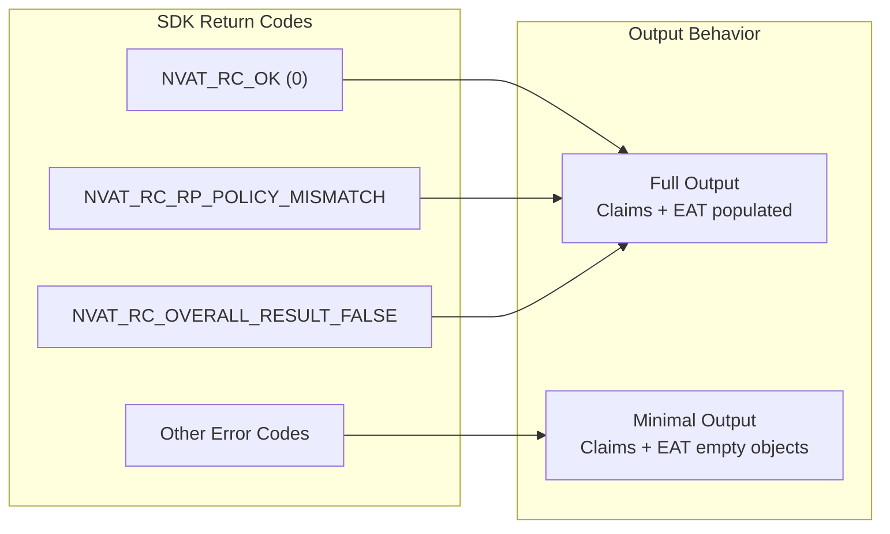
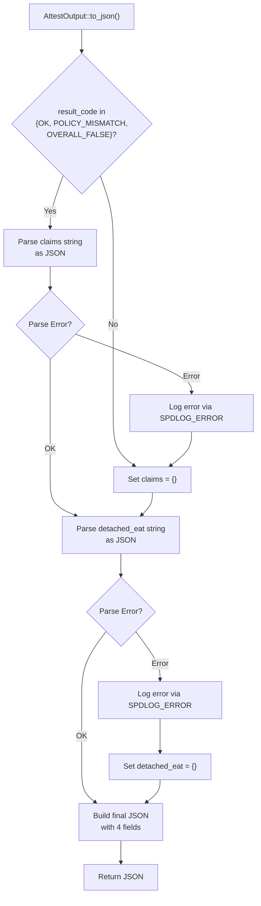
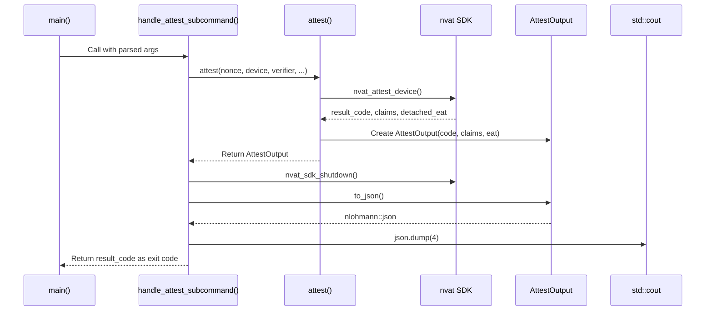

<!-- source: DeepWiki mcp.deepwiki.com · repo NVIDIA/attestation-sdk · page 4.4 Output Format · fetched 2026-10-26 -->

# Output Format

<details>
<summary>Relevant source files</summary>

The following files were used as context for generating this wiki page:

- [nv-attestation-cli/src/attest.cpp](nv-attestation-cli/src/attest.cpp)
- [nv-attestation-cli/tests/cli_tests.cpp](nv-attestation-cli/tests/cli_tests.cpp)

</details>


This page documents the JSON output structure produced by the `nvattest attest` command. The CLI tool serializes attestation results into a standardized JSON format that includes a result code, human-readable message, verification claims, and a detached Entity Attestation Token (EAT).

For information about the `attest` command and its parameters, see [Attest Command Reference](#4.2). For details on interpreting error codes, see [Error Codes and Handling](#8.2). For information about the claims structure itself, see [Evidence Format and Structure](#5.2).

## JSON Output Structure

The `nvattest attest` command always produces a JSON object written to standard output with four top-level fields:

| Field | Type | Description |
|-------|------|-------------|
| `result_code` | integer | Numeric status code indicating attestation outcome (see [Error Codes and Handling](#8.2)) |
| `result_message` | string | Human-readable description of the result code |
| `claims` | object | JSON object containing verified attestation claims (populated on success or policy mismatch) |
| `detached_eat` | object | JSON object containing the detached Entity Attestation Token (populated on success or policy mismatch) |

The output is pretty-printed with 4-space indentation for readability. The JSON is written to standard output regardless of success or failure, and the process exit code matches the `result_code` value.

**Sources:** [nv-attestation-cli/src/attest.cpp:36-68](), [nv-attestation-cli/src/attest.cpp:354-356]()

## AttestOutput Class and Serialization Flow



**Diagram: JSON Output Generation Pipeline**

The `AttestOutput` class encapsulates the attestation result and provides serialization to JSON format through its `to_json()` method. The class is instantiated with the result code from the SDK and optionally populated with claims and detached EAT data.

**Sources:** [nv-attestation-cli/src/attest.cpp:30-34](), [nv-attestation-cli/src/attest.cpp:149-336](), [nv-attestation-cli/src/attest.cpp:339-357]()

## Result Code Handling



**Diagram: Output Population Logic Based on Result Code**

The `claims` and `detached_eat` fields are conditionally populated based on the result code:

- **Populated as JSON objects**: When `result_code` is `NVAT_RC_OK`, `NVAT_RC_RP_POLICY_MISMATCH`, or `NVAT_RC_OVERALL_RESULT_FALSE`. In these cases, the SDK successfully collected evidence and performed verification, even if the final policy evaluation failed.

- **Empty JSON objects**: For all other error codes, indicating that attestation could not complete successfully enough to generate claims or EAT data.

The `result_message` field is always populated by calling `nvat_rc_to_string()` to convert the numeric result code to a human-readable string.

**Sources:** [nv-attestation-cli/src/attest.cpp:39-60](), [nv-attestation-cli/src/attest.cpp:63-67]()

## Example Output Scenarios

### Successful Attestation

```json
{
    "result_code": 0,
    "result_message": "Success",
    "claims": {
        "device-type": "gpu",
        "gpu-arch": "hopper",
        "certificate-chain-validated": true,
        "measurements-validated": true,
        "overall-attestation-result": true
    },
    "detached_eat": {
        "iat": 1234567890,
        "nonce": "931d8dd0add203ac3d8b4fbde75e115278eefcdceac5b87671a748f32364dfcb",
        "submods": {
            "gpu": {
                "hwmodel": "NVIDIA H100",
                "fwids": [...]
            }
        }
    }
}
```

### Policy Mismatch

When the relying party policy evaluation fails, the output includes full claims and EAT data with a non-zero result code:

```json
{
    "result_code": 8,
    "result_message": "Relying party policy mismatch",
    "claims": {
        "device-type": "gpu",
        "certificate-chain-validated": true,
        "measurements-validated": true,
        "overall-attestation-result": true,
        "relying-party-policy-result": false
    },
    "detached_eat": {
        "iat": 1234567890,
        "nonce": "931d8dd0add203ac3d8b4fbde75e115278eefcdceac5b87671a748f32364dfcb",
        "submods": {...}
    }
}
```

### Error Cases

For errors that prevent attestation from completing, claims and EAT are returned as empty objects:

```json
{
    "result_code": 2,
    "result_message": "Bad argument",
    "claims": {},
    "detached_eat": {}
}
```

**Sources:** [nv-attestation-cli/src/attest.cpp:296-334](), [nv-attestation-cli/tests/cli_tests.cpp:109-113]()

## Error Handling During Serialization



**Diagram: JSON Serialization Error Handling**

The `AttestOutput::to_json()` method implements robust error handling when parsing claims and detached EAT strings into JSON objects. If either string fails to parse (due to malformed JSON or exceptions), the method:

1. Logs the error using `SPDLOG_ERROR` with details about the parsing failure
2. Sets the corresponding field to an empty JSON object (`{}`)
3. Continues processing to ensure a valid JSON output is always produced

This ensures that the CLI always produces valid JSON output even if internal data serialization encounters issues.

**Sources:** [nv-attestation-cli/src/attest.cpp:40-58]()

## Integration with Command Handler



**Diagram: Output Generation in Command Handler Flow**

The `handle_attest_subcommand()` function orchestrates the entire attestation workflow and output generation:

1. Calls the `attest()` function with parsed command-line arguments
2. Receives an `AttestOutput` object containing the result
3. Shuts down the SDK using `nvat_sdk_shutdown()`
4. Converts the output to JSON using `to_json()`
5. Pretty-prints the JSON to standard output with `json.dump(4)`
6. Returns the result code as the process exit code

**Sources:** [nv-attestation-cli/src/attest.cpp:339-357]()

## Parsing Output in Scripts

The JSON output can be easily parsed using standard JSON tools. All test cases validate the output structure by:

1. Extracting the JSON object from standard output
2. Parsing it with `nlohmann::json::parse()`
3. Checking for the presence of `result_code`
4. Validating the result code value

Example test validation pattern:

```cpp
// From test code demonstrating output validation
std::string json_str;
extract_json_object(output, json_str);
nlohmann::json response = nlohmann::json::parse(json_str);
ASSERT_TRUE(response.contains("result_code"));
EXPECT_EQ(response["result_code"].get<int>(), 0);
```

Shell scripts can use `jq` or similar tools:

```bash
# Extract result code
result_code=$(nvattest attest --device gpu | jq -r '.result_code')

# Extract claims
claims=$(nvattest attest --device gpu | jq '.claims')

# Check for success
if [ "$result_code" -eq 0 ]; then
    echo "Attestation successful"
fi
```

**Sources:** [nv-attestation-cli/tests/cli_tests.cpp:108-113](), [nv-attestation-cli/tests/cli_tests.cpp:139-144]()

## Output Field Details

### result_code

The `result_code` is an integer representing the attestation outcome. Common values include:

- `0` (`NVAT_RC_OK`): Attestation completed successfully
- `8` (`NVAT_RC_RP_POLICY_MISMATCH`): Policy evaluation failed
- `2` (`NVAT_RC_BAD_ARGUMENT`): Invalid input parameters
- Other codes: See [Error Codes and Handling](#8.2) for a complete list

The result code is also returned as the process exit code, allowing shell scripts to check attestation status using standard mechanisms (`$?` in bash).

**Sources:** [nv-attestation-cli/src/attest.cpp:63]()

### result_message

The `result_message` is a human-readable string description of the result code, obtained by calling `nvat_rc_to_string()`. This provides a standardized textual representation of the error or success condition.

**Sources:** [nv-attestation-cli/src/attest.cpp:64]()

### claims

The `claims` field is a JSON object containing the verification results and device information. When populated, it includes:

- Device identification (type, architecture, model)
- Certificate validation results
- Measurement verification results
- Policy evaluation results
- Overall attestation result

The structure of this object depends on the device type (GPU vs. Switch) and verification mode (local vs. remote). For complete details on the claims structure, see [Evidence Format and Structure](#5.2).

**Sources:** [nv-attestation-cli/src/attest.cpp:41-48](), [nv-attestation-cli/src/attest.cpp:65]()

### detached_eat

The `detached_eat` field contains the detached Entity Attestation Token in JSON format. This token includes:

- Issued-at timestamp (`iat`)
- Nonce value used for freshness
- Sub-modules section with device-specific measurements
- Hardware model information
- Firmware identifiers

The EAT format follows industry standards for attestation tokens and can be used for offline verification or forwarding to third-party verifiers.

**Sources:** [nv-attestation-cli/src/attest.cpp:50-58](), [nv-attestation-cli/src/attest.cpp:66]()

---

