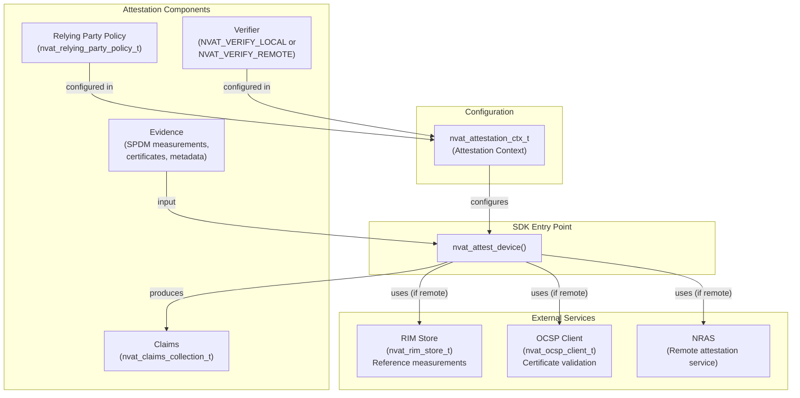
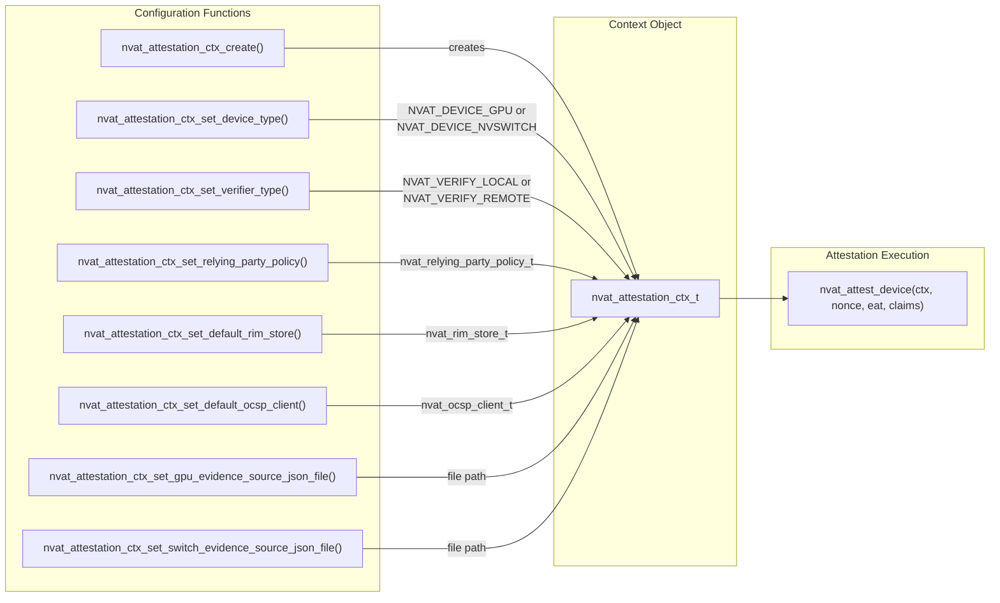
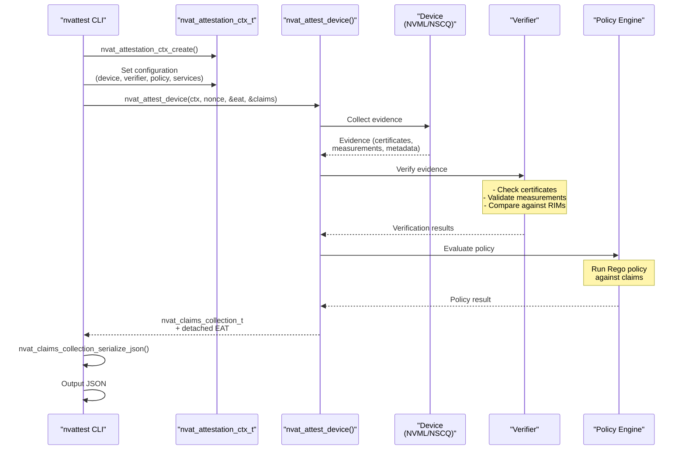
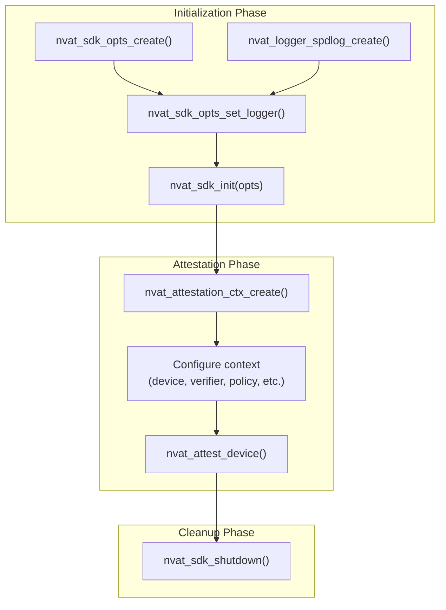

<!-- source: DeepWiki mcp.deepwiki.com · repo NVIDIA/attestation-sdk · page 5 Attestation Concepts · fetched 2026-10-26 -->

# Attestation Concepts

<details>
<summary>Relevant source files</summary>

The following files were used as context for generating this wiki page:

- [README.md](README.md)
- [common-test-data/serialized_test_evidence/hopper_evidence.json](common-test-data/serialized_test_evidence/hopper_evidence.json)
- [nv-attestation-cli/src/attest.cpp](nv-attestation-cli/src/attest.cpp)

</details>


## Purpose and Scope

This page introduces the fundamental attestation concepts implemented in the NVIDIA Attestation SDK. It covers the core components involved in attestation—evidence collection, claims generation, policy evaluation, and verification—and explains how these concepts are realized in the codebase.

For detailed information about specific aspects of attestation:
- For the complete attestation workflow and step-by-step process, see [Device Attestation Flow](#5.1)
- For detailed evidence structure and serialization formats, see [Evidence Format and Structure](#5.2)
- For policy authoring and evaluation, see [Relying Party Policies](#5.3)
- For choosing between local and remote verification, see [Verification Modes](#5.4)
- For hardware-specific considerations, see [Device Support](#5.5)

For architectural information about the SDK implementation, see [Core SDK](#3.2).

---

## What is Attestation?

**Attestation** is the process of verifying that a device or computing environment is in a trusted state. In the context of NVIDIA's Confidential Computing solutions, attestation provides cryptographic proof that:

1. **Hardware identity** - The device is a genuine NVIDIA product
2. **Firmware integrity** - The firmware and software running on the device match expected reference measurements
3. **Configuration state** - The device is configured according to security policies

The NVIDIA Attestation SDK implements a complete attestation system that collects evidence from NVIDIA GPUs and NVSwitch devices, verifies this evidence against reference measurements, evaluates security policies, and produces structured attestation results.

**Sources:** [README.md:1-20]()

---

## Core Attestation Components

The attestation system consists of four primary components that work together to establish trust:



**Sources:** [nv-attestation-cli/src/attest.cpp:196-334]()

### Evidence

**Evidence** is the raw cryptographic and measurement data collected from a device. It consists of:

- **SPDM measurement records** - Secure measurements of firmware and configuration
- **Certificate chains** - X.509 certificates establishing device identity
- **Opaque data** - Architecture-specific binary data
- **Metadata** - Driver version, VBIOS version, architecture type, nonce

Evidence can be collected from two sources:
1. **Live collection** - Queried directly from hardware via NVML (GPU) or NSCQ (Switch)
2. **Pre-serialized files** - Loaded from JSON files for testing or offline verification

The SDK represents evidence internally and processes it through device-specific verification logic in [nv-attestation-sdk-cpp/src/gpu/verify.cpp]() and [nv-attestation-sdk-cpp/src/switch/verify.cpp]().

**Sources:** [common-test-data/serialized_test_evidence/hopper_evidence.json:1](), [nv-attestation-cli/src/attest.cpp:216-228]()

### Claims

**Claims** are structured attestation results produced after verification. They represent verified facts about the device state. The SDK generates claims in the form of an `nvat_claims_collection_t` object, which contains:

- **Device identity claims** - UUID, architecture, firmware versions
- **Verification results** - Pass/fail status for measurements, certificates, policies
- **Measurement claims** - Individual SPDM measurement results
- **Overall attestation result** - Combined pass/fail determination

Claims are serialized to JSON for output and can be further wrapped in Entity Attestation Tokens (EAT) for standardized attestation reporting.

**Sources:** [nv-attestation-cli/src/attest.cpp:286-318]()

### Relying Party Policy

A **Relying Party Policy** defines the security requirements that the relying party (the entity trusting the attestation result) requires. Policies are written in **Rego** (the policy language from Open Policy Agent) and evaluate claims to determine if they meet requirements.

The SDK uses `nvat_relying_party_policy_t` objects created from Rego strings:

```cpp
nvat_relying_party_policy_create_rego_from_str(&rp_raw, rego_str.c_str());
```

Policies can check:
- Device type and architecture
- Specific firmware versions
- Certificate validity
- Individual measurement values
- Any combination of claims

**Sources:** [nv-attestation-cli/src/attest.cpp:115-146]()

### Verifier

The **Verifier** performs the cryptographic and logical verification of evidence. The SDK supports two verifier types configured via `NVAT_VERIFY_LOCAL` or `NVAT_VERIFY_REMOTE`:

| Verifier Type | Description | When to Use |
|---------------|-------------|-------------|
| `NVAT_VERIFY_LOCAL` | Performs all verification locally within the SDK | Environments with pre-cached RIM data, air-gapped systems, or when minimizing external dependencies |
| `NVAT_VERIFY_REMOTE` | Delegates verification to NVIDIA Remote Attestation Service (NRAS) | Production environments with internet access, when trusting NVIDIA's verification service |

Local verification requires configuring RIM stores and OCSP clients. Remote verification delegates to NRAS but still performs local policy evaluation.

**Sources:** [nv-attestation-cli/src/attest.cpp:272-284]()

---

## Attestation Context Configuration

The `nvat_attestation_ctx_t` object is the primary configuration interface for attestation operations. It encapsulates all parameters needed to perform attestation:



**Configuration Steps:**

1. **Create context** - Initialize with `nvat_attestation_ctx_create()`
2. **Set device type** - Specify GPU or NVSwitch target
3. **Configure evidence source** - Live collection (default) or file-based
4. **Set verifier type** - Local or remote verification
5. **Configure services** - RIM store, OCSP client for local verification
6. **Set policy** - Relying party policy for evaluation
7. **Execute attestation** - Call `nvat_attest_device()`

**Sources:** [nv-attestation-cli/src/attest.cpp:198-284]()

---

## Attestation Execution Flow

The complete attestation flow from invocation to result output:



**Key Function Calls:**

- **[nv-attestation-cli/src/attest.cpp:296]()** - `nvat_attest_device(ctx, nonce_ptr, &detached_eat, &raw_claims)`
- **[nv-attestation-cli/src/attest.cpp:315]()** - `nvat_claims_collection_serialize_json(claims, &serialized_claims)`

**Sources:** [nv-attestation-cli/src/attest.cpp:149-334]()

---

## Device Types and Architectures

The SDK supports attestation for two device types, each with architecture-specific handling:

| Device Type | Enum Constant | Evidence Collection | Architecture Support |
|-------------|---------------|---------------------|---------------------|
| GPU | `NVAT_DEVICE_GPU` | NVML library | HOPPER, future architectures |
| NVSwitch | `NVAT_DEVICE_NVSWITCH` | NSCQ library | LS10, future switches |

**Architecture-Specific Fields:**

The evidence structure includes an `arch` field that identifies the hardware architecture (e.g., `"HOPPER"` for H100 GPUs). Architecture-specific verification logic processes opaque data fields that contain measurement records in SPDM format.

**Example from evidence:**
```json
{
  "arch": "HOPPER",
  "driver_version": "550.90.07",
  "vbios_version": "96.00.9F.00.01"
}
```

**Sources:** [common-test-data/serialized_test_evidence/hopper_evidence.json:1](), [nv-attestation-cli/src/attest.cpp:204-214]()

---

## Result Codes and Output

Attestation operations return one of several result codes indicating the outcome:

| Result Code | Constant | Meaning |
|-------------|----------|---------|
| Success | `NVAT_RC_OK` | Attestation passed all checks |
| Policy mismatch | `NVAT_RC_RP_POLICY_MISMATCH` | Policy evaluation failed |
| Overall failure | `NVAT_RC_OVERALL_RESULT_FALSE` | Verification failed |
| Bad argument | `NVAT_RC_BAD_ARGUMENT` | Invalid input parameters |
| Internal error | `NVAT_RC_INTERNAL_ERROR` | SDK internal error |

**Output Structure:**

The CLI produces JSON output with the following structure:

```json
{
  "result_code": 0,
  "result_message": "Success",
  "claims": { /* claims object */ },
  "detached_eat": { /* EAT token */ }
}
```

Even when attestation fails (policy mismatch or overall result false), claims and EAT are still populated so that the relying party can inspect what failed.

**Sources:** [nv-attestation-cli/src/attest.cpp:36-68](), [nv-attestation-cli/src/attest.cpp:296-309]()

---

## SDK Initialization and Lifecycle

Before performing attestation, the SDK must be initialized. The lifecycle management follows this pattern:



**Logger Configuration:**

The SDK uses spdlog for logging and supports configurable log levels:

```cpp
nvat_log_level_t levels = {
    NVAT_LOG_LEVEL_TRACE,
    NVAT_LOG_LEVEL_DEBUG,
    NVAT_LOG_LEVEL_INFO,
    NVAT_LOG_LEVEL_WARN,
    NVAT_LOG_LEVEL_ERROR,
    NVAT_LOG_LEVEL_OFF
};
```

**Sources:** [nv-attestation-cli/src/attest.cpp:164-196](), [nv-attestation-cli/src/attest.cpp:352]()

---

## Resource Management

The SDK uses C APIs with explicit resource management. The CLI wraps SDK handles in `nv_unique_ptr` smart pointers for automatic cleanup:

```cpp
nv_unique_ptr<nvat_attestation_ctx_t> ctx;
nvat_attestation_ctx_t raw_ctx = nullptr;
nvat_attestation_ctx_create(&raw_ctx);
ctx.reset(&raw_ctx);  // Automatic cleanup on scope exit
```

**Key SDK Types Requiring Management:**

- `nvat_sdk_opts_t` - SDK initialization options
- `nvat_attestation_ctx_t` - Attestation context
- `nvat_claims_collection_t` - Claims output
- `nvat_relying_party_policy_t` - Policy object
- `nvat_rim_store_t` - RIM store handle
- `nvat_ocsp_client_t` - OCSP client handle
- `nvat_str_t` - String data from SDK

For details on resource management patterns, see [Resource Management Patterns](#6.5).

**Sources:** [nv-attestation-cli/src/attest.cpp:164-170](), [nv-attestation-cli/src/attest.cpp:198-202]()

---

## Nonce Handling

A **nonce** (number used once) is a cryptographic value that ensures attestation freshness and prevents replay attacks. The SDK supports:

1. **Auto-generated nonce** - SDK generates a random nonce if not provided
2. **User-provided nonce** - Pass hex-encoded nonce via `nvat_nonce_from_hex()`

```cpp
nvat_nonce_t nonce_ptr = nullptr;
if (!nonce.empty()) {
    nvat_nonce_from_hex(&nonce_ptr, nonce.c_str());
}
nvat_attest_device(ctx, nonce_ptr, &eat, &claims);
```

The nonce is included in the evidence and bound cryptographically to the attestation result, allowing the relying party to verify that the attestation is fresh and not replayed from a previous session.

**Sources:** [nv-attestation-cli/src/attest.cpp:289-295]()

---

## Service Endpoints Configuration

For local verification, the SDK requires access to external services:

| Service | Type | Purpose | Default URL |
|---------|------|---------|-------------|
| RIM Service | `nvat_rim_store_t` | Reference Integrity Manifests | `https://rim.attestation.nvidia.com` |
| OCSP Responder | `nvat_ocsp_client_t` | Certificate revocation status | `https://ocsp.ndis.nvidia.com` |
| NRAS | Environment variable | Remote attestation service | `https://nras.attestation.nvidia.com` |

**Configuration Example:**

```cpp
// RIM Store
nvat_rim_store_create_remote(&rim_store_raw, rim_base_url, nullptr);
nvat_attestation_ctx_set_default_rim_store(ctx, rim_store);

// OCSP Client
nvat_ocsp_client_create_default(&ocsp_client_raw, ocsp_base_url, nullptr);
nvat_attestation_ctx_set_default_ocsp_client(ctx, ocsp_client);

// NRAS (for remote verifier)
setenv("NVAT_NRAS_BASE_URL", nras_base_url, 1);
```

**Sources:** [nv-attestation-cli/src/attest.cpp:231-265]()

---

## Summary

The NVIDIA Attestation SDK implements a comprehensive attestation system built around four core concepts:

1. **Evidence** - Cryptographic measurements and certificates from devices
2. **Verification** - Validation of evidence against reference measurements and policies
3. **Claims** - Structured results representing verified facts
4. **Policies** - Rego-based security requirements evaluation

These components are orchestrated through the `nvat_attestation_ctx_t` configuration object and executed via `nvat_attest_device()`, producing JSON-serialized claims and EAT tokens that relying parties can use to establish trust in device state.

For implementation details on each concept, refer to the child pages listed at the beginning of this document.

---

