<!-- source: DeepWiki mcp.deepwiki.com · repo NVIDIA/attestation-sdk · page 5.1 Device Attestation Flow · fetched 2026-10-26 -->

# Device Attestation Flow

Relevant source files

The following files were used as context for generating this wiki page:

- [README.md](README.md)
- [nv-attestation-cli/src/attest.cpp](nv-attestation-cli/src/attest.cpp)
- [nv-attestation-cli/tests/cli_tests.cpp](nv-attestation-cli/tests/cli_tests.cpp)

## Purpose

This document explains the end-to-end attestation workflow from evidence collection to claims generation for both GPU and Switch devices. It details the sequence of SDK operations, context configuration, and result processing that occur when attestation is performed. For detailed information about evidence structure, see [Evidence Format and Structure](#5.2). For policy evaluation specifics, see [Relying Party Policies](#5.3). For verification mode comparison, see [Verification Modes](#5.4).

## Overview

Device attestation is the process of verifying the integrity and trustworthiness of NVIDIA hardware devices (GPUs or Switches). The attestation flow consists of five phases:

1. **Initialization**: SDK initialization and attestation context creation
2. **Configuration**: Setting device type, evidence sources, verification mode, and external service endpoints
3. **Evidence Collection**: Gathering measurements and certificates from hardware (or loading from file)
4. **Verification**: Validating evidence against reference measurements and policies
5. **Result Generation**: Producing claims and Entity Attestation Tokens (EAT)

## Attestation Phases

### Phase 1: Initialization

The attestation process begins by initializing the SDK and creating an attestation context. The context is a stateful object that holds all configuration for a single attestation operation.

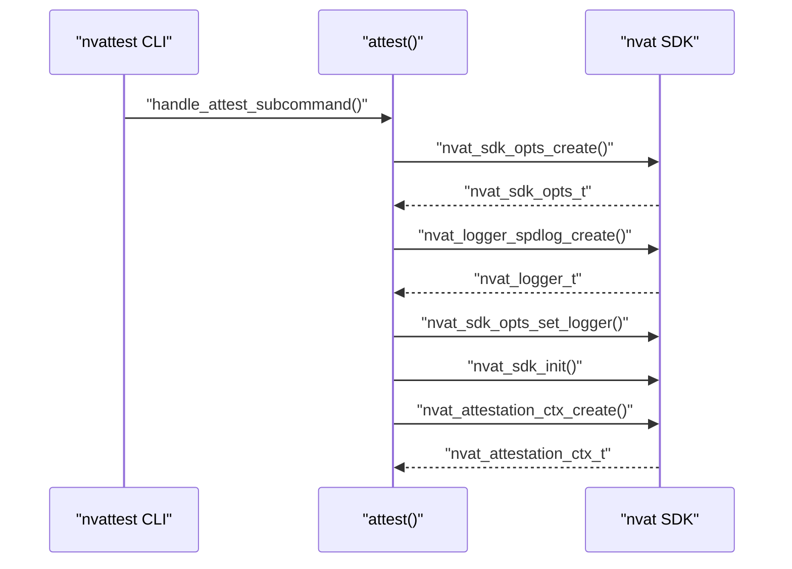

**Sources**: [nv-attestation-cli/src/attest.cpp:164-202]()

The SDK initialization configures logging and internal state. The attestation context (`nvat_attestation_ctx_t`) is created empty and will be populated with configuration in the next phase.

### Phase 2: Configuration

The attestation context must be configured with device type, evidence source, verifier type, and external service endpoints before attestation can proceed.

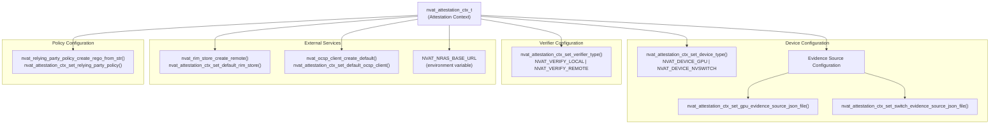

**Sources**: [nv-attestation-cli/src/attest.cpp:204-284]()

| Configuration Type | SDK Function | CLI Argument | Default |
|-------------------|--------------|--------------|---------|
| Device Type | `nvat_attestation_ctx_set_device_type()` | `--device` | `gpu` |
| GPU Evidence Source | `nvat_attestation_ctx_set_gpu_evidence_source_json_file()` | `--gpu-evidence` | Live via NVML |
| Switch Evidence Source | `nvat_attestation_ctx_set_switch_evidence_source_json_file()` | `--switch-evidence` | Live via NSCQ |
| Verifier Type | `nvat_attestation_ctx_set_verifier_type()` | `--verifier` | `local` |
| RIM Store | `nvat_attestation_ctx_set_default_rim_store()` | `--rim-url` | `https://rim.attestation.nvidia.com` |
| OCSP Client | `nvat_attestation_ctx_set_default_ocsp_client()` | `--ocsp-url` | `https://ocsp.ndis.nvidia.com` |
| NRAS URL | Environment: `NVAT_NRAS_BASE_URL` | `--nras-url` | `https://nras.attestation.nvidia.com` |
| Relying Party Policy | `nvat_attestation_ctx_set_relying_party_policy()` | `--relying-party-policy` | None (optional) |

**Sources**: [nv-attestation-cli/src/attest.cpp:70-106]()

#### Policy Configuration Detail

When a relying party policy file is provided, it is read and converted to a Rego policy object:

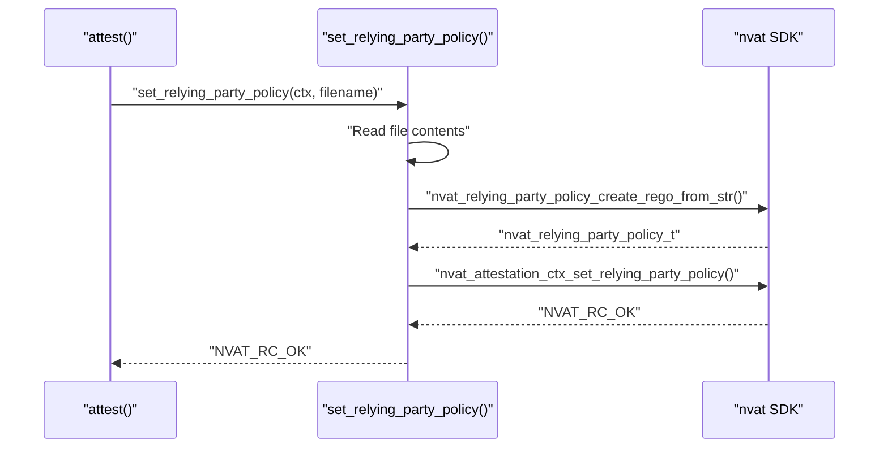

**Sources**: [nv-attestation-cli/src/attest.cpp:115-146]()

### Phase 3: Evidence Collection

Once the context is configured, the attestation process begins with `nvat_attest_device()`. This function orchestrates evidence collection from the device.

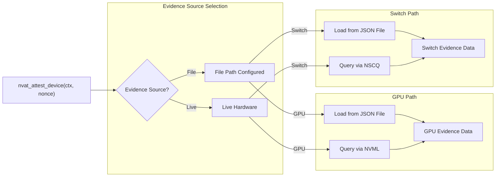

**Sources**: [nv-attestation-cli/src/attest.cpp:286-299]()

The evidence collection mechanism depends on the configuration:
- If `--gpu-evidence` was provided, GPU evidence is loaded from the JSON file
- If `--switch-evidence` was provided, Switch evidence is loaded from the JSON file  
- Otherwise, evidence is collected live from hardware using NVML (GPU) or NSCQ (Switch)

### Phase 4: Verification

After evidence collection, the SDK performs verification. The verification path differs based on the verifier type (local or remote).

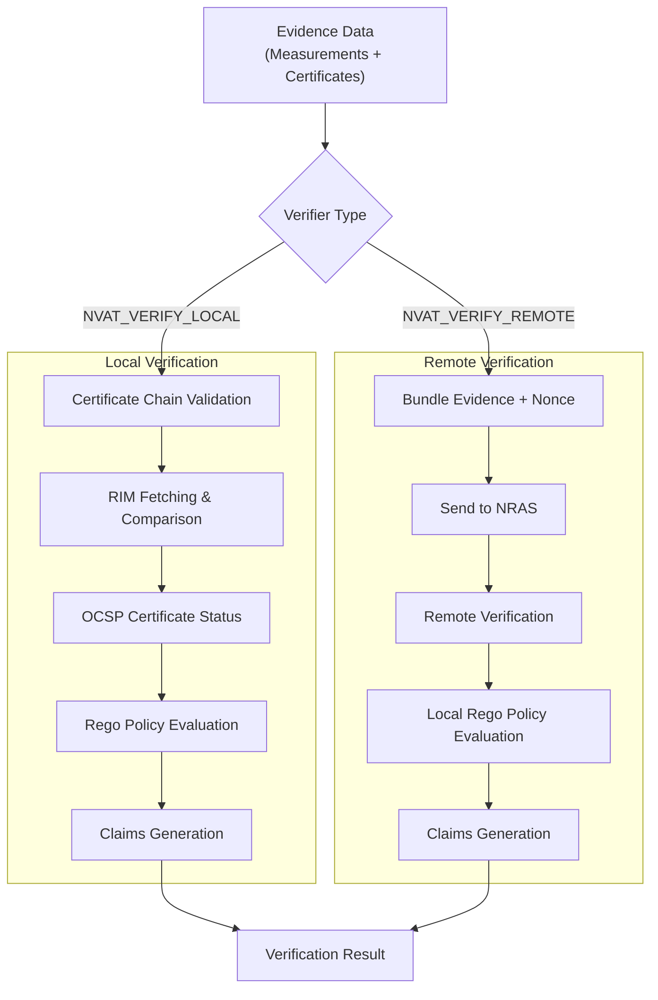

**Sources**: [nv-attestation-cli/src/attest.cpp:272-284]()

The verification process uses external services:
- **RIM Store** (`nvat_rim_store_t`): Provides reference integrity measurements to compare against device measurements
- **OCSP Client** (`nvat_ocsp_client_t`): Validates certificate revocation status
- **NRAS** (Remote Attestation Service): Performs verification remotely when `NVAT_VERIFY_REMOTE` is configured

### Phase 5: Result Generation

The final phase produces two outputs: a claims collection and a detached EAT (Entity Attestation Token).

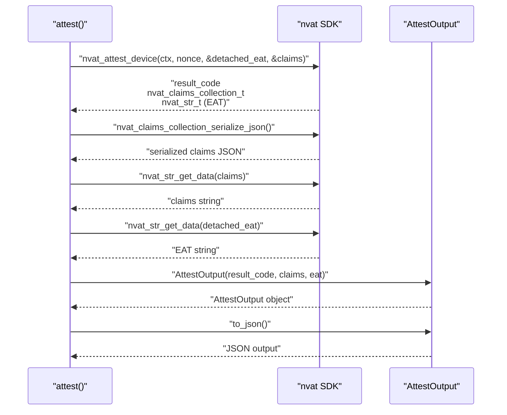

**Sources**: [nv-attestation-cli/src/attest.cpp:286-334]()

The `nvat_attest_device()` function returns three values:
- **Result Code** (`nvat_rc_t`): Indicates success or failure type
  - `NVAT_RC_OK`: Attestation succeeded
  - `NVAT_RC_RP_POLICY_MISMATCH`: Policy evaluation failed
  - `NVAT_RC_OVERALL_RESULT_FALSE`: Verification failed
  - Other error codes indicate processing failures
- **Claims Collection** (`nvat_claims_collection_t`): Structured claims from attestation
- **Detached EAT** (`nvat_str_t`): Entity Attestation Token in JSON format

## Complete Attestation Flow

The following diagram shows the complete end-to-end flow with all phases:

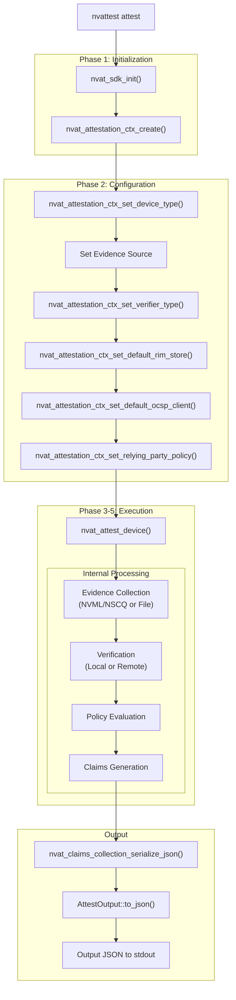

**Sources**: [nv-attestation-cli/src/attest.cpp:149-336]()

## Device-Specific Paths

The attestation flow branches based on device type. The device type is set via `nvat_attestation_ctx_set_device_type()` with one of:
- `NVAT_DEVICE_GPU`: GPU attestation via NVML
- `NVAT_DEVICE_NVSWITCH`: Switch attestation via NSCQ

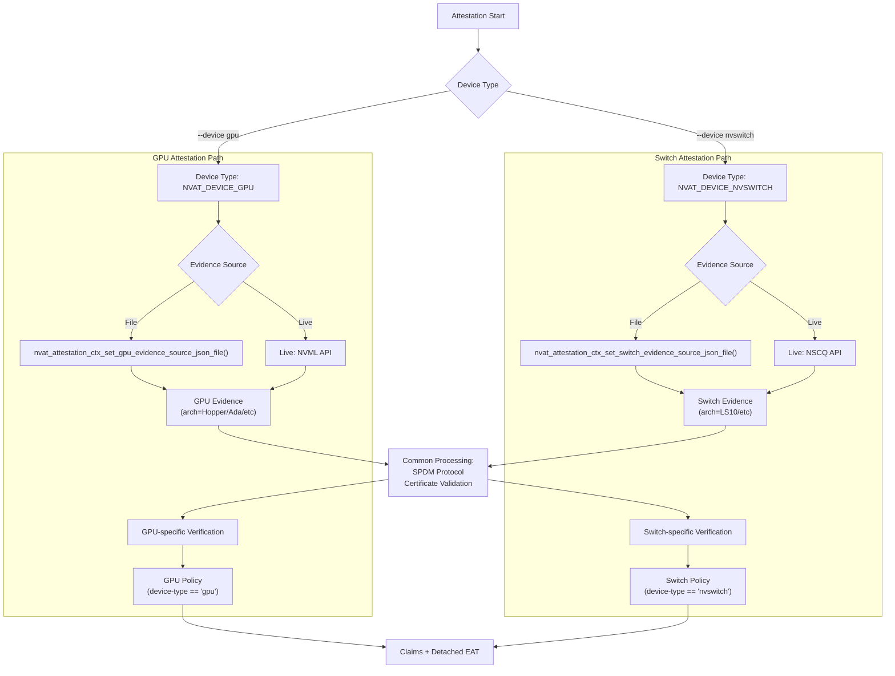

**Sources**: [nv-attestation-cli/src/attest.cpp:204-228]()

## Result Codes and Error Handling

The attestation flow can produce three success-like result codes that still generate valid output:

| Result Code | Value | Meaning | Claims Generated | EAT Generated |
|-------------|-------|---------|------------------|---------------|
| `NVAT_RC_OK` | 0 | Full success | Yes | Yes |
| `NVAT_RC_RP_POLICY_MISMATCH` | Non-zero | Policy evaluation failed but data valid | Yes | Yes |
| `NVAT_RC_OVERALL_RESULT_FALSE` | Non-zero | Verification failed but data valid | Yes | Yes |

Other error codes indicate processing failures and do not generate claims or EAT data.

**Sources**: [nv-attestation-cli/src/attest.cpp:36-68](), [nv-attestation-cli/src/attest.cpp:296-299]()

The `AttestOutput` class handles result formatting:

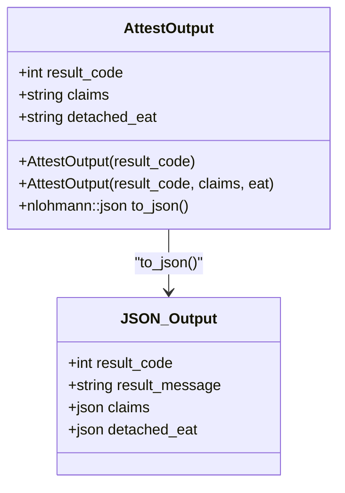

**Sources**: [nv-attestation-cli/src/attest.cpp:30-68]()

The `to_json()` method produces structured output with:
- `result_code`: Numeric result code
- `result_message`: Human-readable message via `nvat_rc_to_string()`
- `claims`: Parsed JSON object (or empty object on error)
- `detached_eat`: Parsed JSON object (or empty object on error)

## Nonce Handling

A nonce (number used once) ensures freshness of the attestation. The nonce can be provided by the caller or auto-generated.

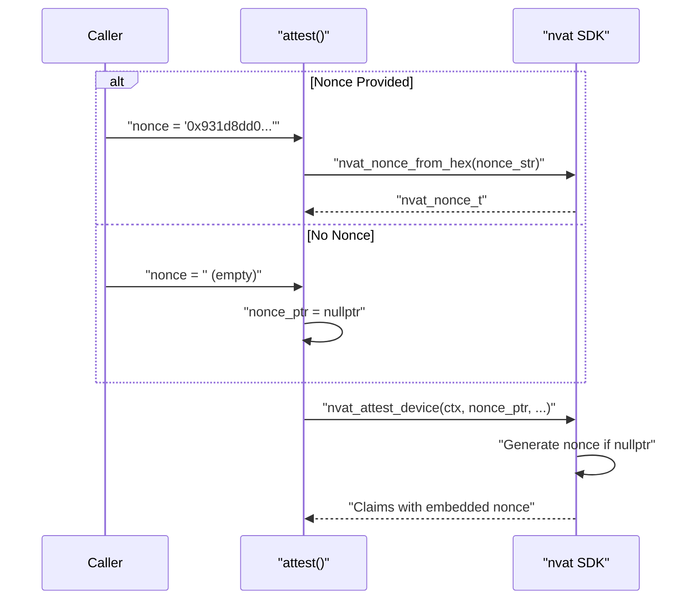

**Sources**: [nv-attestation-cli/src/attest.cpp:289-296]()

When no nonce is provided (`nonce_ptr = nullptr`), the SDK generates a random nonce internally. The nonce is included in the generated claims and EAT.

## Testing the Attestation Flow

The attestation flow is tested in both unit and integration modes:

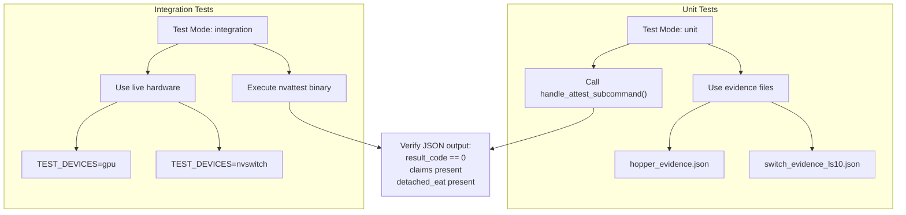

**Sources**: [nv-attestation-cli/tests/cli_tests.cpp:86-316]()

Test cases exercise all combinations:
- Device types: `gpu`, `nvswitch`
- Verifier types: `local`, `remote`
- Policy configurations: with policy, without policy

Example test configurations:

| Test | Device | Verifier | Evidence Source | Policy | Lines |
|------|--------|----------|-----------------|--------|-------|
| GPULocalCommand | `gpu` | `local` | File (unit) / Live (integ) | Yes | [86-114]() |
| GPURemoteCommand | `gpu` | `remote` | File (unit) / Live (integ) | Yes | [116-145]() |
| SwitchLocalCommand | `nvswitch` | `local` | File (unit) / Live (integ) | Yes | [147-174]() |
| SwitchRemoteCommand | `nvswitch` | `remote` | File (unit) / Live (integ) | Yes | [176-204]() |

**Sources**: [nv-attestation-cli/tests/cli_tests.cpp:1-316]()

---

