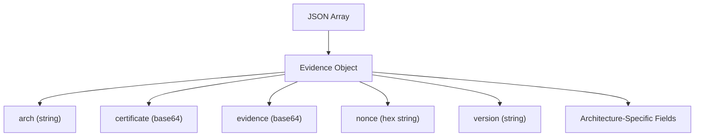
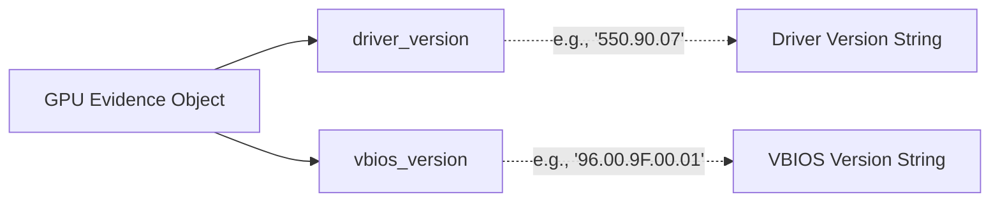
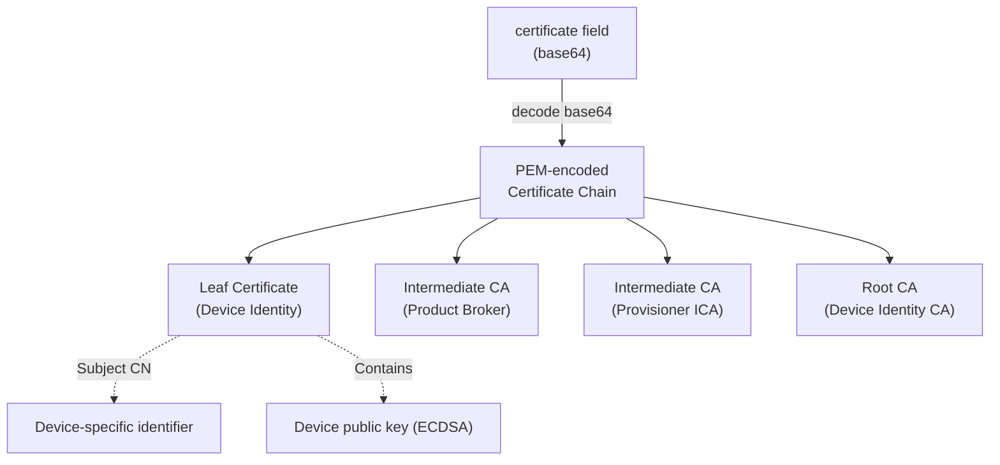
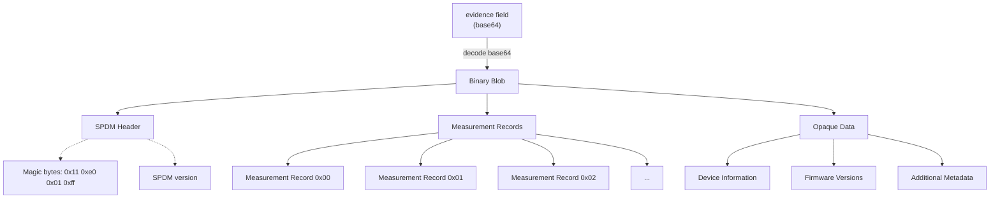
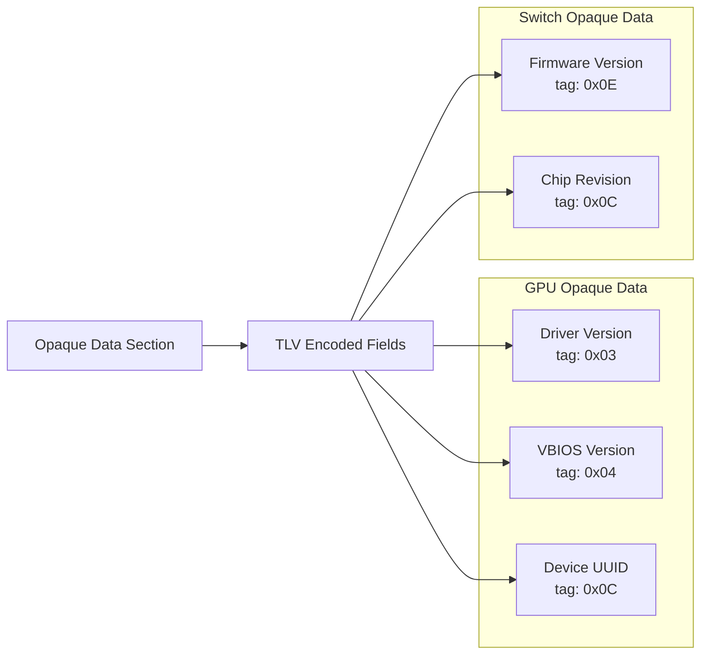
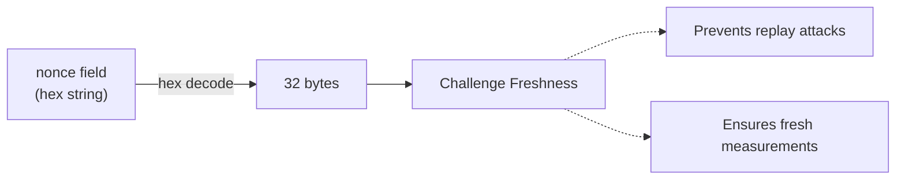
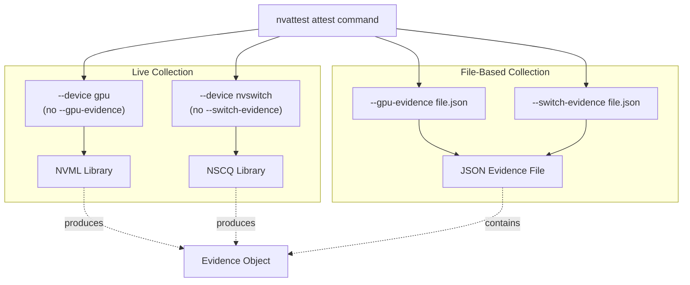
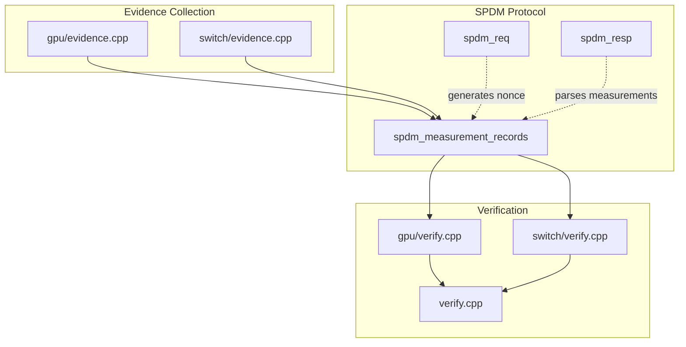

<!-- source: DeepWiki mcp.deepwiki.com · repo NVIDIA/attestation-sdk · page 5.2 Evidence Format and Structure · fetched 2026-10-26 -->

# Evidence Format and Structure

Relevant source files

The following files were used as context for generating this wiki page:

- [common-test-data/serialized_test_evidence/hopper_evidence.json](common-test-data/serialized_test_evidence/hopper_evidence.json)
- [common-test-data/serialized_test_evidence/switch_evidence_ls10.json](common-test-data/serialized_test_evidence/switch_evidence_ls10.json)

## Purpose and Scope

This document describes the structure and format of attestation evidence used by the NVIDIA Attestation SDK. Evidence is the raw data collected from NVIDIA devices (GPUs and NVSwitches) that contains cryptographic measurements, certificates, and device metadata necessary for attestation verification. This page focuses on the serialized JSON format and the structure of the embedded binary data.

For information about how evidence is collected from devices, see [Device Support](#5.5). For information about how evidence is verified, see [Verification Modes](#5.4). For the complete attestation workflow, see [Device Attestation Flow](#5.1).

## Evidence Container Format

Evidence is serialized as a JSON array containing one or more evidence objects. Each object represents attestation data from a single device at a specific point in time.

### Top-Level Structure

**Sources:** [common-test-data/serialized_test_evidence/hopper_evidence.json:1](), [common-test-data/serialized_test_evidence/switch_evidence_ls10.json:1]()

### Common Fields

All evidence objects contain these required fields:

| Field Name | Type | Description |
|------------|------|-------------|
| `arch` | string | Device architecture identifier (e.g., "HOPPER", "LS10") |
| `certificate` | string | Base64-encoded X.509 certificate chain for device attestation |
| `evidence` | string | Base64-encoded SPDM measurement records and opaque data |
| `nonce` | string | Hex-encoded challenge nonce used in attestation request |
| `version` | string | Evidence format version (currently "1.0") |

**Sources:** [common-test-data/serialized_test_evidence/hopper_evidence.json:1](), [common-test-data/serialized_test_evidence/switch_evidence_ls10.json:1]()

## Architecture-Specific Fields

Different device types include additional metadata fields specific to their architecture.

### GPU Evidence Fields (HOPPER)

GPU evidence includes:

| Field Name | Type | Example | Description |
|------------|------|---------|-------------|
| `driver_version` | string | "550.90.07" | NVIDIA GPU driver version installed on the system |
| `vbios_version` | string | "96.00.9F.00.01" | Video BIOS firmware version |

**Sources:** [common-test-data/serialized_test_evidence/hopper_evidence.json:1]()

### Switch Evidence Fields (LS10)

Switch evidence (LS10 architecture) does not include additional architecture-specific fields beyond the common fields. All necessary metadata is embedded in the evidence blob and certificate chain.

**Sources:** [common-test-data/serialized_test_evidence/switch_evidence_ls10.json:1]()

## Certificate Chain Structure

The `certificate` field contains a base64-encoded PEM certificate chain establishing device identity.

### Certificate Chain Hierarchy

The certificate chain follows this structure (from leaf to root):

1. **Leaf Certificate**: Device-specific certificate containing:
   - Device serial number in Subject DN
   - ECDSA public key (P-384 curve)
   - Subject Alternative Name with device type identifier
   - Extended Key Usage for attestation

2. **Broker Certificate**: Product-specific intermediate CA (e.g., "GH100 A01 GSP BROKER" or "LS_10 A01 FSP BROKER")

3. **Provisioner Certificate**: Architecture-specific intermediate CA (e.g., "NVIDIA GH100 Provisioner ICA 1" or "NVIDIA LS_10 Provisioner ICA 1")

4. **Identity Certificate**: NVIDIA device identity issuer (e.g., "NVIDIA GH100 Identity")

5. **Root Certificate**: NVIDIA Device Identity CA

**Sources:** [common-test-data/serialized_test_evidence/hopper_evidence.json:1](), [common-test-data/serialized_test_evidence/switch_evidence_ls10.json:1]()

## Evidence Blob Structure

The `evidence` field contains base64-encoded binary data following the SPDM (Security Protocol and Data Model) measurement records format.

### SPDM Measurement Record Format

Each measurement record has this structure:

| Offset | Size | Field | Description |
|--------|------|-------|-------------|
| 0 | 1 | Index | Measurement index (0x00-0xFF) |
| 1 | 1 | MeasurementSpecification | Always 0x01 (DMTF) |
| 2 | 2 | MeasurementSize | Size of measurement value |
| 4-7 | 4 | Reserved | Must be 0x00 |
| 8-11 | 4 | MeasurementType | Type of measurement |
| 12+ | Variable | MeasurementValue | Hash or raw measurement data |

### Measurement Indices

The SDK processes specific measurement indices:

**GPU Measurements (HOPPER):**
- Indices 0x00-0x2F: Firmware component measurements
- Opaque data section: Driver version, VBIOS version, device metadata

**Switch Measurements (LS10):**
- Indices 0x00-0x1F: Firmware component measurements  
- Opaque data section: Firmware version, device configuration

**Sources:** [common-test-data/serialized_test_evidence/hopper_evidence.json:1](), [common-test-data/serialized_test_evidence/switch_evidence_ls10.json:1]()

## Opaque Data Section

The opaque data section at the end of the evidence blob contains device-specific metadata not covered by SPDM measurements.

### TLV Format

The opaque data uses a Type-Length-Value (TLV) encoding:

| Offset | Size | Field | Description |
|--------|------|-------|-------------|
| 0 | 2 | Tag | Field identifier |
| 2 | 2 | Length | Value length in bytes |
| 4 | Variable | Value | Field data |

**Sources:** [common-test-data/serialized_test_evidence/hopper_evidence.json:1](), [common-test-data/serialized_test_evidence/switch_evidence_ls10.json:1]()

## Nonce Field

The `nonce` field contains a hex-encoded 32-byte random value used as a challenge in the attestation protocol.

The nonce must be:
- Generated cryptographically randomly by the verifier
- 32 bytes (256 bits) in length
- Included in the SPDM measurement request
- Verified to match in the attestation response

The same nonce value is used across all evidence objects in a multi-device attestation.

**Example:** `931d8dd0add203ac3d8b4fbde75e115278eefcdceac5b87671a748f32364dfcb`

**Sources:** [common-test-data/serialized_test_evidence/hopper_evidence.json:1](), [common-test-data/serialized_test_evidence/switch_evidence_ls10.json:1]()

## Evidence Collection Sources

Evidence is collected from different sources depending on the execution mode:

**Live Collection:**
- Evidence is retrieved directly from hardware via NVML (GPU) or NSCQ (Switch)
- Requires appropriate hardware present and accessible
- Used in production attestation scenarios

**File-Based Collection:**
- Evidence is loaded from pre-serialized JSON files
- Used for testing, offline verification, and remote attestation
- Evidence files must match the format documented in this page

**Sources:** [common-test-data/serialized_test_evidence/hopper_evidence.json:1](), [common-test-data/serialized_test_evidence/switch_evidence_ls10.json:1]()

## Code Entity Mapping

The following code entities handle evidence format and parsing:

**Key Code Locations:**

- Evidence collection: Device-specific evidence modules gather measurements and certificates
- SPDM handling: Protocol-level code parses measurement records and validates format
- Verification: Verifier modules process evidence blobs and extract claims

**Sources:** Based on repository structure from high-level architecture diagrams

## Version Evolution

The `version` field indicates the evidence format version. Currently, all evidence uses version "1.0".

Future versions may:
- Add new measurement indices
- Extend opaque data with additional fields
- Support new device architectures
- Modify encoding schemes

Verifiers must check the version field and reject evidence with unsupported versions to maintain security guarantees.

**Sources:** [common-test-data/serialized_test_evidence/hopper_evidence.json:1](), [common-test-data/serialized_test_evidence/switch_evidence_ls10.json:1]()

---

