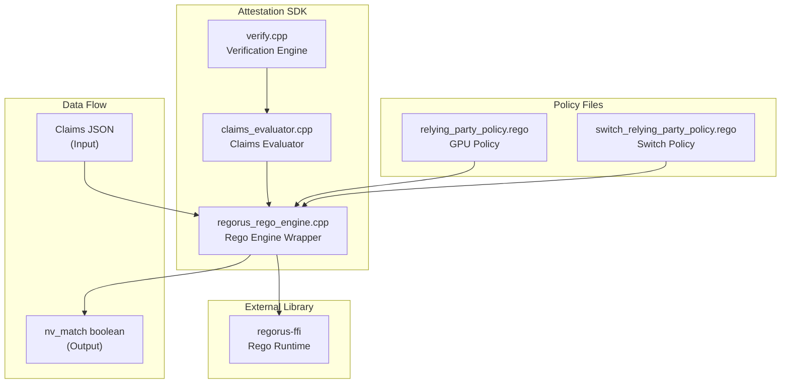
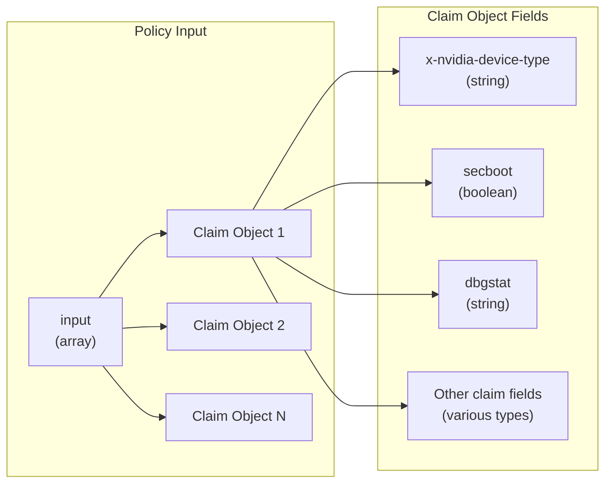
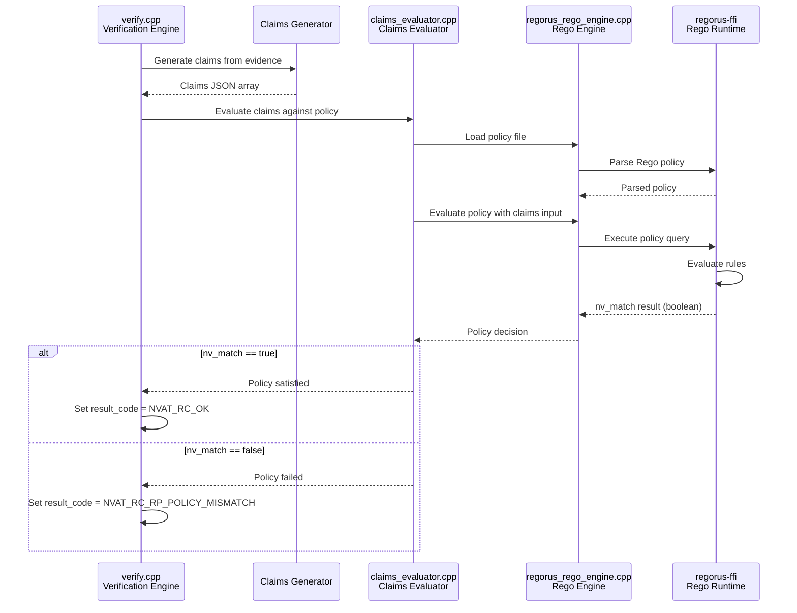
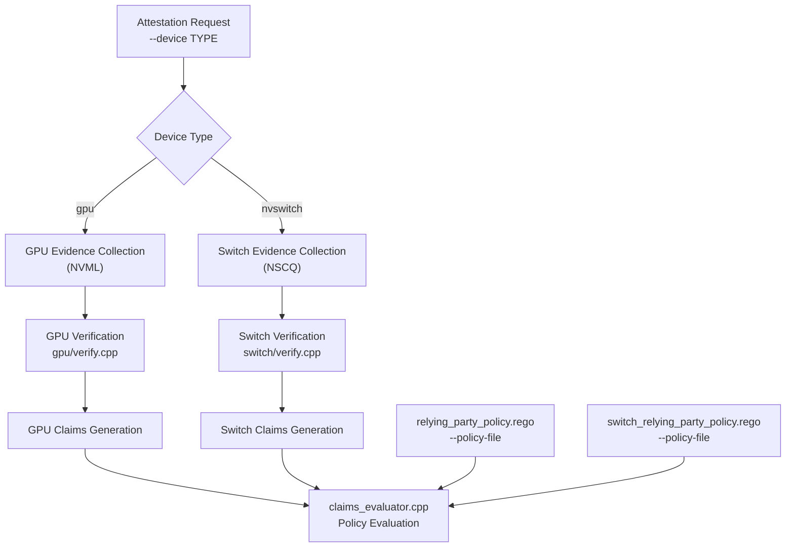
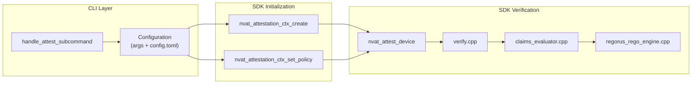

<!-- source: DeepWiki mcp.deepwiki.com · repo NVIDIA/attestation-sdk · page 5.3 Relying Party Policies · fetched 2026-10-26 -->

# Relying Party Policies

<details>
<summary>Relevant source files</summary>

The following files were used as context for generating this wiki page:

- [common-test-data/relying_party_policy.rego](common-test-data/relying_party_policy.rego)
- [common-test-data/switch_relying_party_policy.rego](common-test-data/switch_relying_party_policy.rego)

</details>


## Purpose and Scope

This document explains relying party policies in the NVIDIA Attestation SDK, which are written in the Rego policy language and evaluated during attestation to enforce security requirements. Relying party policies determine whether collected evidence and generated claims meet the security posture required by the verifier.

For information about the overall attestation workflow, see [Device Attestation Flow](#5.1). For details on the verification modes and external services, see [Verification Modes](#5.4).

---

## What are Relying Party Policies?

Relying party policies are security rules that define the acceptance criteria for attestation results. A relying party (the entity trusting the attestation) specifies policies that must be satisfied before accepting a device's attestation as valid. These policies are evaluated against the claims generated during the attestation process.

Key characteristics:
- Written in Rego (a declarative policy language)
- Evaluated by the `regorus` policy engine embedded in the SDK
- Input: structured claims in JSON format
- Output: boolean decision (`nv_match`)
- Can be customized per device type and security requirements

Sources: [common-test-data/relying_party_policy.rego:1-11](), [common-test-data/switch_relying_party_policy.rego:1-11]()

---

## Policy Language: Rego

The SDK uses Rego, a purpose-built declarative policy language from the Open Policy Agent (OPA) project. Rego policies express rules as logical queries over structured data.

### Why Rego?

- **Declarative**: Express "what" should be true, not "how" to check it
- **Composable**: Build complex policies from simple rules
- **Portable**: Standard language used across many attestation systems
- **Safe**: No side effects, deterministic evaluation

### Rego Engine Integration

The SDK integrates the `regorus-ffi` library through the `regorus_rego_engine.cpp` module, which provides the policy evaluation engine.



Sources: [common-test-data/relying_party_policy.rego:1-11](), [common-test-data/switch_relying_party_policy.rego:1-11]()

---

## Policy Structure and Convention

All relying party policies in the SDK follow a standard structure with the `nv_match` convention.

### Standard Policy Template

```rego
package policy
import future.keywords.every

default nv_match := false
nv_match {
  # Policy rules here
}
```

### Key Components

| Component | Purpose | Example |
|-----------|---------|---------|
| `package policy` | Namespace declaration | All policies use the `policy` package |
| `import future.keywords.every` | Enables universal quantification | Required for iterating over all claims |
| `default nv_match := false` | Default deny | Policy fails unless explicitly matched |
| `nv_match { ... }` | Policy rule | Succeeds when all conditions are true |

### The `nv_match` Convention

The SDK expects policies to define a rule named `nv_match` that returns a boolean:
- `true`: Claims satisfy the policy (attestation accepted)
- `false`: Claims do not satisfy the policy (attestation rejected)

The default value is `false`, implementing a "deny by default" security posture. The policy must explicitly grant acceptance by satisfying all rules within the `nv_match` block.

Sources: [common-test-data/relying_party_policy.rego:1-11](), [common-test-data/switch_relying_party_policy.rego:1-11]()

---

## Input Format

Policies evaluate against the claims generated during attestation. The input is a JSON array of claim objects, where each claim represents a verified measurement or property.

### Input Structure



### Common Claim Fields

| Field | Type | Description | Example Values |
|-------|------|-------------|----------------|
| `x-nvidia-device-type` | string | Device type identifier | `"gpu"`, `"nvswitch"` |
| `secboot` | boolean | Secure boot status | `true`, `false` |
| `dbgstat` | string | Debug status | `"disabled"`, `"enabled"` |

Additional device-specific fields may be present depending on the evidence collected. For details on claim structure, see [Device Attestation Flow](#5.1).

Sources: [common-test-data/relying_party_policy.rego:5-10](), [common-test-data/switch_relying_party_policy.rego:5-10]()

---

## Policy Evaluation Workflow

Policy evaluation occurs after claims are generated from verified evidence. The workflow integrates with the attestation verification process.

### Evaluation Flow Diagram



### Result Codes

| Result Code | Value | Meaning |
|-------------|-------|---------|
| `NVAT_RC_OK` | 0 | Policy evaluation succeeded, all claims satisfied |
| `NVAT_RC_RP_POLICY_MISMATCH` | Non-zero | Policy evaluation failed, claims do not meet requirements |

For a complete list of error codes, see [Error Codes and Handling](#8.2).

Sources: [common-test-data/relying_party_policy.rego:1-11](), [common-test-data/switch_relying_party_policy.rego:1-11]()

---

## Device-Specific Policies

The SDK provides different policies for different device types, reflecting their unique security characteristics.

### GPU Policy

The GPU policy enforces security requirements for NVIDIA GPU devices using NVML for evidence collection.

**Policy File**: [common-test-data/relying_party_policy.rego:1-11]()

```rego
package policy
import future.keywords.every

default nv_match := false
nv_match {
  every result in input {
    result["x-nvidia-device-type"] == "gpu"
    result.secboot
    result.dbgstat == "disabled"
  }
}
```

**Requirements**:
- All claims must have `x-nvidia-device-type` equal to `"gpu"`
- Secure boot must be enabled (`secboot == true`)
- Debug status must be `"disabled"`

### Switch Policy

The switch policy enforces security requirements for NVIDIA NVSwitch devices using NSCQ for evidence collection.

**Policy File**: [common-test-data/switch_relying_party_policy.rego:1-11]()

```rego
package policy
import future.keywords.every

default nv_match := false
nv_match {
  every result in input {
    result["x-nvidia-device-type"] == "nvswitch"
    result.secboot
    result.dbgstat == "disabled"
  }
}
```

**Requirements**:
- All claims must have `x-nvidia-device-type` equal to `"nvswitch"`
- Secure boot must be enabled (`secboot == true`)
- Debug status must be `"disabled"`

### Policy Selection



The policy file is specified via the `--policy-file` CLI argument or the `policy_file` configuration option. If not specified, the SDK uses a default policy appropriate for the device type.

Sources: [common-test-data/relying_party_policy.rego:1-11](), [common-test-data/switch_relying_party_policy.rego:1-11]()

---

## Writing Custom Policies

Custom policies allow relying parties to enforce specific security requirements beyond the default policies.

### Policy Writing Guidelines

#### 1. Use the Standard Structure

Always follow the standard policy template with the `nv_match` convention:

```rego
package policy
import future.keywords.every

default nv_match := false
nv_match {
  # Your custom rules here
}
```

#### 2. Universal Quantification

Use `every` to require all claims in the input array to satisfy conditions:

```rego
nv_match {
  every result in input {
    # All claims must satisfy these conditions
    result.secboot
    result.dbgstat == "disabled"
  }
}
```

#### 3. Conditional Logic

Use Rego's logical operators for complex conditions:

```rego
nv_match {
  every result in input {
    # Device type check
    result["x-nvidia-device-type"] == "gpu"
    
    # Secure boot must be enabled
    result.secboot
    
    # Debug must be disabled OR system is in production mode
    result.dbgstat == "disabled"
    result.production_mode
  }
}
```

#### 4. Testing Policies

Test policies using the provided test evidence files:
- [common-test-data/hopper_evidence.json]() for GPU testing
- [common-test-data/switch_evidence_ls10.json]() for Switch testing

For details on test data, see [Test Data Reference](#8.4).

### Example Custom Policy Scenarios

| Scenario | Policy Rule Example |
|----------|---------------------|
| Require specific device type | `result["x-nvidia-device-type"] == "gpu"` |
| Enforce secure boot | `result.secboot == true` |
| Require disabled debug | `result.dbgstat == "disabled"` |
| Check firmware version | `result.firmware_version >= "1.2.3"` |
| Validate multiple conditions | Use multiple statements in `every` block |

### Policy Debugging

When a policy fails, the SDK returns `NVAT_RC_RP_POLICY_MISMATCH`. To debug:

1. Examine the claims output in the JSON result
2. Verify each claim field matches policy expectations
3. Check for typos in field names (case-sensitive)
4. Ensure the `nv_match` rule is properly structured
5. Test with known-good evidence files

Sources: [common-test-data/relying_party_policy.rego:1-11](), [common-test-data/switch_relying_party_policy.rego:1-11]()

---

## Common Policy Checks

Standard policies typically enforce these security properties:

### Device Type Verification

```rego
result["x-nvidia-device-type"] == "gpu"
```

Ensures all claims originate from the expected device type. This prevents accepting attestation from unauthorized device classes.

**Device Type Values**:
- `"gpu"`: NVIDIA GPU devices (via NVML)
- `"nvswitch"`: NVIDIA NVSwitch devices (via NSCQ)

### Secure Boot Status

```rego
result.secboot
```

Verifies that secure boot is enabled on the device. Secure boot ensures only signed, trusted firmware can execute during boot.

**Values**:
- `true`: Secure boot is enabled (required for production)
- `false`: Secure boot is disabled (development only)

### Debug Status

```rego
result.dbgstat == "disabled"
```

Checks that debug interfaces are disabled. Enabled debug interfaces can compromise device security by allowing unauthorized access to internal state.

**Values**:
- `"disabled"`: Debug interfaces are disabled (production requirement)
- `"enabled"`: Debug interfaces are enabled (development/debugging only)

### Policy Check Combinations

```mermaid
graph TD
    subgraph "Standard Policy Checks"
        PolicyStart["Policy Evaluation Start"]
        
        DeviceCheck{"`x-nvidia-device-type`<br/>matches expected?"}
        SecbootCheck{"`secboot == true`?"}
        DbgstatCheck{"`dbgstat == 'disabled'`?"}
        
        PolicyPass["nv_match = true<br/>Policy Satisfied"]
        PolicyFail["nv_match = false<br/>Policy Failed"]
    end
    
    PolicyStart --> DeviceCheck
    DeviceCheck -->|Yes| SecbootCheck
    DeviceCheck -->|No| PolicyFail
    
    SecbootCheck -->|Yes| DbgstatCheck
    SecbootCheck -->|No| PolicyFail
    
    DbgstatCheck -->|Yes| PolicyPass
    DbgstatCheck -->|No| PolicyFail
```

All three checks typically must pass for a claim to satisfy the standard policy. The `every` keyword ensures these checks apply to all claims in the input array.

Sources: [common-test-data/relying_party_policy.rego:6-10](), [common-test-data/switch_relying_party_policy.rego:6-10]()

---

## Policy Integration with SDK and CLI

### CLI Integration

Policies are specified via the `--policy-file` command-line argument:

```bash
nvattest attest --device gpu --verifier local \
  --policy-file /path/to/custom_policy.rego
```

If `--policy-file` is not specified, the SDK uses a default policy for the device type.

### Configuration File Integration

Policies can also be specified in the `config.toml` configuration file:

```toml
[attest]
policy_file = "/path/to/custom_policy.rego"
```

For details on configuration files, see [Configuration Files](#4.3).

### SDK API Integration



### Policy File Loading

The SDK loads the policy file during attestation context initialization. The policy is then cached and used for all subsequent evaluations within that context.

**Error Handling**:
- Invalid policy file path: Returns error during context setup
- Malformed Rego syntax: Returns error during policy parsing
- Missing `nv_match` rule: Policy evaluation always fails

Sources: [common-test-data/relying_party_policy.rego:1-11](), [common-test-data/switch_relying_party_policy.rego:1-11]()

---

## Summary

Relying party policies are Rego-based rules that determine attestation acceptance criteria. Key points:

| Aspect | Details |
|--------|---------|
| **Language** | Rego (declarative policy language) |
| **Convention** | `nv_match` boolean rule in `policy` package |
| **Input** | JSON array of claims from attestation |
| **Output** | Boolean decision (`true` = accept, `false` = reject) |
| **Default Behavior** | Deny by default (`nv_match := false`) |
| **Device Support** | Separate policies for GPU and NVSwitch |
| **Standard Checks** | Device type, secure boot, debug status |
| **Customization** | Write custom Rego policies for specific requirements |
| **Integration** | Specified via `--policy-file` CLI arg or config.toml |

For the complete attestation workflow including policy evaluation, see [Device Attestation Flow](#5.1). For information on configuring the CLI, see [Attest Command Reference](#4.2).

Sources: [common-test-data/relying_party_policy.rego:1-11](), [common-test-data/switch_relying_party_policy.rego:1-11]()

---

