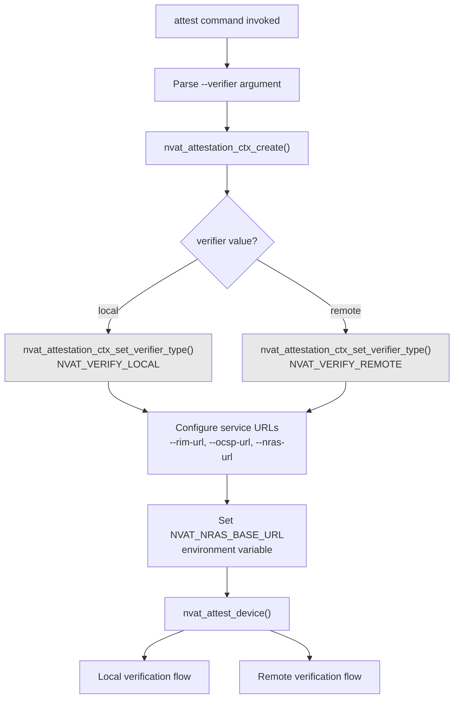
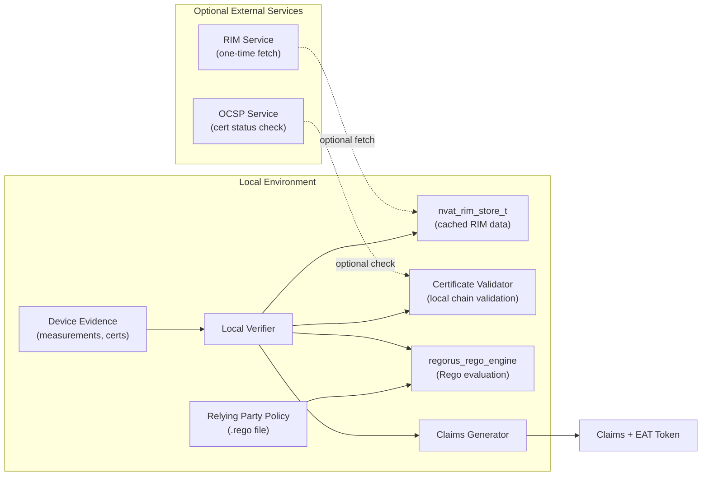
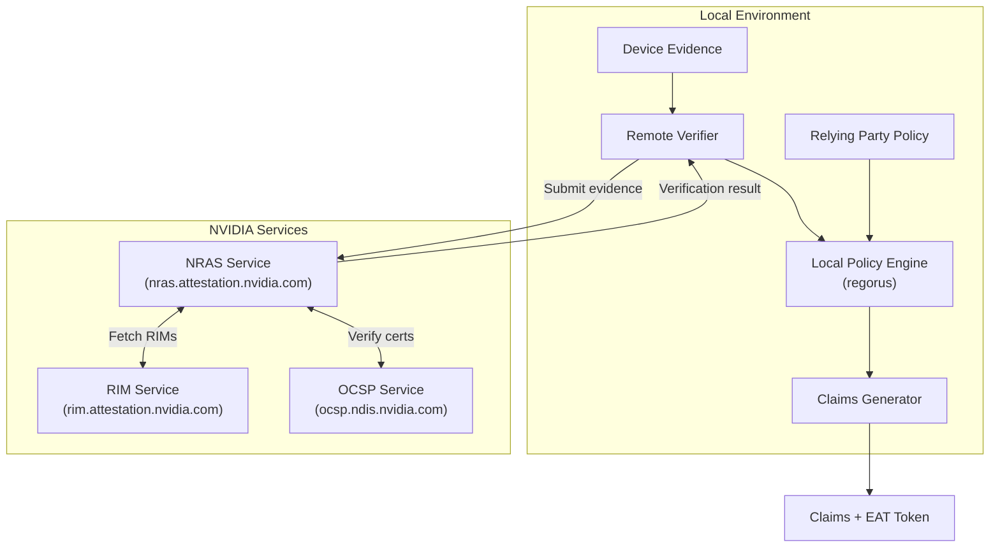
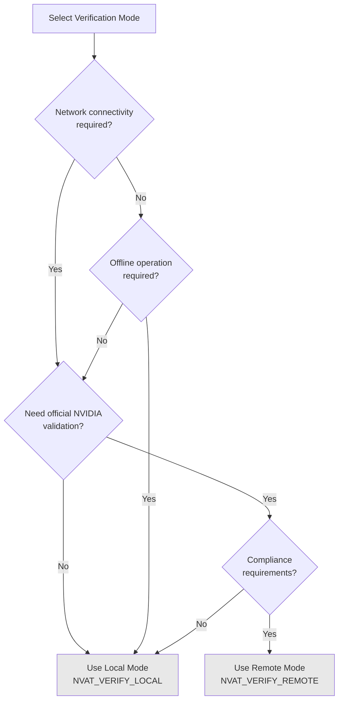

<!-- source: DeepWiki mcp.deepwiki.com · repo NVIDIA/attestation-sdk · page 5.4 Verification Modes · fetched 2026-10-26 -->

# Verification Modes

<details>
<summary>Relevant source files</summary>

The following files were used as context for generating this wiki page:

- [nv-attestation-cli/src/attest.cpp](nv-attestation-cli/src/attest.cpp)
- [nv-attestation-cli/tests/cli_tests.cpp](nv-attestation-cli/tests/cli_tests.cpp)

</details>


## Purpose and Scope

This document explains the two verification modes supported by the NVIDIA Attestation SDK: local and remote verification. It covers how each mode processes attestation evidence, what external dependencies they require, and when to use each approach. For information about the overall attestation workflow, see [Device Attestation Flow](#5.1). For details on writing and evaluating policies during verification, see [Relying Party Policies](#5.3).

## Overview

The attestation SDK supports two distinct verification modes that determine where and how attestation evidence is validated:

| Verification Mode | Description | External Services Required | Use Case |
|-------------------|-------------|---------------------------|-----------|
| **Local** | Performs all verification operations locally using cached reference data and local policy evaluation | None (optional RIM/OCSP for reference data) | Offline environments, development/testing, when external service dependencies must be minimized |
| **Remote** | Delegates verification to NVIDIA's Remote Attestation Service (NRAS) while also performing local policy checks | RIM, OCSP, NRAS | Production environments requiring authoritative validation from NVIDIA infrastructure |

The verification mode is specified via the `--verifier` CLI option or the `nvat_attestation_ctx_set_verifier_type()` SDK function.

**Sources:** [nv-attestation-cli/src/attest.cpp:91-93](), [nv-attestation-cli/src/attest.cpp:272-284]()

## Verification Mode Selection

The following diagram shows how the verification mode is selected and applied during attestation:



**Sources:** [nv-attestation-cli/src/attest.cpp:149-335](), [nv-attestation-cli/src/attest.cpp:272-284](), [nv-attestation-cli/src/attest.cpp:261-265]()

## Local Verification Mode

### Description

Local verification performs all attestation validation operations on the client system without requiring network connectivity to NVIDIA services. The SDK validates evidence by:

1. Verifying certificate chains locally
2. Comparing measurements against Reference Integrity Manifests (RIMs) stored locally or fetched once
3. Evaluating device claims against the relying party Rego policy using the local `regorus` engine
4. Generating attestation claims and EAT tokens based on local validation results

### Architecture



**Sources:** [nv-attestation-cli/src/attest.cpp:272-276](), [nv-attestation-cli/src/attest.cpp:231-244](), [nv-attestation-cli/src/attest.cpp:115-146]()

### Configuration

Local verification is enabled by setting the verifier type to `local`:

**CLI:**
```bash
nvattest attest --device gpu --verifier local \
  --relying-party-policy policy.rego \
  --rim-url https://rim.attestation.nvidia.com \
  --ocsp-url https://ocsp.ndis.nvidia.com
```

**SDK:**
```cpp
nvat_attestation_ctx_set_verifier_type(ctx, NVAT_VERIFY_LOCAL);
```

Service URLs (`--rim-url`, `--ocsp-url`) are optional for local mode but recommended to fetch reference data when available. Once fetched, RIM data is cached for offline use.

**Sources:** [nv-attestation-cli/src/attest.cpp:272-276](), [nv-attestation-cli/src/attest.cpp:231-259](), [nv-attestation-cli/tests/cli_tests.cpp:86-114]()

### Test Examples

The test suite demonstrates local verification for both device types:

**GPU Local Verification:**
```bash
nvattest attest --device gpu --verifier local \
  --gpu-evidence hopper_evidence.json \
  --relying-party-policy relying_party_policy.rego
```

**Switch Local Verification:**
```bash
nvattest attest --device nvswitch --verifier local \
  --switch-evidence switch_evidence_ls10.json \
  --rim-url https://rim.attestation-stg.nvidia.com \
  --ocsp-url https://ocsp.ndis-stg.nvidia.com \
  --relying-party-policy switch_relying_party_policy.rego
```

**Sources:** [nv-attestation-cli/tests/cli_tests.cpp:86-114](), [nv-attestation-cli/tests/cli_tests.cpp:147-174](), [nv-attestation-cli/tests/cli_tests.cpp:206-218](), [nv-attestation-cli/tests/cli_tests.cpp:262-274]()

## Remote Verification Mode

### Description

Remote verification delegates the primary attestation validation to NVIDIA's Remote Attestation Service (NRAS). This mode provides authoritative validation by:

1. Sending evidence to NRAS for verification against NVIDIA's reference database
2. Receiving verification results from NRAS
3. Still performing local Rego policy evaluation on the returned claims
4. Combining remote and local validation results

Remote mode requires network connectivity to NVIDIA attestation infrastructure and is the recommended mode for production workloads requiring official NVIDIA attestation.

### Architecture



**Sources:** [nv-attestation-cli/src/attest.cpp:277-284](), [nv-attestation-cli/src/attest.cpp:99-101](), [nv-attestation-cli/src/attest.cpp:261-265]()

### Configuration

Remote verification is enabled by setting the verifier type to `remote`:

**CLI:**
```bash
nvattest attest --device gpu --verifier remote \
  --relying-party-policy policy.rego \
  --rim-url https://rim.attestation.nvidia.com \
  --ocsp-url https://ocsp.ndis.nvidia.com \
  --nras-url https://nras.attestation.nvidia.com
```

**SDK:**
```cpp
nvat_attestation_ctx_set_verifier_type(ctx, NVAT_VERIFY_REMOTE);
```

The NRAS URL is configured via the `NVAT_NRAS_BASE_URL` environment variable, which is automatically set by the CLI when the `--nras-url` option is provided.

**Sources:** [nv-attestation-cli/src/attest.cpp:277-284](), [nv-attestation-cli/src/attest.cpp:261-265](), [nv-attestation-cli/tests/cli_tests.cpp:116-145]()

### Test Examples

The test suite demonstrates remote verification for both device types:

**GPU Remote Verification:**
```bash
nvattest attest --device gpu --verifier remote \
  --gpu-evidence hopper_evidence.json \
  --nras-url https://nras.attestation-stg.nvidia.com \
  --relying-party-policy relying_party_policy.rego
```

**Switch Remote Verification:**
```bash
nvattest attest --device nvswitch --verifier remote \
  --switch-evidence switch_evidence_ls10.json \
  --rim-url https://rim.attestation-stg.nvidia.com \
  --ocsp-url https://ocsp.ndis-stg.nvidia.com \
  --nras-url https://nras.attestation-stg.nvidia.com \
  --relying-party-policy switch_relying_party_policy.rego
```

**Sources:** [nv-attestation-cli/tests/cli_tests.cpp:116-145](), [nv-attestation-cli/tests/cli_tests.cpp:176-204](), [nv-attestation-cli/tests/cli_tests.cpp:234-246](), [nv-attestation-cli/tests/cli_tests.cpp:290-302]()

## External Services

Both verification modes can interact with three external NVIDIA services:

### RIM Service (Reference Integrity Manifest)

- **Purpose:** Provides reference measurements (golden values) for device firmware and hardware configurations
- **Default URL:** `https://rim.attestation.nvidia.com`
- **Usage:** The SDK fetches RIM data to compare against device measurements
- **Configuration:** Set via `--rim-url` CLI option or `nvat_rim_store_create_remote()`
- **Modes:** Used by both local and remote verification

### OCSP Service (Online Certificate Status Protocol)

- **Purpose:** Validates certificate revocation status in real-time
- **Default URL:** `https://ocsp.ndis.nvidia.com`
- **Usage:** Checks that device certificates have not been revoked
- **Configuration:** Set via `--ocsp-url` CLI option or `nvat_ocsp_client_create_default()`
- **Modes:** Used by both local and remote verification

### NRAS Service (NVIDIA Remote Attestation Service)

- **Purpose:** Performs authoritative remote attestation on behalf of the client
- **Default URL:** `https://nras.attestation.nvidia.com`
- **Usage:** Validates complete attestation evidence against NVIDIA's reference database
- **Configuration:** Set via `--nras-url` CLI option or `NVAT_NRAS_BASE_URL` environment variable
- **Modes:** Used only by remote verification

**Sources:** [nv-attestation-cli/src/attest.cpp:99-101](), [nv-attestation-cli/src/attest.cpp:231-265]()

### Service URL Configuration in Code

The following code snippet shows how service URLs are configured in the attestation context:

```cpp
// RIM Service configuration (lines 231-244)
nvat_rim_store_t rim_store_raw = nullptr;
nvat_rim_store_create_remote(&rim_store_raw, rim_base.c_str(), nullptr);
nvat_attestation_ctx_set_default_rim_store(ctx, rim_store_raw);

// OCSP Service configuration (lines 246-259)
nvat_ocsp_client_t ocsp_client_raw = nullptr;
nvat_ocsp_client_create_default(&ocsp_client_raw, ocsp_base.c_str(), nullptr);
nvat_attestation_ctx_set_default_ocsp_client(ctx, ocsp_client_raw);

// NRAS Service configuration (lines 261-265)
setenv("NVAT_NRAS_BASE_URL", nras_base.c_str(), 1);
```

**Sources:** [nv-attestation-cli/src/attest.cpp:231-265]()

## Mode Comparison

The following table summarizes the key differences between verification modes:

| Aspect | Local Verification | Remote Verification |
|--------|-------------------|---------------------|
| **Network Dependency** | Optional (for RIM/OCSP fetch only) | Required (for NRAS communication) |
| **Validation Authority** | Local system | NVIDIA infrastructure |
| **RIM Data** | Cached locally, periodic updates | Fetched by NRAS, always current |
| **Certificate Validation** | Local chain validation (optional OCSP) | NRAS validates via OCSP |
| **Policy Evaluation** | Local Rego engine | NRAS validation + local Rego engine |
| **Performance** | Faster (no network round-trip) | Slower (network latency) |
| **Use Case** | Testing, offline environments, edge deployments | Production, compliance-required validation |
| **Trust Model** | Trust local RIM cache and policy | Trust NVIDIA attestation service |

**Sources:** [nv-attestation-cli/src/attest.cpp:272-284](), [nv-attestation-cli/tests/cli_tests.cpp:86-316]()

## Verification Mode Decision Flow

The following diagram illustrates the decision-making process for selecting a verification mode:



**Sources:** Based on analysis of [nv-attestation-cli/src/attest.cpp:272-284]() and test patterns in [nv-attestation-cli/tests/cli_tests.cpp]()

## Error Handling

Both verification modes return standard result codes via `nvat_attest_device()`. Common result codes include:

- `NVAT_RC_OK` (0): Attestation succeeded
- `NVAT_RC_RP_POLICY_MISMATCH`: Device passed verification but failed relying party policy
- `NVAT_RC_OVERALL_RESULT_FALSE`: Verification failed
- `NVAT_RC_BAD_ARGUMENT`: Invalid configuration parameters
- `NVAT_RC_INTERNAL_ERROR`: Internal SDK error

When verification completes (successfully or not), the SDK still returns claims and EAT tokens for codes `NVAT_RC_OK`, `NVAT_RC_RP_POLICY_MISMATCH`, and `NVAT_RC_OVERALL_RESULT_FALSE`.

**Sources:** [nv-attestation-cli/src/attest.cpp:296-299](), [nv-attestation-cli/src/attest.cpp:39]()

---

