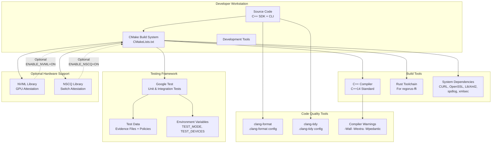
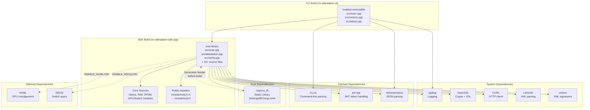
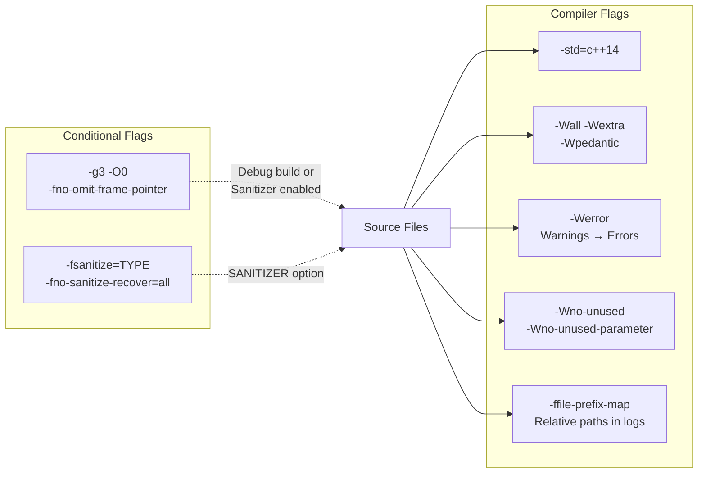
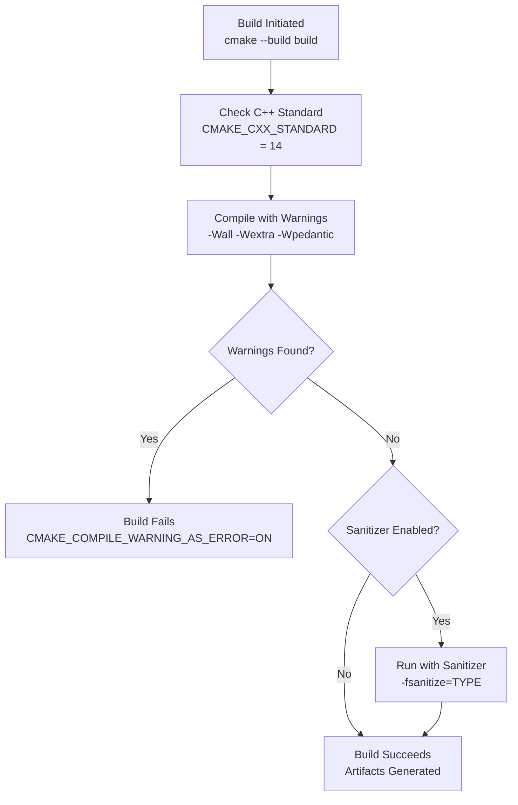
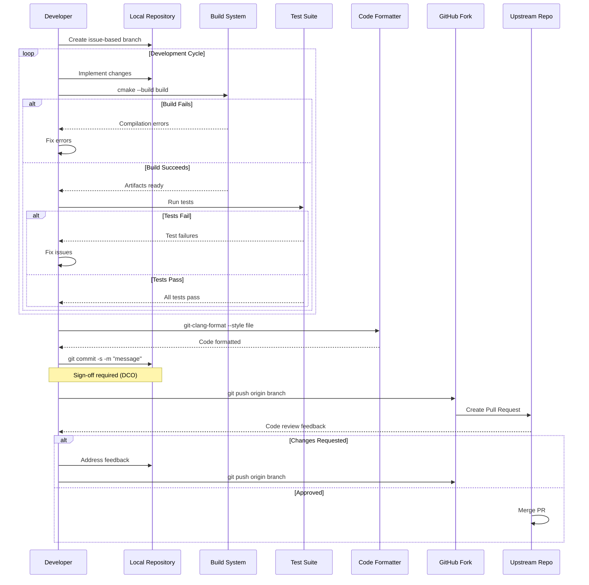
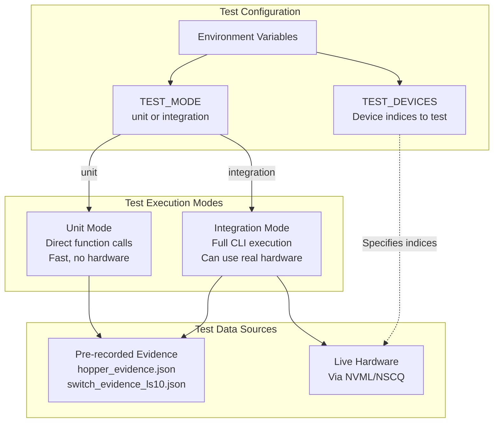
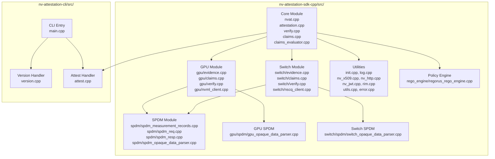

<!-- source: DeepWiki mcp.deepwiki.com · repo NVIDIA/attestation-sdk · page 6 Development Guide · fetched 2026-10-26 -->

# Development Guide

<details>
<summary>Relevant source files</summary>

The following files were used as context for generating this wiki page:

- [CONTRIBUTING.md](CONTRIBUTING.md)
- [nv-attestation-cli/CMakeLists.txt](nv-attestation-cli/CMakeLists.txt)
- [nv-attestation-sdk-cpp/CMakeLists.txt](nv-attestation-sdk-cpp/CMakeLists.txt)

</details>


This guide provides essential information for developers working on the NVIDIA Attestation SDK codebase. It covers the build system, development environment setup, code quality standards, testing infrastructure, and contribution workflows. This page serves as an overview; more detailed information on specific topics can be found in the child pages.

**Scope**: This guide focuses on SDK and CLI development workflows. For information about:
- Building and installing as an end user, see [Installation Guide](#2.1)
- Using the SDK in your own applications, see [Architecture](#3)
- SDK API reference, see [Reference](#8)
- Contribution requirements and PR process, see [Contributing](#7)

---

## Development Environment Components

The development environment consists of multiple interconnected systems that support building, testing, and maintaining code quality:



**Sources**: [nv-attestation-sdk-cpp/CMakeLists.txt:1-273](), [nv-attestation-cli/CMakeLists.txt:1-70](), [CONTRIBUTING.md:10-74]()

---

## Build System Architecture

The project uses CMake with a two-tier structure: the core SDK library (`nvat`) and the CLI tool (`nvattest`) that depends on it.

### Build Configuration Options

| Option | Type | Default | Purpose |
|--------|------|---------|---------|
| `BUILD_SHARED_LIBS` | Boolean | `ON` | Build shared libraries instead of static |
| `BUILD_TESTING` | Boolean | `OFF` | Enable test compilation |
| `BUILD_EXAMPLES` | Boolean | `OFF` | Build example executables |
| `ENABLE_NVML` | Boolean | `OFF` | Enable GPU attestation via NVML |
| `ENABLE_NSCQ` | Boolean | `OFF` | Enable switch attestation via NSCQ |
| `SANITIZER` | String | `OFF` | Enable sanitizer (`thread`, `address`, `undefined`, `leak`) |
| `CMAKE_BUILD_TYPE` | String | - | Build type (`Debug`, `Release`, etc.) |
| `CMAKE_COMPILE_WARNING_AS_ERROR` | Boolean | `ON` | Treat compiler warnings as errors |

**Sources**: [nv-attestation-sdk-cpp/CMakeLists.txt:12-17](), [nv-attestation-cli/CMakeLists.txt:4]()

### CMake Target Dependencies



**Sources**: [nv-attestation-sdk-cpp/CMakeLists.txt:123-216](), [nv-attestation-cli/CMakeLists.txt:27-57]()

### Build Directory Structure

After a typical build, the directory structure looks like:

```
build/
├── nv-attestation-sdk-build/          # SDK library build artifacts
│   ├── include/nvat.h                  # Generated public header
│   ├── libnvat.so                      # Shared library (or .a if static)
│   ├── unit-tests/                     # SDK unit tests
│   └── integration-tests/              # SDK integration tests
├── nvattest                            # CLI executable
├── config.toml                         # Copied config file
├── version_config.h                    # Generated version header
└── tests/                              # CLI tests
    └── cli_tests
```

The CLI build includes the SDK as a subdirectory via `add_subdirectory()` at [nv-attestation-cli/CMakeLists.txt:44-47](). This creates an alias target `nvat::nvat` for linking.

**Sources**: [nv-attestation-cli/CMakeLists.txt:44-50](), [nv-attestation-sdk-cpp/CMakeLists.txt:123-158]()

---

## Code Quality Standards

The project enforces strict code quality through multiple mechanisms working together:

### Compiler Warnings

The build system enables comprehensive warnings treated as errors:



**Sources**: [nv-attestation-sdk-cpp/CMakeLists.txt:4-119](), [nv-attestation-cli/CMakeLists.txt:7-11]()

### Code Formatting with clang-format

Code formatting is enforced through `clang-format` with a project-specific `.clang-format` configuration file. Developers must format code before committing:

| Command | Purpose |
|---------|---------|
| `git-clang-format --style file [commit]` | Format git changes (staged if no commit specified) |
| `clang-format -style=file -i <files>` | Format individual files in-place |

**Key formatting rules enforced**:
- Class, function, method, variable, and field naming conventions
- Comment style consistency
- Indentation rules
- Line length limits

**Sources**: [CONTRIBUTING.md:16-33]()

### Build-Time Validation

The CMake configuration enforces quality at build time:



**Sources**: [nv-attestation-sdk-cpp/CMakeLists.txt:8-10](), [nv-attestation-sdk-cpp/CMakeLists.txt:103-114](), [nv-attestation-cli/CMakeLists.txt:8]()

---

## Development Workflow

The typical development cycle follows this pattern:



**Sources**: [CONTRIBUTING.md:76-140]()

### Commit Requirements

All commits must:
1. **Reference an issue**: Format as `#<Issue Number> - <Commit Title>`
2. **Be signed off**: Use `git commit -s` to add Developer Certificate of Origin
3. **Follow formatting**: Code must be formatted with `clang-format`
4. **Build cleanly**: No warnings or errors
5. **Pass tests**: All existing tests must continue passing

**Sources**: [CONTRIBUTING.md:47-52](), [CONTRIBUTING.md:99-113]()

---

## Testing Strategy Overview

The project includes multiple test levels with configurable execution modes:

### Test Infrastructure Components

| Component | Location | Purpose |
|-----------|----------|---------|
| SDK Unit Tests | `nv-attestation-sdk-cpp/unit-tests/` | Test individual SDK components |
| SDK Integration Tests | `nv-attestation-sdk-cpp/integration-tests/` | Test SDK end-to-end flows |
| CLI Tests | `nv-attestation-cli/tests/` | Test CLI application and subcommands |
| Test Evidence | `nv-attestation-cli/tests/data/` | Pre-recorded GPU and switch evidence |
| Test Policies | `nv-attestation-cli/tests/policies/` | Rego policies for testing |

### Test Environment Configuration

Tests can be configured via environment variables:



For detailed information on the testing infrastructure, see [Testing Infrastructure](#6.3).

**Sources**: Based on system diagrams provided and test architecture patterns

---

## Development Tools Reference

### Essential Commands

```bash
# Initial setup
cmake -B build -S . -DBUILD_TESTING=ON -DENABLE_NVML=ON

# Build
cmake --build build

# Run tests
cd build && ctest

# Format code
git-clang-format --style file

# Format specific files
clang-format -style=file -i -fallback-style=none src/attestation.cpp

# Build with sanitizer
cmake -B build -S . -DSANITIZER=address
cmake --build build

# Clean build
rm -rf build
cmake -B build -S .
```

**Sources**: [CONTRIBUTING.md:22-39]()

### CMake Configuration Examples

```bash
# Development build with all features
cmake -B build -S nv-attestation-cli \
  -DCMAKE_BUILD_TYPE=Debug \
  -DBUILD_TESTING=ON \
  -DENABLE_NVML=ON \
  -DENABLE_NSCQ=ON

# Release build for production
cmake -B build -S nv-attestation-cli \
  -DCMAKE_BUILD_TYPE=Release \
  -DBUILD_SHARED_LIBS=ON \
  -DENABLE_NVML=ON

# Testing with sanitizer
cmake -B build -S nv-attestation-sdk-cpp \
  -DBUILD_TESTING=ON \
  -DSANITIZER=thread \
  -DENABLE_NVML=OFF
```

**Sources**: [nv-attestation-sdk-cpp/CMakeLists.txt:12-17]()

---

## Module Organization

The codebase is organized into well-defined modules with clear boundaries:



For detailed code organization information, see [Code Organization](#6.2).

**Sources**: [nv-attestation-sdk-cpp/CMakeLists.txt:123-152](), [nv-attestation-cli/CMakeLists.txt:27-31]()

---

## Next Steps

For more detailed information on specific development topics:

- **[Building from Source](#6.1)**: Detailed build instructions, dependency installation, and build options
- **[Code Organization](#6.2)**: Source file structure, module boundaries, and architectural patterns  
- **[Testing Infrastructure](#6.3)**: Test framework details, test modes, and how to run tests
- **[Code Quality Standards](#6.4)**: clang-tidy configuration, code review criteria, and quality gates
- **[Resource Management Patterns](#6.5)**: C++ patterns used in the SDK for safe resource handling

For contribution guidelines and community standards:

- **[Contributing](#7)**: Complete contribution workflow and requirements
- **[Code of Conduct](#7.2)**: Community behavioral expectations
- **[Security Policy](#7.3)**: How to report security vulnerabilities

---

